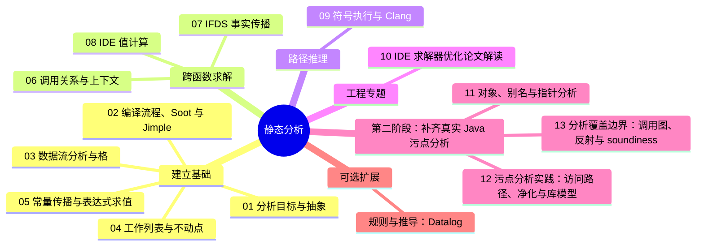
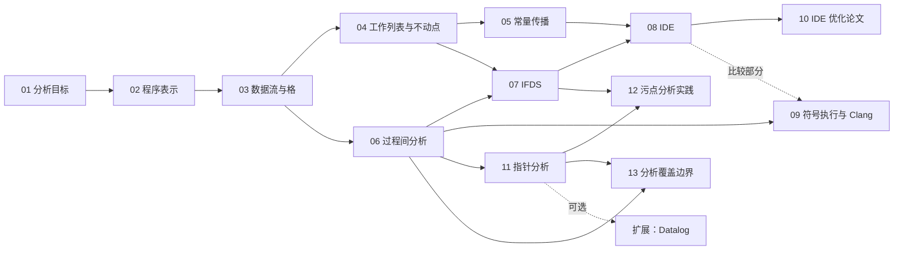

# 静态分析系列：从程序表示到过程间求解

本文维护系列的组织方案与写作约束。01—10 篇正文已完成，篇目链接与阅读路线见[系列总览](../../src/static-analysis/README.md)；第 02、04 篇共用[可运行示例](../../examples/static-analysis/README.md)。本轮核对见[系列自审记录](reviews/series-review.md)，拆分前材料保留在[历史长文](静态分析知识-历史长文.md)。第二阶段的 11 篇已成稿（自审见 [11-review](reviews/11-review.md)），12—13 篇已定题与提纲（第 4 节），尚未成稿。11 篇成稿后对全系列做了第三轮审阅，记录见 [series-review-2026-09-30](reviews/series-review-2026-09-30.md)。

2026-10-10 按作者要求重新划分 03、04：03 集中讲数据流与格。04 按最新大纲分为十二节：问题、核心规则、具体例子（原表与逐行解读）、停止条件、终止依据、伪代码、首次可达、调度策略、算法对比、复杂度、常见误区、总结。原表的 8 列、16 行与逐行解读保留，只在表外说明 H 的两行属于同一次出队；技术纠错不借机重排原表。形式化延伸与 Soot 验证置于文末折叠区。既往审阅记录中的编号按当时结构理解。

系列面向熟悉 Java、希望理解静态分析引擎的开发者。主线围绕一个问题：**分析器怎样从代码中得到结论，这个结论的精度与计算成本又由什么决定？**

2026-09-29 的整体审阅结论：01—10 的概念定义、验证纪律达到可对外发布的水准；主要短板是覆盖的截断位置——止步于局部变量污点与调用返回匹配，离真实 Java 污点分析所依赖的堆、别名、调用图和净化语义还差一跳。因此第二阶段以“补齐主线例子的闭环”为目标，而不是横向扩展新话题。本轮对现有篇目的调整见第 8 节。

## 1. 知识总览



思维导图表示主题归属。首次系统阅读可以按 01—08 的顺序推进，再选择 09 或 10；第二阶段的 11—12 在 07 之后阅读，13 可在 06 之后阅读。下面的实线箭头表示正文所需的主要知识依赖，虚线表示比较部分的额外前提；只画直接依赖，间接依赖沿箭头继承。



只想建立整体认识，可以先读 01—04。以污点分析理解 IFDS，可以走 01→02→03→04→06→07；理解 IDE 时再补上 05，进入 08。09 的基础部分可在 06 后阅读，和 IFDS/IDE 的比较部分在 08 后阅读；10 直接接续 08。05 是值分析的基础，不是理解过程间传播的必修前提。

第二阶段的推荐路线是 07→11→12→13：11 解决“变量指向哪个对象”，12 把 IFDS 事实域从局部变量扩展到访问路径并加入净化与库模型，13 回头审视调用图、反射与原生代码给可靠性带来的缺口。想直接理解 FlowDroid 一类工具的读者，读完 07 后可以先读 12 的前半部分，遇到别名问题再回 11。

## 2. 每篇只承担一个明确主题

| 篇目与拟定标题 | 核心问题 | 读完应能完成的事情 | 前提 |
| :--- | :--- | :--- | :--- |
| 01 程序分析的基本构成：状态、抽象与近似 | 分析保存什么、怎样计算、近似方向怎样影响结论？ | 解释具体与抽象状态、转移与合并，区分过近似与欠近似的结论能力、可靠性与精度 | Java 基础 |
| 02 从编译流程到 Soot：Jimple 在哪里，为什么需要它？ | 编译各阶段产生什么，Soot 从哪里接入？ | 画出 Java 源码到字节码再到 Jimple 的路线，区分 AST、IR 与 CFG，阅读简单 Jimple | 01 |
| 03 数据流分析与格：状态怎样传播和合并 | 状态怎样传播，为什么这样合并？ | 手算分支 IN/OUT，用初始化分析对照 may/must，解释偏序、格与 Join | 02 |
| 04 数据流分析：工作列表（Worklist）如何安排重算？ | 哪些节点需要重算，什么时候可以停？ | 沿原表逐行推演工作列表，解释首次可达、输入变化与不动点，运行 Soot 核对 | 03 |
| 05 常量传播与表达式求值：变量的值能确定到什么程度？ | 怎样把数据流框架用于值分析？ | 区分求值、折叠与传播，手算分支和循环中的常量结果，解释精度损失 | 03、04 |
| 06 跨过函数调用：调用图、参数传递与上下文 | 信息跨函数后，新增了哪些问题？ | 追踪参数和返回值，指出错误返回路径；认识别名和动态派发给建模带来的问题 | 03 |
| 07 IFDS：把集合传播拆成匹配路径上的事实传播 | 哪些问题能转成图可达问题，如何求解？ | 用分配律判断能否拆分事实，构造单事实边并演示调用返回匹配与摘要复用 | 04、06 |
| 08 IDE：从事实是否存在到事实携带什么值 | 怎样在传播时计算并汇总值？ | 区分环境、边函数与跳转函数，将 05 的值分析问题发展为满足 IDE 条件的跨过程示例 | 05、07 |
| 09 符号执行与 Clang：怎样排除不可行路径？ | 保留路径条件会怎样改变分析？ | 追踪符号状态与约束，解释 Clang 的图节点与 IFDS 节点有何不同 | 06；比较部分用到 07、08 |
| 10 IDE 求解器如何扩展到大程序：一篇工程论文解读 | 论文中的实现如何降低时间和内存成本？ | 解释布局、批处理与回收，区分实验观察、适用条件与可迁移经验 | 08 |
| 11 对象、别名与指针分析：变量指向哪个对象？（已成稿，标题以正文为准） | 两个变量何时可能指向同一对象，调用目标怎样由指向信息确定？ | 手算 Andersen 式指向集合与字段传播，解释上下文敏感的必要性，用指向结果精化调用图 | 06 |
| 12 污点分析实践：从求解器到安全结论（拟定） | 污点怎样经字段、容器和库调用传播，净化怎样打断它，报告怎样解释？ | 把 IFDS 事实域扩展到访问路径，写出 source/sink/sanitizer 与库摘要，并解释一条报告的路径 | 07、11 |
| 13 分析覆盖边界：调用图、反射与 soundiness（拟定） | 哪些行为在模型之外，“没有告警”依赖哪些假设？ | 列出 CHA/指针调用图的差异，指出反射、动态代理、原生代码与序列化的缺口，读懂 soundiness 声明 | 06、11 |

03 先展示实际传播与合并，再解释偏序、格与 Join；04 集中讲重算调度与收敛依据。分配律的定义、正反例及作用集中放在 07：读者先遇到“能不能逐个事实传播”的问题，再学习判断条件。

09 是路径推理专题，10 是 ECOOP 2024 IDE 优化论文的解读，两者不构成前后依赖。10 不承担求解器优化方法的全面综述。

### 各篇讲到哪里，以及怎样衔接

| 篇目 | 学习成果：用什么证明读懂了 | 本篇范围与后续衔接 |
| :--- | :--- | :--- |
| 01 | 沿污点例子定位信息损失，用状态集合包含关系说明近似方向与结论能力 | 讲清基础概念及联系；格由 03 深入，工作列表由 04 展开 |
| 02 | 读懂一段简短 Jimple，画出含分支的 CFG，定位 Soot 的输入与输出 | 编译知识用于定位；03 定义分析规则，04 运行分析 |
| 03 | 完成逐点事实表，根据 may/must 语义读懂两张格图与 Join | 讲状态、传播、合并和格；序对偶可选读，循环调度交给 04 |
| 04 | 逐行解释原表的 IN 更新、入队和队列清空，比较调度与迭代方式，估算复杂度并运行示例核对 | 核心是工作列表与不动点；区分 FIFO/LIFO/优先队列、轮询/混沌迭代与 Kildall，复杂度明确 N、E、h、c，加宽放折叠延伸 |
| 05 | 手算分支前后的常量状态，指出合并丢失的信息 | 主讲过程内值分析；不介绍边函数与跳转函数，08 接续跨过程求解 |
| 06 | 在两个调用点的例子中标出参数映射、合法返回和错误返回 | 用短例子认识别名、字段和动态调用；完整指针分析另设专题，07 进入专门求解算法 |
| 07 | 为赋值构造单事实边，走完一次摘要生成与应用，说明分配律反例为什么失败 | 明确有限事实域及模型假设；先求事实能否到达，08 再求携带的值 |
| 08 | 组合边函数得到摘要，并对两个入口值复用它；指出普通常量传播与示例的区别 | 复用 05 的值域定义，重点讲环境、函数操作和两阶段求解；实现成本交给 10 |
| 09 | 追踪一对互斥条件下的符号状态，解释一条路径为何被排除 | 先讲符号执行，再用 Clang 展示组织方式；探索预算和约束能力随例子说明 |
| 10 | 把一项优化对应到具体开销，并解释一组带基线和配置的实验数据 | 将论文事实、解释和迁移建议区分开；不把特定实现的倍率当成普遍收益 |

### 第 02 篇的图文安排

正文已放在[《分析器怎样读懂 Java：从编译阶段到 Jimple 与 CFG》](../../src/static-analysis/02-compilation-and-tools.md)。按下面的顺序阅读，每张图后紧跟对应解释，先走 Java 示例，再做工具对照。

| 图 | 正文位置 | 读图后应解决的问题 |
| :--- | :--- | :--- |
| 图 1：六阶段与前中后端 | 第 02 篇开头，工具介绍之前 | 六阶段与三个职责分组怎样对应？ |
| 图 2：Soot | 总图之后，进入 Jimple 细节之前 | 字节码从哪里来，Soot 为什么再次构建 IR，分析作者还要做什么？ |
| 图 3、4：语句级 CFG 与基本块 | Jimple 示例之后 | 两条执行路线怎样分开、汇合，节点粒度怎样改变？ |
| 图 5：Coverity | 完成 Jimple 与 CFG 主线后的对照阅读 | 构建捕获与正常编译是什么关系，分析模型怎样进入检测流程？ |
| 图 6：Clang 与 Static Analyzer | 对照部分末尾 | AST 之后怎样分出编译与缺陷分析两条路线？ |

第 02 篇的完整顺序固定为“图 1 编译阶段 → 图 2 Soot 定位 → 同一程序的源码与简化 Jimple 对照 → 程序点、基本块与 CFG → 图 5、图 6 工具对照”。Jimple 示例要包含赋值、条件跳转和调用；CFG 标注入口、出口、分支与汇合位置，说明按语句或基本块建图的区别。工具对照可选读，不打断 Java 主线。现有正文已按实测结果完成该顺序，并标明简化显示方式。第 09 篇通过链接回顾图 6，再展开符号状态推演，不复制整段编译流程。

系列总览保留知识思维导图和阅读依赖图，不再加入工具内部流程。原长文只增加图解入口，避免两处维护相同图。编译阶段与工具位置在本篇讲清，Soot Pack 接口仍随 04、06 的实践出现。

### 第 04 篇的配套实践

配套一个最小 Soot 示例工程，明确 JDK、Soot 版本、运行命令和预期输出。流程是“编译样例 → 加载目标方法体 → 输出 Jimple → 构建 CFG → 按已定义的规则传播事实 → 输出各程序点的结果”。先手算，再运行并对照；第 02 篇的[配套工程](../../examples/static-analysis/README.md)已经实现并验证加载、Jimple 输出与构图；03 定义数据流规则，04 在此基础上补充工作列表与结果核对，不重复搭建工程。

输入源与敏感操作在这个样例中使用明确的简化模型。运行部分提供可直接使用的加载代码，正文只解释与当前分析有关的接口；`jb/jtp` 等执行组织放实践附注，`wjtp` 在过程间实践需要时介绍。后续实践尽量复用同一工程，但 IFDS/IDE 篇不要求读者从零实现整个求解器。

先把分析问题定义完整：事实域、每个程序点的 IN/OUT、语句转移规则、路径合并、入口边界条件，以及其他节点的初始值，再开始工作列表推演。区分入口没有污点事实与程序点不可达，交代采用的可达性处理方式。

通过一处赋值变化检验理解，例如将污点赋值改为安全常量，并核对事实表。示例要交代入口事实、分析范围和异常边处理；若不处理堆对象、未知调用或并发，应把结论限定在声明的模型内。

## 3. 前后篇怎样接起来

篇目编号承担推荐阅读顺序，依赖图承担跳读导航。各篇复用前文的代码、图或计算结果，结尾用简短链接衔接后续内容。承接应落在具体知识上，不强制每篇先回顾、再列目标、最后设问。

| 篇目 | 从前文接过什么，并在本篇推进 | 结尾留下什么问题 |
| :--- | :--- | :--- |
| 01 | 以局部变量污点为例，明确分析目标、抽象信息与模型范围 | 分析器怎样把代码变成可处理的结构？ |
| 02 | 沿用污点程序，展示源码、简化 Jimple 和 CFG 的对应；最后对照其他工具 | 图已经有了，各节点上的事实怎样计算？ |
| 03 | 在 02 的 CFG 上定义状态、转移与合并，用 may/must 对照引入偏序、格与 Join | 有了数据流规则，怎样安排重算、判断结束？ |
| 04 | 用 03 的规则推演循环工作列表，从原表逐行解读走到不动点与终止条件，再运行示例核对 | 同一计算框架能否追踪具体数值？ |
| 05 | 换成一个短常量程序，复用传播与合并框架，计算直线、分支和循环；展示合并丢失关联的例子 | 把其中一段计算封装成函数后，值怎样跨调用传播？ |
| 06 | 先承接 05 的简单常量调用，再将相同调用结构用于污点，追踪实参、形参与返回；引入别名和动态调用的局限 | 怎样正确、可复用地求解这些跨函数传播？ |
| 07 | 继续用 06 的污点调用图，先判断能否逐事实分解，再引入 ESG、匹配返回与摘要求解 | 除了事实能否到达，怎样计算它携带的值？ |
| 08 | 将 07 的传播结构与 05 的值域连接起来，用满足 IDE 条件的算术示例推演函数组合、合并与求值 | 候选路径怎样进一步筛选，大量中间结果怎样存得下？ |
| 09 | 接续 06/07 的不可行分支例子，加入路径约束，再展示 Clang 如何组织状态与检查器 | 哪些路径仍无法判断，探索预算会怎样影响结果？ |
| 10 | 直接接过 08 的跳转函数条目，沿论文解释布局、访问与回收，并对照实验 | 哪些经验可迁移到其他实现，需要怎样测量验证？ |

第 06 篇的常量引例应短到不依赖 05 的完整算法：只展示两个已知实参通过函数产生不同返回值，再转入参数映射与调用上下文。这样顺读有承接，跳过 05 的读者也能进入过程间分析。

第 07 篇既展示进入被调函数的传播，也展示调用者中不受该调用影响的事实如何保留。明确普通、调用、返回与调用到返回的流函数各自作用；后者表达的是分析定义的旁路效果，不能无条件忽略副作用。解释摘要的输入输出关系，并用短小递归例子说明摘要如何迭代稳定。

第 05 篇先展示常量结果与精度损失，第 07 篇用污点例子正式解释分配律，第 08 篇再核对值传播的分配性条件。普通常量传播不自动等于 IDE 示例；三篇各承担一步，避免定义重复和条件提前出现。

特殊值与术语绑定具体模型解释：在 03、05 中分别说明顶底元素的含义，并区分不可达、值未知与源语言中的未初始化状态。后文引用定义时保留同一约定。

贯穿各篇的一条关系是：**程序表示与图结构 → 分析规则 → 求解算法 → 结果解释**。02—04 用小分析依次展开这四项，07、08 再把 IFDS/IDE 放到求解位置；工具框架、具体分析与通用求解器始终分开介绍。

09、10 是两条专题分支，不按“符号执行之后才学优化”的关系叙述。模型覆盖边界从 01 开始随例子说明，扩展专题再深入讨论。

## 4. 第二阶段：11—13 篇的边界与提纲

第二阶段的目标是让贯穿全系列的污点例子走到真实 Java 分析器的形态。三篇按优先级排列；每篇沿用第 6 节的写作约定，并继续复用 examples 工程验证可运行部分。

| 专题 | 单独解决的问题 | 与主线的关系 |
| :--- | :--- | :--- |
| 11 指针分析：变量可能指向哪些对象？ | 对象抽象（分配点）、字段读写、别名、动态调用目标，以及上下文选择 | 接续 06 第 7 节的别名与动态派发问题，完整讲解求解；它对理解真实 Java 分析器很重要，但不作为局部变量 IFDS 示例的前置要求 |
| 12 污点分析实践：怎样把传播结果变成安全结论？ | 访问路径事实域、来源、敏感操作、净化条件、库模型、容器与报告解释 | 贯穿示例在此扩展成较完整的分析设计；区分通用求解器（07）与具体安全语义 |
| 13 分析覆盖边界：调用图、反射、原生代码与外部模型 | 模型无法覆盖哪些行为，结论依赖哪些假设？ | 在 06、11 后可读，深入展开各篇已交代的模型限制；无需先读完 12 |
| Datalog：怎样用规则表达分析？（可选） | 将事实和推导规则交给求解器，理解递归求解 | 用 11 的指针分析作为建模对象，避免同时学习新语言和新分析问题；是否成篇视需要决定 |

### 4.1 第 11 篇：对象、别名与指针分析

用下面的程序进入问题，它是 06 第 7 节别名一行的展开：

```java
Holder a = new Holder();   // 分配点 o1
Holder b = a;
a.f = input();
sink(b.f);
```

必须展示的推演：

1. 以分配点抽象对象：`pts(a)={o1}`，`b=a` 使 `pts(b)={o1}`；字段写 `a.f=…` 写入 `o1.f`，字段读 `b.f` 从 `o1.f` 取值。由此说明局部变量 IFDS 为何无法看到这条传播。
2. Andersen 式规则的四条语句（new、copy、store、load）与约束求解，手算到指向集合稳定；只用两三个对象，不引入 SSA。
3. 上下文不敏感的合流：同一工厂方法两次 `new`，两个调用者共享一个分配点时的伪别名；对照 call-site 敏感与 object 敏感各保留了什么区别，只讲清区别，不实现。
4. 用指向集合确定 `service.read()` 的目标类，对比 06 新增的 CHA 结果，说明指针分析怎样精化调用图，以及两者对 IFDS 事实数量的影响。
5. 明确 k-limiting、数组、静态字段的处理是模型选择；堆抽象与上下文选择共同决定精度与成本。

依据：[Static Program Analysis 第 10—11 章](https://cs.au.dk/~amoeller/spa/spa.pdf)、[Smaragdakis 与 Balatsouras 的指针分析教程](https://yanniss.github.io/points-to-tutorial15.pdf)、[Spark 论文](https://plg.uwaterloo.ca/~olhotak/pubs/cc03.pdf)。可运行部分：在 examples 中加入 Holder 例子，输出 Soot Spark 的指向集合与调用图边，与手算对照。

2026-09-30 成稿为[《对象、别名与指针分析》](../../src/static-analysis/11-pointer-analysis.md)。五项推演全部覆盖；第 3 项另加了对象敏感的 `set` 例子与一张四种配置的对照表，并明确调用点敏感需配合上下文敏感堆才能分开工厂返回的对象。可运行部分为 `PointsToCases`/`PointsToInspect`，两处写法迁就 Soot 的 IR 处理（拷贝经方法、对象经声明 Reader 的工厂取得），原因写进正文第 7 节与示例 README。

### 4.2 第 12 篇：污点分析实践

必须展示的推演：

1. 把 07 的事实域从局部变量 `x` 扩展为访问路径 `x.f.g`，重写 store/load 的流函数，说明 k-limiting 截断后事实的含义变化（`x.f.*` 是过近似）。
2. 与 11 的关系：`a.f=input(); sink(b.f)` 中 b 的污点来自别名，正向传播发现不了它；解释 FlowDroid 的按需反向别名分析为什么在写字段处触发，只讲触发条件与结果，不实现。
3. source/sink/sanitizer 三元组：净化是删除访问路径事实的流函数；部分净化（只对某类 sink 有效）如何表示。用同一程序演示净化前后 sink 处集合的变化。
4. 库模型：没有方法体时，摘要写成“哪个参数/接收者/返回值受哪个参数影响”；`StringBuilder.append`、集合 `put/get` 的例子；缺失模型时默认过近似还是欠近似的取舍，以及为什么 04 的实现选择直接报错。
5. 容器与隐式流：解释为什么主流工具用“容器整体污染”和不追踪隐式流，这两个决定各损失了什么。
6. 报告解释：把 ESG 上的一条路径边序列还原为源码位置链，与 01 的误报/漏报定义对应。

依据：[FlowDroid 论文](https://www.bodden.de/pubs/far+14flowdroid.pdf)、[Boomerang 论文](https://drops.dagstuhl.de/entities/document/10.4230/LIPIcs.ECOOP.2016.22)。可运行部分：在 examples 中给 TaintWorklist 加字段访问路径（k=1）与一个净化调用，核对 sink 集合。

### 4.3 第 13 篇：分析覆盖边界

必须展示的推演：

1. 调用图三档对照：CHA、基于指向的调用图、加入反射与 invokedynamic 处理后的调用图，对同一程序各给出多少条边、缺多少条边。
2. 反射 `Class.forName(name).newInstance()`、`Method.invoke`、动态代理、`Runnable`/lambda、JNI、序列化回调各举一个最短例子，说明模型缺口在哪一层（调用图、堆、入口）。
3. 入口点与生命周期：框架回调（Servlet、Spring、Android）不是从 main 可达，需要额外入口模型。
4. 读懂 soundiness 声明：一个工具说“sound modulo reflection”时承诺了什么；把 01 的 `R⊆γ(S)` 加上前提条件重写一遍。
5. 分析超时、内存不足与“没有告警”的关系，接 01 第 3.2 节与 10 第 5 节。

依据：[Soundiness 宣言](http://soundiness.org/)（Livshits 等，CACM 2015）、[Static Program Analysis 第 8 章的过程间分析前提](https://cs.au.dk/~amoeller/spa/spa.pdf)、[Soot 调用图与反射选项](https://github.com/soot-oss/soot/wiki/Tutorials)。

对外介绍本系列时，应明确它以数据流与过程间分析为主，不把这份目录称为静态分析领域的完整覆盖。

## 5. 现有文章怎样迁移

| 现有内容 | 目标位置 | 处理方式 |
| :--- | :--- | :--- |
| 第一章的分析目标、抽象与精度 | 01 | 保留核心解释，补齐结论成立的模型前提 |
| 第一章的贯穿污点例子 | 01、03、04 | 01 解释状态、抽象与近似；03 展开逐点计算与合并；04 展开循环和工作列表 |
| 原文缺少的编译流程、Soot/Jimple 定位与 CFG | 02；04 配套实践 | 02 解释位置与表示，04 运行最小分析；工具扩展接口随实践说明 |
| 原文中零散的常量示例 | 05 | 新增常量传播专题；08 继续讲跨过程的值求解 |
| 第二章的偏序、格、有限高度、单调性 | 03、04 | 03 解释格与合并，04 解释单调迭代与收敛 |
| 第二章的分配律及正反例 | 07 | 在单事实分解的动机之后正式引入，与表示关系一起讲清 |
| 第三章的调用上下文与敏感性说明 | 06 | 补充调用图、ICFG 和参数返回映射；正式区分三种敏感性 |
| 第三章的 IFDS 条件、表示关系与 ESG | 07 | 补充一轮摘要求解的执行过程，保留适用条件和反例 |
| 第四章 IDE | 08 | 将边函数、跳转函数、两阶段求解串成一次计算 |
| 第六章 Clang | 09 | 先走符号状态变化，再介绍内部结构和检查器 |
| 第五章 ECOOP 2024 优化论文 | 10 | 保留实现与实验背景，将论文结论和一般经验分开 |
| 第七章总结、附录符号与参考资料 | 总览页及各篇末尾 | 总览页维护导航；符号在首次使用处解释，各篇保留相关来源 |

`src/static-analysis/README.md` 是系列入口，与正文同目录，集中放总览图、篇目链接和阅读路线。原长文保留为历史档案，不再与分篇正文同时维护定义。

## 6. 单篇的写作约定

系列的目标读者是**第一次接触静态分析的 Java 开发者**，按一门课的方式顺读。因此正文既要保持技术准确，也要保证初学者在没有老师的情况下能自己读下去。2026-09-29 审阅发现原稿密度过高：几乎每句都承载定义或推理，缺少直白说法和回顾。以下 6.0 节的三项是为此新增的硬性要求，6.1—6.4 是原有约定。

### 6.0 面向初学者的三个固定装置

1. **读前须知**：每篇 frontmatter 之后用一个 `::: tip 读前须知` 容器给出两到三句——需要先读哪几篇（用到什么）、本篇回答什么问题，必要时加一句可跳过或分次读的提示。不复述目录。句式不固定，不要篇篇都写成“前提：……本篇回答：……”。容器之后紧跟 `<!-- more -->`，博客列表以读前须知作为摘要。
2. **直白说法**：每个正式定义或公式之后，紧跟一句用日常语言或比喻重述它的话，再用当前例子代入一次。人话直接接在定义后面，不要加“直白地说”“一句话概括”这类报幕。比喻只用来建立第一印象，定义仍以正式表述为准；比喻与定义不一致处要明说。
3. **本篇要点**：每篇末尾、导航链接之前，用三到六条短句回顾本篇引入的概念和结论，每条可以跟一个例子中的具体值。要点不引入新内容。第 04 篇按作者指定的“十二、总结”承担此作用，其后保留可选折叠材料，不另加重复的“本篇要点”。
4. **结尾导航**：要点之后一句承接语（可无），再一行固定格式的三个链接，用 ` · ` 分隔：“上一篇：NN 短名”、“下一篇：NN 短名”、“返回系列总览”（指向总览 README）；首篇无上一篇，末篇的下一篇写“（规划中）”不加链接。短名即 frontmatter 的 `shortTitle`，README 表格、术语表分节标题、总览思维导图使用同一字符串。跨篇引用节写作“第 NN 篇第 N 节 / 第 N.M 节”，篇内写“第 N 节 / 第 N.M 节”。贯穿例子的布尔条件统一用 `flag`。

全系列共用一份[术语表](../../src/static-analysis/99-glossary.md)，收录中文术语、英文原文、一句话解释和首次定义的篇目；正文首次使用某术语时给出英文，后文不再重复。术语表随篇目增加维护。

开头尽快进入代码、计算或待解释的现象。正文按理解需要引入概念、方法和依据，模型假设在首次使用时说明。不要求各篇遵循同一套过渡方式，也不强制设置练习或问答；若增加练习，须要求读者做一次新的计算，并把答案放在单独文件。

引言如列出几个方面，应与正文层级对应；相互重叠或贯穿全文的概念不硬分成独立选择。

### 6.1 概念：先能解释，再能准确使用

核心概念从当前例子的需要处引入，先给直白说法，再给准确的定义。只有确实容易混淆时才增加辨析，不要求每个概念都跟一句“不是……”。正式定义集中在所属篇目，后文简短回顾并链接；理解当前例子所需的语义仍在当前段落交代。

| 概念 | 从哪个现象进入 | 必须讲清的边界 |
| :--- | :--- | :--- |
| 分析事实与状态 | 用集合记录哪些变量可能有污点 | 一个事实和一份事实集合不同；程序点、变量和事实也不是同一种对象 |
| Join 与精确度 | 分支汇合后需要同时覆盖两边的行为 | Join 是所选偏序下的最小上界；并集或交集取决于集合语义与排序约定 |
| 单调性与不动点 | 新信息沿回边传播，直到结果不再变化 | 单调不要求每条语句只增加事实；“停止变化”与“计算中未发现新项”需结合完整调度理解 |
| 上下文与路径 | 同一函数被调用两次，返回信息发生混淆 | 调用返回匹配不等于证明分支条件可满足 |
| 分配律 | 希望把集合传播拆成逐个事实的传播 | 正例和联合触发反例都要计算，不能只给公式或口头结论 |
| 边函数与跳转函数 | 一步值变换能否汇总、复用 | 单条边的值变换与入口到目标点的汇总不同；沿路径组合与路径间合并不同 |

符号第一次出现时说明读法、对象类型以及它在例子中指什么。公式之后用同一例子代入一次。其他教材约定与严格证明集中放在相关篇目后部，不打断首次理解。

### 6.2 算法：让读者能跟着执行

先给小程序和预期要回答的问题，再画初始分析状态。算法步骤随状态变化解释，读者走完关键过程后，再给简化伪代码归纳。伪代码里的变量名应能对应到已经出现的图或表；工程代码另放实践部分，明确简化了哪些实现细节。

每次推演固定交代“当前处理项、已有状态、本次计算与新增结果、后续处理项”。只列会改变理解的步骤，但不能省略首次汇合、首次回边、调用返回和最终稳定等关键转折。完整轨迹过长时放到配套材料，并给出定位链接。

| 篇目 | 必须展示的推演 | 讲完后要回答的依据问题 |
| :--- | :--- | :--- |
| 04 工作列表 | 入口初始化 → 取出节点 → 计算输出 → 合并后继 → 仅对变化继续调度 → 队列清空；保留原表 8 列、16 行及逐行解读 | 为什么循环需要重访？为什么新增信息不会遗漏？为什么可以停止，又为什么必然终止？ |
| 05 常量传播 | 赋值得到常量 → 表达式求值 → 分支同值/异值合并 → 循环结果稳定 | 为什么单常量域不能保留两个不同常量？结果损失了哪些关联信息？ |
| 06 过程间传播 | 实参到形参 → 函数内部转移 → 返回值到接收变量 → 回到相应调用点 | 调用图与 ICFG 各解决什么问题？错误返回路径从哪里产生？ |
| 07 IFDS | 流函数分解 → 辅助事实生成 → 调用入口 → 出口摘要 → 摘要应用 → 重复结果去重 | 为什么能按单事实传播？为什么普通图遍历不够？摘要在什么条件下能复用？ |
| 08 IDE | 单步边函数 → 顺序组合 → 汇合处合并 → 跳转函数稳定 → 代入入口值 | 函数组合的顺序是什么？为什么先保存变换再求值？采用的函数表示怎样支持必要操作？ |
| 09 符号执行 | 建立符号值 → 分支增加约束 → 状态分叉 → 条件冲突排除路径 | 排除依据是什么？模型和探索预算限制了哪些结论？ |
| 10 论文解读 | 一组条目的实际访问 → 不同布局的查找与存储 → 中间条目保留或回收 | 优化减少了哪类成本？回收为何不破坏后续计算？实验基线是否可比？ |

解释“为什么有效”时，先说算法始终维持的关系及必要条件，再给短论证。复杂度要定义规模参数，区分理论界与实现成本；不是所有篇目都需要长证明或复杂度推导。

### 6.3 IFDS 篇的具体讲解顺序

用下面的示意程序作为跨调用推演对象。假定 `input()` 产生污点、`sink()` 检查污点，`id()` 无副作用，暂不处理异常、别名和动态派发。

```java
String id(String p) { return p; }

String a = input();
String b = id(a);       // 调用点 A
String c = id("safe"); // 调用点 B
sink(b);
sink(c);
```

1. 先说明要回答的问题：为什么污点应到达 b，而不应因共享 `id` 的方法体就到达 c？画出调用与返回位置，用错误连线展示直接遍历的风险。
2. 回到一条局部赋值，列出流函数对空集、单事实和事实集合的结果。提出“能否分别计算再合并”，由此引入分配律，并计算一个不满足它的反例。
3. 把允许分解的流函数画成事实边，再将它们放在程序边上形成 ESG。明确辅助事实的用途、恒等边和覆盖赋值删除的边，不能只画新增污点的边。
4. 从源点开始演示求解：到达 A、映射到形参、传播到出口、得到摘要、应用于对应返回点，再说明 B 为何不能借用 A 的入口污点。若用不同调度顺序展示摘要复用，要先交代该摘要已经怎样获得。
5. 图中分别标识程序边、单事实边、路径边和摘要，表中记录新增条目及待处理项。用一轮重复传播解释去重与稳定，而不把“可达”简化成普通 BFS。
6. 最后归纳伪代码、适用条件和精度边界。摘要复用应在正文推演中讲清，不再用重复同一结论的变体题收尾。

这份顺序规定正文需展示什么，并不代替完整的 IFDS 算法说明。摘要和路径边的记号、初始化以及求解规则应与所采用的原始算法一致；省略规则必须标明适用的简化场景。

### 6.4 图文组织与论证质量

标题直接标明技术内容，有明确疑点时才用问句。按内容关系选择排版，让读者能看出步骤、并列项和推理之间的区别：

- **编号列表**用于有先后顺序的操作、算法步骤和逐步推导，或后文需要按编号引用的项目。
- **无序列表**用于并列的前提、分支情况和要点；并列项保持同一层次和相近句式。
- **连续段落**用于解释原因、建立概念联系和展开论证。不能因拆成列表而丢失因果、条件或转折关系。
- **表格**用于按相同维度逐项比较；图表达结构或状态变化，公式负责精确定义。

列举多个独立要点时，优先判断列表是否比长句清楚；不把每句话都拆成一项，也不为短小枚举强加列表。默认只用一层列表，确有从属关系再嵌套。列表前后留空行，正文统一用 `1.`、`2.` 等表示编号，用 `-` 表示无序项。避免用大量小标题或加粗代替结构。

同一推演沿用相同节点编号、变量名和图形布局，每张图只突出当前变化。格图的连线表示信息顺序，CFG 的箭头表示控制流，事实边表示传播关系，各自在图中说明。正文图、伪代码和运行结果之间使用可对应的名称。

不强制每篇出题。删除答案显而易见、重复正文或只替换变量与数值的问答；不以提问数量制造深度。只保留能揭示关键区别、暴露错误假设或解释结果变化的反例和对照，并直接纳入对应论证。算法展示关键迭代，工程分析将测量结果对应到具体开销。

文字以解释技术为主，删去“下面明确……再解释……”等复述写作安排的句子；6.0 节的读前须知与本篇要点是例外，它们承担导学功能。少用无具体对象的“关键是”“这正是……的价值”和反复的“不是……而是……”，直接写条件、计算和结论。精简时保留定义、推导、反例、适用条件和直白说法；不通过删去难点来追求短篇幅，也不用空泛口语代替解释。

正文完成后的验收依据是：概念是否定义准确，例子是否支撑结论，关键推理是否完整，前提是否明确。逐段判断是否增加理解，删除没有新信息的提醒和设问。配套工具输出需实际运行核对；未经读者试读，不把结构检查等同于已经证明“人人都能读懂”。

### 6.5 完稿自审与交付标准

每篇写作前回顾本节约定与第 7 节的 pdai 参考方式；完成初稿后必须自行 review，修正发现的问题，再复查受影响的段落、图和示例后交付。

| 检查项 | 完稿要求 |
| :--- | :--- |
| 专业准确 | 技术结论核对原论文、官方文档或实现，保留可追溯来源；明确假设、适用条件和相关版本，区分工具事实、教学类比与推断 |
| 讲解方式 | 按第 7 节借鉴 pdai 的问题引入、连贯示例、图示衔接与执行推演；检查每个概念是否有用途、每个算法是否有可跟随的计算过程 |
| 简洁有效 | 删除重复定义、重复提醒、空泛引导语及偏离主线的旁支；适用范围在首次需要时讲清，后文仅在条件变化时补充；写作与验证过程放自审记录，正文保留必要的来源和示例标注；保留承担不同解释任务的图、代码与推演，不以删减关键推理追求短篇幅 |
| 可读与连贯 | 通读修改后的正文，检查段落衔接、符号解释和算法步骤；按第 6.4 节选择排版，删除提纲式铺垫、低价值问答和重复结论，保留关键论证及反例 |
| 图文与代码一致 | 对照正文、图、伪代码和结果，核对名称、方向、状态变化及结论；可运行示例实际运行验证，示意代码明确标注，未验证内容说明缺口 |

交付时简述实际完成的核对，以及仍未验证的事项及其影响。已经发现的错误应修正后再交付；暂时无法验证的结论应限定表述或标为待核实，不写成已确认事实。审查过程和验证记录放在交付说明或配套材料中，正文保留读者理解所需的条件、来源与示例标注。

## 7. 参考站点与组织依据

pdai 的写作参考具体落实在三个地方：[ThreadLocal 详解](https://pdai.tech/md/java/thread/java-thread-x-threadlocal.html)的问题与方案引入，用于各篇的开头；[JMM 详解](https://pdai.tech/md/java/jvm/java-jvm-jmm.html)从结构到过程的图示衔接，用于源码、IR、CFG 和分析状态的对应；[AQS 详解](https://pdai.tech/md/java/thread/java-thread-x-lock-AbstractQueuedSynchronizer.html)沿执行过程展示状态变化的方式，用于工作列表、摘要和符号状态的推演。借鉴其讲解方法，保留本系列自己的案例与技术来源，避免照搬长源码段落或固定版式。

本规划参考了[静态分析教程的完整目录](https://static-analysis.cuijiacai.com/preface/)，并重点阅读了与原文直接相关章节的结构与引入。这里借鉴的是教学组织；技术定义和算法保证仍应回到原论文、课程原始材料与实现文档核对。

- [程序的中间表示](https://static-analysis.cuijiacai.com/02-ir/)先建立分析对象，为后续图上的传播提供前提。
- [数据流分析应用](https://static-analysis.cuijiacai.com/03-dfa-ap/)先围绕具体问题展开，[数据流分析基础](https://static-analysis.cuijiacai.com/04-dfa-fd/)再追问迭代为何收敛、结果如何，从而引入数学结构。
- [过程间分析](https://static-analysis.cuijiacai.com/05-inter/)先讨论调用及其表示，再进入跨函数传播。
- [指针分析引入](https://static-analysis.cuijiacai.com/06-pta-intro/)、[基础算法](https://static-analysis.cuijiacai.com/07-pta-fd/)与[上下文敏感](https://static-analysis.cuijiacai.com/08-pta-cs/)分篇处理动机、求解与精度提升。
- [静态分析与安全](https://static-analysis.cuijiacai.com/09-security/)和 [Datalog](https://static-analysis.cuijiacai.com/10-datalog/)分别承担应用语义和另一种实现方式。
- [CFL 可达与 IFDS](https://static-analysis.cuijiacai.com/11-ifds/)从路径与调用返回匹配的问题进入，再展开图构造和求解。
- [完全性与近似完全性](https://static-analysis.cuijiacai.com/12-soundiness/)回到现实语言特性带来的分析边界。

该教程以课程体系组织内容。我们的系列保留 IFDS/IDE、Clang 和求解器工程这些既有重点，采用自己的主线与扩展分支，不机械复制其篇目顺序。

## 8. 2026-09-29 整体审阅：对 01—10 的调整

审阅从静态分析专业读者的角度检查了概念准确性、覆盖截断位置、图文配比与链接有效性。概念定义与验证纪律未发现需要修正的错误；以下调整均为补足，不改变既有推演与结论。

| 篇目 | 调整 | 理由 |
| :--- | :--- | :--- |
| 04 | 第 6 节 widening 一句扩为区间域三行推演与一次加宽 | 只说“域允许无限上升链”不足以让读者看到有限高度条件为何必要 |
| 05 | 命名“平坦格（flat lattice）”，新增格图 `05-series-1` | 05 是唯一没有图的技术篇；平坦格是标准配图，且命名后可对接英文文献 |
| 06 | 新增第 3 节“调用目标从哪里来”：CHA 例子、指向精化、lambda/反射缺口；第 7 节表格补净化与隐式流两行 | 原文假设调用目标已知；调用图构建是过程间分析可用性的前提。净化是污点分析区别于一般数据流的核心语义，全系列此前未出现 |
| 07 | 第 5 节新增 id 双调用的 ESG 全景图 `07-series-2`；第 8 节补 CFL 可达性一段 | 四类流函数原来只有表格；CFL 可达性是 IFDS 与按需指针分析的统一视角 |
| 08 | 第 6 节阶段一新增 calc 例子的跳转函数逐步表 | 03、07 都有逐步表，IDE 阶段一只有文字，推演深度不一致 |
| 10 | 新增第 6 节“同一问题的其他路线”：稀疏化、按需求解、摘要回收、并行；原迁移建议改为第 7 节 | 避免读者把单篇论文的布局与回收理解为 scaling 的唯一路线 |
| 02、03、06 | `sable.mcgill.ca` 链接已失效，换为 soot-oss 的 Javadoc 与 GitHub Wiki | 2026-09-29 实测原站不可达 |

未在本轮处理、列入后续的事项：

- 09 缺可复现实验，需在装有 Clang 的环境用 `clang --analyze` 跑等价 C 程序并导出 exploded graph，与第 2 节推演表对照后再补正文。本机无 Clang，未添加未经验证的命令。
- 12—13 成篇，见第 4 节提纲；每篇成稿后按第 6.5 节自审，并更新 `scripts/check_series.py` 的篇数断言。11 已于 2026-09-30 完成。

已决定不做：把各篇概念映射到自家 analyzer 模块的附录。系列保持面向外部读者的独立性，不与内部工程绑定。

### 8.1 同日第二轮：面向初学者的可读性调整

第一轮审阅按“专业读者”标准判定行文合格，但系列的实际定位是**给第一次接触静态分析的 Java 开发者开的一门课**。按这个标准，01—10 的正文过度压缩：定义准确但缺少直白重述，读者难以在符号与意义之间建立联系；各篇没有前提说明和收束。本轮按第 6.0 节新增的三个固定装置，对 01—10 全部做了同样的处理，不改动任何推演、表格、图与结论：

| 装置 | 做法 | 覆盖 |
| :--- | :--- | :--- |
| 读前须知 | H1 之后一段引用块：前提篇目、本篇回答的问题、可跳过或分次读的提示 | 01—10 |
| 直白说法 | 在 γ、过近似、CFG、IN/OUT、工作列表、偏序、Join、格、单调、不动点、环境、ICFG、摘要、分配律、Λ、ESG、三类记录、边函数与跳转函数、两阶段、符号值与路径条件、跳转函数表、回收等定义之后各加一到两句生活化重述，并沿用本篇例子代入 | 01—10 |
| 本篇要点 | 结尾导航链接之前 `## 本篇要点`，3—6 条，只重述本篇已推演出的结论 | 01—10 |
| 术语表 | 新增 `静态分析系列/术语表.md`，按篇分节，每条给英文、一句话解释和“在例子中”的对应 | 全系列 |
| README | 首段改写目标读者；新增“怎样读这门课”一节 | README |

三处固定装置在第 6.0 节列为写作硬性要求，后续 11—13 成篇时同样适用。

## 9. 2026-09-30 迁入博客仓库：目录与工作流

系列从工作仓库 `sast-java-cursor-1/knowlege/` 迁入博客仓库 `Scrates1/Scrates1.github.io`，博客仓库即唯一源，不再经转换脚本同步。

| 内容 | 位置 | 说明 |
| :--- | :--- | :--- |
| 十一篇正文、总览、术语表 | `src/static-analysis/` | 文件名为英文 slug（`07-ifds.md`），标题保持中文；自带 frontmatter（`title/shortTitle/order/date/category/tag`），直接参与站点构建 |
| 图源与渲染结果 | `src/static-analysis/assets/` | `.mmd` 与 `.svg` 成对提交；正文引用 `.svg`，“查看可编辑图源”链到 GitHub 上的 `.mmd` |
| Soot 示例工程 | `examples/static-analysis/` | 不在 `src/` 下，不参与构建；正文用 GitHub 地址链接 |
| 规划、审阅记录、历史长文 | `notes/static-analysis/` | 不在 `src/` 下，不参与构建；GitHub 上可读 |
| 校验与渲染脚本 | `scripts/` | `python scripts/check_series.py`；`node scripts/render_named_diagrams.cjs <name>…` |

写作时的差异：读前须知写成 `::: tip 读前须知` 容器而非引用块（见 6.0）；篇间链接用英文 slug；新增一篇时同时更新 `src/static-analysis/README.md` 的表格与 `scripts/check_series.py` 的篇数断言。第 11 篇是迁入后新增的第一篇，按这条流程走了一遍：正文、两张图、术语表新节、README 表格与阅读路线、总览两张图、06/07 的前向链接、示例工程与 `run.ps1`、脚本断言改为 11。ECOOP 2024 论文 PDF 有版权，只保留在本地，不入库。构建与部署由 `.github/workflows/deploy-docs.yml` 在 push 到 `main` 后自动完成；本地验证用 `yarn docs:build`。
