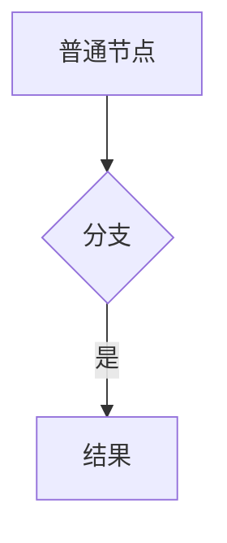

# 技术博客：暖调蓝图配图

**适用范围**：仓库 `Scrates1/Scrates1.github.io` 里任意技术文章的结构图、流程图、调用图等。  
**权威副本**：`skills/blueprint-diagrams/`（随 git）。个人目录同名 skill 应与此一致。

全站技术配图统一「暖调蓝图」：画板网格、等宽字体、语义配色、日夜各一张 SVG。配色取站点秋山 `--yuan-*`。颜色与字体只活在 `scripts/diagram-style/`；`.mmd` 只写结构和语义 class。不依赖某一家 IDE/Agent。

静态分析系列是目前用量最大的落地处（`src/static-analysis/assets/`），但**风格与管线面向全站**；新栏目按下面「资源目录」约定即可复用。

## 何时使用

- 技术博文要加图、改图（不限栏目）
- 写或改 `.mmd`，或重渲蓝图 SVG
- 用户提到蓝图风格、日夜主题图、博客配图

不要用手写装饰 SVG、默认 Mermaid 主题、或在 `.mmd` 里写色值。

## 资源目录

每组图放在文章旁的 `assets/`（或栏目统一的 assets）：

```
<assets>/
  diagram-manifest.json    # name -> type
  <name>.mmd
  <name>.svg               # 日间（提交）
  <name>.dark.svg          # 夜间（提交）
```

渲染时指定目录（省略则默认静态分析系列）：

```bash
node scripts/render_named_diagrams.cjs --dir src/<栏目>/assets <name>
node scripts/render_named_diagrams.cjs --dir src/<栏目>/assets --all
# 默认：
node scripts/render_named_diagrams.cjs <name>
```

正文里的图片路径按该文相对 `assets/` 书写。

## 工作流（新图 / 改图）

```
- [ ] 1. 定 assets 目录、图名与 type，写入 diagram-manifest.json
- [ ] 2. 写 .mmd（结构 + 语义 class，无色值）
- [ ] 3. 渲染并目检日夜 PNG
- [ ] 4. 正文成对引用 #light / #dark
- [ ] 5. 跑该栏目需要的校验（静态分析：check_series.py）
```

### 1. 命名与类型

- 文件名：短英文 slug；同栏目内唯一（如 `overview`、`07-series-2`、`call-flow`）
- 在该目录的 `diagram-manifest.json` 登记 `"<name>": "<type>"`
- 通用 type：

| type | 用途 |
|------|------|
| `process` | 流水线 / 阶段 / 步骤全景 |
| `cfg` | 控制流、调用关系 |
| `overview` | 依赖 / 总览 flowchart |
| `tree` | 左根右叶树；后处理直角连线 |

静态分析等专题可继续用扩展 type：`lattice`、`ifds`、`points-to`（见 [reference.md](reference.md)）。不确定时用 `process` 或 `cfg`。

### 2. 写 `.mmd`

1. 用 `flowchart`（或既有 `graph`）；目录树用 `tree` + `flowchart LR`，不要新开 mindmap
2. **禁止** `classDef`、带 `#色值` 的 `style` / `linkStyle`
3. 语义 class：`statement` `branch` `merge` `object` `field` `note` `aux`
4. 边：`-->` 实线、`-.->` 虚线、`==>` 粗线、`---` 细无箭头
5. 标签双引号写 `#quot;`（不要 `&quot;`）
6. 多行用换行或 `<br/>`；优先让图宽贴近正文栏（约 764px），过宽改 `TB` 或折行
7. 正文写「左/右/上/下」时，布局必须一致



### 3. 渲染与目检

产出：`<assets>/<name>.svg` + `.dark.svg`；`%TEMP%\<name>.png` + `.dark.png`（只目检）。

目检：网格不抢线；语义色与正文图例一致；夜间无浅色残留；中文与 ①–⑳ 清晰；子图标题不被边划穿。

### 4. 正文嵌入

定点改 Markdown（禁止 shell 批量替换正文）：

```markdown


```

可选：链到 GitHub 上的 `.mmd`。站点已开 `markdown.imgMark`；路径须带 `./`；两行图注必须相同。

### 5. 校验

- 静态分析栏目：`python scripts/check_series.py`
- 其他栏目：至少 `yarn docs:build`（`NODE_OPTIONS=--max_old_space_size=8192`），并在日夜主题下看一眼该页

## 不要做

- 在 `.mmd` 里写颜色
- 只交一张 SVG，或正文只引白天图
- 无必要改节点 `id` / 坐标（专题校验可能依赖坐标；`tree` 列对齐除外）
- 为单篇文章另起一套配色或默认 Mermaid 皮肤

## 改全站样式（少见）

- 配色 / 字体 / 画板 → `scripts/diagram-style/tokens.cjs`
- class 映射 / 间距 → `scripts/diagram-style/blueprint-theme.cjs`
- 后处理 → `scripts/diagram-style/svg-postprocess.cjs`

改完对**所有**使用该管线的 assets 目录跑 `--all`，并抽检多栏目日夜图。

## 更多

- class、边、报错、扩展 type：[reference.md](reference.md)
- 仓库入口：`AGENTS.md`
