# 建站参考

今舍弃 hexo 的博客，改为使用 vuepress。 具体使用 vuepress-theme-hope 版本。

## 官方教程

vuepress-theme-hope：https://vuepress-theme-hope.github.io/v2/zh/guide/

vuepress 2：https://v2.vuepress.vuejs.org/

## 安装

```yarn
yarn create vuepress-theme-hope my-blog
```

## 本地启动

```
yarn docs:dev
```

## 项目打包

```bash
yarn docs:build
```

打包完可以在`src\.vuepress` 看到文件夹 `dist`。

## 更新到仓库

使用 `shell` 脚本将打包后的文件（src\.vuepress\dist文件夹下的文件）更新到 Gitee仓库。（此脚本包含打包，以后修改完不用再手动打包了）

<!-- 截图已遗失 -->

```sh
#!/usr/bin/env sh

# 确保脚本抛出遇到的错误
set -e
# 生成静态文件
yarn docs:build

#上传
# git add -A
# git commit -m '上传'
# git push origin master


# 进入生成的文件夹
cd src/.vuepress/dist

# 如果是发布到自定义域名
# echo 'www.example.com' > CNAME

git init
git add -A
git commit -m 'deploy'
git remote add gitee https://gitee.com/...

git push  --force gitee master

cd -

echo 按任意键继续
read -n 1
echo 继续运行
```

备份： 在 github 仓库备份原文档。

## 部署

### 宝塔下运行

环境：Ubuntu 22.04

安装宝塔：https://www.bt.cn/new/index.html

宝塔上安装：

* Nginx/Apache（根据个人需求任意安装一个，用于反向代理做域名绑定或80端口访问使用）
*  Node.js
  * Node.js设置（**很重要：命令运行版本默认状态是：未设置，这里我们需要选择一下版本，否则后面安装vuepress无法使用命令行模式。**registy源默认使用 官方源 即可）

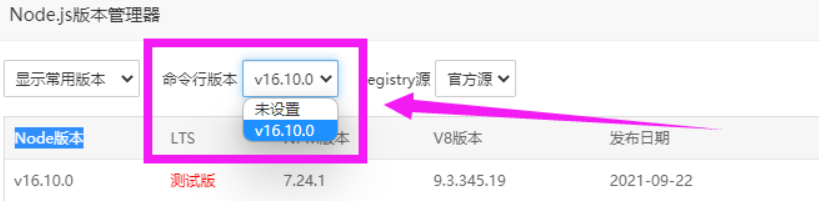

建站：
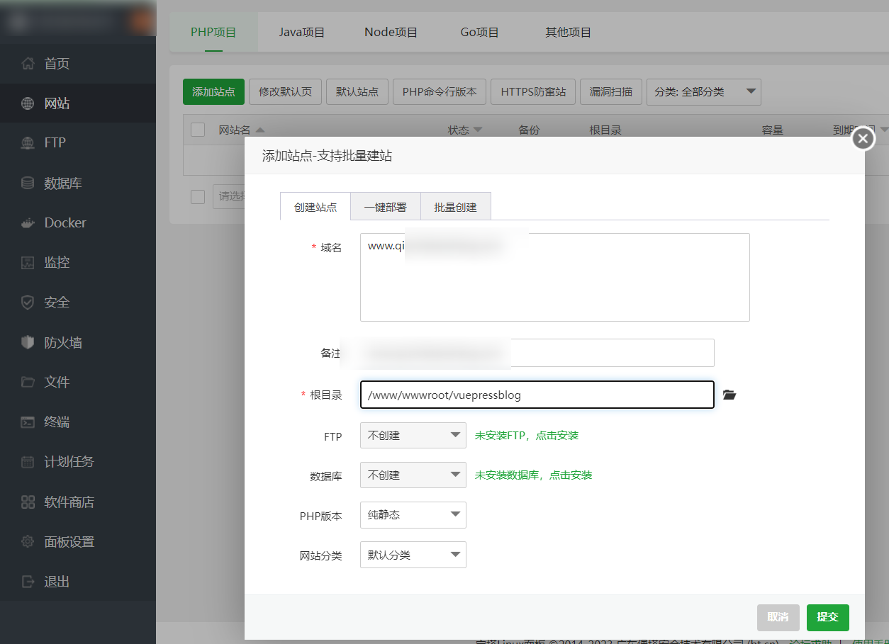

删除网站对应根目录（/www/wwwroot/vuepressblog）下所有文件，在/www/wwwroot/vuepressblog下右键打开终端，克隆gitee上的项目：

```bash
git clone https://gitee.com/...
```

----

**一些问题：**

* 一切就绪后访问网站时：

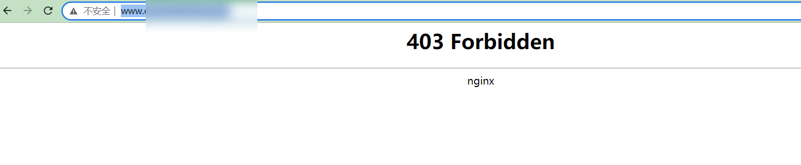

> 解决参考：https://www.bt.cn/bbs/forum.php?mod=viewthread&tid=72173&highlight=nginx%2B403
>
> <!-- 截图已遗失 -->

* 若想要nginx 配置位置：（此项目不需要）

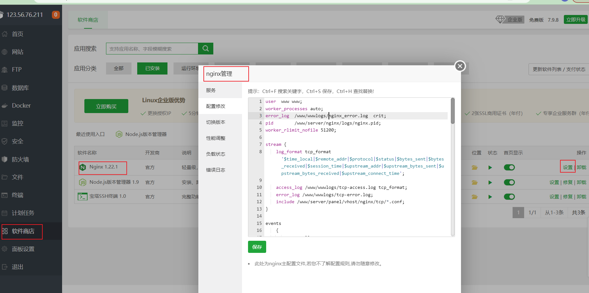

### webhook 设置

> 参考：[宝塔webhook与Gitee配置实现服务器的代码同步更新](https://blog.csdn.net/qq_40025218/article/details/115376472)

当你修改本地文件后，想要网站上的内容自动更新怎么办？

可以使用webhook。当gitee上有push操作时，宝塔自动执行脚本，从gitee上拉取最新的文件。

<!-- 截图已遗失 -->

脚本：

```bash
cd /www/wwwroot/vuepressblog/vuepressblogdist;

#git pull 来从远程仓库拉取同步代码
## 注意宝塔好像无法识别&&后的指令，只执行了fetch，所以在宝塔上分开写
#git fetch --all && git reset --hard origin/master && git pull
git fetch --all; 
git reset --hard origin/master;
git pull;

```

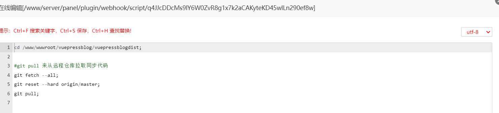

或

```bash
#!/bin/bash
echo ""
#输出当前时间
date --date='0 days ago' "+%Y-%m-%d %H:%M:%S"
echo "Start"
#判断宝塔WebHook参数是否存在
if [ ! -n "$1" ];
then
          echo "param参数错误"
          echo "End"
          exit
fi
#git项目路径
gitPath="/www/wwwroot/..."
#git 网址
gitHttp="https://gitee.com/..."

echo "Web站点路径：$gitPath"
 
#判断项目路径是否存在
if [ -d "$gitPath" ]; then
        cd $gitPath
        #判断是否存在git目录
        if [ ! -d ".git" ]; then
                echo "在该目录下克隆 git"
                git clone $gitHttp gittemp
                mv gittemp/.git .
               rm -rf gittemp
        fi
        #强制拉取最新的项目文件
        git fetch --all
        git reset --hard origin/master
        git pull origin master
        #设置目录权限
        chown -R www:www $gitPath
        echo "End"
        exit
else
        echo "该项目路径不存在"
        echo "End"
        exit
fi
```

> 注意有时修改内容后**重启宝塔**才会生效：
>
> ```bash
> # bt restart
> ```

然后再对gitee进行webhook配置。

## 配置阿里云DNS

保证网站从 github 拉取代码的网速，配置上了阿里云 DNS。

https://alidns.com/knowledge?type=SETTING_DOCS#user_linux

## 右侧目录

### 适用 vuepress2

链接：https://www.npmjs.com/package/vuepress-plugin-anchor-right

* 安装

```
yarn add -D vuepress-plugin-anchor-right
```

指定目录版本：

```
yarn add -D vuepress-plugin-anchor-right@0.0.1-beta.7
```

* 引入

```js
// docs/.vuepress/config.js
const vuepressPluginAnchorRight = require ('vuepress-plugin-anchor-right') ;

module.exports = {
  ...,
  plugins: [
    [vuepressPluginAnchorRight()],
  ]
};
```

或

```ts
// docs/.vuepress/config.ts
import vuepressPluginAnchorRight from 'vuepress-plugin-anchor-right';

export default {
  ...,
  plugins: [
    [vuepressPluginAnchorRight()],
  ],
};
```

卸载目录：

```
yarn remove vuepress-plugin-anchor-right
```

### 适用 vuepress-theme-hope

#### 分析

当我使用小屏笔记本的时候，发现文章目录都在左侧，显得很臃肿。就像下面：

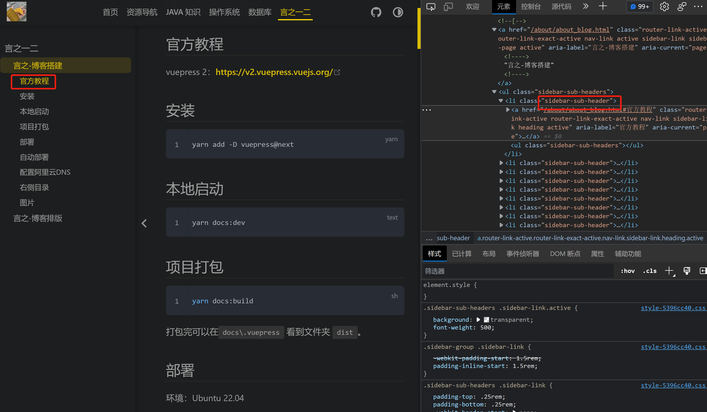

在官网上只找到 sidebar 开关或者设置 headerDepth，但前者是关闭侧边栏，后者是控制目录层深，无法解决问题。

于是 F12，大屏电脑，右侧是 toc： 

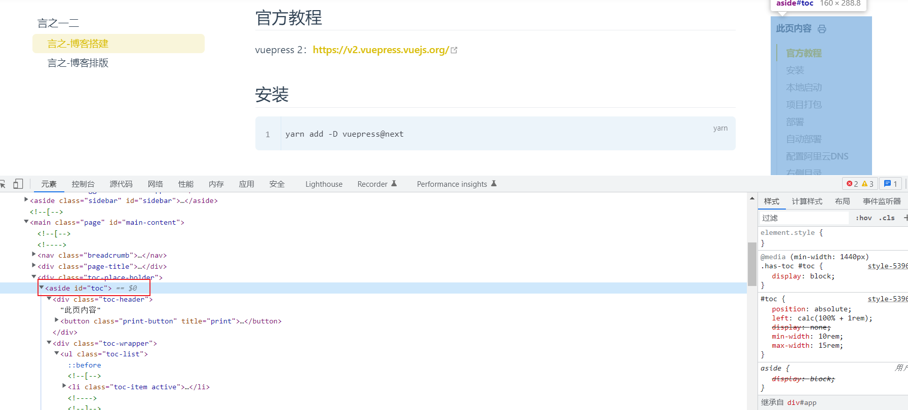


用上面的 `toc-list` 去 `node_modules` 目录下搜索，最后找到了 `renderChildren`：

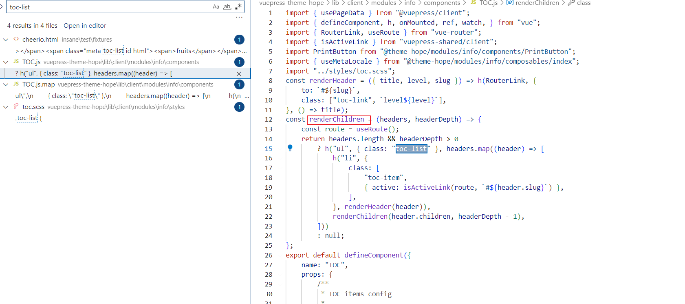

再用 `renderChildren`，找到了生成 html 里 `toc-list` 的地方：

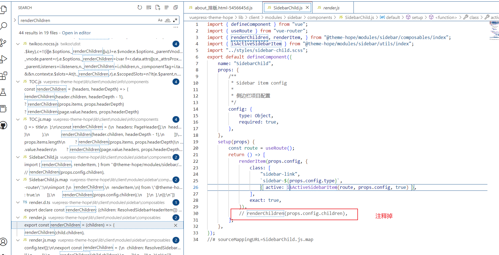

注释掉上面试了一下，的确是这个位置无误。

---

那如何达到我的小屏幕电脑，目录也在右侧显示的目的呢？

我们可以发现，小屏电脑左侧标签是 `sidebar-sub-header`。


打开生成的  dist 下生成的 html 文件，发现 `sidebar-sub-header` 与 `toc-list` 标签皆存在。所以很大可能就是因为 `css` 根据不同屏幕对其的控制了。

在 `node_modules` 下搜索 `toc-list`，果然找到了 `toc.scss` 文件：

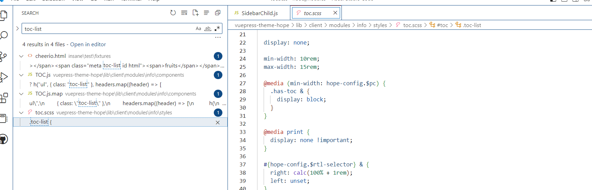

```scss
  @media (min-width: hope-config.$pc) {
    .has-toc & {
      display: block;
    }
  }
```

> 上面的意思是媒体尺寸大于 `hope-config.$pc` 时，以block格式显示。

再搜索 `sidebar-sub-header`，可以看到这里控制着当右侧目录显示时，就不显示 `sidebar-sub-header`。

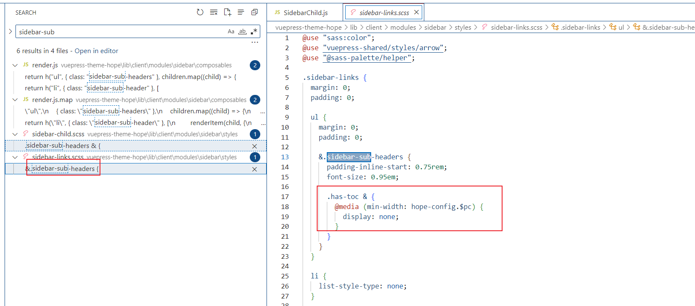

那么 `hope-config.$pc` 又是啥？

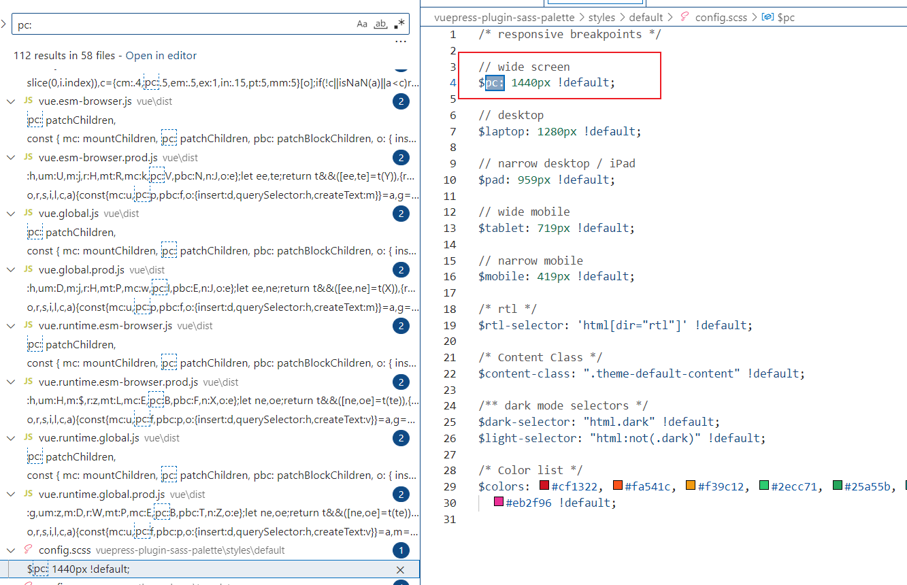

至此就很明晰了，小屏电脑都在左侧是因为它的尺寸小于 `1440px`，而大屏电脑则大于这个数值。

#### 设置

最终在 `src\.vuepress\styles\index.scss` 设置如下：

```scss
// place your custom styles here
// desktop
$laptop: 1280px ;
#toc {

  
    @media (min-width: $laptop) {
      .has-toc & {
        display: block;
      }
    }
  
    @media print {
      display: none !important;
    }
}

.sidebar-links {
    ul {
  
      &.sidebar-sub-headers {
  
        .has-toc & {
          @media (min-width: $laptop) {
            display: none;
          }
        }
      }
    }
}

.sidebar {
    @media (min-width: $laptop) {
        box-shadow: none;
      }
}

.theme-container {
  
    &.has-toc .page.blog {
      @media (min-width: $laptop) {
        // fix toc padding
        padding-inline-end: 0;
      }
    }
}

.toggle-sidebar-wrapper {

    @media (min-width: $laptop) {
      display: none;
    }
}

.theme-container {
  
    .page {
    
  
      @media (min-width: $laptop) {
        padding-inline-end: calc(
          100vw - var(--content-width) - var(--sidebar-space) - 6rem
        );
      }
    }
  // sidebar is disabled
    &.no-sidebar {

        &.has-toc {
        .page {
            // add padding for anchor
            @media (min-width: $laptop) {
            padding-inline-end: 16rem;
            }
        }
        }
    }
}
```

### 自定义

如果想自己生成右侧目录，可以参考这个链接：[为 vuepress 站点添加侧边导航栏](https://zhuanlan.zhihu.com/p/361897932) 。

## 图片

### 适用 vuepress2

 修改 docs/.vuepress/config.ts 配置文件

- 设置 head 属性，添加 link 标签，href 设置图片路径。
- **注意：图片放在 docs/.vuepress/public 文件夹下，public 要手动创建**。
- 编译后 dist 文件夹会将 public 文件夹下的文件放出。

```javascript
import { defaultTheme } from 'vuepress';
import vuepressPluginAnchorRight from 'vuepress-plugin-anchor-right';


export default {

  plugins: [
    [vuepressPluginAnchorRight()],
  ],
  lang: 'zh-CN',
  title: '秋迟先生',
  description: '有趣的知识库',
  head: [[
    // 设置 favor.ico，.vuepress/public 下
        'link', { rel: 'icon', href: '/images/avatar.jpg' }]
  ],
  theme: defaultTheme({
    // 默认主题配置
    logo: '/images/avatar.jpg',
    ...
  }),
}
```
