# PLSQL优化

> 本文选自 TGITCIC [给PLSQL插上飞翔的翅膀-PLSQL优化](https://blog.csdn.net/lifetragedy/article/details/51013069)。虽然文章有些老旧，但里面的一些优化知识还是很值得学习的。本文对 Oracle 数据库中的RBO、CBO、索引、WHERE条件等进行了详细讲解，并配有大量案例方便读者将优化方式快速运用到生产中去。@qiuchi

60-80% of database performance issues are related to poorly performing SQL，60-80%的数据库性能问题要归结于生产中糟糕的[SQL语句](https://so.csdn.net/so/search?q=SQL语句&spm=1001.2101.3001.7020)！

## 优化的理论基础

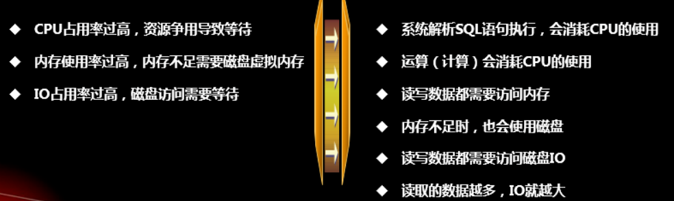


## 通过Select Count(?)进入优化之旅


不看百度或者GOOGLE说出下面3者的区别？


SELECT COUNT (*)


SELECT COUNT(1)


SELECT COUNT(字段名）


### SELECT COUNT(?) 的知识

> 原文此处解释应是有误，秋迟放上正确理解：

* SELECT COUNT (*) 与 SELECT COUNT(1) 都可**以统计表中行数**，**二者没啥太大区别**，除了 COUNT(1) 会把“1”这个文字附加到“FROM”查出的每个列后面。

  Oracle 推荐使用 COUNT(\*)，因为 COUNT(1) 时，虽然数据库优化器意识到“1”是永远不会是 NULL 值，不会每行都计算一次，但是 *把“1”这个文字附加到“FROM”查出的每个列后面* 与 *统计附加完“1”的列* 用的可能不是同一个逻辑单元。
  <https://www.techtarget.com/searchoracle/answer/COUNT-or-COUNT-1>

* SELECT COUNT(字段名）：**如果该字段有 NULL 值则不计数**

>  COUNT() 有两个非常不同的作用：
>
> * 它可以统计某个列值的数量，也可以统计行数。在统计列值时要求列值是非空的（不统计 NULL）。如果在 COUNT() 的括号中定了列或者列表达式，则统计的就是这个表达式有值的结果数。
>
> * COUNT() 的另一个作用是统计结果集的行数。当 MySQL 确认括号内的表达式值不可能为空时，实际上就是在统计行数。最简单的就是当我们使用COUNT(\*)的时候，这种情况下通配符 * 并不像我们猜想的那样扩展成所有的列，实际上，他会忽略所有列而直接统计所有的行数。
>
>   ——《高性能MySQL》。

<https://learnsql.com/blog/difference-between-count-distinct/>

## ORACLE的优化器


要说 PLSQL 优化，我们先需要来好好说一下 Oracle 优化器的知识：


### 优化器的优化模式

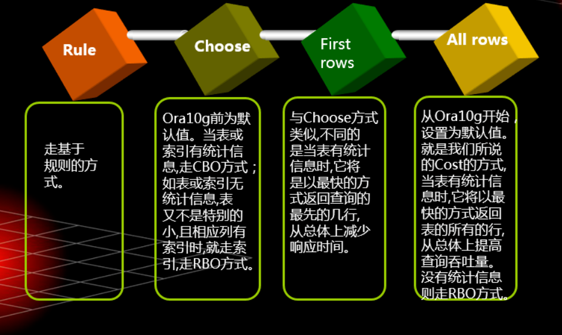


### CBO模式


### RBO模式

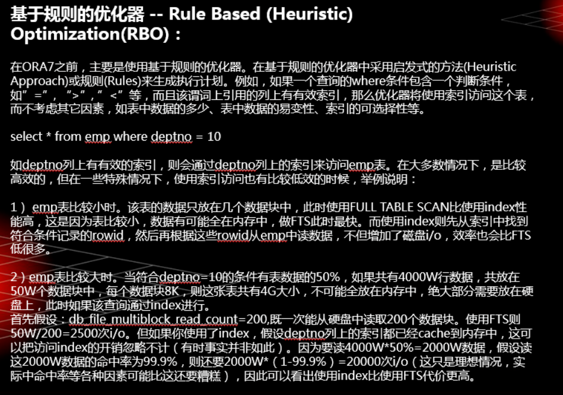


### 一起来看看oracle优化器的发展历程

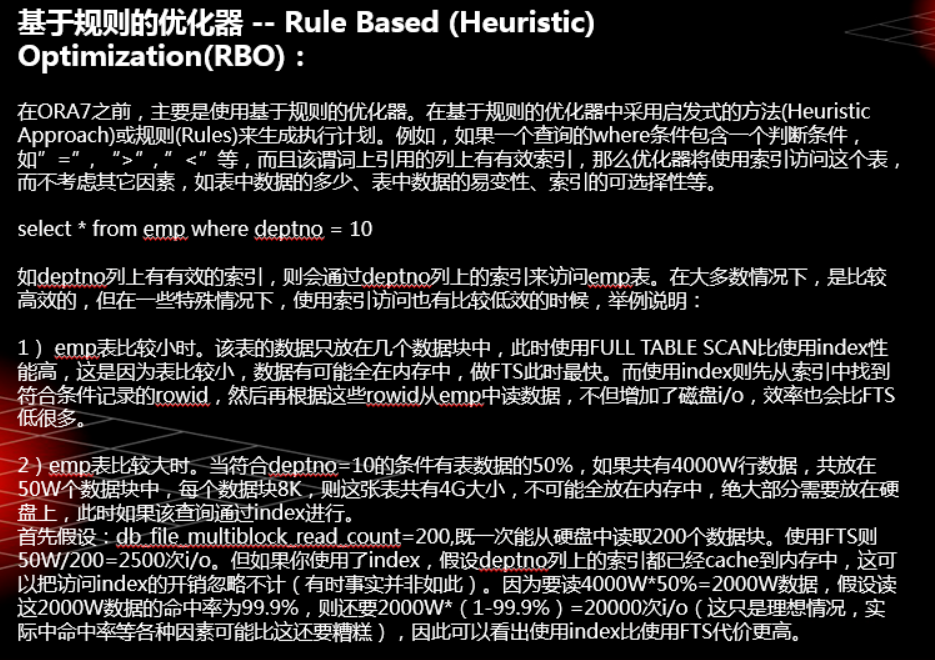


所以，我们知道 ORACLE10 后开始默认使用 CBO，在 CBO 时 ORACLE 会自动来选择最优的执行计划，有时我们会认为：这个应该走索引更好啊，但是对于 CBO 来说，一个 FULL TABLE ACCESS 反而比索引更有效。


因此，在CBO的模式下，我们需要做的就是：


1. 做好数据库信息的相关统计
2. 合理建设我们的索引
3. 优化我们的SQL


## 让我们从索引的基本知识下手吧

索引是不需要修改SQL最直接带来性能提升的利器，何时该建索引，怎么建？怎么样让你的索引更合理？

### 索引按内部结构分类

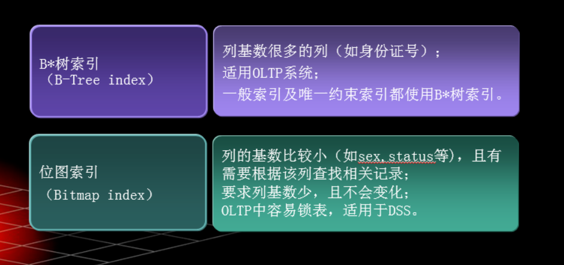


### 索引按功能分类


### 索引按索引对象分类


### 建立索引的方法论

上面介绍了这么多索引的分类，下面来讲讲建立索引的方法论吧，大家可能较关心这个，因为这个是经验总结也是实战有用的利器哈。

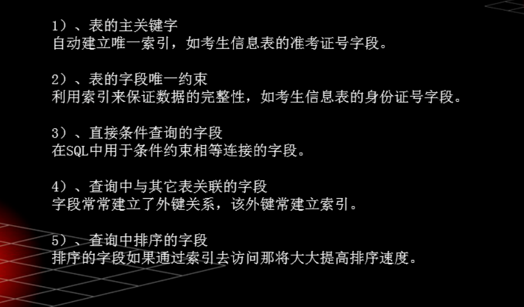

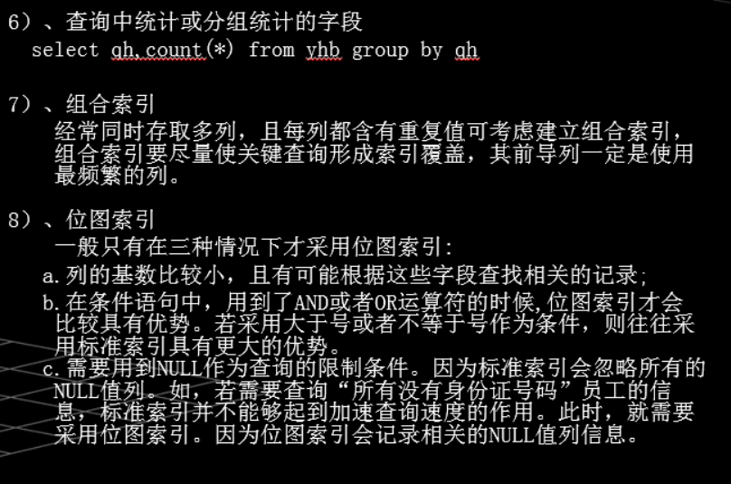


### 不建议建立索引的情况


索引很神奇，可是索引不是万能，有时你建了索引也等于没用或者是白建、作无用功，为什么呢？我们看下去。

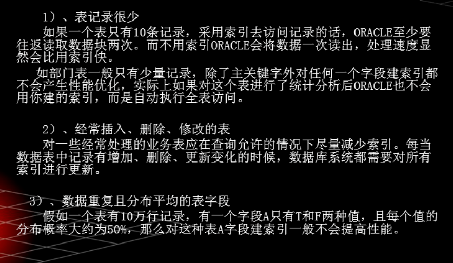

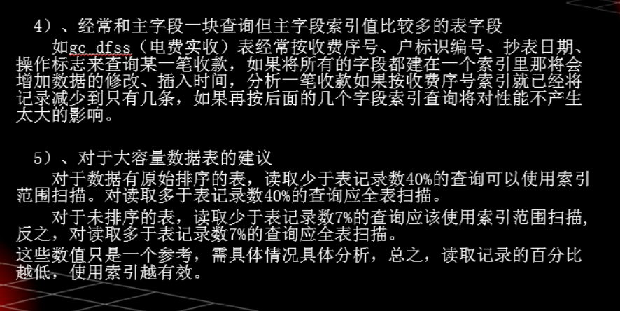


### 索引不会生效的情况

所以索引不要乱建，有时建了也是白建，为什么呢？来看看下面的案例分析吧：

 

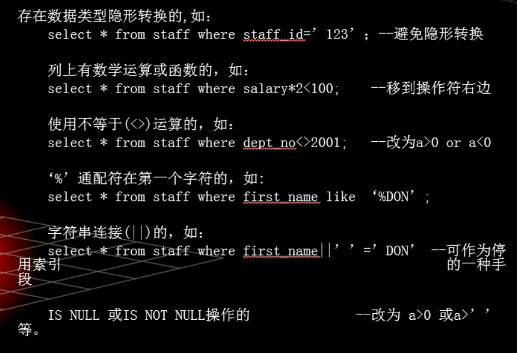


### 以案例来说明


#### PLSQL优化>一个不走索引的优化案例

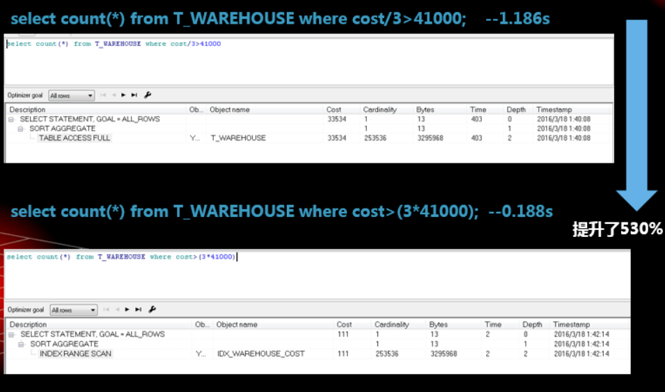


这个例子说明了，如果你有一字参于WHERE条件查询的字段，但是它参于了运算符，因此它在ORACLE的内部执行计划中是不会走索引的，因此我们做了一个小小的变化，效率提升了多少倍？5.3倍，530%，呵呵！


以上例我们可以为建立索引作一个总结。


### 建立索引的总结

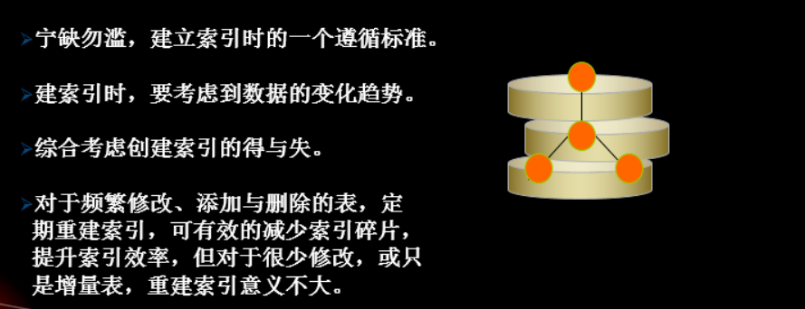

##  Table Analyze


### Analyze Table VS DBMS_STATS


## Import & Export

说到Import & Export命令，大家会说，哎，这个不是很简单，就是：imp username/pwd@oraid file=path 吗？嘿嘿，试想：

1. 你需要导入一个8GB左右的.dmp文件进入数据库
2. 你需要将一个库，其中含有至少30张表并且每张表都超过1200万条记录的数据进入一个.dmp文件

然后你去试试看这个耗时。

### Import的常规做法

这是一个真实的案例，我们在CCC即世界著名车险公司项目中，我们定期会和CCC芝加哥总部同步一个8GB左右的.dmp文件进入我们的数据库，由于安全原因因此需要依靠.dmp交换文件的形式于零晨同步至中国的数据库，并且在T+1第二天早晨的8：00前完成同步。

于是，我们的DBA开始来了。。。。。。


从零晨到第二天早上8：00，硬是没有导完，一查，数据库中session已经超时了，连续2天还是这样。

于是，我们把原有的语句稍稍作了一下变化：

只是把原来的一句imp折成了2条：

- 第一条，只导数据，不导索引，并且设置成10000条数据一次commit，同时设置了一个缓冲池
- 第二条，只导索引，不导数据，并且设置成10000条数据一次commit，同时设置了一个缓冲池

结果让人惊叹。。。发觉最后只用了40分钟不到，两条语句全部执行完毕，完成了导入。。。其实这个原因我可以用下面2个例子来说明：

1. 一个含有8GB文件内容的目录，用FTP客户端下载，你会发觉似乎永远等不到头，几小时就这样耗着，然后你改成先把这个目录打成一个压缩包，然后再用FTP客户端下载，几十分钟就能搞定。
2. 你用JDBC写一个FOR循环插入100万条记录，结果是ORACLE直接爆掉，而你采用批量提交，结果是惊人的！

其实我们当时所做的折分，原理如同上述两个案例，是一样的道理，减少IO读写，设置缓冲，批量提交。如果你的事务太大......

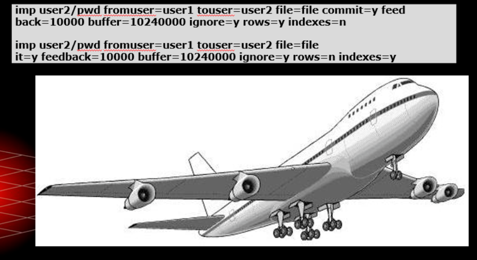

## 以案例来说明PLSQL的优化

### PLSQL优化-SELECT IN 与SELECT EXISTS

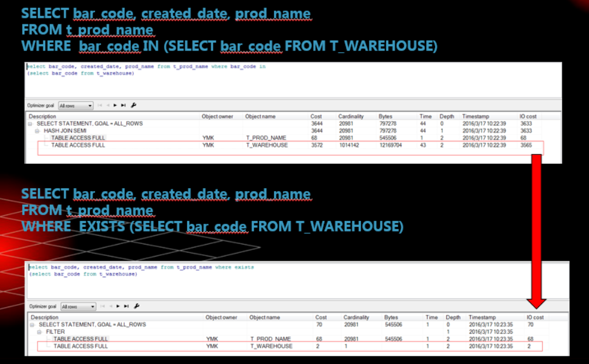

这边提高了多少？光看IO就知道提高了多少了，呵 呵，很好玩吧？再来！

### PLSQL优化-SELECT IN的几种优化

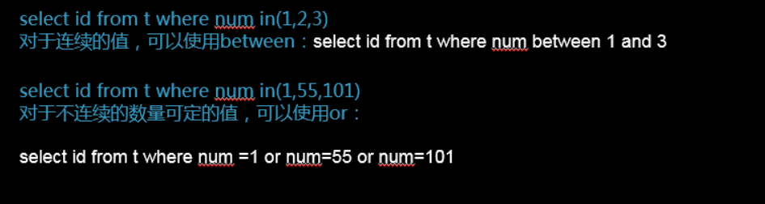

### PLSQL优化-SELECT IN、OR、UNION的互转


看看3次修改，最后一次，提升了多少倍？11.2850-0.0261再除以0.0261=431.375，431.375倍。。。。。。一条SQL啊。。。在寸土寸金的互联网应用中，单条SQL提高了431.375倍。。。这是什么概念！！！

**你好讨厌！！！再来！！！**

###  PLSQL优化-分页语句中加入索引的优化

以下是一条分页语句，我们对created_date做一个索引，等。。。。。。等等等，这边的索引不是一般的索引，我们把图形化工具建的索引翻译成SQL：

```sql
create index IDX_WAREHOUSE_CT on T_WAREHOUSE(CREATED_DATE DESC);
```

我们这个表是一个含有1000万条记录的表，仅此一招，整个SQL查询提高了300%-340%

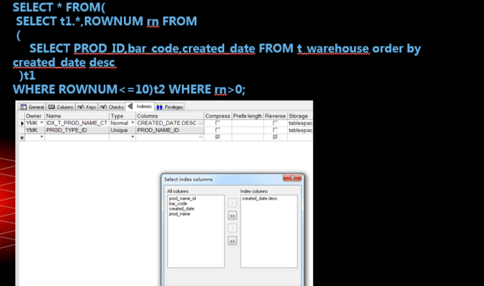

### PLSQL优化-INNER JOIN VS WHERE


### PLSQL优化-WHERE语句优化要点

注意下面这个例子，只是WHERE条件后的顺序上下颠倒一下，就提高了10倍的效率，呵呵。


#### WHERE语句中选择最有效的表名顺序


好玩吧！！！再来！！！

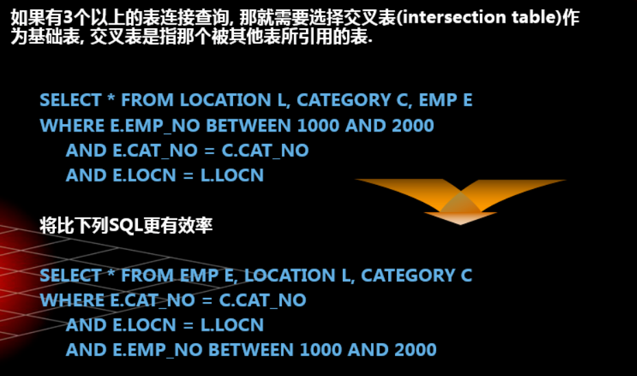

PLSQL优化-用UNION取代OR

看看下面这个例子吧：

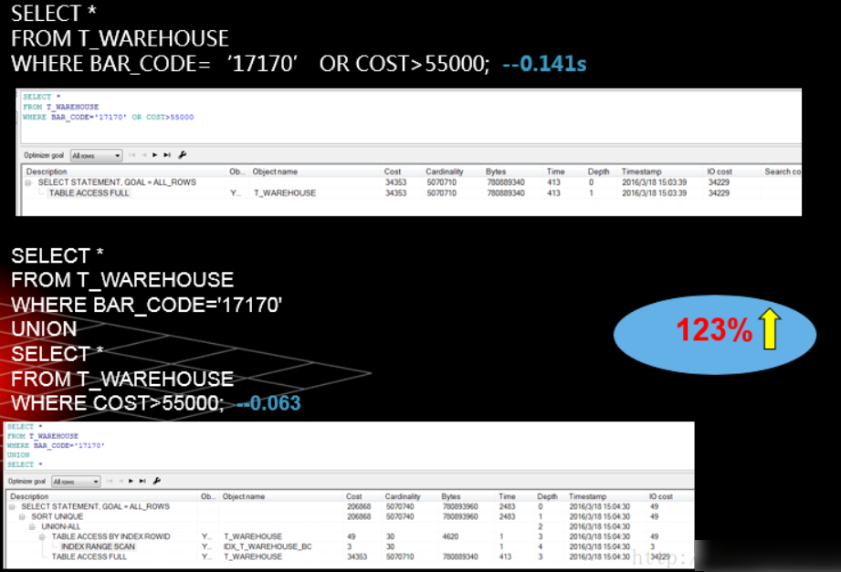

是不是写SQL时稍微注意一下。。。这个效率。。。这个性能 。。。123%。。。123%的提高啊。

## PLSQL优化>共享SQL

前面我们用好几个实例说了一下PLSQL中最基本的一些性能上可以带来的提升，这边我们需要提一下 ORACLE 自带的一个缓冲 SQL 结果集命中率的工具


所以，我们在写SQL时要用 JAVA 的 PreparedStatement，要用:1这样的东西来做传值，因为 ORACLE 是自带 SQL 缓冲池的，另外在此要多说一句的是，虽然ORACLE10后开始带有ASM（自动内存管理），但有时ASM不是万能，对于一些大形网站，有时我们的DBA是需要手工去调整ORACLE的SGA，即：

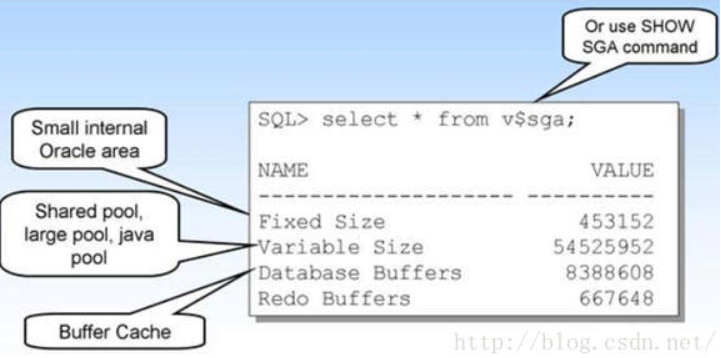

因此，这对我们的ORACLE DBA来说提出了更高的要求。