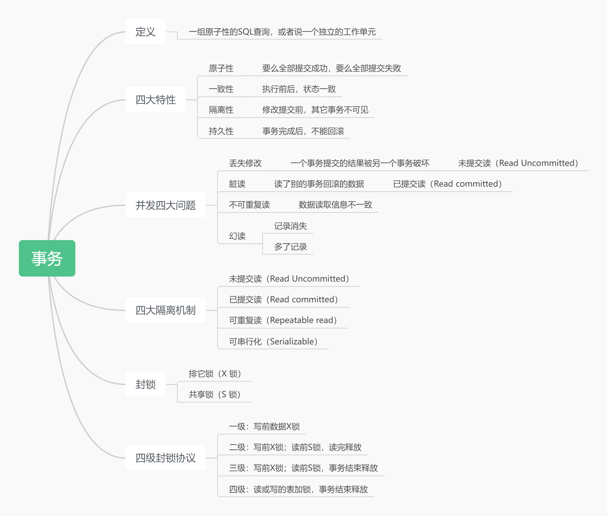
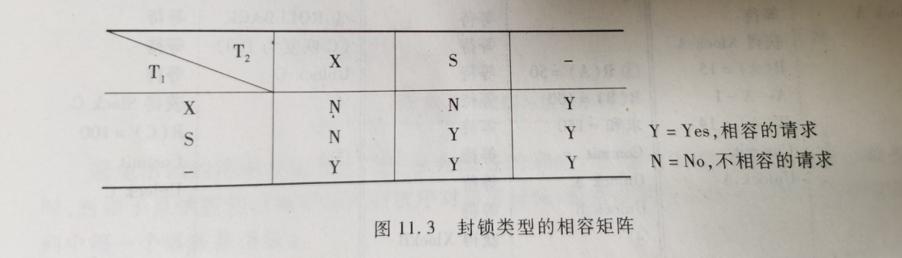

> 当我们某个业务完成时，进行落库的时候，经常会用到事务。现在总结一下事务的特性以及实现方式。@qiuchi

# 事务的原理

## 事务的四大特性

事务就是**一组原子性的SQL查询，或者说一个独立的工作单元**。如果数据库引擎能够成功地对数据库应用该组查询的全部语句，那么就执行该组查询。如果其中有任何一条语句因为崩溃或其他原因无法执行，那么所有的语句都不会执行。也就是说，事务内的语句，要么全部执行成功，要么全部执行失败。

> 银行应用是解释事务必要性的一个经典例子。假设一个银行的数据库有两张表：支票（checking）表和储蓄（savings）表。现在要从Jane的支票账户转移200美元到她的储蓄账户，那么需要至少3个步骤：
>
> 1.检查支票账户余额高于200美元。 
>
> 2.从支票账户余额中减去200美元。
>
> 3.在储蓄账户余额中增加200美元。
>
> 上述三个操作必须打包在一个事务中，任何一个步骤失败，则必须回滚所有步骤。

除非系统通过严格的 ACID 测试，否则空谈事务的概念是不够的。ACID表示原子性（atomicity）、一致性（consistency）、隔离性（isolation）和持久性（durability）。一个运行良好的事务处理系统，必须具备这些标准特征。

**原子性：**对于一个事务来说，要么**全部提交成功，要么全部失败回滚**，不可能执行其中的一部分。

**一致性：**事务执行前后，数据**从一个状态到另一个状态必须是一致的**（A向B转账，不能出现A扣了钱，B却没收到）。

**隔离性**：通常一个事务所做的修改在**最终提交以前**，对其他事务都是不可见的。

**持久性**： 事务完成后，对数据库的更改是永久保存的，**不能回滚**。

## 事务的并发控制

###  **并发事务的四个问题**

首先看一个简单的例子：
考虑飞机订票系统的一个活动序列：
（1）甲售票点（事务T1）读出某航班的机票余额A,设A=16.
（2）乙售票点（事务T2）读出同一航班的机票余额A,也为16.
（3）甲售票点卖出一张机票,修改余额A←A-1.所以A为15,把A写回数据库.
（4）乙售票点也卖出一张机票,修改余额A←A-1.所以A为15,把A写回数据库.
结果明明卖出两张机票，数据库中机票余额只减少1。
这种情况称**为数据库的不一致性**。这种不一致性是由**事务的是并发操作破坏了事务的隔离性引起的**。在并发的操作情况下，如果没有任何的并发控制机制，对事务T1、T2的两个事务的操作序列的调度是随机的。若按照上面的调度序列执行，T1事务的修改就被丢失了（丢失可以理解成为失效）。这是由于第4步中T2事务对A进行修改了，并且写回数据库覆盖了T1事务做出的修改。

----

并发操作带来的**数据不一致性**包括丢失修改、不可重复读和读“脏”数据。

**1.1 丢失修改**（也是脏写（Dirty Write） ）

两个事务 T1 和 T2 读入同一数据并修改，**T2 提交的结果破坏了 T1 提交的结果**，导致了 T1 的修改失效了。飞机订票的例子就属于此类。

**1.2 脏读**

读"脏"数据是指当事务 T1 修改某一数据时，事务 T2 读取同一数据后，**T1 由于某种原因撤销修改了**，这时 T1 已修改过的数据恢复原值，而 **T2 读到的数据是撤销修改之前的数据**，那么此时 T2 的数据就与数据库中的数据不一致，则 T2 读到的数据就为"脏"数据，即**不正确的数据**。

**1.3 不可重复读**

不可重复读是指事务T1读取数据后，事务T2执行更新操作，使T1无法再现前一次读取结果。具体的，不可重复读包括三种情况：
（1）事务T1读取**某一数据**后，事务T2对其做了修改，当事务1再次读该数据时，得到与前一次不同的值。例如，T1读取B=100进行运算，T2读取同一数据B，对其进行修改后将B=200写回数据库。T1为了对读取值校对重读B，B已为200，**与第一次读取值不一致**。
（2）事务T1按一定条件从数据库中读取了某些数据记录后，事务T2删除了其中部分记录，当T1再次按相同条件读取数据时，**发现某些记录神秘地消失了**。
（3）事务T1按一定条件从数据库中读取某些数据记录后，事务T2插入了一些记录，当T1再次按相同条件读取数据时，发现**多了一些记录**。

**1.4 幻读**（后两种不可重复读方式有时也称为幻读（Phantom Row））

事务A首先根据条件索引得到N条数据，然后事务B在N条之外删除或者增加了M条符合事务A**搜索条件**的数据，导致事务A再次搜索发现有N+M条数据了，就产生了虚读。

### 事务的四大隔离级别

产生上述四类数据不一致性的主要原因是**并发操作破坏了事务的隔离性**。**并发控制**就是要用**正确的方式调度并发操作**，使一个用户事务的执行不受其它事务的干扰，从而避免造成数据的不一致性。
有了以上的数据不一致性，那么数据库肯定要有相应的处理事务并行办法。

----

数据库的隔离级别越高，越能解决更多的数据不一致性问题。但是也是要牺牲的性能也逐渐递增。

以下事务隔离**级别逐渐增加**。

**2.1未提交读（Read Uncommitted）**

​		事务中的修改，即使没有提交，对其他事务也都是可见的。事务可以读取未提交的数据，也称为脏读。这种级别下，数据库会出现不可重复读、脏读和幻读等数据不一致性问题。

**2.2 提交读(Read Committed)**

​		一个事务开始时，只能看见**已经提交事务所做的修改**。换句话说，一个事务从开始直到提交之前，所做的任何修改对其他事务都是不可见的。**只有在事务A已经提交的时候，事务B才可以进行读写**。这种级别下，数据库不会出现在事务A执行过程中，B去读写的情况，那么B也不会出现脏读了。**所以此级别可以避免脏读，但是不能避免可重复读以及幻读。**

**2.3 可重复读(Repeatable Read)**

这种级别可以避免不可重复读，也能避免脏读。**但不能避免幻读**。

**2.4可序列化(Serializable)**

最高隔离级别。可以避免所有的数据不一致性问题。

----

个人理解：事务的隔离级别本质其实是**底层使用了不同的封锁协议**。因为封锁是实现并发控制的一个非常重要的技术。
隔离级别：

| 隔离级别                     | 脏写（Dirty Write） | 脏读（Dirty Read） | 不可重复读（Non repeatable Read） | 幻读（Phantom Read） |
| ---------------------------- | ------------------- | ------------------ | --------------------------------- | -------------------- |
| 未提交读（Read uncommitted） | 不会                | 可能               | 可能                              | 可能                 |
| 已提交读（Read committed）   | 不会                | 不会               | 可能                              | 可能                 |
| 可重复读（Repeatable read）  | 不会                | 不会               | 不会                              | 可能                 |
| 可串行化（Serializable）     | 不会                | 不会               | 不会                              | 不会                 |

级别越高，数据越安全，但性能越低。

### 封锁

那么如何实现以上隔离机制呢？方法就是给记录或者表加锁。

基本的封锁类型有两种：

* 排它锁（Exclusive Locks，又称为X锁或者写锁）

* 共享锁（(Share Locks，又称为S锁或者读锁)。
  读锁之间可以共享，写锁既不能共享写锁也不能共享读锁。·

如果事务T对对象 A 加了 X 锁：任何事务都不能再对 A 加任何类型的锁

如果事务 T 对 A 加了 S 锁：其它事务可以对 A 加 S 锁，不能加 X 锁。

### 实现四大隔离级别的四级封锁协议

一级封锁协议（对应未提交读）：事务T在**修改**数据R之前，**必须要加上X锁**，可以避免丢失更新的问题。

二级封锁协议（对应提交读）：事务T在修改数据R之前，必须要加上X锁；事务T在**读取**数据R之前，必须要加上**S锁**，**读完后释放S锁**。这样就避免了读脏数据。

三级封锁协议（对应可重复读）：事务T在修改数据R之前，必须要加上X锁；事务T在读取数据R之前，必须要加上S锁，**事务结束后才释放**。这样在二级封锁协议的基础上避免不可重复读的问题。

最强封锁协议（对应可串行化）：四级封锁协议是对三级封锁协议的增强，其实现机制也最为简单，直接对事务中所读取或者更改的数据**所在的表加表锁**，也就是说，其他事务不能读写该表中的任何数据。

**为什么一级封锁协议不能禁止脏读：**在事务T修改数据R之前，需要加排它锁，此时其他事务不能申请共享锁或排它锁，**但可以直接通过基本的select来读取数据，不用加锁。**

## 参考链接

* <https://www.modb.pro/db/46842>
* <https://blog.csdn.net/sinat_32336967/article/details/99339403>
* 《数据库系统概论》第四版，王珊、萨师煊著
* <https://blog.csdn.net/qq_34491508/article/details/110056638>