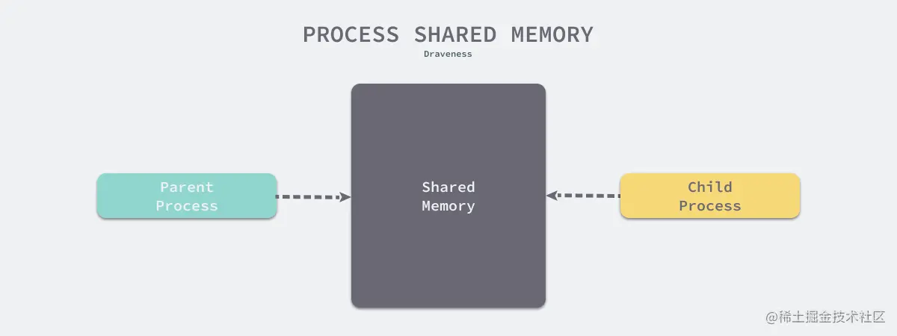
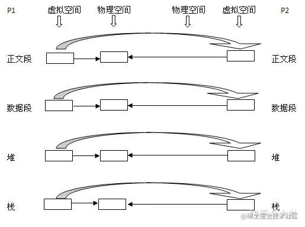

> 本文转载自 <https://juejin.cn/post/7084238719867158565>，详细介绍了 COW 的原理。@qiuchi

# Redis写时拷贝（COW）总结

虽然我们经常将 Redis 看做一个纯内存的键值存储系统，但是我们也会用到它的持久化功能，RDB 和 AOF 就是 Redis 为我们提供的两种持久化工具，其中 RDB 就是 Redis 的数据快照，我们在这篇文章想要分析 Redis 为什么在对数据进行快照持久化时会需要使用子进程，而不是将内存中的数据结构直接导出到磁盘上进行存储。

### 概述

在具体分析今天的问题之前，我们首先需要了解 Redis 的持久化存储机制 RDB 究竟是什么，RDB 会每隔一段时间中对 Redis 服务中当下的数据集进行快照，除了 Redis 的配置文件可以对快照的间隔进行设置之外，Redis 客户端还同时提供两个命令来生成 RDB 存储文件，也就是 SAVE 和 BGSAVE，通过命令的名字我们就能猜出这两个命令的区别。


**其中 SAVE 命令在执行时会直接阻塞当前的线程，由于 Redis 是单线程的，所以 SAVE 命令会直接阻塞来自客户端的所有其他请求，这在很多时候对于需要提供较强可用性保证的 Redis 服务都是无法接受的。我们往往需要 BGSAVE 命令在后台生成 Redis 全部数据对应的 RDB 文件，当我们使用 BGSAVE 命令时，Redis 会立刻 fork 出一个子进程，子进程会执行『将内存中的数据以 RDB 格式保存到磁盘中』这一过程，而 Redis 服务在 BGSAVE 工作期间仍然可以处理来自客户端的请求。**

```java
int rdbSaveBackground(char *filename, rdbSaveInfo *rsi) {
    pid_t childpid;
 
    if (hasActiveChildProcess()) return C_ERR;
    ...
 
    if ((childpid = redisFork()) == 0) {
        int retval;
 
        /* Child */
        redisSetProcTitle("redis-rdb-bgsave");
        retval = rdbSave(filename,rsi);
        if (retval == C_OK) {
            sendChildCOWInfo(CHILD_INFO_TYPE_RDB, "RDB");
        }
        exitFromChild((retval == C_OK) ? 0 : 1);
    } else {
        /* Parent */
        ...
    }
    ...
}
```

Redis 服务器会在触发 BGSAVE 时调用 redis Fork 函数来创建子进程并调用 rdbSave 在子进程中对数据进行持久化，我们在这里虽然省略了函数中的一些内容，但是整体的结构还是非常清晰的，感兴趣的读者可以在点击上面的链接了解整个函数的实现。使用 fork 的目的最终一定是为了不阻塞主进程来提升 Redis 服务的可用性，但是到了这里我们其实能够发现两个问题：

- 为什么 fork 之后的子进程能够获取父进程内存中的数据？
- fork 函数是否会带来额外的性能开销，这些开销我们怎么样才可以避免？

既然 Redis 选择使用了 fork 的方式来解决快照持久化的问题，那就说明这两个问题已经有了答案，首先 fork 之后的子进程是可以获取父进程内存中的数据的，而 fork 带来的额外性能开销相比阻塞主线程也一定是可以接受的，只有同时具备这两点，Redis 最终才会选择这样的方案。

### 设计

为了分析上一节提出的两个问题，我们在这里需要了解以下的这些内容，这些内容是 Redis 服务器使用 fork 函数的前提条件，也是最终促使它选择这种实现方式的关键：

- 通过 fork 生成的父子进程会共享包括内存空间在内的资源；
- fork 函数并不会带来明显的性能开销，尤其是对内存进行大量的拷贝，它能通过写时拷贝将拷贝内存这一工作推迟到真正需要的时候；

### 子进程

在计算机编程领域，尤其是 Unix 和类 Unix 系统中，fork 都是一个进程用于创建自己拷贝的操作，它往往都是被操作系统内核实现的系统调用，也是操作系统在 Linux 系统中创建新进程的主要方法。


当程序调用了 fork 方法之后，我们就可以通过 fork 的返回值确定父子进程，以此来执行不同的操作：

- fork 函数返回 0 时，意味着当前进程是子进程；
- fork 函数返回非 0 时，意味着当前进程是父进程，返回值是子进程的 pid；

```java
int main() {
    if (fork() == 0) {
        // child process
    } else {
        // parent process
    }
}
```

在 `fork` 的 [手册](https://link.juejin.cn?target=http%3A%2F%2Fman7.org%2Flinux%2Fman-pages%2Fman2%2Ffork.2.html) 中，我们会发现调用 `fork` 后的父子进程会运行在不同的内存空间中，当 `fork` 发生时两者的内存空间有着完全相同的内容，对内存的写入和修改、文件的映射都是独立的，两个进程不会相互影响。

除此之外，子进程几乎是父进程的完整副本（Exact duplicate），然而这两个进程在以下的一些方面会有较小的区别：

- 子进程用于独立且唯一的进程 ID；
- 子进程的父进程 ID 与父进程 ID 完全相同；
- 子进程不会继承父进程的内存锁；
- 子进程会重新设置进程资源利用率和 CPU 计时器；
- …

最关键的点在于父子进程的内存在 fork 时是完全相同的，在 fork 之后进行写入和修改也不会相互影响，这其实就完美的解决了快照这个场景的问题 —— 只需要某个时间点下内存中的数据，而父进程可以继续对自己的内存进行修改，这既不会被阻塞，也不会影响生成的快照。

### 写时拷贝

既然父进程和子进程拥有完全相同的内存空间并且两者对内存的写入都不会相互影响，那么是否意味着子进程在 fork 时需要对父进程的内存进行全量的拷贝呢？假设子进程需要对父进程的内存进行拷贝，这对于 Redis 服务来说基本都是灾难性的，尤其是在以下的两个场景中：

- 内存中存储大量的数据，fork 时拷贝内存空间会消耗大量的时间和资源，会导致程序一段时间的不可用；
- Redis 占用了 10G 的内存，而物理机或者虚拟机的资源上限只有 16G，在这时我们就无法对 Redis 中的数据进行持久化，也就是说 Redis 对机器上内存资源的最大利用率不能超过 50%；

如果无法解决上面的两个问题，使用 fork 来生成内存镜像的方式也无法真正落地，不是一个工程中真正可以使用的方法。就算脱离了 Redis 的场景，fork 时全量拷贝内存也是难以接受的，假设我们需要在命令行中执行一个命令，我们需要先通过 fork 创建一个新的进程再通过 exec 来执行程序，fork 拷贝的大量内存空间对于子进程来说可能完全没有任何作用的，但是却引入了巨大的额外开销。

**写时拷贝（Copy-on-Write）的出现就是为了解决这一问题，就像我们在这一节开头介绍的，写时拷贝的主要作用就是将拷贝推迟到写操作真正发生时，这也就避免了大量无意义的拷贝操作。在一些早期的 Unix 系统上，系统调用 fork 确实会立刻对父进程的内存空间进行复制，但是在今天的多数系统中，fork 并不会立刻触发这一过程：**



在 fork 函数调用时，父进程和子进程会被 Kernel 分配到不同的虚拟内存空间中，所以在两个进程看来它们访问的是不同的内存：

- 在真正访问虚拟内存空间时，Kernel 会将虚拟内存映射到物理内存上，所以父子进程**共享了物理上的内存空间**；
- 当父进程或者子进程对共享的内存进行**修改时**，**共享的内存才会以页为单位进行拷贝**，父进程会保留原有的物理空间，而子进程会使用拷贝后的新物理空间；

在 Redis 服务中，子进程只会读取共享内存中的数据，它并不会执行任何写操作，只有父进程会在写入时才会触发这一机制，而对于大多数的 Redis 服务或者数据库，写请求往往都是远小于读请求的，所以使用 fork 加上写时拷贝这一机制能够带来非常好的性能，也让 BGSAVE 这一操作的实现变得非常简单。

> 秋迟注：
>
> 总结就是，今天的系统中，系统调用 fork，不会立刻触发对父进程的物理内存的拷贝，此时父子进程最终都会指向这个内存，即共享内存。写时拷贝就是当父进程往共享内存写入时， 被写入的内存页会先被拷贝到新的物理空间，这个空间给子进程用，原共享内存页独属父进程，然后父进程才会对其进行写入。

### 为什么 Redis 的 RDB 备份不用多线程实现 CopyOnWrite？

快照持久化是个很耗时间的操作，而 Redis 采用 fork 一个子进程出来进行持久化。理论而言，fork出来的子进程会拷贝父进程所有的数据，这样当 Redis 要持久化 2G 的内存数据的时候，子进程也会占据几乎 2G 的内存。那么此时 Redis 相关的进程内存占用就会达到 4G 左右。这在数据体量比较小的时候还不严重，但是比如你的电脑内存是 8G，目前备份快照数据本身体积是 5G，那么按照上面的计算备份一定是无法进行的。所幸在Unix类操作系统上面做了如下的优化：**在刚开始的时候父子进程共享相同的内存，直到父进程或者子进程进行内存的写入后，对被写入的内存共享才结束。这样就会减少快照持久化时对内存的消耗。这就是COW技术，减少了快照生成时候的内存使用的同时节省了不少时间。而备份期间多用的内存正比于在此期间接收到的数据更改请求数目。**

更具体地讲，我们知道每个进程的虚拟空间是被划分成正文段、数据段、堆和栈这四个部分，同时对应于每一个部分，操作系统会为之分配真实物理块。当我们从父进程 P1 中fork出一个子进程 P2 时：

- 在没有 CopyOnWrite 之前，我们要给子进程生成虚拟空间，并为虚拟空间地每一个部分分配对应地物理空间，接着要把父进程对应部分地物理空间地内容复制到子进程的空间中。这实际上是个既耗时又耗费空间地操作。
- 有了 COW 之后， fork 子进程时，我们只为其生成虚拟空间，但是并不先为每个部分分配真实的物理空间，而是让每个虚拟空间部分仍然指向父进程的物理空间。只有当父进程或子进程修改相应的共享内存空间时，才会为子进程分配物理空间并把父进程的物理空间内容进行复制。这就是所谓的写时复制，即把内存的复制延迟到了内存写入的时刻。



同时需要注意地是，**父子进程共享的空间粒度是页（在 Linux 中，页的大小为 4KB），父/子进程修改某个页时，该页的共享才结束，同时子进程分配该页大小的物理空间复制父进程对应页的内容。这样，如果当子进程运行期间，父子进程都没有修改数据，那么操作系统就节省了大量的内存复制时间和占用空间。**

上面讲的 CopyOnWrite 是操作系统在 fork 子进程时实现的。而题主问的是，我们能不能用多线程来实现 COW 进而来实现 RDB 生成呢？在回答这个问题之前，为了让大家更明白多线程实现 COW 的事情，我们先以 Java 中的 CopyOnWriteArrayList 为例进行来看多线程实现 COW 是个什么操作。

首先我们看这么一段代码。这段代码在多线程下肯定是不安全的，为了让它变得更安全，一个简单的方法就是读取和写入时都加锁，即同时要有读锁和写锁。但是我们都知道锁是非常影响性能的，为了减少锁的消耗，Java便推出了 CopyOnWriteArrayList。

```java
public static Object getLast(Vector list){
    int lastIndex = list.size() - 1;
    return list.get(lastIndex);
}

public static void deleteLast(Vector list){
    int lastIndex = list.size() - 1;
    return list.remove(lastIndex);
}
```

CopyOnWriteArrayList 相对于 ArrayList 线程安全，底层通过复制数组的方式来实现，其核心概念就是： 数据读取时直接读取，不需要锁，数据写入时，需要锁，且对副本进行操作。那么当数据的操作以读取为主时，我们便可以省去大量的读锁带来的消耗。同时为了能让多线程操作 List 时，一个线程的修改能被另一个线程立马发现，CopyOnWriteList 采用了 Volatile 关键词来进行修饰，即每次数据读取不从缓存里面读取，而是直接从数据的内存地址中读取。

我们以 CopyOnWriteArrayList 的 add()操作为例来看。

```java
// 这个数组是核心的，因为用volatile修饰了
  // 只要把最新的数组对他赋值，其他线程立马可以看到最新的数组
  private transient volatile Object[] array;

  public boolean add(E e) {

      final ReentrantLock lock = this.lock;
      lock.lock();

      try {
          Object[] elements = getArray();
          int len = elements.length;

          // 对数组拷贝一个副本出来
          Object[] newElements = Arrays.copyOf(elements, len + 1);

          // 对副本数组进行修改，比如在里面加入一个元素
          newElements[len] = e;

          // 然后把副本数组赋值给volatile修饰的变量
          setArray(newElements);
          return true;


      } finally {
          lock.unlock();
      }
  }
```

总结而言，多线程实现 COW 实际上就是以空间换取时间使得数据读取时不需要锁。只是减少了读锁的开销，但与常规的多线程操作共享数据的本质没有什么区别。

好，最后我们回到题主的问题，使用多线程实现 COW 来实现 RDB 生成这个问题可以规约成使用多线程实现 RDB 生成问题。所以我们的问题核心在于解决能不能使用多线程来实现 RDB 生成。如果要这么做我们需要做出哪些额外的操作？

大家肯定会想 **RDB 的生成过程本质**不就是**把内存中的数据序列化到硬盘文件中么**？RDB 生成时，子线程只需要进行数据读取，主线程修改时加锁修改。并且为了避免常规操作时锁的过多开销，我们可以只需要在 RDB 生成期间再加锁，常规期间写操作不需要加锁。这样总体而言带来的开销不会多很多，因为毕竟 RDB 生成是个低频的操作。

但这里面其实有个很重要的概念就是 ”SnapShot“, 即 RDB 是 Redis 内存的某一个时刻的快照。比如，我 6：15 分开始生成 RDB, 那么这个RDB保存的数据就是当时那一刻整个Redis内存中的数据状态。使用多进程我们是很容易保证这一点的，但是使用多线程，我们是很难保证这个性质的。因为你可能在 DUMP 的过程中，主线程又修改了你还没读取的数据，又或者主线程修改了你刚刚已经序列化到文件中的某个数据。也就是说使用多线程进行生成 RDB 的时候，你并不知道自己生成的数据是到底哪个时刻的数据。你也并不知道修改期间哪些主线程的命令已经体现在了 RDB 文件中。

这个会产生大的影响么？单机版的 Redis 也许不大会，但是 Redis 集群中涉及到主从复制的时候就会产生很大的影响。

单机版 Redis 生成 RDB 无非就是想留个档，那么具体 RDB 是哪一个时刻的，可能没那么重要。更重要的是要生成 RDB。而且这个 RDB显然越新越好，因为越新，Redis 重启后丢失的数据就越少。那么从这个角度而言，甚至说用多线程反而可能更好，因为多线程时可以让一些生成 RDB 期间被修改的数据也体现在 RDB 中。

但是涉及到主从复制时就不可以了。主从复制时，Redis 主节点会生成当时时刻的内存快照 RDB 文件，同时把 RDB 期间的所有的命令写到缓存repl_backlog中，等从节点从主节点的RDB文件恢复数据之后，便从主节点的命令缓存中读取所有的命令再进行执行一遍，以达到和主节点相同的状态。那么用多线程生成RDB时，如果当主线程执行某个写入命令时，从线程还未DUMP该数据，那么从线程生成的RDB就包含了该命令的执行结果。而子节点又恢复了数据之后，相当于子节点已经执行过了这个命令。那么当子节点从主节点的命令缓存中拉取命令来再执行一遍后，有些命令就会被重复执行。

### 总结

Redis 实现后台快照的方式非常巧妙，通过**操作系统提供的 fork 和写时拷贝**的特性轻而易举的就实现了这个功能，从这里我们就能看出作者对于操作系统知识的掌握还是非常扎实的，大多人在面对类似的场景时，想到的方法可能就是手动实现类似『写时拷贝』的特性，然而这不仅增加了工作量，还增加了程序出现问题的可能性。

到这里，我们简单总结一下 Redis 为什么在使用 RDB 进行快照时会通过子进程的方式进行实现：

- 通过 fork 创建的子进程能够获得和父进程完全相同的内存空间，父进程对内存的修改对于子进程是不可见的，两者不会相互影响；
- 通过 fork 创建子进程时不会立刻触发大量内存的拷贝，内存在被修改时会以页为单位进行拷贝，这也就避免了大量拷贝内存而带来的性能问题；

上述两个原因中，一个为子进程访问父进程提供了支撑，另一个为减少额外开销做了支持，这两者缺一不可，共同成为了 Redis 使用子进程实现快照持久化的原因。到最后，我们还是来看一些比较开放的相关问题，有兴趣的读者可以仔细思考一下下面的问题：

- Nginx 的主进程会在运行时 fork 一组子进程，这些子进程可以分别处理请求，还有哪些服务会使用这一特性？
- 写时拷贝其实是一个比较常见的机制，在 Redis 之外还有哪里会用到它？

cow 分为进程级别的和线程级别的，两者是有区别的，进程级别的主要是主进程和子进程共用内存数据，而主进程写的时候子进程才进行复制数据，也就是写时复制，子进程使用的是老的数据，而不是最新的数据，所以进程级别的cow用了最少的时间和最小的空间；线程级别的cow主要是使用了volatile这个关键字加锁来进行实现的。写时复制思想很重要，主要是在Linux系统级别来进行实现的；