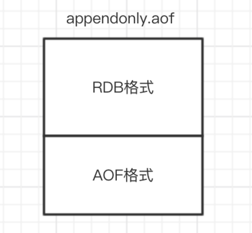

# Redis 

## Redis持久化

官网地址：https://redis.io/docs/manual/persistence/

### RDB快照（snapshot）

* 存储：默认情况下， Redis 将**内存数据库快照**保存在名字为 **dump.rdb** 的二进制文件中。

* 自动生成快照：
  如：下面意思为满足“ 60 秒内有至少有 1000 个键被改动”这一条件时， 自动保存一次数据集

  ```
  # save 60 1000    //关闭RDB只需要将所有的save保存策略注释掉即可
  ```

* 手动生成快照：
  redis客户端执行命令 **save** 或 **bgsave** 可以生成 dump.rdb 文件。每次命令执行都会将所有redis内存快照到一个新的rdb文件里，并覆盖原有rdb快照文件。

**bgsave的写时复制( COW) 机制**

Redis 借助操作系统提供的**写时复制技术（Copy-On-Write, COW）**，在生成快照的同时，依然可以正常处理写命令。简单来说，bgsave 子进程是由主进程 fork 生成的，可以共享主进程的所有内存数据（今天的系统中，系统调用 fork，不会立刻触发对父进程的物理内存的拷贝，此时父子进程最终都会指向这个内存，即共享父进程内存）。bgsave 子进程运行后，开始读取主进程的内存数据，并把它们写入 RDB 文件。此时，如果主线程对这些数据也都是读操作，那么，主线程和 bgsave 子进程相互不影响。但是，如果主线程要修改一块数据，那么，这块数据就会被复制一份，生成该数据的副本。然后，bgsave 子进程会把这个副本数据写入 RDB 文件，而在这个过程中，主线程仍然可以直接修改原来的数据。

> 详见[《Redis写时拷贝（COW）总结》](./Redis_COW.md)。

**save与bgsave对比：**

| **命令**              | **save**         | **bgsave**                                       |
| --------------------- | ---------------- | ------------------------------------------------ |
| IO类型                | 同步             | 异步                                             |
| 是否阻塞redis其它命令 | 是               | 否(在生成子进程执行调用 fork 函数时会有短暂阻塞) |
| 复杂度                | O(n)             | O(n)                                             |
| 优点                  | 不会消耗额外内存 | 不阻塞客户端命令                                 |
| 缺点                  | 阻塞客户端命令   | 需要 fork子进程，消耗内存                        |

**配置自动生成rdb文件后台使用的是bgsave方式。**

### **AOF（append-only file）**

#### AOF 简介

快照功能并不是非常耐久（durable）： 如果 Redis 因为某些原因而造成故障停机， 那么服务器将丢失最近写入、且仍未保存到快照中的那些数据。从 1.1 版本开始， Redis 增加了一种完全耐久的持久化方式： AOF 持久化，将**修改的**每一条指令记录进文件appendonly.aof中(先写入os cache，每隔一段时间fsync到磁盘)

比如执行命令**“set qiuchi 666”**，aof文件里会记录如下数据：

```
*3
$3
set
$6
qiuchi
$3
666
```

这是一种 resp 协议格式数据，星号后面的数字代表命令有多少个参数，$号后面的数字代表这个参数有几个字符。

注意，如果执行带过期时间的set命令，aof 文件里记录的是并不是执行的原始命令，而是记录key过期的**时间戳**。

比如执行**“set qiuchi 888 ex 1000”**（设置键过期时间为1000秒，1000秒后自动删除），对应 aof 文件里记录如下

```
*3
$3
set
$6
qiuchi
$3
888
*3
$9
PEXPIREAT
$6
qiuchi
$13
1604299786302            
```

#### AOF 开启

通过修改配置文件打开 AOF 功能：

```
 # appendonly yes              
```

从现在开始， 每当 Redis 执行一个改变数据集的命令时（比如 [SET](http://redisdoc.com/string/set.html#set)）， 这个命令就会被追加到 AOF 文件的末尾。

这样的话， 当 Redis 重新启动时， 程序就可以通过重新执行 AOF 文件中的命令来达到重建数据集的目的。

#### fsync 时效

你可以配置 Redis 多久才将数据 fsync 到磁盘一次（即往磁盘延迟写的时间间隔）。

有三个选项：

```
appendfsync always：每次有新命令追加到 AOF 文件时就执行一次 fsync ，非常慢，也非常安全。 
appendfsync everysec：每秒 fsync 一次，足够快，并且在故障时只会丢失 1 秒钟的数据。
appendfsync no：从不 fsync ，将数据交给操作系统来处理。更快，也更不安全的选择。   
```


推荐（并且也是默认）的措施为每秒 fsync 一次， 这种 fsync 策略可以兼顾速度和安全性。           

#### **AOF 重写**

AOF文件里可能有太多没用指令，所以 AOF 会定期根据**内存的最新数据**生成 aof 文件。

例如，执行了如下几条命令：

```
127.0.0.1:6379> incr readcount
(integer) 1
127.0.0.1:6379> incr readcount
(integer) 2
127.0.0.1:6379> incr readcount
(integer) 3
127.0.0.1:6379> incr readcount
(integer) 4
127.0.0.1:6379> incr readcount
(integer) 5
```

​            

重写后AOF文件里变成

 ```
 *3
 $3
 SET
 $2
 readcount
 $1
 5
 ```

​        

**控制AOF自动重写频率：**

```
# auto-aof-rewrite-min-size 64mb   //aof文件至少要达到64M才会自动重写，文件太小恢复速度本来就很快，重写的意义不大
# auto-aof-rewrite-percentage 100  //aof文件自上一次重写后文件大小增长了100%则再次触发重写  
```

**AOF 手动重写：**

进入redis客户端执行命令:

```
bgrewriteaof
```

注意，**AOF重写redis会fork出一个子进程去做(与bgsave命令类似)，不会对redis正常命令处理有太多影响**

**AOF 重写机制：**

Redis >= 7.0：

* Redis fork，得到一个子进程和一个父进程。
* 子进程在一个临时文件中写下新的基本的 AOF 文件。
* 在子进程写的时候，父进程将增量的更新写到一个新的增量 AOF 文件中。（此时如果重写失败，旧的 AOF 文件和增量文件（如果有的话），就构成了完整的记录）。
* 子进程将基本 AOF 文件写完后，给父进程发一个信息，子进程写的新的基本文件和父进程的增量文件就组成（原子操作）了新 AOF 文件。
* 删除旧的 AOF 文件和无用的增量文件即可。

Redis < 7.0：

* Redis fork，得到一个子进程和一个父进程。
* 子进程在一个临时文件中写下新的 AOF 文件。
* 在子进程写的时候，父进程将改变更新到缓存中，同时继续更新旧的 AOF 文件。（此时如果重写失败，AOF 文件里依旧是完整记录）。
* 子进程将基本 AOF 文件写完后，给父进程发一个信息，父进程会将缓存中内容追加到子进程产生的新 AOF 文件中。
* 原子性地将新文件重命名为旧的文件名。

> 新的方法避免了以前在重写时很占内存的缺点。

### RDB 和 AOF ，我应该用哪一个？

| **命令**   | **RDB**    | **AOF**      |
| ---------- | ---------- | ------------ |
| 启动优先级 | 低         | 高           |
| 体积       | 小         | 大           |
| 恢复速度   | 快         | 慢           |
| 数据安全性 | 容易丢数据 | 根据策略决定 |

生产环境可以都启用，redis启动时如果既有rdb文件又有aof文件则优先选择aof文件恢复数据，因为aof一般来说数据更全一点。

### **Redis 4.0 混合持久化**

重启 Redis 时，我们很少使用 RDB来恢复内存状态，因为会丢失大量数据。我们通常使用 AOF 日志重放，但是重放 AOF 日志性能相对 RDB来说要慢很多，这样在 Redis 实例很大的情况下，启动需要花费很长的时间。 Redis 4.0 为了解决这个问题，带来了一个新的持久化选项——混合持久化。

通过如下配置可以开启混合持久化(**必须先开启aof**)：

```
# aof-use-rdb-preamble yes   
```

如果开启了混合持久化，**AOF在重写时**，不再是单纯将内存数据转换为RESP命令写入AOF文件，而是将重写**这一刻之前**的内存做RDB快照处理，并且将RDB快照内容和**增量的**AOF修改内存数据的命令存在一起，都写入新的AOF文件，新的文件一开始不叫appendonly.aof，等到重写完新的AOF文件才会进行改名，覆盖原有的AOF文件，完成新旧两个AOF文件的替换。

于是在 Redis 重启的时候，可以先加载 RDB 的内容，然后再重放增量 AOF 日志就可以完全替代之前的 AOF 全量文件重放，因此重启效率大幅得到提升。

 

混合持久化AOF文件结构如下：



**Redis数据备份策略**

1. 写 crontab 定时调度脚本，每小时都 copy 一份 rdb 或 aof 的备份到一个目录中去，仅仅保留最近 48 小时的备份
2. 每天都保留一份当日的数据备份到一个目录中去，可以保留最近1个月的备份
3. 每次 copy 备份的时候，都把太旧的备份给删了
4. 每天晚上将当前机器上的备份复制一份到其他机器上，以防机器损坏
