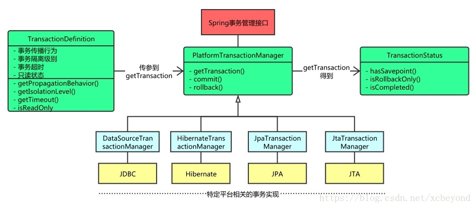
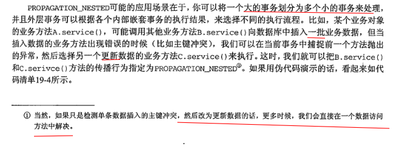
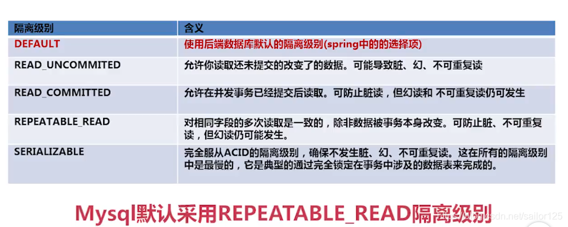
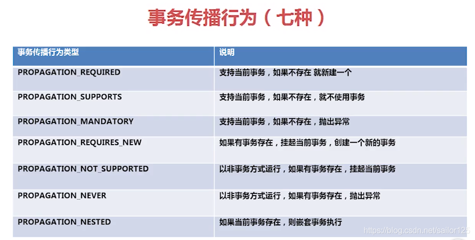

> 本文主要转载自<https://blog.csdn.net/qq_34491508/article/details/110056638>，详细介绍了 Spring 对各数据库的封装，以及如何在 Spring Boot 中使用事务。更多有关事务的概念可以参考秋迟的另一篇文章[事务的原理](../data/03data_transaction.md)。@qiuchi

# Spring Boot 中的事务

## 一、事务处理

### 1、Spring Boot事务介绍

Spring采用**统一的机制**来处理不同的数据访问技术的事务， Spring的事务提供一个 `PlatformTransactionManager` 的接口，不同的数据访问技术使用不同的接口实现。

| Data Tech  |                              |
| ---------- | ---------------------------- |
| JDBC       | DataSourceTransactionManager |
| JPA        | JPATransactionManager        |
| Hibernate  | HibernateTransactionManager  |
| JDO        | JDOTransactionManager        |
| 分布式事务 | JtaTransactionManager        |

涉及到接口关系如下：





接口 PlatformTransactionManager 源码如下：

```java
/*
 * Copyright 2002-2012 the original author or authors.
 *
 * Licensed under the Apache License, Version 2.0 (the "License");
 * you may not use this file except in compliance with the License.
 * You may obtain a copy of the License at
 *
 *      http://www.apache.org/licenses/LICENSE-2.0
 *
 * Unless required by applicable law or agreed to in writing, software
 * distributed under the License is distributed on an "AS IS" BASIS,
 * WITHOUT WARRANTIES OR CONDITIONS OF ANY KIND, either express or implied.
 * See the License for the specific language governing permissions and
 * limitations under the License.
 */
 
package org.springframework.transaction;
 
import org.springframework.lang.Nullable;
 
/**
 * This is the central interface in Spring's transaction infrastructure.
 * Applications can use this directly, but it is not primarily meant as API:
 * Typically, applications will work with either TransactionTemplate or
 * declarative transaction demarcation through AOP.
 *
 * <p>For implementors, it is recommended to derive from the provided
 * {@link org.springframework.transaction.support.AbstractPlatformTransactionManager}
 * class, which pre-implements the defined propagation behavior and takes care
 * of transaction synchronization handling. Subclasses have to implement
 * template methods for specific states of the underlying transaction,
 * for example: begin, suspend, resume, commit.
 *
 * <p>The default implementations of this strategy interface are
 * {@link org.springframework.transaction.jta.JtaTransactionManager} and
 * {@link org.springframework.jdbc.datasource.DataSourceTransactionManager},
 * which can serve as an implementation guide for other transaction strategies.
 *
 * @author Rod Johnson
 * @author Juergen Hoeller
 * @since 16.05.2003
 * @see org.springframework.transaction.support.TransactionTemplate
 * @see org.springframework.transaction.interceptor.TransactionInterceptor
 * @see org.springframework.transaction.interceptor.TransactionProxyFactoryBean
 */
public interface PlatformTransactionManager {
 
	/**
	 * Return a currently active transaction or create a new one, according to
	 * the specified propagation behavior.
	 * <p>Note that parameters like isolation level or timeout will only be applied
	 * to new transactions, and thus be ignored when participating in active ones.
	 * <p>Furthermore, not all transaction definition settings will be supported
	 * by every transaction manager: A proper transaction manager implementation
	 * should throw an exception when unsupported settings are encountered.
	 * <p>An exception to the above rule is the read-only flag, which should be
	 * ignored if no explicit read-only mode is supported. Essentially, the
	 * read-only flag is just a hint for potential optimization.
	 * @param definition TransactionDefinition instance (can be {@code null} for defaults),
	 * describing propagation behavior, isolation level, timeout etc.
	 * @return transaction status object representing the new or current transaction
	 * @throws TransactionException in case of lookup, creation, or system errors
	 * @throws IllegalTransactionStateException if the given transaction definition
	 * cannot be executed (for example, if a currently active transaction is in
	 * conflict with the specified propagation behavior)
	 * @see TransactionDefinition#getPropagationBehavior
	 * @see TransactionDefinition#getIsolationLevel
	 * @see TransactionDefinition#getTimeout
	 * @see TransactionDefinition#isReadOnly
	 */
	TransactionStatus getTransaction(@Nullable TransactionDefinition definition) throws TransactionException;
 
	/**
	 * Commit the given transaction, with regard to its status. If the transaction
	 * has been marked rollback-only programmatically, perform a rollback.
	 * <p>If the transaction wasn't a new one, omit the commit for proper
	 * participation in the surrounding transaction. If a previous transaction
	 * has been suspended to be able to create a new one, resume the previous
	 * transaction after committing the new one.
	 * <p>Note that when the commit call completes, no matter if normally or
	 * throwing an exception, the transaction must be fully completed and
	 * cleaned up. No rollback call should be expected in such a case.
	 * <p>If this method throws an exception other than a TransactionException,
	 * then some before-commit error caused the commit attempt to fail. For
	 * example, an O/R Mapping tool might have tried to flush changes to the
	 * database right before commit, with the resulting DataAccessException
	 * causing the transaction to fail. The original exception will be
	 * propagated to the caller of this commit method in such a case.
	 * @param status object returned by the {@code getTransaction} method
	 * @throws UnexpectedRollbackException in case of an unexpected rollback
	 * that the transaction coordinator initiated
	 * @throws HeuristicCompletionException in case of a transaction failure
	 * caused by a heuristic decision on the side of the transaction coordinator
	 * @throws TransactionSystemException in case of commit or system errors
	 * (typically caused by fundamental resource failures)
	 * @throws IllegalTransactionStateException if the given transaction
	 * is already completed (that is, committed or rolled back)
	 * @see TransactionStatus#setRollbackOnly
	 */
	void commit(TransactionStatus status) throws TransactionException;
 
	/**
	 * Perform a rollback of the given transaction.
	 * <p>If the transaction wasn't a new one, just set it rollback-only for proper
	 * participation in the surrounding transaction. If a previous transaction
	 * has been suspended to be able to create a new one, resume the previous
	 * transaction after rolling back the new one.
	 * <p><b>Do not call rollback on a transaction if commit threw an exception.</b>
	 * The transaction will already have been completed and cleaned up when commit
	 * returns, even in case of a commit exception. Consequently, a rollback call
	 * after commit failure will lead to an IllegalTransactionStateException.
	 * @param status object returned by the {@code getTransaction} method
	 * @throws TransactionSystemException in case of rollback or system errors
	 * (typically caused by fundamental resource failures)
	 * @throws IllegalTransactionStateException if the given transaction
	 * is already completed (that is, committed or rolled back)
	 */
	void rollback(TransactionStatus status) throws TransactionException;
 
}
```

### 2. @Transactional

Spring提供一个@EnableTransactionManagement注解在配置类上开启声明式事务支持， 自动扫描加了@Transactional注解的类和方法，加入事务支持。

而得益于 SpringBoot 的自动配置机制，为我们自动开启了声明式事务支持， 我们无需添加注解 @EnableTransactionManagement。

**@Transactional注解的几个属性：**

#### propagation
事务的传播机制，主要有以下几种，默认是REQUIRED：

* REQUIRED - 方法A调用时候没有事务新建一个事务，在方法A中调用方法B，将使用相同的事务，如果方法B发生异常需要回滚，整个事务回滚。
* REQUIRES_NEW - 方法A调用方法B时，无论是否存在事务都开启一个新事务，这样B方法异常不会导致A的数据回滚。
* NESTED - 和REQUIRES_NEW类似，但是只支持JDBC，不支持JPA或Hibernate
* SUPPORTS - 方法调用时有事务就用事务，没事务就不用事务
* NOT_SUPPORTED - 强制方法不在事务中执行，若有事务，在方法调用到结束阶段先挂起事务。
* NEVER - 强制不能有事务，若有事务就抛出异常
* MANDATORY - 强制必须有事务，如果没有事务就抛出异常

#### isolation

事务的隔离级别，决定了事务的完整性，主要一下几种，默认是DEFAULT：

* READ_UNCOMMITTED - A事务修改记录但没提交，B事务可读取到修改后的值。可导致脏读、不可重复读、幻读。
* READ_COMMITTED - A事务修改并提交后，B事务才能读取到修改后的值，阻止了脏读，但可能导致不可重复读和幻读。
* REPEATABLE_READ - A事务读取了一条记录，B事务将不能修改这条记录，阻止脏读和不可重复读，但是可能出现幻读。
* SERIALIZABLE - 事务是顺序执行的，可避免所有缺陷，但是开销很大。
* DEFAULT - 使用当前数据库默认隔离级别，入Oracle、SQL Server是READ_COMMITTED，MySQL是REPEATABLE_READ

#### **timeout**

事务过期时间，默认是当前数据库默认事务过期时间。

#### readOnly

指定是否为只读事务，默认是 false。

如果你一次执行单条查询语句，则没有必要启用事务支持，数据库默认支持SQL执行期间的读一致性；

如果你一次执行多条查询语句，例如统计查询，报表查询，在这种场景下，多条查询SQL必须保证整体的读一致性， 否则，在前条SQL查询之后，后条SQL查询之前，数据被其他用户改变，则该次整体的统计查询将会出现读数据不一致的状态， 此时，应该启用只读事务支持。

只读事务与读写事务区别：

对于只读查询，可以指定事务类型为 readOnly，即只读事务。由于只读事务不存在数据的修改， 因此数据库将会为只读事务提供一些优化手段，例如 Oracle 对于只读事务，不启动回滚段，不记录回滚log。
#### **rollbackFor**

指定哪些异常可以导致事务回滚，默认是 Throwable 的子类

#### **noRollbackFor**

执行哪些异常不可用引起事务回滚，默认是 Throwable 的子类

以下为Transactional源码：

```java
package org.springframework.transaction.annotation;
 
import java.lang.annotation.Documented;
import java.lang.annotation.ElementType;
import java.lang.annotation.Inherited;
import java.lang.annotation.Retention;
import java.lang.annotation.RetentionPolicy;
import java.lang.annotation.Target;
 
import org.springframework.core.annotation.AliasFor;
import org.springframework.transaction.TransactionDefinition;
 
 
@Target({ElementType.METHOD, ElementType.TYPE})
@Retention(RetentionPolicy.RUNTIME)
@Inherited
@Documented
public @interface Transactional {
 
	@AliasFor("transactionManager")
	String value() default "";
	
	@AliasFor("value")
	String transactionManager() default "";
	
	Propagation propagation() default Propagation.REQUIRED;
 
	Isolation isolation() default Isolation.DEFAULT;
 
	int timeout() default TransactionDefinition.TIMEOUT_DEFAULT;
 
	boolean readOnly() default false;
 
	Class<? extends Throwable>[] rollbackFor() default {};
 
	String[] rollbackForClassName() default {};
	
	Class<? extends Throwable>[] noRollbackFor() default {};
 
	String[] noRollbackForClassName() default {};
}
```

### 3. 事务失效的原因
Spring Boot是默认启动事务的，只需要在类或者方法上添加 @Transactional 注解即可，但有时候会发现事务不生效，具体原因可以从以下几个方面找寻：

**外部原因：**

1. 数据库支持事务。比如MySQL 5.5.5 开始的默认存储引擎是 InnoDB（支持事务），而以前默认的都是 MyISAM（不支持事务）。

2. 如果是 Spring ，需要数据源配置事务管理器

   * 开启配置文件:

     ```
     transaction: 
     	rollback-on-commit-failure: true
     ```

   * 启动类中加入注解

   > @EnableTransactionManagement

**内部原因：**

1. 通过 Spring 管理：

   * 调用事务的类要是 Bean，这样 Spring 才能加载
   * 需经 Spring 的代理类，默认只有在外部调用事务才会生效。即自身调用不生效
   * 方法是 public，不是的话，需要可以开启 AspectJ 代理模式

2. 事务：

   * 注意注解：@Transactional(propagation = Propagation.NOT_SUPPORTED)的意思是不支持事务

   * 默认只回滚Error与RuntimeException异常。

   * 如果想回滚checked异常或自定义的Exception，需要如下设置

     ```java
     @Transactional(rollbackFor = Exception.class)
     ```

3. 代码：

   * 是否进行了异常捕获，如果使用了try--catch，事务是肯定不生效，也就是系统没有接收到异常场景；
   

### 4. 并发主键冲突问题

对于并发事务：事务 1 查询某一条记录发现没有，开始对其 insert 。但此时事务 2 已经锁住了这个记录，事务 2 也正在 insert 这条记录。 就需要事务 2 释放锁。释放之后，事务1进行 insert，此时由于记录已存在，主键冲突，就会抛出错误。（实际上是幻读的问题）

（比如 Oracle 默认隔离机制，已提交读就会出现这个问题；MySQL 的可重复读也会出现。）

* 解决方法：捕获主键冲突异常，然后进行 update。

```java
    private void saveLdPerson(LDPersonVo vo) {
        LDPerson ldPerson = XXmlUtil.getNewObject(vo, LDPerson.class);
        int count = ldPersonMapper.countByPrimaryKey(ldPerson.getCustomerno());
        if (count == 0) {
            //防止并发
            try {
                ldPersonMapper.insert(ldPerson);
            } catch (DuplicateKeyException e) {
                ldPersonMapper.updateByPrimaryKey(ldPerson);
            }
        } else {
            ldPersonMapper.updateByPrimaryKey(ldPerson);
        }
    }
```


> 参考《Spring揭秘》379页。
>
> 

如果是MySQL，可以参考下面这个文章：

​	https://blog.csdn.net/java_zhangshuai/article/details/83273520

## 二、全局事务

采用 AOP 对项目进行全局异常事务处理

```java
@Aspect
@Configuration
public class TransactionAdviceConfig {
	
	private static final String AOP_POINTCUT_EXPRESSION = "execution(* demo.service.impl.*.*(..))";
 
	@Autowired
	private PlatformTransactionManager transactionManager;
 
	@Bean
	public TransactionInterceptor txAdvice() {
 
		DefaultTransactionAttribute txAttr_REQUIRED = new DefaultTransactionAttribute();
		txAttr_REQUIRED.setPropagationBehavior(TransactionDefinition.PROPAGATION_REQUIRED);
 
		DefaultTransactionAttribute txAttr_REQUIRED_READONLY = new DefaultTransactionAttribute();
		txAttr_REQUIRED_READONLY.setPropagationBehavior(TransactionDefinition.PROPAGATION_REQUIRED);
		txAttr_REQUIRED_READONLY.setReadOnly(true);
 
		NameMatchTransactionAttributeSource source = new NameMatchTransactionAttributeSource();
		source.addTransactionalMethod("add*", txAttr_REQUIRED);
		source.addTransactionalMethod("delete*", txAttr_REQUIRED);
		source.addTransactionalMethod("update*", txAttr_REQUIRED);
		source.addTransactionalMethod("select*", txAttr_REQUIRED_READONLY);
		source.addTransactionalMethod("likeSelect*", txAttr_REQUIRED_READONLY);
		return new TransactionInterceptor(transactionManager, source);
	}
 
	@Bean
	public Advisor txAdviceAdvisor() {
		AspectJExpressionPointcut pointcut = new AspectJExpressionPointcut();
		pointcut.setExpression(AOP_POINTCUT_EXPRESSION);
		return new DefaultPointcutAdvisor(pointcut, txAdvice());
	}
}
```

## 三、扩展

**隔离级别**



**传播行为**



自我调用解决：https://wenku.baidu.com/view/95f34168862458fb770bf78a6529647d2728341f.html

使用事务要注意：https://blog.csdn.net/qq_42008300/article/details/121093568

事务建议加在实现而不是方法上：https://blog.csdn.net/qq_39654841/article/details/123914446

默认回滚的异常：https://blog.csdn.net/comphoner/article/details/123288994

## 参考链接

* https://www.cnblogs.com/cuilp3000/p/15356686.html