# Java 基础知识

## 数据类型

Java语言提供了八种基本类型。六种数字类型（**即数值型**）(四个整数型，两个[浮点](https://so.csdn.net/so/search?q=浮点&spm=1001.2101.3001.7020)型)，一种**字符型**，还有一种**布尔型**。

基本类型都有对应的包装类型，基本类型与其对应的包装类型之间的赋值使用自动装箱与拆箱完成。

```java
Integer x = 2;     // 装箱
int y = x;         // 拆箱
```

### 基本类型与包装器对照

|          | 类型                                                         | 后缀 | 大小（字节） | 包装器（wrapper） |
| -------- | ------------------------------------------------------------ | ---- | ------------ | ----------------- |
| 整型     | byte                                                         |      | 1            | Byte              |
|          | short                                                        |      | 2            | Short             |
|          | int                                                          |      | 4            | Integer           |
|          | long                                                         | L、l | 8            | Long              |
|          |                                                              |      |              |                   |
| 浮点类型 | float                                                        | F、f | 4            | Float             |
|          | double(默认)                                                 | D、d | 8            | Double            |
|          | 三个特殊：<br />Double.POSITIVE_INFINITY<br />Double.NEGATIVE_INFINITY<br />Double.NaN     if(Double.isNaN(x)) |      |              |                   |
|          |                                                              |      |              |                   |
|          | char                                                         |      |              | Character         |
|          |                                                              |      |              |                   |
|          | boolean                                                      |      |              | Boolean           |

### 各进制前缀

16进制：前缀prefix 0x或0X

8进制：前缀 prefix 0

自Java7：

* 二进制前缀：0b或0B ；如 0b1001 代表十进制的 9
* 可以数字字面量加下划线，如1_000_000 表示100万（下划线只是为了容易读，编译器会去掉）

> Java在任意机器，整型范围一样：易移植

> 数值计算不允许误差：使用 BigDecimal

### 装箱与拆箱

1. 拆箱装箱是**编译器做的工作**，会在生成字节码时插入必要的方法调用。

2. **装箱**就是 自动将**基本数据类型**转换为**包装器类型**；

   **拆箱**就是 自动将包装器类型转换为基本数据类型。

3. **装箱**过程是通过调用包装器的 **valueOf方法** 实现的，而 **拆箱** 过程是通过调用包装器的 **xxxValue** 方法实现的。（xxx代表对应的基本数据类型）。

   如：装箱：Integer.valueOf(int) 方法。拆箱: Integer 的 intValue 方法。

### **包装器（wrapper）类**

* 包装器类都是 final 类，不能派生
* 不可变的，一但构造，不允许更改其中的值（如果有新的，有些是new，有些是cache里拿来呗（比如Integer[-128,127]），反正就那么多的数据）
* 使用注意：**警惕 null**

> 所以包装器类也无法实现 修改数值参数的方法。
>
> 	若想，试着holder类型。如使用IntHolder,BooleanHolder的字段value访问存储的值。

```java
//不可变   
public void integerTest(){
        Integer x = 1;//x:Integer@6735 
        x=x*10;//x:Integer@8489。这里 x 指向了 cache 中的地址 Integer@8489，值是10；而地址 Integer@6735 的值依然是 1。
        System.out.println(x);//10
    }
```

### **自动装箱（autoboxing）**

尖括号里参数类型不允许是基本类型，所以需要用到包装器。

* 举例：

  ```java
  var list=new ArrayList<Integer>();
  list.add(3); //其中包括自动装箱：list.add(Integer.valueOf(3))
  ```

### **自动拆箱**

* 数组列表

```java
int n = list.get(i);//其中自动拆箱：int n=list.get(i).intValue();
```

* 用于算术表达式

  ```java
  Integer n = 3;
  n++;
  ```

> 对于表达式混用 Integer、Double: Integer 拆箱，提升为 double ,再装箱为 Double ,两个 Double 再拆箱计算。
>
> 如：
>
> ```java
> Integer x = 10;
> Double y = 2.0;
> Double z = x + y ;
> ```

### 缓存池

new Integer(123) 与 Integer.valueOf(123) 的区别在于:

- new Integer(123) 每次都会新建一个对象
- Integer.valueOf(123) 会使用缓存池中的对象，多次调用会取得同一个对象的引用。

```java
Integer x = new Integer(123);
Integer y = new Integer(123);
System.out.println(x == y);    // false
Integer z = Integer.valueOf(123);
Integer k = Integer.valueOf(123);
System.out.println(z == k);   // true
```

valueOf() 方法的实现比较简单，就是先判断值是否在缓存池中，如果在的话就直接返回缓存池的内容。

```java
public static Integer valueOf(int i) {
    if (i >= IntegerCache.low && i <= IntegerCache.high)
        return IntegerCache.cache[i + (-IntegerCache.low)];
    return new Integer(i);
}
```

在 Java 8 中，Integer 缓存池的大小默认为 -128~127。

```java
static final int low = -128;
static final int high;
static final Integer cache[];

static {
    // high value may be configured by property
    int h = 127;
    String integerCacheHighPropValue =
        sun.misc.VM.getSavedProperty("java.lang.Integer.IntegerCache.high");
    if (integerCacheHighPropValue != null) {
        try {
            int i = parseInt(integerCacheHighPropValue);
            i = Math.max(i, 127);
            // Maximum array size is Integer.MAX_VALUE
            h = Math.min(i, Integer.MAX_VALUE - (-low) -1);
        } catch( NumberFormatException nfe) {
            // If the property cannot be parsed into an int, ignore it.
        }
    }
    high = h;

    cache = new Integer[(high - low) + 1];
    int j = low;
    for(int k = 0; k < cache.length; k++)
        cache[k] = new Integer(j++);

    // range [-128, 127] must be interned (JLS7 5.1.7)
    assert IntegerCache.high >= 127;
}
```

编译器会**在缓冲池范围内的基本类型**自动装箱过程调用 valueOf() 方法，因此多个 Integer 实例使用自动装箱来创建并且值相同，那么就会引用相同的对象。

```java
Integer m = 123;
Integer n = 123;
System.out.println(m == n); // true
```

基本类型对应的缓冲池如下:

- boolean values true and false【true,false】
- all byte values （即[-128,127]）
- short values between -128 and 127（即[-128,127]）
- int values between -128 and 127（即[-128,127]）
- long values between -128 and 127（即[-128,127]）
- char in the range \u0000 to \u007F（十进制对应 [0,127] ）


> * Integer、Short、Byte、Character、Long这几个类的 valueOf 方法的实现是类似的，会拥有 cache。
>
> * Double、Float的 valueOf 方法的实现是类似的，都是产生新的对象，不使用缓存池。原因很简单：在某个范围内的整型数值的个数是有限的，而浮点数却不是。
>
> ##### Float.valueOf("123");
>
> ```java
> public static Float valueOf(String s) throws NumberFormatException {
>     return new Float(parseFloat(s));
> }
> ```
>
> 直接返回new Float无缓存池。
>
> ##### Double.valueOf("123");
>
> ```java
> public static Double valueOf(String s) throws NumberFormatException {
>     return new Double(parseDouble(s));
> }
> ```
>
> 直接返回new Double无返回值。
>
> * 对于Boolean类型：
>
> ```java
> Boolean i1 = false;
> Boolean i2 = false;
> Boolean i3 = true;
> Boolean i4 = true;
> 
> System.out.println(i1==i2);//true
> System.out.println(i3==i4);//true
> ```
>
> 至于为什么是这个结果，同样地，看了 Boolean 类的源码也会一目了然。下面是 Boolean 的 valueOf 方法的具体实现：
>
> ```java
> public static Boolean valueOf(boolean b) {
>         return (b ? TRUE : FALSE);
>     }
> ```
>
> 　　而其中的 TRUE 和FALSE又是什么呢？在 Boolean 中定义了2个静态成员属性：
>
> ```java
>  public static final Boolean TRUE = new Boolean(true);
> 
>     /** 
>      * The <code>Boolean</code> object corresponding to the primitive 
>      * value <code>false</code>. 
>      */
>     public static final Boolean FALSE = new Boolean(false); 
> ```


如果在缓冲池之外：

```java
Integer m = 323;
Integer n = 323;
System.out.println(m == n); // false     
```


### 装箱拆箱举例

```java
public class Main {
    public static void main(String[] args) {
         
        Integer a = 1;
        Integer b = 2;
        Integer c = 3;
        Integer d = 3;
        Integer e = 321;
        Integer f = 321;
        Long g = 3L;
        Long h = 2L;
         
        System.out.println(c==d);//true
        System.out.println(e==f);//false 不是[-128,127]范围
        System.out.println(c==(a+b));//true 左边拆箱，右边拆箱，加；比较数值
        System.out.println(c.equals(a+b));//true a、b拆箱，加，装箱为Integer，再equals
        System.out.println(g==(a+b));//true 
        System.out.println(g.equals(a+b));//false 因为a+b装箱为Integer,g是Long。
        System.out.println(g.equals(a+h));//true
    }
}
```

g==a+b字节码如下：等号左边g拆箱为long，等号右边拆箱为int。右边相加，再判断。

> ```
> true
> ```

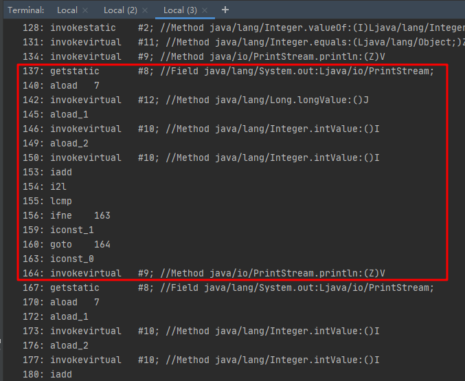


下面是 g.equals(a+b）字节码：先两个 Integer 拆箱为 int，然后 int+int 加法计算 ,**再用 Integer 装箱**，然后再用 equals 比较。由于类型不同，得到 false。

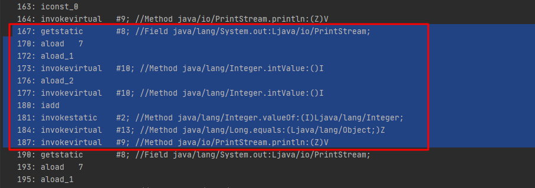

g.equals(a+h)：Integer+Long 分别拆箱为 int、long，然后加法计算 ,**再用Long装箱**，然后再用 equals 比较。Long 装箱时，使用cache，所以得到true。

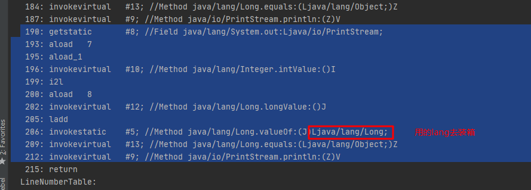

###  变量初始化问题

* 成员变量：在创建时，系统会为其分配一个默认值。
  	成员变量包括8种基本数据类型、引用类型、数组类型。引用与数组都是null。

* 局部变量：没有默认值（不管是什么类型。如果试图使用一个局部变量的值，而这个局部变量尚未初始化，就会产生编译错误。
* 数组：如果数组使用 new 在堆上分配了空间，则数组的元素就会获得默认值。

实例成员变量与静态成员变量默认值：

boolean: false 
 byte: 0 
 short: 0 
 char: 
 int: 0 
 long: 0 
 float: 0.0 
 double: 0.0 
 String: null 
 String[]: null

>  char: 默认值为“空字符”，也就是‘\u0000’；(int) c==0

## String

### 概览

String 被声明为 final，因此它不可被继承。

内部使用 char 数组存储数据，该数组被声明为 final，这意味着 value 数组初始化之后就不能再引用其它数组。并且 String 内部没有改变 value 数组的方法，因此可以保证 String 不可变（Immutable）。

```java
public final class String
    implements java.io.Serializable, Comparable<String>, CharSequence {
    /** The value is used for character storage. */
    private final char value[];
```

### 不可变的好处

**1. 可以缓存 hash 值**

因为 String 的 hash 值经常被使用，例如 String 用做 HashMap 的 key。不可变的特性可以使得 **hash 值也不可变**，因此**只需要进行一次计算**。

**2. String Pool 的需要**

如果一个 String 对象已经被创建过了，那么就会从 String Pool 中取得引用。只有 String 是不可变的，才可能使用 String Pool。

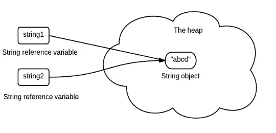

**3. 安全性**

String 经常作为参数，String 不可变性可以保证**参数不可变**。例如在作为网络连接参数的情况下如果 String 是可变的，那么在网络连接过程中，String 被改变，改变 String 对象的那一方以为现在连接的是其它主机，而实际情况却不一定是。

**4. 线程安全**

String 不可变性天生具备线程安全，可以在多个线程中安全地使用。

### String 作为形参传递无法改变内容

即上面安全性说的“保证参数不可变”。

```java
public class StringTest01 {
    private void changeString(String copy) {
        copy = "bbb";
        System.out.println("在changeString中值:"+copy);
    }    

    public static void main(String[] args) {
        String a = new String("a");
        StringTest01 stringTest01 = new StringTest01();
        stringTest01.changeString(a);
        System.out.println("结果：" + a);
    }

}
```

输出：

```
在changeString中值:bbb
结果：a
```

**原因：**

我们知道 Java 传参是值传递而非引用传递。**在调用 changeString（）方法时，方法得到的是对象引用的副本，原来的对象引用和这个副本都引用同一个对象。**

明确java方法参数可为与不可为：

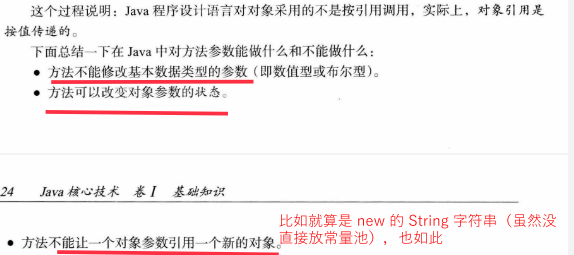

> 注：方法不能修饰基本数据类型的参数，也包括 char 类型。


由于 String 对象时不可变的，"bbb" 时会在常量池创建一个新的对象，然后 copy 会指向这个路径，但是 a 还是指向原来地址，所以数据不会修改。

这种情况属于上面的第三种情况，即“方法不能让一个对象参数引用一个新的对象。

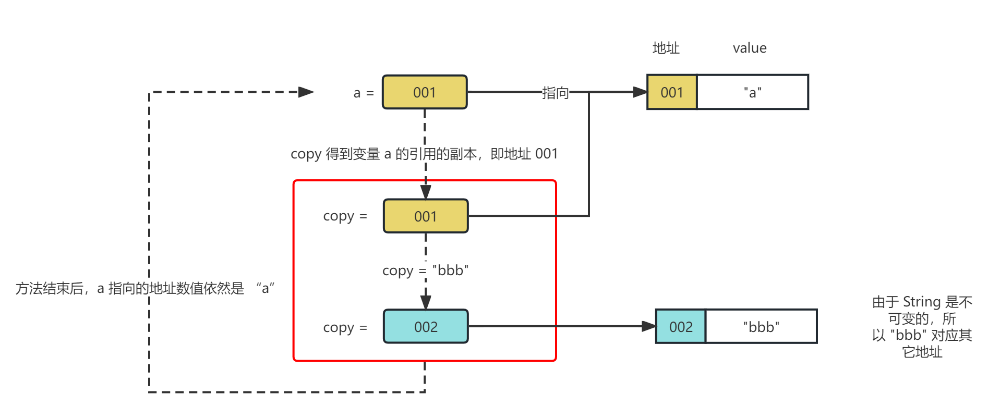


**如果上面代码中修改的不是 String 类型，而是 String[] 类型：**

```java
import java.util.Arrays;

public class StringTest01 {

    private void changeObj(String[] copy) { 

        for (int i = 0; i < copy.length; i++) {
            copy[i] = "h";
        }
        
        System.out.println("在changeObj中值："+ Arrays.toString(copy));

    }

    public static void main(String[] args) {
        String[] arr={"1","2","3"};
        StringTest01 stringTest01 = new StringTest01();
        stringTest01.changeObj(arr);
        System.out.println("结果："+Arrays.toString(arr));
        
    }
}
```

输出：

```
在changeObj中值：[h, h, h]
结果：[h, h, h]
```

**原因：**

这是因为在修改如 arr[0] 的值时，数组所指地址没有变，当然可以循着这个地址，找到新的字符串对应位置。

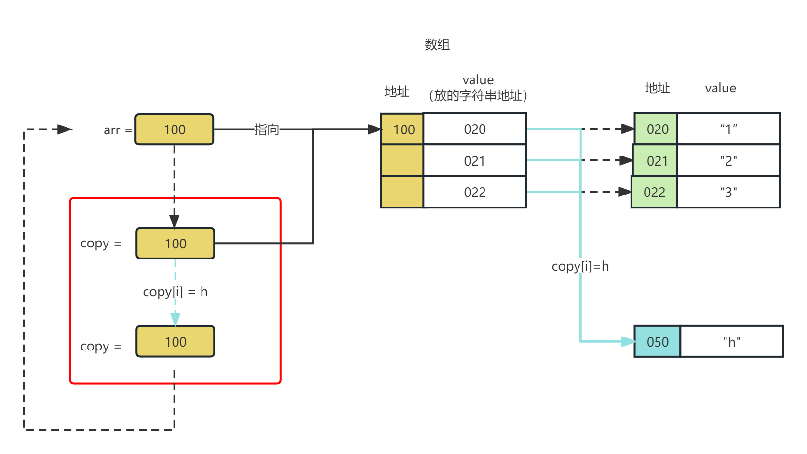


**注意：**

下面也无法修改 arr 里的值，这是因为 for-each 循环底层也是使用的参数的副本。所以出了这个循环后，arr 内值未变， changeObj 方法结束后自然也未变。

```java
    private void changeObj(String[] arr) { 
        for (String string : arr) {
            string = "h";
        }
        System.out.println("在changeObj中值："+ Arrays.toString(arr));
    }
```

输出：

```
在changeObj中值：[1, 2, 3]
结果：[1, 2, 3]
```


### Java空字符串与 null 的区别

1、类型
null 表示的是一个**对象的值**，而并不是一个字符串。例如声明一个对象的引用，String a = null  ;
"" 表示的是一个**空字符串**，也就是说它的长度为0。例如声明一个字符串String str = "" ;

2、内存分配
String str = null ;  表示声明一个字符串对象的引用，但指向为null，也就是说还**没有指向任何的内存空间**；
String str = "";   表示声明一个字符串类型的引用，其值为""空字符串，这个str引用指向的是**空字符串的内存空间**；

在 java 中变量和引用变量是存在栈中（stack），而对象（new产生的）都是存放在堆中（heap）：

就如下：

String str = new String("abc") ;

ps：= 左边的是存放在栈中（stack），= 右边是存放在堆中（heap）。

```java
	public static void main(String[] args) {
		String[] str1 = new String[10];
        String str2 = null ;
        int[] s = new int[10];
        String str3 = "" ;
        String str4 = null ;
        String str5 = new String() ;
    }
```

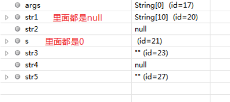

- 空字符串与对象为 null 的值不相等，且内存地址也不相等；
- new String() 创建一个字符串对象的默认值为"" （String 类型成员变量的初始值为 null）

 

### Java 判断字符串是否为空的四种方法

方法一: 最多人使用的一个方法, 直观, 方便, 但效率很低:

           if(s == null || s.equals(""));

方法二: 比较字符串长度, 效率高,  是我知道的最好一个方法:

           if(s == null || s.length() == 0);

方法三: Java SE 6.0  才开始提供的方法, 效率和方法二几乎相等, 若考虑兼容性, 则推荐使用方法二.

           if(s == null || s.isEmpty());

方法四: 这是一种比较直观,简便的方法,而且效率也非常的高,与方法二、三的效率差不多:

           if (s == null || s == "");

 **注意：**s == null 是有必要存在的.

　　如果 String 类型为null, 而去进行 equals(String) 或 length()  等操作会抛出java.lang.NullPointerException.

　　并且s==null 的顺序必须出现在前面，不然同样会抛出java.lang.NullPointerException.

　　如下Java代码:

```java
　　String str = null;
　　if(str.equals("") || str == null){//会抛出异常
　　          System.out.println("success");
　　}
```

### 可变长度参数列表

String… 是java5新加入的功能，表示的是一个可变长度的参数列表。
**语法：**

​		类型后跟 …

**含义：**

​		表示此处接受的参数为 **0 到多个** Object 类型的对象，或者是**一个 Object[]**。 

**注意：**

​		如果我们有一个方法叫做 test(String…strings)，那么你**还可以写方法 test()**，但你**不能写 test(String[] strings)**，这样会出编译错误，系统提示出现重复的方法。

**使用：**

​		对于 test(String…strings)，你可以直接用 **test() 去调用，表示没有参数**，也可以用 test(“aaa”)，也可以用 test(new String[]{“aaa”,”bbb”})。另外如果既有 test(String…strings) 函数，**又有 test()函数 **，我们在调用 test() 时，会**优先使用 test() 函数**。只有当没有 test() 函数式，我们调用 test() ，程序才会走 test(String…strings)。

----

即：

* 书写：test(String…strings)；此时还可以写方法test()**，但你**不能写 test(String[] strings)
* 调用方式：test()；test(“aaa”)；test(new String[]{“aaa”,”bbb”})
* 使用test()调用时：优先调用test()函数，若没有则调用test(String…strings)

**举例：**

```java
//ArrayList<String>-->字符串数组
String[] cmdarray = command.toArray(new String[command.size()]);
//字符串数组-->可变长度的参数列表-->ArrayList<String>
String[] cmdarray=['h','j','ki'];
ProcessBuilder(cmdarray)
public ProcessBuilder(String... command) {
       this.command = new ArrayList<String>(command.length);
       for (String arg : command)
           this.command.add(arg);
    }
```

### StringBuilder 还是 StringBuffer

在无并发情况下，建议StringBuilder 。

| String               | StringBuilder    | StringBuffer                                     |
| -------------------- | ---------------- | ------------------------------------------------ |
| 不可变序列           | 可变序列         | 可变序列                                         |
| 线程安全             | 异步，线程不安全 | 内部使用 synchronized 同步，有锁很慢。线程安全。 |
| 复用性高（在常量池） |                  |                                                  |

三者底层都是使用char[]。

如果我们对String做大量修改，会导致大量副本字符串存留在内存中，降低效率，当无并发，建议**StringBuilder** 。

### String.intern()

使用 String.intern() 可以保证**相同内容的字符串变量引用同一的内存对象**。

下面示例中，s1 和 s2 采用 new String() 的方式新建了**两个不同对象**，而 s3 是通过 s1.intern() 方法取得一个对象引用。**intern() 首先把 s1 引用的对象放到 String Pool(字符串常量池)中，然后返回这个对象引用**。因此 s3 和 s1 引用的是同一个字符串常量池的对象。

```java
String s1 = new String("aaa");
String s2 = new String("aaa");
System.out.println(s1 == s2);           // false
String s3 = s1.intern();
System.out.println(s1.intern() == s3);  // true
```

如果是采用 "bbb" 这种使用双引号的形式创建字符串实例，会**自动地将新建的对象放入 String Pool** 中。

```java
String s4 = "bbb";
String s5 = "bbb";
System.out.println(s4 == s5);  // true
```

- **HotSpot中字符串常量池保存哪里？永久代？方法区还是堆区**？

1. 运行时常量池（Runtime Constant Pool）是虚拟机规范中是方法区的一部分，在加载类和结构到虚拟机后，就会创建对应的运行时常量池；而字符串常量池是这个过程中常量字符串的存放位置。所以从这个角度，字符串常量池属于虚拟机规范中的方法区，它是一个**逻辑上的概念**；而堆区，永久代以及元空间是实际的存放位置。
2. 不同的虚拟机对虚拟机的规范（比如方法区）是不一样的，只有 HotSpot 才有永久代的概念。
3. HotSpot也是发展的，由于[一些问题在新窗口打开](http://openjdk.java.net/jeps/122)的存在，HotSpot考虑逐渐去永久代，对于不同版本的JDK，**实际的存储位置**是有差异的，具体看如下表格：

| JDK版本      | 是否有永久代，字符串常量池放在哪里？                         | 方法区逻辑上规范，由哪些实际的部分实现的？                   |
| ------------ | ------------------------------------------------------------ | ------------------------------------------------------------ |
| jdk1.6及之前 | 有永久代，运行时常量池（包括字符串常量池），静态变量存放在永久代上 | 这个时期方法区在HotSpot中是由永久代来实现的，以至于**这个时期说方法区就是指永久代** |
| jdk1.7       | 有永久代，但已经逐步“去永久代”，字符串常量池、静态变量移除，保存在堆中； | 这个时期方法区在HotSpot中由**永久代**（类型信息、字段、方法、常量）和**堆**（字符串常量池、静态变量）共同实现 |
| jdk1.8及之后 | 取消永久代，类型信息、字段、方法、常量保存在本地内存的元空间，但字符串常量池、静态变量仍在堆中 | 这个时期方法区在HotSpot中由本地内存的**元空间**（类型信息、字段、方法、常量）和**堆**（字符串常量池、静态变量）共同实现 |

### String比较

#### 一、公知结论

**1、 == 针对基本类型的数据，比较的是值；对于引用类型则比较内存地址（hashcode）
 2、equals方法，对于 String 类型的数据，因为 String 重写了此方法，比较的是值（byte[] value）**

> 字符串 new String，不会在常量池生成String，对于同一内容，此时用 ==，得到的值会是 FALSE。

#### 二、[字符串比较](https://so.csdn.net/so/search?q=字符串比较&spm=1001.2101.3001.7020)测试实验

1、**针对同一字符串，== 和 equals 没有区别**

```java
 //这里简化比较，即平常我们以字面量方式声明的变量
 String str1 = "hello world";
 String str2 = "hello world";
 
 // true，因为都指向同一内存地址（堆中的字符串常量池）
 System.out.println(str1 == str2); // true
 System.out.println(str1.equals(str2)); // true
```


2、**针对同一字符串，== 和equals 有区别**

```java
// data.txt中存储的数据为一行hello world!
URL url = ClassLoader.getSystemResource("data.txt");
try( BufferedReader data = new BufferedReader(new FileReader(url.getPath()))){
     String str1 = data.readLine(); // hello world!
     //String str1 = data.readLine().inter(); // str1 == str2 为true
     String str2 = "hello world!";
     
     /**
      * 可以想象http请求、io读取数据时，字符串的生成都是StringBuilder完成的，
      * 但不会在常量池中生成对应的字符串
      */
     System.out.println(str1 == str2); // false
     System.out.println(str1.equals(str2)); // true
 } catch (Exception e){
     //do nothing
 }
```


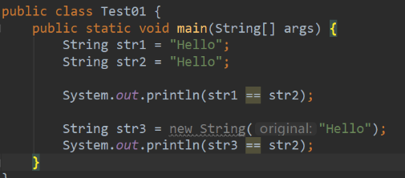

返回： true false;


## 运算

### 参数传递

Java 的参数是以**值传递**的形式传入方法中，而不是引用传递。

所以才会有上方 [](###String 作为形参传递无法改变内容) 的问题。

### float 与 double

1.1 字面量属于 double 类型，不能直接将 1.1 直接赋值给 float 变量，因为这是向下转型。Java 不能隐式执行向下转型，因为这会使得精度降低。

```java
// float f = 1.1;
```

1.1f 字面量才是 float 类型。

```java
float f = 1.1f;
```

### 隐式类型转换

因为字面量 1 是 int 类型，它比 short 类型精度要高，因此不能隐式地将 int 类型下转型为 short 类型。

```java
short s1 = 1;
// s1 = s1 + 1;
```

但是使用 += 运算符可以执行隐式类型转换。

```java
s1 += 1;
```

上面的语句相当于将 s1 + 1 的计算结果进行了向下转型:

```java
s1 = (short) (s1 + 1);
```

[StackOverflow : Why don't Java's +=, -=, *=, /= compound assignment operators require casting?](https://stackoverflow.com/questions/8710619/why-dont-javas-compound-assignment-operators-require-casting)

### switch

从 Java 7 开始，可以在 switch 条件判断语句中使用 String 对象。

```java
String s = "a";
switch (s) {
    case "a":
        System.out.println("aaa");
        break;
    case "b":
        System.out.println("bbb");
        break;
}
```

switch 不支持 long，是因为 switch 的设计初衷是对那些只有少数的几个值进行等值判断，如果值过于复杂，那么还是用 if 比较合适。

### 大数 BigDecimal

 1. `add` 方法不会改变自身的值，需要一个值去**接收**结果。

    ```java
    BigDecimal couTotalMoney = new BigDecimal("0.00");
    couTotalMoney.add(new BigDecimal("30"));//此时couTotalMoney=0
    ```

    ```java
    BigDecimal couTotalMoney = new BigDecimal("0.00");
    couTotalMoney=couTotalMoney.add(new BigDecimal("30"));//此时couTotalMoney=30
    ```

 2. 创建 BigDecimal 对象：

    **BigDecimal  bigDecimal = new  BigDecimal(xxx)**；其中，**xxx可以是整型数据，也可以是数字内容的字符串数据**，但不可以是浮点型数据，如：

    ```java
            BigDecimal couTotalMoney = new BigDecimal(7583.20);
            BigDecimal rBigDecimal=couTotalMoney.multiply(new BigDecimal(0.10));
            System.out.println(rBigDecimal.toString());//输出758.32000000000002390532216622886961865967839443643204173743643803362601829576306045055389404296875
    ```

    ```java
            BigDecimal couTotalMoney = new BigDecimal("7583.20");
            BigDecimal rBigDecimal=couTotalMoney.multiply(new BigDecimal("0.10"));
            System.out.println(rBigDecimal.toString());//输出758.3200
    ```

## 对象

### 泛型

#### 含义

Java 库使用:

* 变量E表示集合的元素类型
* K、V分别表示表的键和值的类型
* T(必要时还可以用相邻的字母U、S)表示任意类型

#### 泛型擦除

编译器进行。

类型变量会被擦除 (erased ，并替换为其限定类型（或者，对于无限定的变量则替换为 Object)。

原始类型用第一个限定来替换类型变量 ，或者，如果没有给定限定，就替换为 Object

#### 类的泛型

```java
public class Pa <T, U> {... }
```

调用：

```java
Pair<String,Integer>(String, String)
```

#### 方法的泛型

类型变量放在修饰符（这里 的修饰符就是 public static 的后面，并在返回类型的前面，比如：

```java
    public static <T> T getNewObject(Object obj, Class<T> cl) {
        Map<String, Object> map = HUtil.beanToMap(obj);
        Map<String, Object> newMap = MapUtil.newHashMap();
        for (Entry<String, Object> mmp : map.entrySet()) {
            String key = mmp.getKey().toLowerCase();
            newMap.put(key, mmp.getValue());
        }
        return JsonUtils.parse(JsonUtils.toJson(newMap), cl);
    }
```

调用

```java
String middle = ArrayAlg.<String>getMiddle( "John", "Q. ", "Public"); 
```

## 继承


### 访问权限

Java 中有三个**访问权限修饰符**: private、protected 以及 public，如果不加访问修饰符（即缺省，default），表示包级可见。

可以对类或类中的成员(字段以及方法)加上访问修饰符。

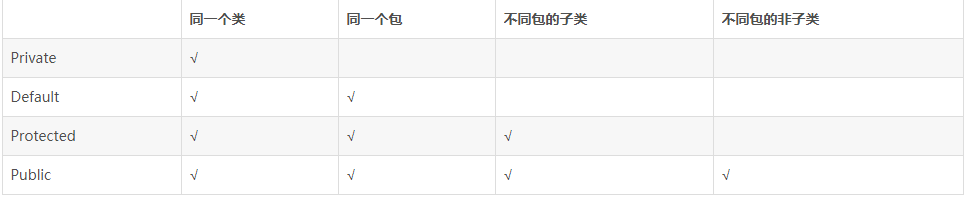

> 注意，表缺省时修饰符啥都不写，不要写 default。在java8 中，default 修饰符是用于接口的方法。

比如 protected：不同包下，可以通过子类访问。

* 包1

```java
package com.sinosoft.app.project.saveCont.service.shiyan2;

public class Parent {

    protected void save1() {
        System.out.println("我是father");
    }
}
```

* 包2

```java
package com.sinosoft.app.project.saveCont.service.shiyan;

import com.sinosoft.app.project.saveCont.service.shiyan2.Parent;

public class Sun extends Parent {
    public static void main(String[] args) {
        /*可以*/
        Sun sun = new Sun();
        sun.save1();
        /* 不可*/
        Parent parent = new Parent();
        parent.save1();
        /* 不可*/
        Parent parent1 = new Sun();
        parent1.save1();
    }
}
```

### 多态

一个对象变量可以指示多种实际类型的现象称为多态。

```java
Animal animal = new cat()
```

* 成员变量：编译、执行都看左边（父类）
  成员方法：**编译看左边，执行看右边**

  > animal 是引用类型变量
  >
  > 左边 Animal 类型被称为声明类型
  >
  > 右边 Cat 类型被称为实际类型
  
* 好处：扩展性
  弊端：不能使用子类特有成员（若想使用子类特有成员，需向下转型，转型完又不是多态了）

* 向上转型
  父类引用指向子类对象就是向上转型
  向下转型
  格式：子类型 对象名 = (子类型)父类引用;  

* 多态前提：

  要有继承或实现关系
  要有**方法的重写**
  要有**父类引用指向子类对象**  (或者说子类的引用赋给父类对象，即向上转型)

* **多态的形式**：具体类多态，抽象类多态，接口多态。

#### 绑定

将一个方法调用同这个方法所属的主体（也就是对象或类）关联起来，分前期绑定和后期绑定两种。

        前期绑定：在程序运行之前进行绑定，由编译器和连接程序实现，又叫做静态绑定。比如 static 方法和 final 方法，注意，这里也包括 private 方法，因为它是隐式 final 的。
        后期绑定：在运行时根据对象的类型进行绑定，由方法调用机制实现，因此又叫做动态绑定，或者运行时绑定。除了前期绑定外的所有方法都属于后期绑定。

多态就是在**后期绑定**这种机制上实现的。

多态给我们带来的好处是消除了类之间的耦合关系，使程序更容易扩展。

### 抽象与接口

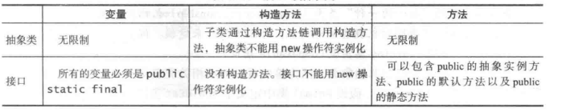

#### 抽象

```java
//抽象类的定义
public abstract class 类名 {}
//抽象方法的定义
public abstract void eat();
```

* 抽象类中不一定有抽象方法，有抽象方法的类一定是抽象类  

* 抽象类不能被实例化——与普通类最大区别

  * 需要继承抽象类才能实例化其子类，这叫抽象类多态：

    ```java
    public abstract class AbstractClassExample {
    
        protected int x;
        private int y;
    
        public abstract void func1();
    
        public void func2() {
            System.out.println("func2");
        }
    }
    ```

    ```java
    public class AbstractExtendClassExample extends AbstractClassExample {
        @Override
        public void func1() {
            System.out.println("func1");
        }
    }
    ```

    ```java
    // AbstractClassExample ac1 = new AbstractClassExample(); // 'AbstractClassExample' is abstract; cannot be instantiated
    AbstractClassExample ac2 = new AbstractExtendClassExample();
    ac2.func1();
    ```

    

* 抽象类的子类
  要么**重写**抽象类中的**所有**抽象方法
  要么是抽象类  

* 成员的特点
  成员变量：变量、常量

  构造方法：空参构造、有参构造

  成员方法：抽象方法、普通方法  

#### 接口

接口是抽象类的延伸，在 Java 8 之前，它可以看成是一个完全抽象的类，也就是说它不能有任何的方法实现。

从 Java 8 开始，接口也可以拥有默认的方法实现，这是因为不支持默认方法的接口的维护成本太高了。在 Java 8 之前，如果一个接口想要添加新的方法，那么要修改所有实现了该接口的类。

**成员特点**

* 成员变量：常量 默认修饰符：public static final
* 构造方法：没有，因为接口主要是扩展功能的，而没有具体存在
* 成员方法：抽象方法 默认修饰符：**public abstract**

> 成员变量与方法不允许定义为 private 或者 protected。

**接口的 default**

Java8 新增。表示在接口里面声明的方法，可以有默认的实现。其访问权限还是public。

```java
package com.sinosoft.app.project.saveCont.service.shiyan2;

import org.junit.Test;

public interface Impl1 {
    @Test
    default void save() {
        heh();
    }
    void heh();
}

```

----

第一种实现：

```java
package com.sinosoft.app.project.saveCont.service.shiyan;


import com.sinosoft.app.project.saveCont.service.shiyan2.Impl1;

public class Sun implements Impl1 {
    public static void main(String[] args) {
        Sun sun = new Sun();
        sun.save();//调用接口的save()
    }
    @Override
    public void heh() {
        System.out.println("我是非同包Sun");
    }
}
```

输出：

```
我是非同包Sun
```

----

第二种实现：

```java
package com.sinosoft.app.project.saveCont.service.shiyan;


import com.sinosoft.app.project.saveCont.service.shiyan2.Impl1;

public class Sun implements Impl1 {
    public static void main(String[] args) {
        Sun sun = new Sun();
        sun.save();//调用的是 Sun 的save()
    }

    @Override//实现类 Sun 重写了 save()
    public void save() {
        System.out.println("我是Sun的save");
    }

    @Override
    public void heh() {
        System.out.println("我是非同包Sun");
    }
}
```

输出：

```
我是Sun的save
```

#### 对比

- 从设计层面上看，抽象类提供了一种 IS-A 关系，那么就必须满足里式替换原则，即子类对象必须能够替换掉所有父类对象。而接口更像是一种 LIKE-A 关系，它只是提供一种方法实现契约，并不要求接口和实现接口的类具有 IS-A 关系。
- 从使用上来看，一个类可以实现多个接口，但是不能继承多个抽象类。
- 接口的字段只能是 static 和 final 类型的，而抽象类的字段没有这种限制。
- 接口的成员只能是 public 的，而抽象类的成员可以有多种访问权限。

#### 使用选择

使用接口:

- 需要让不相关的类都实现一个方法，例如不相关的类都可以实现 Compareable 接口中的 compareTo() 方法；
- 需要使用多重继承。

使用抽象类:

- 需要在几个相关的类中共享代码。
- 需要能控制继承来的成员的访问权限，而不是都为 public。
- 需要继承非静态和非常量字段。

在很多情况下，接口优先于抽象类，因为接口没有抽象类严格的类层次结构要求，可以灵活地为一个类添加行为。并且从 Java 8 开始，接口也可以有默认的方法实现，使得修改接口的成本也变的很低。

### 重写与重载

**1. 重写(Override)**

存在于继承体系中，指子类实现了一个与父类在方法声明上完全相同的一个方法。

为了满足里式替换原则，重写有以下两个限制:

- 子类方法的**访问权限**必须**大于等于父类方法**；
- 子类方法的**返回类型**必须是父类方法返回类型或为其**子类型**（Java1.5 版本之前返回值类型必须一样，后放开限制）。

> 使用 @Override 注解，可以让编译器帮忙检查是否满足上面的两个限制条件。

- 子类方法**不能抛出新的检査异常**或者比父类方法声明**更加宽泛的检査型异常**。
  例如，父类的一个方法声明了一个检査异常 IOException，在重写这个方法时就不能抛出 Exception，只能拋出 IOException 的子类异常，**可以抛出非检査异常**。

另外还要注意以下几条：

- 父类的成员方法只能被它的子类重写。
- 声明为 final 的方法不能被重写。
- 声明为 static 的方法不能被重写，但是能够再次声明。
- 构造方法不能被重写。
- 子类和父类在同一个包中时，子类可以重写父类的所有方法，除了声明为 private 和 final 的方法。
- 子类和父类不在同一个包中时，子类只能重写父类的声明为 public 和 protected 的非 final 方法。
- 如果不能继承一个方法，则不能重写这个方法。

**2. 重载(Overload)**

存在于同一个类中，指一个方法与已经存在的方法名称上相同，但是**参数类型、个数、顺序至少有一个不同**。

应该注意的是，**返回值不同，其它都相同不算是重载**。

| 区别           | 重写方法                                                     | 重载方法     |
| -------------- | ------------------------------------------------------------ | ------------ |
| 发生范围       | 子类中                                                       | 同一个类     |
| 参数列表       | 不能修改                                                     | **必须修改** |
| 返回类型       | 父类方法返回类型或为其**子类型**                             | 可修改       |
| 异常           | 可减少或删除，可抛出非检查异常，不能抛出新的或更广的检查型异常 | 可修改       |
| 访问权限修饰符 | 大于等于父类方法                                             | 可修改       |
| 发生阶段       | 运行期                                                       | 编译器       |

## Object 通用方法

### 概览

```java
public final native Class<?> getClass()

public native int hashCode()

public boolean equals(Object obj)

protected native Object clone() throws CloneNotSupportedException

public String toString()

public final native void notify()

public final native void notifyAll()

public final native void wait(long timeout) throws InterruptedException

public final void wait(long timeout, int nanos) throws InterruptedException

public final void wait() throws InterruptedException

protected void finalize() throws Throwable {}
```

### equals()

**1. 等价关系**

(一)自反性

```java
x.equals(x); // true
```

(二)对称性

```java
x.equals(y) == y.equals(x); // true
```

(三)传递性

```java
if (x.equals(y) && y.equals(z))
    x.equals(z); // true;
```

(四)一致性

多次调用 equals() 方法结果不变

```java
x.equals(y) == x.equals(y); // true
```

(五)与 null 的比较

对任何不是 null 的对象 x 调用 x.equals(null) 结果都为 false

```java
x.equals(null); // false;
```

**2. equals() 与 ==**

- 对于基本类型，== 判断两个值是否相等，基本类型没有 equals() 方法。
- 对于引用类型，== 判断两个变量是否引用同一个对象，而 equals() 判断引用的对象是否等价。

```java
Integer x = new Integer(1);
Integer y = new Integer(1);
System.out.println(x.equals(y)); // true
System.out.println(x == y);      // false
```

**3. 实现**

- 检查是否为同一个对象的**引用**，如果是直接返回 true；
- 检查是否是同一个类型，如果不是，直接返回 false；
- 将 Object 对象进行转型；
- 判断每个关键域是否相等。

```java
public class EqualExample {
    private int x;
    private int y;
    private int z;

    public EqualExample(int x, int y, int z) {
        this.x = x;
        this.y = y;
        this.z = z;
    }

    @Override
    public boolean equals(Object o) {
        if (this == o) return true;
        if (o == null || getClass() != o.getClass()) return false;

        EqualExample that = (EqualExample) o;

        if (x != that.x) return false;
        if (y != that.y) return false;
        return z == that.z;
    }
}
```

### hashCode()

hashCode() 返回散列值，而 equals() 是用来判断两个对象是否等价。**等价的两个对象散列值一定相同，但是散列值相同的两个对象不一定等价。**

**在覆盖 equals() 方法时应当总是覆盖 hashCode() 方法，保证等价的两个对象散列值也相等。**

下面的代码中，新建了两个等价的对象，并将它们添加到 HashSet 中。我们希望将这两个对象当成一样的，**只在集合中添加一个对象**，但是因为 EqualExample 没有实现 hasCode() 方法，因此这两个对象的散列值是不同的，最终导致集合添加了两个等价的对象。

```java
EqualExample e1 = new EqualExample(1, 1, 1);
EqualExample e2 = new EqualExample(1, 1, 1);
System.out.println(e1.equals(e2)); // true
HashSet<EqualExample> set = new HashSet<>();
set.add(e1);
set.add(e2);
System.out.println(set.size());   // 2
```

理想的**散列函数**应当具有均匀性，即不相等的对象应当均匀分布到所有可能的散列值上。这就要求了散列函数要把所有域的值都考虑进来，可以将每个域都当成 R 进制的某一位，然后组成一个 R 进制的整数。**R 一般取 31，因为它是一个奇素数，如果是偶数的话，当出现乘法溢出，信息就会丢失，因为与 2 相乘相当于向左移一位。**

一个数与 31 相乘可以转换成移位和减法: `31*x == (x<<5)-x`，编译器会自动进行这个优化。

```java
@Override
public int hashCode() {
    int result = 17;
    result = 31 * result + x;
    result = 31 * result + y;
    result = 31 * result + z;
    return result;
}
```

### toString()

默认返回 ToStringExample@4554617c 这种形式，其中 @ 后面的数值为**散列码的无符号十六进制**表示。

```java
public class ToStringExample {
    private int number;

    public ToStringExample(int number) {
        this.number = number;
    }
}
ToStringExample example = new ToStringExample(123);
System.out.println(example.toString());//ToStringExample@4554617c
```

### clone()

**1. cloneable**

**clone() 是 Object 的 protected 方法**，它不是 public，一个类不显式去重写 clone()，其它类就不能直接去调用该类实例的 clone() 方法。

```java
public class CloneExample {
    private int a;
    private int b;
}
CloneExample e1 = new CloneExample();
// CloneExample e2 = e1.clone(); // 'clone()' has protected access in 'java.lang.Object'
```

重写 clone() 得到以下实现:

```java
public class CloneExample {
    private int a;
    private int b;

    @Override
    protected CloneExample clone() throws CloneNotSupportedException {
        return (CloneExample)super.clone();
    }
}
CloneExample e1 = new CloneExample();
try {
    CloneExample e2 = e1.clone();
} catch (CloneNotSupportedException e) {
    e.printStackTrace();
}
java.lang.CloneNotSupportedException: CloneExample
```

以上抛出了 CloneNotSupportedException，**这是因为 CloneExample 没有实现 Cloneable 接口**。

应该注意的是，clone() 方法并不是 Cloneable 接口的方法，而是 Object 的一个 protected 方法。Cloneable 接口只是规定，如果一个类没有实现 Cloneable 接口又调用了 clone() 方法，就会抛出 CloneNotSupportedException。

```java
public class CloneExample implements Cloneable {
    private int a;
    private int b;

    @Override
    protected Object clone() throws CloneNotSupportedException {
        return super.clone();
    }
}
```

**2. 浅拷贝**

"拷贝对象"和“原始对象的引用类型”引用同一个对象。

```java
public class ShallowCloneExample implements Cloneable {
    private int[] arr;

    public ShallowCloneExample() {
        arr = new int[10];
        for (int i = 0; i < arr.length; i++) {
            arr[i] = i;
        }
    }

    public void set(int index, int value) {
        arr[index] = value;
    }

    public int get(int index) {
        return arr[index];
    }

    @Override
    protected ShallowCloneExample clone() throws CloneNotSupportedException {
        return (ShallowCloneExample) super.clone();
    }
}
ShallowCloneExample e1 = new ShallowCloneExample();
ShallowCloneExample e2 = null;
try {
    e2 = e1.clone();
} catch (CloneNotSupportedException e) {
    e.printStackTrace();
}
e1.set(2, 222);
System.out.println(e2.get(2)); // 222
```

**3. 深拷贝**

"拷贝对象"和“原始对象的引用类型”引用不同对象。

```java
public class DeepCloneExample implements Cloneable {
    private int[] arr;

    public DeepCloneExample() {
        arr = new int[10];
        for (int i = 0; i < arr.length; i++) {
            arr[i] = i;
        }
    }

    public void set(int index, int value) {
        arr[index] = value;
    }

    public int get(int index) {
        return arr[index];
    }

    @Override
    protected DeepCloneExample clone() throws CloneNotSupportedException {
        DeepCloneExample result = (DeepCloneExample) super.clone();
        result.arr = new int[arr.length];//新建对象
        for (int i = 0; i < arr.length; i++) {
            result.arr[i] = arr[i];
        }
        return result;
    }
}
DeepCloneExample e1 = new DeepCloneExample();
DeepCloneExample e2 = null;
try {
    e2 = e1.clone();
} catch (CloneNotSupportedException e) {
    e.printStackTrace();
}
e1.set(2, 222);
System.out.println(e2.get(2)); // 2
```

**4. clone() 的替代方案**

使用 clone() 方法来拷贝一个对象即复杂又有风险，它会抛出异常，并且还需要类型转换。Effective Java 书上讲到，最好不要去使用 clone()，可以使用**拷贝构造函数**或者**拷贝工厂**来拷贝一个对象。

```java
public class CloneConstructorExample {
    private int[] arr;

    public CloneConstructorExample() {
        arr = new int[10];
        for (int i = 0; i < arr.length; i++) {
            arr[i] = i;
        }
    }

    public CloneConstructorExample(CloneConstructorExample original) {
        arr = new int[original.arr.length];
        for (int i = 0; i < original.arr.length; i++) {
            arr[i] = original.arr[i];
        }
    }

    public void set(int index, int value) {
        arr[index] = value;
    }

    public int get(int index) {
        return arr[index];
    }
}
CloneConstructorExample e1 = new CloneConstructorExample();
CloneConstructorExample e2 = new CloneConstructorExample(e1);
e1.set(2, 222);
System.out.println(e2.get(2)); // 2
```

##  异常

### 异常的分类

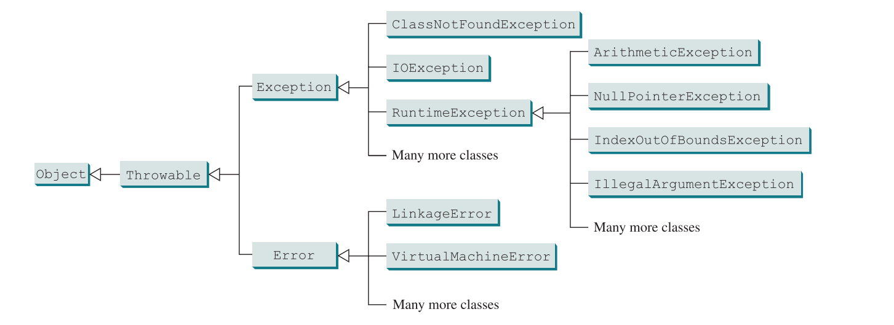

**系统错误（system error）：** Java 虚拟机抛出，用 Error 类表示。描述系统内部错误。发生后只能通知用户尽可能稳妥终止程序。

**异常(exception)：** Exception 类表示。程序和外部环境引起。可被程序捕获处理。

* **运行时异常（runtime exception）:**  用 RuntimeException 类表示。它描述的是程序设计错误，例如：错误的类型转换、访问一个越界数组或数值错误。运行时异常通常表明了**编程错误**。**我们可以不作处理**。当出现这种异常时，如果我们不做处理，总是由虚拟机接管。比如我们从来没有人去处理过 NullPointerException 异常，它就是运行时异常，而且它还是最常见的异常之一。
* 其它。

### 非检查型异常与检查型异常

* 非检查型异常（unchecked exception）： 
  Error 类或 RuntimeException 类以及他们的子类（Spring默认对这种进行回滚）
* 检查型异常（checked exception）：
  除了非检查型异常都是检查型异常。**运行环境错误引发**。我们常遇到的 IO 异常以及 sql 异常就属于检查时异常。对于这种异常，Java编译器要求我们必须**对出现的这些异常进行 catch**，所以面对这些异常，不管我们愿意与否，只能自己写一堆 catch 来捕获这些异常。

```java
	public static void testUncheck() {
		//运行时异常可以不做处理
		throw new NullPointerException();
	}
	public static void testCheck() throws InterruptedException {
		//检查型异常需要处理,这里throws了
		throw new InterruptedException();
	}
```

```java
package test;

public class HelloWorld{
	
		public static void test() {
		try {
			try {
				throw new RuntimeException("test RuntimeException123");
			} catch (RuntimeException e) {
				System.out.println("里面");
				throw new RuntimeException(e.getMessage());
			} catch (Exception f) {
				System.out.println("ff");
			}
			//RuntimeException123会被上一层Exception捕获
		}catch (Exception e){
			System.out.println("RuntimeException123会被上一层Exception捕获");
		}
	}
	public static void test2() {
		System.out.println("执行到test2");
		test();
		System.out.println("test()抛异常后面还会执行吗？");
	}
	public static void main(String[] args) {
		try {
			test2();
		} catch(Exception e) {
			e.printStackTrace();
			System.out.println("外面");
		}
	}
}
```

输出：

```
执行到test2
里面
RuntimeException123会被上一层Exception捕获
test()抛异常后面还会执行吗？
```

### 声明异常（throws）

每个方法**必须声明**其可能抛出的**检查型异常**。（所以这个声明主要用于检查型异常的声明，非检查型异常不要求也没必要显式声明）

目的：告知方法调用者。

```java
public void myMethod() throws Exception1,Exception2{
    ...
}
```

> 注：如果父类方法未声明的异常，子类重写时也不能声明（可以声明这个异常或者其子类）。

### 抛出异常

检测到错误的程序可以创建一个合适的异常类型的实例并抛出它。

如：

```java
throw new IllegalArgumentException("Wrong Argument");
```

### 捕获异常（throw）	

异常捕获处理的方法通常有：

- try-catch
- try-catch-finally
- try-finally
- try-with-resource（自 Java 7）

### 自定义异常

习惯上，定义一个异常类应包含两个构造函数，一个无参构造函数和一个带有详细描述信息的构造函数（ Throwable 的 toString 方法会打印这些详细信息，调试时很有用，可以通过调用 getMessage() 方法获取这个信息）。

```java
public class MyException extends Exception {
    public MyException(){ }
    public MyException(String msg){
        super(msg);
    }
    // ...
}
```

### 链式异常

抛出的**带有原始异常**的**新异常**被称作链式异常。

思考如下代码：

```java
public class ChainedExceptionDemo {
  public static void main(String[] args) {
    try {
      method1();
    }
    catch (Exception ex) {
      ex.printStackTrace();
    }
  }

  public static void method1() throws Exception {
    try {
      method2();
    }
    catch (Exception ex) {
      throw new Exception("New info from method1", ex);//这个新抛出的异常就带有原始异常 ex 。
    }
  }

  public static void method2() throws Exception {
    throw new Exception("New info from method2");
  }
}
```

控制台输出如下：

```
java.lang.Exception: New info from method1
	at ChainedExceptionDemo.method1(ChainedExceptionDemo.java:16)
	at ChainedExceptionDemo.main(ChainedExceptionDemo.java:4)
Caused by: java.lang.Exception: New info from method2
	at ChainedExceptionDemo.method2(ChainedExceptionDemo.java:21)
	at ChainedExceptionDemo.method1(ChainedExceptionDemo.java:13)
	... 1 more
```

我们看一下**调用关系**：

`main` 方法调用 `method1`，`method1` 调用 `method2`。

**异常关系**：

`method2` 抛出异常，

`method1` 捕获并将其包装成新异常，并进行抛出。

`main` 捕获 `method1` 抛出的新异常，并进行打印。

**显示关系**：

先显示新异常，再显示原始异常。

### 该抛出什么类型的异常

《Spring揭秘》第三版368页在分析既往事务处理缺陷时有如下一段：

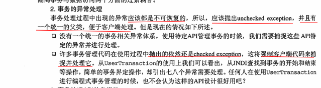


> ChatGPT 对上面“事务不可恢复”的解释：在事务处理中，不可恢复的异常是指发生了严重的错误，导致事务无法继续进行或无法回滚到之前的状态。这种情况下，事务必须被终止，并采取其他手段来纠正错误。例如，在一个转账的事务中，如果发现无法从一个账户中扣款并向另一个账户汇款，就会发生不可恢复的异常。
>
> 因为这种异常通常表示严重的问题，导致事务无法继续，所以通常使用非检查型异常来抛出和处理它们。非检查型异常可以不显式地在方法签名中声明，也不需要在调用它们的方法中进行try-catch处理。这样做可以让异常向上抛出，直到被处理或者程序终止。对于事务处理中的异常来说，通常采用这种方式来处理，因为它们通常是严重的问题，需要被及时地处理并停止事务的进行。

在《Introduction to Java Programming and Data Structures》第十二版中有这样一段：

> In most cases, unchecked exceptions reflect programming **logic errors that are unrecoverable**. For example, a `NullPointerException` is thrown if you access an object through a reference variable before an object is assigned to it; an `IndexOutOfBoundsException` is thrown if you access an element in an array outside the bounds of the array. These are logic errors that should be corrected in the program. Unchecked exceptions **can occur anywhere** in a program. To avoid cumbersome overuse of try-catch blocks, Java does not mandate that you write code to catch or declare unchecked exceptions. 


**判断是构建检查型异常还是非检查型异常的依据是：**

* 你能预见这个错误或者希望这个错误被调用方感知到，交由他们去处理，可以使用检查型异常。（一般项目中我们不太自定义检查型异常）。

上面的 `unchecked exceptions reflect programming logic errors that are unrecoverable` 可以这样理解：

* 一些需要人工干预的，代码不方便对其进行自动修复（unrecoverable）的严重错误（这里就像前面说的，就属于是不希望调用方感知处理的错误），此时用非检查型异常比较合适。

### finally 子句

无论异常是否发生，finally 子句总会执行。


###  Java 内置异常类

Java 语言定义了一些异常类在 java.lang 标准包中。

标准运行时异常类的子类是最常见的异常类。由于 java.lang 包是默认加载到所有的 Java 程序的，所以大部分从运行时异常类继承而来的异常都可以直接使用。

Java 根据各个类库也定义了一些其他的异常，下面的表中列出了 Java 的**非检查**性异常。 

| **异常**                        | **描述**                                                     |
| ------------------------------- | ------------------------------------------------------------ |
| ArithmeticException             | 当出现异常的运算条件时，抛出此异常。例如，一个整数"除以零"时，抛出此类的一个实例。 |
| ArrayIndexOutOfBoundsException  | 用非法索引访问数组时抛出的异常。如果索引为负或大于等于数组大小，则该索引为非法索引。 |
| ArrayStoreException             | 试图将错误类型的对象存储到一个对象数组时抛出的异常。         |
| ClassCastException              | 当试图将对象强制转换为不是实例的子类时，抛出该异常。         |
| **IllegalArgumentException**    | **抛出的异常表明向方法传递了一个不合法或不正确的参数。**     |
| IllegalMonitorStateException    | 抛出的异常表明某一线程已经试图等待对象的监视器，或者试图通知其他正在等待对象的监视器而本身没有指定监视器的线程。 |
| IllegalStateException           | 在非法或不适当的时间调用方法时产生的信号。换句话说，即 Java 环境或 Java 应用程序没有处于请求操作所要求的适当状态下。 |
| IllegalThreadStateException     | 线程没有处于请求操作所要求的适当状态时抛出的异常。           |
| IndexOutOfBoundsException       | 指示某排序索引（例如对数组、字符串或向量的排序）超出范围时抛出。 |
| NegativeArraySizeException      | 如果应用程序试图创建大小为负的数组，则抛出该异常。           |
| NullPointerException            | 当应用程序试图在需要对象的地方使用 `null` 时，抛出该异常     |
| NumberFormatException           | 当应用程序试图将字符串转换成一种数值类型，但该字符串不能转换为适当格式时，抛出该异常。 |
| SecurityException               | 由安全管理器抛出的异常，指示存在安全侵犯。                   |
| StringIndexOutOfBoundsException | 此异常由 `String` 方法抛出，指示索引或者为负，或者超出字符串的大小。 |
| UnsupportedOperationException   | 当不支持请求的操作时，抛出该异常。                           |

下面的表中列出了 Java 定义在 java.lang 包中的**检查性**异常类。

| **异常**                   | **描述**                                                     |
| -------------------------- | ------------------------------------------------------------ |
| ClassNotFoundException     | 应用程序试图加载类时，找不到相应的类，抛出该异常。           |
| CloneNotSupportedException | 当调用 `Object` 类中的 `clone` 方法克隆对象，但该对象的类无法实现 `Cloneable` 接口时，抛出该异常。 |
| IllegalAccessException     | 拒绝访问一个类的时候，抛出该异常。                           |
| InstantiationException     | 当试图使用 `Class` 类中的 `newInstance` 方法创建一个类的实例，而指定的类对象因为是一个接口或是一个抽象类而无法实例化时，抛出该异常。 |
| InterruptedException       | 一个线程被另一个线程中断，抛出该异常。                       |
| NoSuchFieldException       | 请求的变量不存在                                             |
| NoSuchMethodException      | 请求的方法不存在                                             |

### 异常方法

下面的列表是 Throwable 类的主要方法:

| **序号** | **方法及说明**                                               |
| -------- | ------------------------------------------------------------ |
| 1        | **public String getMessage()**  			返回关于发生的异常的详细信息。这个消息在Throwable 类的构造函数中初始化了。 |
| 2        | **public Throwable getCause()**  			返回一个 Throwable 对象代表异常原因。 |
| 3        | **public String toString()**  			返回此 Throwable 的简短描述。 |
| 4        | **public void printStackTrace()**  			将此 Throwable 及其回溯打印到标准错误流。。 |
| 5        | **public StackTraceElement [] getStackTrace()**  			返回一个包含堆栈层次的数组。下标为0的元素代表栈顶，最后一个元素代表方法调用堆栈的栈底。 |
| 6        | **public Throwable fillInStackTrace()**  			用当前的调用栈层次填充Throwable 对象栈层次，添加到栈层次任何先前信息中。 |

### 异常相关练习

附上比较有启发性的一些问题。摘自《Introduction to Java Programming and Data Structures》第十二版。更多可见<https://liveexample.pearsoncmg.com/checkpoint12/Chapter12.html>

[▼](javascript:collapse('expandText1', 'collapseText1');)**12.2.2**

Which of the following statements will throw an exception?

```java
System.out.println(1 / 0);
System.out.println(1.0 / 0);
```

答案：

```java
System.out.println(1 / 0); // Throws an exception 
System.out.println(1.0 / 0); // Will not throw an exception
```


**[▼](javascript:collapse('expandText2', 'collapseText2');)12.2.3**

Point out the problem in the following code. Does the code throw any exceptions?

```java
long value = Long.MAX_VALUE + 1;
System.out.println(value);
```

Adding 1 to Long.MAX_VALUE exceeds the maximum value allowed by a long value. But the current versions of Java does not report this as an exception.

**[▼](javascript:collapse('expandText3', 'collapseText3');)12.2.4**

What does the JVM do when an exception occurs? How do you catch an exception?

When an excepion occurs, Java searches for a handler in the catch clause. So to catch an exception in your program, you need to write a try-catch statement like this:

```java
try {

}
catch (Exception ex) {
  // Catch and process exception
}
```

**[▼](javascript:collapse('expandText9', 'collapseText9');)12.4.1.1**

What is the purpose of declaring exceptions? How do you declare an exception, and where? Can you declare multiple exceptions in a method header?

The purpose of declaring exceptions is to tell the Java runtime system what can go wrong. You declare an exception using the throws keyword in the method declaration. You can declare multiple exceptions, separated by commas.

## 内部类

### 内部类

定义在另一个类范围中的类。

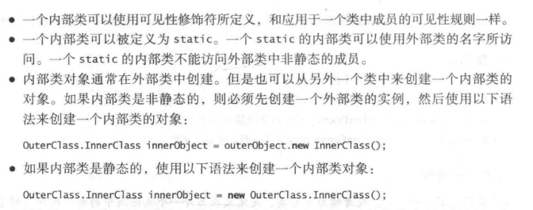

用途：

* 相互依赖的类结合到一个主类当中。
* 避免类名冲突

### 匿名内部类

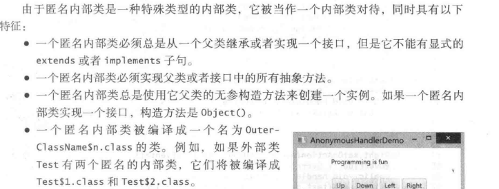

### lambda 表达式

前提：接口只包含一个抽象方法。

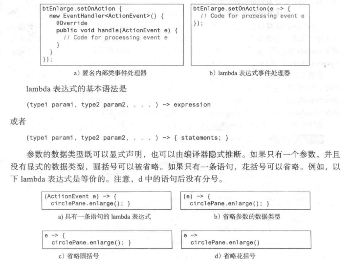


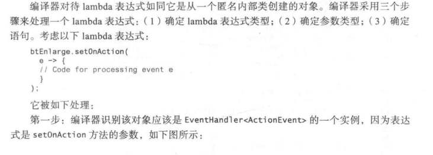

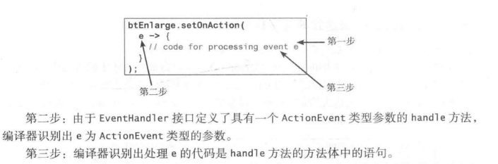

## 参考链接

* [(https://www.cnblogs.com/dolphin0520/p/3780005.html)](https://www.cnblogs.com/dolphin0520/p/3780005.html)
* [https://pdai.tech/md/java/basic/java-basic-lan-basic.html](https://pdai.tech/md/java/basic/java-basic-lan-basic.html)
* [https://www.programcreek.com/2013/04/why-string-is-immutable-in-java/](https://www.programcreek.com/2013/04/why-string-is-immutable-in-java/)
* [https://blog.csdn.net/xsj_blog/article/details/80018476](https://blog.csdn.net/xsj_blog/article/details/80018476)