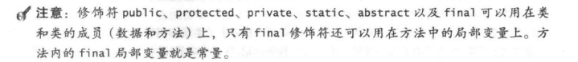

# Java 关键字——final

一个被 final 修饰的类和方法不能被继承。被 final 修饰的数据域是一个常数。




|      | 类                       | 变量                                                         | 参数                                                         | 方法     |
| ---- | ------------------------ | ------------------------------------------------------------ | ------------------------------------------------------------ | -------- |
| 不能 | 不能被继承               | 初始化后无法被更改<br />基本类型变量：值不可变；<br />引用类型变量：引用不可再变） | 无法在方法中更改参数引用所指向的对象（主要用于匿名内部类传递数据） | 无法重写 |
| 能   |                          |                                                              |                                                              | 可以重载 |
| 其它 | 类中所有方法隐式为 final |                                                              |                                                              |          |


## 修饰类

* 此类无法被继承。即没有子类。

注意：final类中的所有**方法都隐式为final**，因为无法覆盖他们，所以在final类中给任何方法添加final关键字是没有任何意义的。

另外字段并不是 final 哦。

### 这里顺道说说 final 类型的类如何拓展? 

> 比如String是final类型，我们想写个MyString复用所有String中方法，同时增加一个新的toMyString()的方法，应该如何做?

设计模式中最重要的两种关系，一种是继承/实现；另外一种是组合关系。所以当遇到不能用继承的(final修饰的类),应该考虑用**组合**, 如下代码大概写个组合实现的意思：

```java
class MyString{

    private String innerString;

    // ...init & other methods

    // 支持老的方法
    public int length(){
        return innerString.length(); // 通过innerString调用老的方法
    }

    // 添加新方法
    public String toMyString(){
        //...
    }
}
```

## 修饰变量

* 变量初始化后无法被更改——常量。

（对基本类型变量来说是其**值**不可变；而对对象引用类型变量来说其**引用**不可再变，而非所指的对象）。

> 这里要说明一下，当我们提到 String 的时候，也说到了 String 不可变：
>
> String 内部使用 char 数组存储数据，该**数组被声明为 final**，这意味着 value 数组初始化之后就不能再引用其它数组。并且 String 内部**没有改变 value 数组的方法**，因此可以保证 String 不可变。
>
> ```java
> public final class String
>     implements java.io.Serializable, Comparable<String>, CharSequence {
>     /** The value is used for character storage. */
>     private final char value[];
> ```
>
> **String 不可变是指 String 类型“对象”的不可变，final 修饰变量的不可变是指"变量"的不可变。**

#### 所有的 final 修饰的字段都是编译期常量吗?

现在来看编译期常量和非编译期常量, 如：

```java
public class Test {
    //编译期常量
    final int i = 1;
    final static int J = 1;
    final int[] a = {1,2,3,4};
    //非编译期常量
    Random r = new Random();
    final int k = r.nextInt(); // k 引用不可变

    public static void main(String[] args) {

    }
}
```

k 的值由随机数对象决定，所以不是所有的 final 修饰的字段都是编译期常量，只是 k 的值在被初始化后无法被更改。

#### static final

一个既是 static 又是 final 的字段只占据一段不能改变的存储空间，它**必须在定义的时候进行赋值**，否则编译器将不予通过。

```java
import java.util.Random;

public class FinalTest01 {

    static Random r = new Random();
    final int k = r.nextInt(10);
    static final int k2 = r.nextInt(10);

    public static void main(String[] args) {
        FinalTest01 t1 = new FinalTest01();
        System.out.println("k=" + t1.k + " k2=" + t1.k2);
        FinalTest01 t2 = new FinalTest01();
        System.out.println("k=" + t2.k + " k2=" + t2.k2);
        System.out.println("k=" + FinalTest01.k2); // 值未变
    }

}
```

上面代码某次输出结果：

```html
k=4 k2=3
k=1 k2=3
k=3
```

我们可以发现对于不同的对象k的值是不同的，但是k2的值却是相同的，这是为什么呢? 因为static关键字所修饰的字段并不属于一个对象，而是属于这个类的。也可简单的理解为static final所修饰的字段仅占据内存的一个一份空间，一旦被初始化之后便不会被更改。

####  blank final

Java允许生成空白final，也就是说被声明为final但又没有给出定值的字段,但是必须在该字段被使用之前被赋值，这给予我们两种选择：

- 在定义处进行赋值(这不叫空白final)
- 在构造器中进行赋值，保证了该值在被使用前赋值。

这增强了final的灵活性。

看下面代码:

```java
public class Test {
    final int i1 = 1;
    final int i2;//空白final
    public Test() {
        i2 = 1;
    }
    public Test(int x) {
        this.i2 = x;
    }
}
```

可以看到i2的赋值更为灵活。但是请注意，如果字段由 static 和 final 修饰，仅能在声明时赋值或声明后在静态代码块中赋值，因为该字段不属于对象，属于这个类。


## 修饰参数

Java允许在参数列表中以声明的方式将参数指明为final，这意味这你无法在方法中更改参数引用所指向的对象。这个特性主要用来向匿名内部类传递数据。

## 修饰方法

方法无法被重写。

- private 方法是隐式的 final
- final 方法是可以被重载的

#### private final

类中所有 private 方法都隐式地指定为 final 的，由于无法取用 private 方法，所以也就**不能覆盖它**。可以对 private 方法增添 final 关键字，但这样做并没有什么好处。看下下面的例子：

```java
public class Base {
    private void test() {
    }
}

public class Son extends Base{
    //这是 son 的 test()
    public void test() {
    }
    public static void main(String[] args) {
        Son son = new Son();
        Base father = son;
        //father.test();
    }
}
```

Base 和 Son 都有方法 test() ，但是这并不是一种覆盖，因为 private 所修饰的方法是隐式的 final，也就是无法被继承，所以更不用说是覆盖了，在**Son 中的 test() 方法不过是属于 Son 的新成员**罢了，Son 进行向上转型得到 father，但是 father.test() 是不可执行的，因为Base 中的 test 方法是 private 的，无法被访问到。

####  final方法是可以被重载的

我们知道父类的 final 方法是不能够被子类重写的，那么 final 方法可以被重载吗? 答案是可以的，下面代码是正确的。

```java
public class FinalExampleParent {
    public final void test() {
    }

    public final void test(String str) {
    }
}
```

## 两个 byte 相加

```java
byte b1 = 1;
byte b2 = 3;
byte b3 = b1 + b2;//当程序执行到这一行的时候会出错，因为b1、b2可以自动转换成int类型的变量，运算时java虚拟机对它进行了转换，结果导致把一个int赋值给byte-----编译出错：“ cannot convert from int to byte”。
```

* 解决一：强制类型转换

```java
byte b1 = 1;
byte b2 = 3;
byte b3 = (byte)(b1 + b2);//编译通过。
```

* 解决二：如果对b1、b2加上 final 。

```java
final byte b1 = 1;
final byte b2 = 3;
byte b3 = b1 + b2;//编译通过。
```

先说个知识点：

1.如果进行运算的是**两个变量**，此时先会根据情况对类型进行提升，然后再进行运算赋值（如上述所说）。

2.如果进行运算的是两个常量，此时先计算数值的大小运算，然后**再判断是否满足类型范围（byte 范围是[-128,127]）**，满足之后再进行赋值。

```java
final byte b1 = 120;
final byte b2 = 37;
byte b3 = b1 + b2;//编译出错：“ cannot convert from int to byte”。
```

