# 序列化


**可以写到输出流的对象被称为可序列化的（Serializable）**。

当存储一个可序列化对象时，会对该对象的类进行编码。编码包括：

* 类名

* 类的签名

* 对象实例变量的值

* 该对象引用的任何其他对象的闭包

  不存储对象静态变量的值。

<div style="float:right;">  ——《Java 语言程序设计与数据结构》</div>
> 本文摘自 https://cloud.tencent.com/developer/article/1524781，用实际例子说明了Java中为什么要序列化，以及如何使用。@qiuchi

序列化是一种对象持久化的手段。普遍应用在网络传输、RMI等场景中。类通过实现 java.io.Serializable 接口以启用其序列化功能。

但是，还有一个知识点并未展开介绍，那就是关于serialVersionUID 。这个字段到底有什么用？

## **背景知识**

在展开本文的介绍之前，先来简单介绍一些和序列化有关的知识，

### **Serializable 和 Externalizable**

* **Serializable**

Java类通过实现 java.io.Serializable 接口以启用其序列化功能。**未实现此接口的类将无法进行序列化或反序列化。**可序列化类的所有子类型本身都是可序列化的。

如果读者看过Serializable的源码，就会发现，他只是一个空的接口，里面什么东西都没有。**Serializable接口没有方法或字段，仅用于标识可序列化的语义。**但是，如果一个类没有实现这个接口，想要被序列化的话，就会抛出java.io.NotSerializableException异常。

**它是怎么保证只有实现了该接口的方法才能进行序列化与反序列化的呢？**

原因是在执行序列化的过程中，会执行到以下代码：

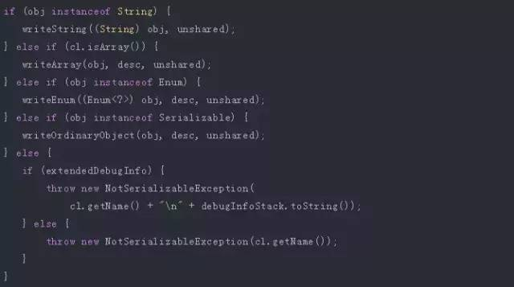

在进行序列化操作时，会判断要被序列化的类是否是Enum、Array和Serializable类型，如果都不是则直接抛出NotSerializableException。

* **Externalizable**

Java中还提供了Externalizable接口，也可以实现它来提供序列化能力。

Externalizable继承自Serializable，该接口中定义了两个抽象方法：writeExternal()与readExternal()。

当使用Externalizable接口来进行序列化与反序列化的时候需要**开发人员重写**writeExternal()与readExternal()方法。否则所有变量的值都会变成默认值。

### **transient**

transient 关键字的作用是**控制变量的序列化**，在变量声明前加上该关键字，可以**阻止该变量被序列化到文件中**，在被反序列化后，transient 变量的值被设为初始值，如 int 型的是 0，对象型的是 null。

### **自定义序列化策略**

在序列化过程中，如果被序列化的类中定义了writeObject 和 readObject 方法，虚拟机会试图调用对象类里的 writeObject 和 readObject 方法，进行用户自定义的序列化和反序列化。

如果没有这样的方法，则默认调用是 ObjectOutputStream 的 defaultWriteObject方法以及 ObjectInputStream 的 defaultReadObject 方法。

用户自定义的 **writeObject 和 readObject** 方法可以允许用户控制序列化的过程，比如可以在序列化的过程中**动态改变序列化的数值**。

所以，对于一些特殊字段需要定义序列化的策略的时候，**可以考虑使用transient修饰，并自己重写writeObject 和 readObject 方法**，如java.util.ArrayList中就有这样的实现。

以上，就是一些读者需要掌握和和序列化有关的知识。

我们随便找几个Java中实现了序列化接口的类，如String、Integer等，我们可以发现一个细节，那就是这些类除了实现了Serializable外，还定义了一个serialVersionUID

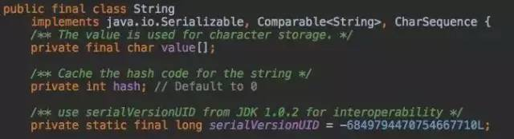

那么，到底什么是serialVersionUID呢？为什么要设置这样一个字段呢？

## **什么是serialVersionUID**

**序列化是将对象的状态信息转换为可存储或传输的形式的过程。我们都知道，Java对象是保存在JVM的堆内存中的，也就是说，如果JVM堆不存在了，那么对象也就跟着消失了。**

而序列化提供了一种方案，可以让你在即使JVM停机的情况下也能把对象保存下来的方案。就像我们平时用的U盘一样。把Java对象序列化成可存储或传输的形式（如二进制流），比如保存在文件中。这样，当再次需要这个对象的时候，从文件中读取出二进制流，再从二进制流中反序列化出对象。

**虚拟机是否允许反序列化，不仅取决于类路径和功能代码是否一致，一个非常重要的一点是两个类的序列化 ID 是否一致**，这个所谓的序列化ID，就是我们在代码中定义的serialVersionUID。

### serialVersionUID 声明格式

字段必须是static、final的且类型为long

```java
ANY-ACCESS-MODIFIER static final long serialVersionUID=42L；
```

强烈建议显式 serialVersionUID 声明尽可能使用 private 修饰符，因为此类声明仅适用于立即声明的类——serialVersionUID字段不可用作继承成员。

### **如果serialVersionUID变了会怎样**

**我们举个例子吧，看看如果serialVersionUID被修改了会发生什么？**

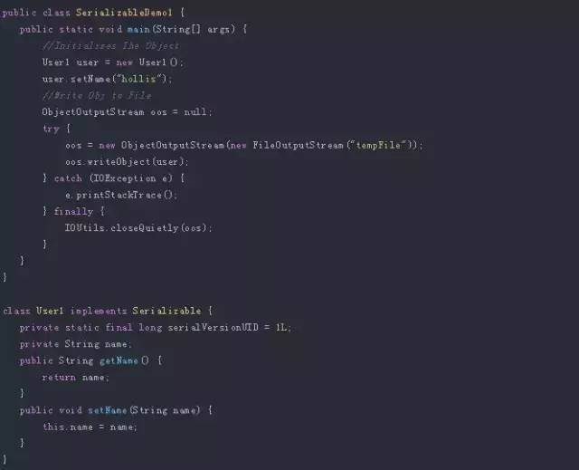

我们先执行以上代码，把一个User1对象写入到文件中。然后我们修改一下User1类，把serialVersionUID的值改为2L。

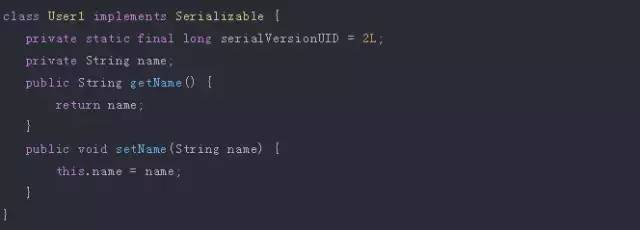

然后执行以下代码，把文件中的对象反序列化出来：

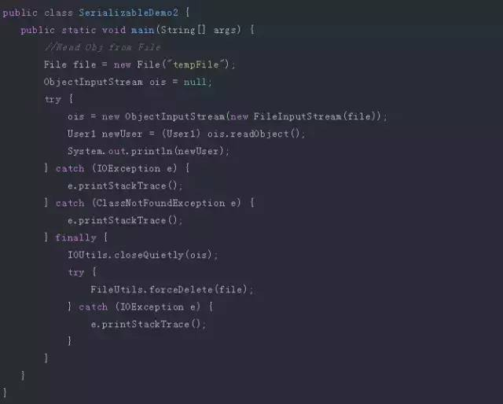

执行结果如下：

> java.io.InvalidClassException: com.hollis.User1; local class incompatible: stream classdesc serialVersionUID = 1, local class serialVersionUID = 2

可以发现，以上代码抛出了一个java.io.InvalidClassException，并且指出serialVersionUID不一致。

这是因为，在进行反序列化时，JVM会把传来的字节流中的serialVersionUID与本地相应实体类的serialVersionUID进行比较，如果相同就认为是一致的，可以进行反序列化，否则就会出现序列化版本不一致的异常，即是InvalidCastException。

这也是《阿里巴巴Java开发手册》中规定，在兼容性升级中，在修改类的时候，不要修改serialVersionUID的原因。**除非是完全不兼容的两个版本**。所以，**serialVersionUID其实是验证版本一致性的。**

如果读者感兴趣，可以把各个版本的JDK代码都拿出来看一下，那些向下兼容的类的serialVersionUID是没有变化过的。比如String类的serialVersionUID一直都是-6849794470754667710L。

但是，作者认为，这个规范其实还可以再严格一些，那就是规定：

如果一个类实现了Serializable接口，就必须手动添加一个private static final long serialVersionUID变量，并且设置初始值。

## **为什么要明确定一个serialVersionUID**

**如果我们没有在类中明确的定义一个serialVersionUID的话，看看会发生什么。**

尝试修改上面的demo代码，先使用以下类定义一个对象，该类中不定义serialVersionUID，将其写入文件。

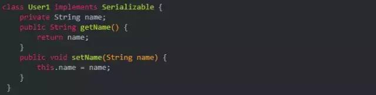

然后我们修改User1类，向其中增加一个属性。在尝试将其从文件中读取出来，并进行反序列化。

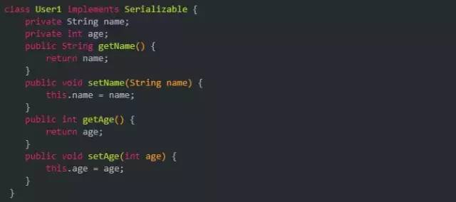

执行结果：

> java.io.InvalidClassException: com.hollis.User1; local class incompatible: stream classdesc serialVersionUID = -2986778152837257883, local class serialVersionUID = 7961728318907695402

同样，抛出了InvalidClassException，并且指出两个serialVersionUID不同，分别是-2986778152837257883和7961728318907695402。

从这里可以看出，系统自己添加了一个serialVersionUID。

所以，一旦类实现了Serializable，就建议明确的定义一个serialVersionUID。不然在修改类的时候，就会发生异常。

serialVersionUID有两种显示的生成方式：

一种是默认的1L，比如：

> private static final long serialVersionUID = 1L;   

另外一种是根据类名、接口名、成员方法及属性等来生成一个64位的哈希字段，比如： 

> private static final long serialVersionUID = xxxxL;

后面这种方式，可以借助IDE生成，后面会介绍。

背后原理

知其然，要知其所以然，我们再来看看源码，分析一下为什么serialVersionUID改变的时候会抛异常？在没有明确定义的情况下，默认的serialVersionUID是怎么来的？

为了简化代码量，反序列化的调用链如下：

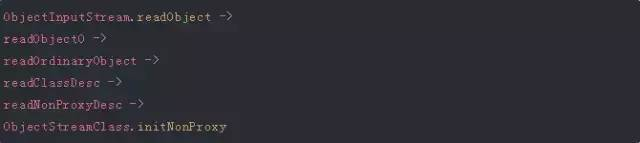

在initNonProxy中 ，关键代码如下：

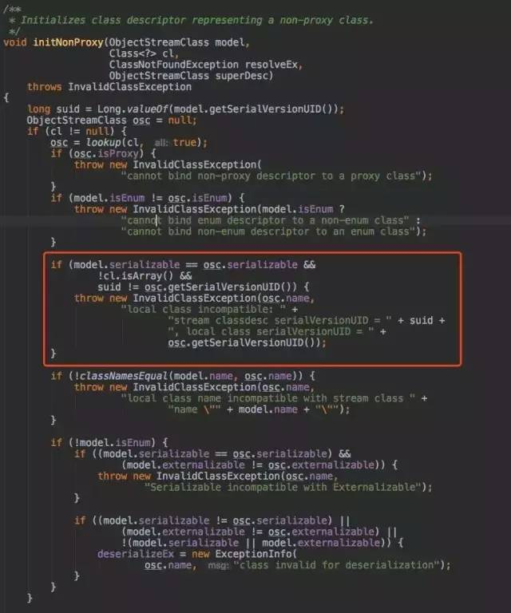

在反序列化过程中，对serialVersionUID做了比较，如果发现不相等，则直接抛出异常。

深入看一下getSerialVersionUID方法：

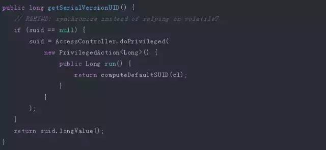

在没有定义serialVersionUID的时候，会调用computeDefaultSUID 方法，生成一个默认的serialVersionUID。

这也就找到了以上两个问题的根源，其实是代码中做了严格的校验，并且在未定义的时候自动生成了一个serialVersionUID。

**IDEA提示**

为了确保我们不会忘记定义serialVersionUID，可以调节一下Intellij IDEA的配置，在实现Serializable接口后，如果没定义serialVersionUID的话，IDEA（eclipse一样）会进行提示：

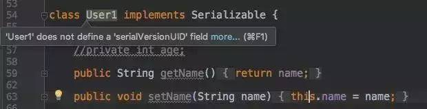

并且可以一键生成一个：

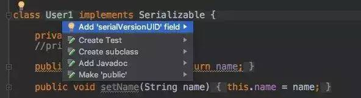

当然，这个配置并不是默认生效的，需要手动到IDEA中设置一下：

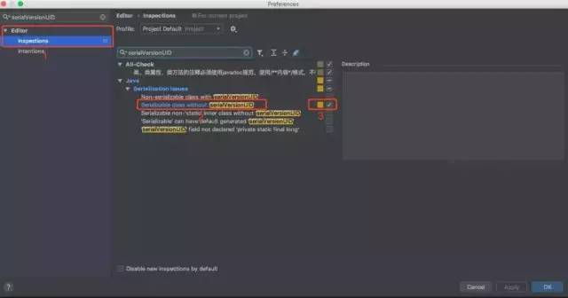

在图中标号3的地方（Serializable class without serialVersionUID的配置），打上勾，保存即可。

## 向上兼容与向下兼容

### 解释

向上兼容性是指老的版本能够读取新的版本序列化的数据流。常常出现在我们的服务器的数据更新了，仍然希望老的客户端能够支持反序列化新的数据流，直到其更新到新的版本。可以说，这是半自动的事情。 

一般而言，因为在java中serialVersionUID是唯一控制着能否反序列化成功的标志，

* 当值不同，无法反序列化成功。

* 当值相同：
  * 对于向上兼容性，老版本读取新数据流（指读取的新版本序列化后的文件）时，多余的内容将会被忽略；
  * 对于向下兼容性，旧的数据流中所包含的所有内容都将会被恢复，新版本的类中没有涉及到的部分将保持默认值。
  * 利用这一特性，可以说，只要我们认为的保持serialVersionUID不变，向上兼容性是自动实现的。

  * 当然，如果我们在新版本中将老的内容拿掉（比如删除了某个老版本会序列化的字段），即使UID保持不变，也会引发异常。

### 举例

　　当我们要人为的产生一个新的版本（实现并没有改动），而抛弃以前的版本的话，可以通过显式的声名UID来实现： 
```java
private static final long serialVersionUID=????;
```

　　你可以编造一个版本号，但注意不要重复。这样在反序列化的时候老版本将得到InvalidClassException，我们可以在老版本的地方捕捉这个异常，并提示用户升级的新的版本。 

　　当改动不大时，保持兼容性（向下兼容性的一个特例）： 

　　有时候你的类增加了一些无关紧要的非私有方法，而逻辑字段并不改变的时候，你当然希望老版本和新版本保持兼容性，方法同样是通过显式的声名UID来实现。下面我们验证一下。 

　　老版本： 
```java
import java.io.*; 

public class Serial implements Serializable { 

　int company_id; 
　String company_addr; 

　public Serial1(int company_id, String company_addr) { 
　　this.company_id = company_id; 
　　this.company_addr = company_addr; 
　} 

　public String toString() { 
　　return "DATA: "+company_id+" "+ 
　　company_addr; 
　} 
}
```
　　新版本 
```java
import java.io.*; 

public class Serial implements Serializable { 

　int company_id; 
　String company_addr; 
　public Serial1(int company_id, String company_addr) { 
　　this.company_id = company_id; 
　　this.company_addr = company_addr; 
　} 

　public String toString() { 
　　return "DATA: "+company_id+" "+ company_addr; 
　} 
　public void todo(){}//无关紧要的方法 
}
```
　　首先将老版本序列化，然后用新版本读出，发生错误： 
```bash
java.io.InvalidClassException: Serial.Serial1; local class incompatible: stream classdesc serialVersionUID = 762508508425139227, local class serialVersionUID = 1187169935661445676
```
　　接下来我们加入显式的声名UID： 
```java
private static final long serialVersionUID=762508508425139227l;
```
　　再次运行，顺利地产生新对象 
```bash
DATA: 1001 com1 
```
## **总结**

serialVersionUID是用来验证版本一致性的。所以在做兼容性升级的时候，不要改变类中serialVersionUID的值。

特别说明一下，由于本文标题并不完全能表达本文的全部内容，这里再强调一下：serialVersionUID 既然是验证版本一致性的，在做版本升级的时候（非兼容性升级），记得要修改这个字段的值哦，这样可以避免序列化混乱。

如果一个类实现了Serializable接口，一定要记得定义serialVersionUID，否则会发生异常。可以在IDE中通过设置，让他帮忙提示，并且可以一键快速生成一个serialVersionUID。

之所以会发生异常，是因为反序列化过程中做了校验，并且如果没有明确定义的话，会根据类名及属性等自动生成一个。

**其他问题**：
Q: 如果父类被序列化，默认情况下子类也被序列化，所以我们也需要为 child 声明 serialVersionUID 吗？

A: 建议对子类，或者说每一个存在序列化需求的类都进行 serialVersionUID 的指定，并且如上建议，采用 private 进行修饰，避免子类对父类的 protected 继承（我还没碰上炸毛的情况，所以也不好讲继承后会在什么情况下出现什么样的问题）

Q: 如果我不序列化，还需要指定吗？

A：如果不存在序列化需求，也就不存在序列化与反序列化中的比对，原则上不声明 serialVersionUID 也是可以的

## 参考链接
* <https://zhuanlan.zhihu.com/p/347246506>
* <https://blog.csdn.net/notonlyrush/article/details/79783349>
