​		今天看书的时候，又碰到了这个词条，每每网上搜这个，老感觉抓不到核心，总觉得差点意思，今天决定好好缕缕。

<!-- more -->

## 前言

在知乎上看到这样一个[观点](https://www.zhihu.com/question/19732473/answer/241673170)：

> * 进程级通信的维度讨论时， 阻塞和同步（非阻塞和异步）就是一对同义词， 且需要针对**发送方**和**接收方**作区分对待。
>   依据是《操作系统概念（第九版）》中有关进程间通信的部分：
>
>   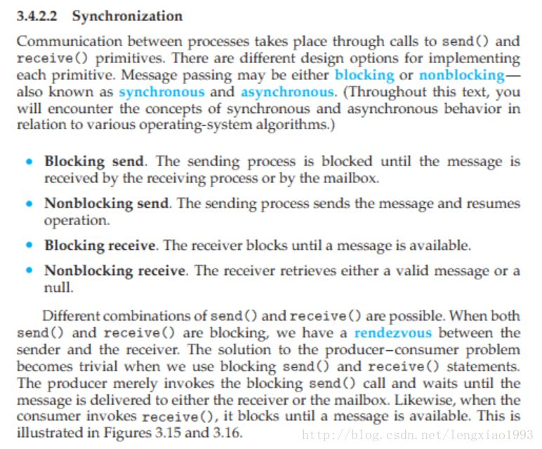
>   翻译一下就是：进程间的通信是通过 [send](https://www.zhihu.com/search?q=send&search_source=Entity&hybrid_search_source=Entity&hybrid_search_extra={"sourceType"%3A"answer"%2C"sourceId"%3A241673170})() 和 receive() 两种基本操作完成的。具体如何实现这两种基础操作，存在着不同的设计。  消息的传递有可能是**阻塞的**或**非阻塞的** – 也被称为**同步**或**异步**的：
>
>   * 阻塞式发送（blocking send）. 发送方进程会被一直阻塞， 直到消息被接受方进程收到。
>   * 非阻塞式发送（nonblocking send）。 发送方进程调用 send() 后， 立即就可以其他操作。
>   * 阻塞式接收（blocking receive） 接收方调用 receive() 后一直阻塞， 直到消息到达可用。
>   * 非阻塞式接受（nonblocking receive） 接收方调用 receive() 函数后， 要么得到一个有效的结果， 要么得到一个空值， 即不会被阻塞。
>
> * 在 **IO 系统调用**层面（ IO system call ）层面， **非阻塞 IO 系统调用** 和 **异步 IO 系统调用**存在着一定的差别， 它们都不会阻塞进程， 但是返回结果的方式和内容有所差别， 但是都属于非阻塞系统调用（ non-blocing system call ）
>

## 同步与异步

​		对于上面的第一点，即“进程级通信的维度讨论时， 阻塞和同步（非阻塞和异步）就是一对同义词”。我觉得这个可能不同出处，意见不同。不过往往提到“同步”与“异步”，我们想到的都是**通信层面**。现在我们暂且只论“同步”与“异步”：

​		在《操作系统概念》第九版中，有如下一段：

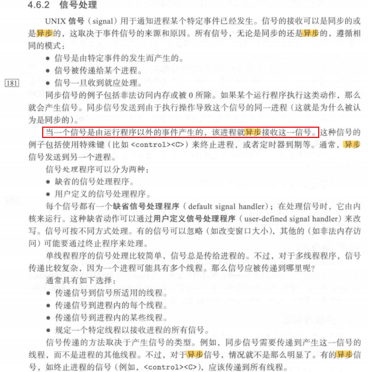

我们再看在《深入理解操作系统》第三版中，对异常同步与异步的区分，可能会对这个概念更加清晰：

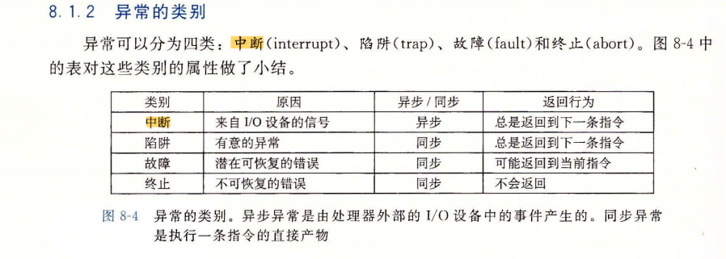

这就很明晰了，**异步信号是运行程序之外的事件产生，传递给其它线程（不限制个数）；同步信号则是运行程序产生，传递给产生这个信号的线程**。通俗讲就是，我正在吃饭，异步信号就像这时有人叫我出去玩；同步信号就像我感受到自己吃饱了。


## 阻塞与非阻塞

​		而对于第二点，“在 **IO 系统调用**层面（ IO system call ）层面， **非阻塞 IO 系统调用** 和 **异步 IO 系统调用**存在着一定的差别”，其为了论证这一观点，有下面一段：

> ​		操作系统内核在执行 System Call 时， CPU 需要与 IO 设备完成一系列物理通信上的交互， 其实再一次会涉及到阻塞和非阻塞的问题， 例如， 操作系统发起了一个读硬盘的请求后， 其实是向硬盘设备通过总线发出了一个请求，它即可以阻塞式地等待IO  设备的返回结果，也可以非阻塞式的继续其他的操作。 在现代计算机中，这些物理通信操作基本都是异步完成的， 即发出请求后， 等待 I/O  设备的中断信号后， 再来读取相应的设备缓冲区 。 但是，大部分操作系统默认为用户级应用程序提供的都是阻塞式的系统调用 （blocking systemcall）接口，  因为阻塞式的调用，使得应用级代码的编写更容易（代码的执行顺序和编写顺序是一致的）。
>
>  		但同样， 现在的大部分操作系统也会提供非阻塞I/O 系统调用接口（Nonblocking I/O system call）。  一个非阻塞调用不会挂起调用程序， 而是会立即返回一个值， 表示有多少bytes 的数据被成功读取（或写入）。
>
> ​		 非阻塞I/O 系统调用( nonblocking system call )的另一个替代品是 异步I/O系统调用 （asychronous  system call）。 与非阻塞 I/O 系统调用类似，asychronous system call 也是会立即返回， 不会等待 I/O  操作的完成， 应用程序可以继续执行其他的操作， 等到 I/O 操作完成了以后，操作系统会通知调用进程（设置一个用户空间特殊的变量值 或者 触发一个 signal 或者 产生一个软中断 或者 调用应用程序的回调函数）。
>
> ​		 此处， 非阻塞I/O 系统调用( nonblocking system call ) 和 异步I/O系统调用 （asychronous  system call）的区别是：
>
> * 一个非阻塞I/O 系统调用 read() 操作立即返回的是任何可以立即拿到的数据， 可以是完整的结果， 也可以是不完整的结果，  还可以是一个空值。
> * 而异步I/O系统调用 read（）结果必须是完整的， 但是这个操作完成的通知可以延迟到将来的一个时间点。

​		先不论上面对错，我觉得，**非阻塞IO系统调用**与**异步IO系统调用**更偏向于**IO模型**的范畴，不适合用来说“阻塞”与“非阻塞”。

----

​		我们最早接触到“阻塞”概念，一般是在学习进程基本状态时。比如《操作系统原理、实现与实践》中的“图3.7 进程的基本状态转移图”，展示了5种进程状态：


* 新建态（New）： 进程正在被创建.
* 就绪态（Ready）：进程在等待被操作系统调度
* 运行态（Running）：进程的指令正在被执行
* 阻塞态（Waiting）： 进程正在等待一些事件的发生（例如 I/O 的完成或者收到某个信号）
* 退出态（Terminated）： 进程执行完毕（可能是被强行终止的）

​		**所以我们通常说的“阻塞”与“非阻塞”，可以类比一个进程。当一个进程在执行过程中，发出了一个写磁盘指令，此时这个进程由于等待事件进入阻塞态（就是此进程放入了阻塞队列，等到不用等待时，会再放入就绪队列）。**

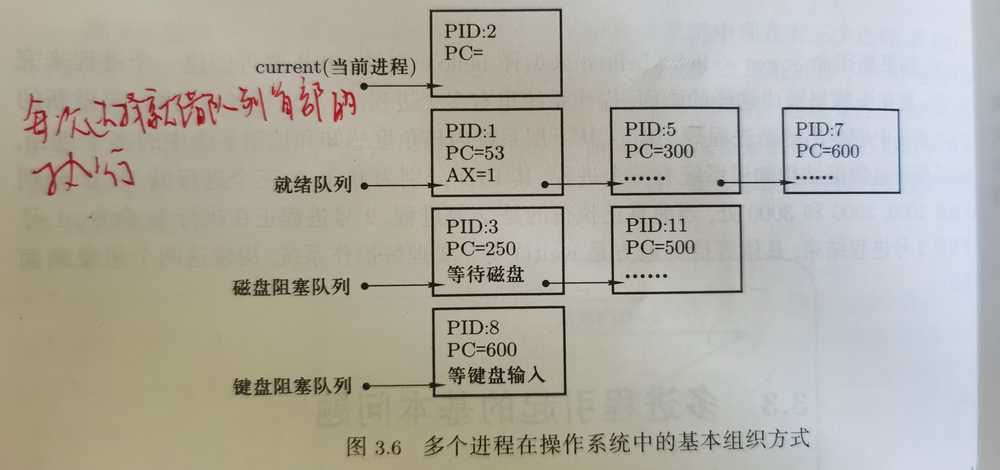

​		那么进程为什么要放进阻塞队列，在原来的地方一直等着不好吗？原因是，同一CPU，某一时间点，最多只能执行一个进程（或者线程）。如果这个进程被阻塞了，就把CPU给让出来呀，让其它等着执行的进程得以执行呀。这样可以提高CPU的利用率。

> 补充：
>
> 多进程切换的时机就是CPU出现空闲的时间点，这个空闲点也被称为**调度点**。产生情况：
>
> * 当前进程执行过程中产生：
>   * 如执行了需要CPU等待的指令，（如启动磁盘读写等），此时当前进程进入阻塞态。
>   * 当前进程执行了exit()退出时
>   * 比如0号进程在时刻48调用fork()创建了1号进程，
>     时刻49:1号进程被放到就绪队列；0号进程执行pause()，从运行态变成就绪态，让出CPU
>   * ......
> * 操作系统硬性加入：
>   * 如给每个进程分配一个时间片，当前进程时间片用完时
>   * ......

## I/O

### 什么是I/O

先看一下什么是系统级IO：

​				在《深入理解计算机系统》第三版中，可以看到下面一段：

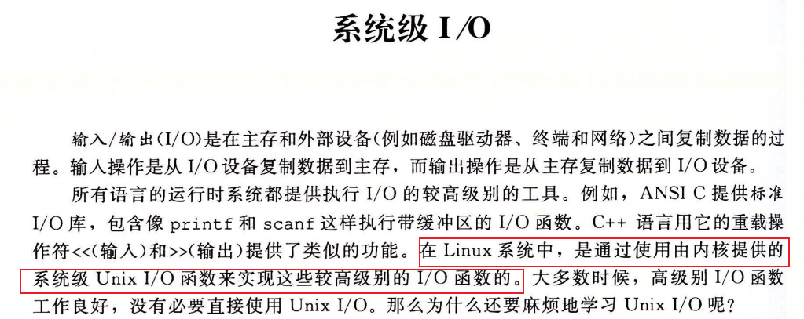

​		我们可以理解为**系统级I/O**就是**由系统内核提供的I/O函数，用于实现主存与外部设备（如磁盘驱动器、终端和网络）之间的数据复制功能。**而我们平时使用的高级语言，如C++的I/O功能，底层是对系统级IO的封装。（我们的**应用程序一般处于用户态，而处于用户态的进程有诸多限制（如不能进行 I/O 操作），所以有些功能必须由内核代劳完成**。而内核就是通过向应用层提供 `系统调用`，来完成一些在用户态不能完成的工作。）

​		我们可以看一下这个关系：（其中“标准I/O函数”是C语言定义的一组高级输入输出函数（实际上也还是对系统级I/O的封装），“RIO函数”是《深入理解计算机系统》作者自己写的一个I/O库。）

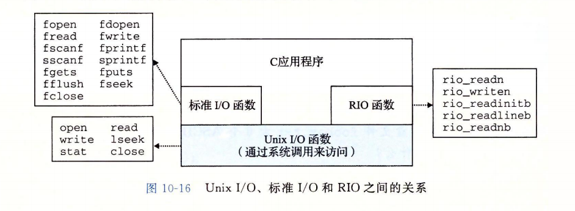

​		那么，什么是**I/O系统调用**？就是**进程对I/O函数的调用**呗。别管什么语言的IO调用，**最终都会转换为**对**系统级I/O函数**的**调用**。

### I/O的工作模式

当我在维基百科上对`I/O`这个词条搜索时，看到下面一段：

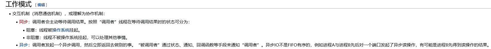

至此，**同步与异步侧重于调用者，同步是调用者主动等待调用结果，其中线程分为挂起与不挂起；异步是调用者立即去做别的事情，被调用者通知”调用者。“**

## IO模型

一个输入操作通常包括两个阶段:

- 等待数据准备好
- 从内核向进程复制数据

比如对于一个**套接字**上的输入操作：

* 第一步：通常涉及等待数据从网络中到达。当所等待分组到达时，它被复制到**内核**中的某个缓冲区。
* 第二步：就是把数据从内核缓冲区复制到**应用进程**缓冲区。

----

下图分别对应 **Unix 的五种 I/O 模型**:：

- 阻塞式 I/O（BIO）
- 非阻塞式 I/O(NIO)
- I/O 复用(select 和 poll)
- 信号驱动式 I/O(SIGIO)
- 异步 I/O(AIO)

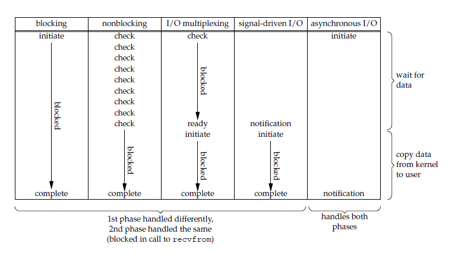

---

**Unix 的五种 I/O 模型的同步与异步：**

- 同步 I/O: 应用进程在调用 recvfrom 操作时**会**阻塞（即第二步时会阻塞）。
- 异步 I/O: 应用进程在调用 recvfrom 操作时**不会**阻塞。

同步 I/O：

​		阻塞式 I/O、非阻塞式 I/O、I/O 复用和信号驱动 I/O 。

> 虽然非阻塞式 I/O 和信号驱动 I/O 在等待数据阶段不会阻塞，但是在之后的将数据从内核复制到应用进程这个操作会阻塞。

### 阻塞式 I/O

应用进程被阻塞，直到数据**复制到**应用进程缓冲区中**才返回**。

应该注意到，在阻塞的过程中，其它程序还可以执行，因此阻塞**不意味着整个操作系统都被阻塞**。因为其他程序还可以执行，因此**不消耗 CPU 时间，这种模型的执行效率会比较高**。

下图中，recvfrom 用于接收 Socket 传来的数据，并复制到应用进程的缓冲区 buf 中（即第二步）。这里把 recvfrom() 当成系统调用。

```c
ssize_t recvfrom(int sockfd, void *buf, size_t len, int flags, struct sockaddr *src_addr, socklen_t *addrlen);
```

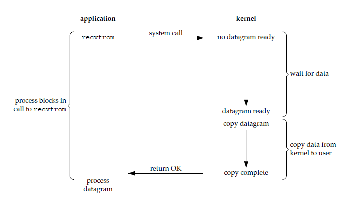

或者网友提供的

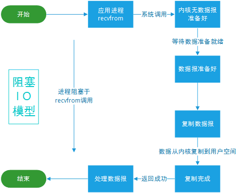

###  非阻塞式 I/O

应用进程执行系统调用之后，内核返回一个错误码。应用进程可以继续执行，但是需要不断的执行系统调用来获知 I/O 是否完成，这种方式称为**轮询 **( polling )。

由于 CPU 要处理更多的系统调用，因此这种模型是比较**低效**的。

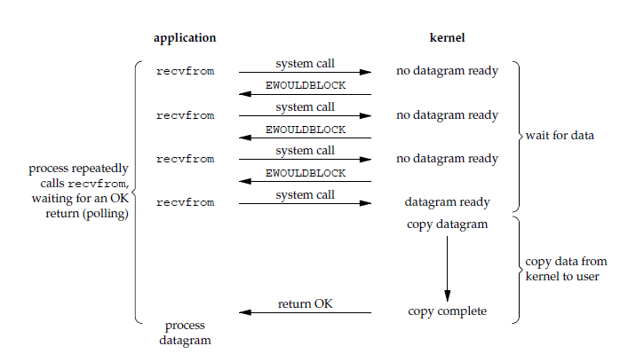

或者网友提供的

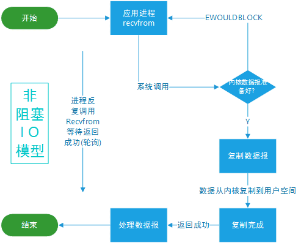

### I/O 复用

使用 select 或者 poll 等待数据，并且可以**等待多个套接字**中的**任何一个**变为可读，这一过程会被阻塞，当某一个套接字可读时返回。之后再使用 recvfrom 把数据从内核复制到进程中。

它可以让单个进程具有处理多个 I/O 事件的能力。又被称为 Event Driven I/O，即事件驱动 I/O。

如果一个 Web 服务器没有 I/O 复用，那么每一个 Socket 连接都需要创建一个线程去处理。如果同时有几万个连接，那么就需要创建相同数量的线程。并且相比于多进程和多线程技术，I/O 复用不需要进程线程创建和切换的开销，系统开销更小。

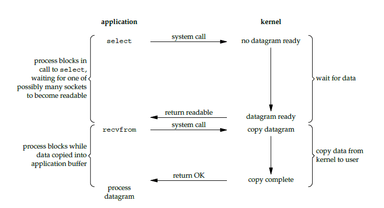

或者网友提供的

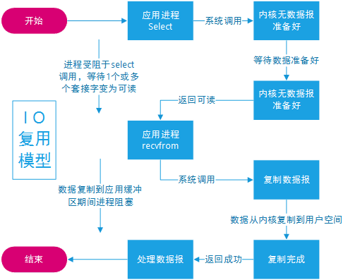

### 信号驱动 I/O

应用进程使用 sigaction 系统调用，内核立即返回，应用进程可以继续执行，也就是说等待数据阶段应用进程是非阻塞的。内核在数据到达时向应用进程发送 SIGIO 信号，应用进程收到之后在信号处理程序中调用 recvfrom 将数据从内核复制到应用进程中。

相比于非阻塞式 I/O 的轮询方式，信号驱动 I/O 的 CPU 利用率更高。

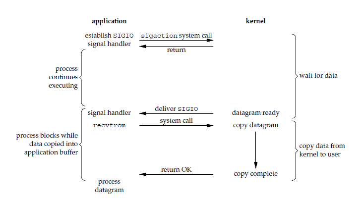

或者网友提供的

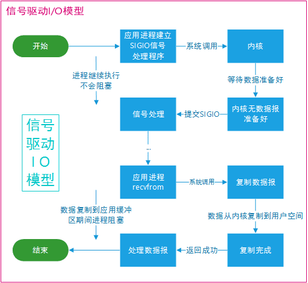

### 异步 I/O

进行 aio_read 系统调用会立即返回，应用进程继续执行，不会被阻塞，内核会在所有操作完成之后向应用进程发送信号。

异步 I/O 与信号驱动 I/O 的区别在于，异步 I/O 的信号是**通知应用进程 I/O 完成**，而信号驱动 I/O 的信号是通知应用进程可以开始 I/O。

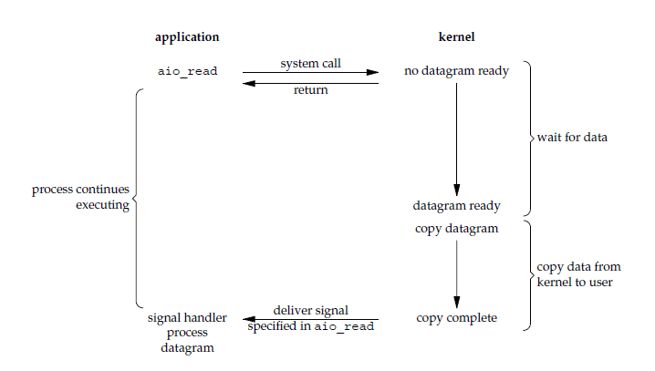

或者网友提供的

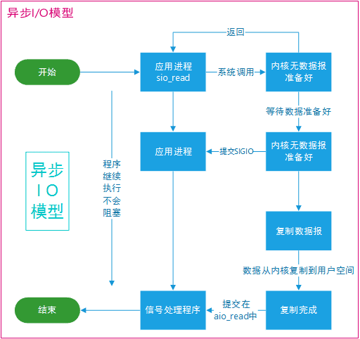

## 参考链接

* https://zh.wikipedia.org/zh-cn/I/O

* https://developer.mozilla.org/zh-CN/docs/Learn/JavaScript/Asynchronous/Introducing

* https://www.zhihu.com/question/19732473/answer/241673170

* https://pdai.tech/md/java/io/java-io-model.html
