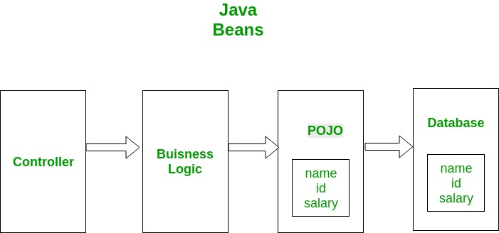

# 名词解释——POJO

> 本文译自< https://www.geeksforgeeks.org/pojo-vs-java-beans/>，主要讲解 POJO 的特点与用处，并与 Java Bean 进行对比。@qiuchi

## 什么是POJO

POJO 全称是 Plain Old Java Object。
**它是一个普通的 Java 对象，不受任何特殊限制的约束**，只受 Java 语言规范的约束，不需要任何类路径（ not requiring any classpath，秋迟感觉意思应该是不需要依赖其它类）。POJO 用于提高程序的可读性和可重用性。POJO 获得了最多的接受，因为它们易于编写和理解。它们是在 EJB 3.0 中由 Sun microsystems 引入的。

POJO不应：

* 继承预先指定的类

    例如：public class GFG extends javax.servlet.http.HttpServlet { … } 不是 POJO 类。

* 实现预先指定的接口
  
    例如：public class Bar implements javax.ejb.EntityBean { … } 不是 POJO 类。
> 这一点跟后面的`实现 Serializable 接口`相悖，姑且认为这一点不包括`Serializable接口`吧。@qiuchi

* 包含预先指定的注解

    例如：@javax.persistence.Entity public class Baz { … }不是 POJO 类。

POJO定义了一个实体。如果您想要一个Employee类，那么您可以创建一个POJO，如下所示：
```java
// Employee POJO class to represent entity Employee
public class Employee
{
	// default field
	String name;

	// public field
	public String id;

	// private salary
	private double salary;

	//arg-constructor to initialize fields
	public Employee(String name, String id,
							double salary)
	{
		this.name = name;
		this.id = id;
		this.salary = salary;
	}

	// getter method for name
	public String getName()
	{
		return name;
	}

	// getter method for id
	public String getId()
	{
		return id;
	}

	// getter method for salary
	public Double getSalary()
	{
		return salary;
	}
}
```
上面的示例是 POJO 类的一个定义良好的示例。如您所见，
* 对字段的访问修饰符（access-modifiers）没有限制。它们可以是私有的、默认的、受保护的或公有的（private, default, protected, or public）。
* 另外，类中可以不包含任何构造函数。

POJO 是一个封装了业务逻辑的对象（an object which encapsulates Business Logic）。下图显示了 POJO 类的工作示例。控制器与业务逻辑交互，业务逻辑又与 POJO 交互以访问数据库。在此示例中，数据库实体由 POJO 表示。这个 POJO 具有与数据库实体相同的成员。


## 什么是Java Beans
Bean 是特殊类型的POJO,POJO 成为一种Bean是有一些条件的：

  1. 所有的 JavaBean 都是 POJO，但并非所有的 POJO 都是 JavaBean。
   
  2. **Serializable，Bean 应该实现 Serializable 接口**。(一些没有实现 Serializer 接口的 POJO 仍被称为 POJO。)
  > 这里原文是：
  >Serializable i.e. they should implement Serializable interface. Still, some POJOs who don’t implement a Serializable interface are called POJOs because Serializable is a marker interface and therefore not of many burdens.

  3. **字段应该是私有的**。这是为了提供对字段的完全控制。

  4. **字段应该有 getter 或 setter**，或者两者都有。

  5. Bean 中应该有一个 **无参（no-arg）构造函数**。

  6. 字段只能由构造函数或 getter 设置器访问。

Getter 和 Setter 根据字段名，有特殊的命名规则。例如，如果字段名是 someProperty，那么它的 getter 最好是:
```java
public "returnType" getSomeProperty()
{
   return someProperty;
} 
```
而setter 方法如下：
```java
public void setSomePRoperty(someProperty)
{
   this.someProperty=someProperty;
}
```
Getter 和 Setter 方法通常可见性设为 public。Getter 和 Setter 提供了对字段的完全限制。例如考虑下面的属性：
```java
Integer age;
```
如果你把 age 的可见性设置为 public，（如 `public Integer age`）那么任何对象都可以直接访问。假设你想让 age 不能为0，在这种情况下，你就无法控制了。任何对象都可以将其设置为 0 。但是通过使用 setter 方法，你就可以控制。你可以在 setter 方法中设置一个条件。同样，对于 getter 方法，如果你希望你的年龄是 0，那么它应该返回 null，你可以通过使用 getter 方法来实现，如下所示：

```java
// Java program to illustrate JavaBeans
class Bean
{
	// private field property
	private Integer property;
	Bean()
	{
		// No-arg constructor
	}
	
	// setter method for property
	public void setProperty(Integer property)
	{
		if (property == 0)
		{
			// if property is 0 return
			return;
		}
		this.property=property;
	}
	
	// getter method for property
	public Integer getProperty()
	{
		if (property == 0)
		{
			// if property is 0 return null
			return null;
		}
		return property;
	}
}
	
// Class to test above bean
public class GFG
{
	public static void main(String[] args)
	{
		Bean bean = new Bean();
	
		bean.setProperty(0);
		System.out.println("After setting to 0: " +
								bean.getProperty());
	
		bean.setProperty(5);
		System.out.println("After setting to valid" +
					" value: " + bean.getProperty());
	}
}
```
Output:- 
```

After setting to 0: null
After setting to valid value: 5
```
## POJO vs Java Bean
<table><thead><tr><th><p style="text-align:center">POJO</p></th><th><p style="text-align:center">Java Bean</p></th></tr></thead><tbody><tr><td>It doesn’t have special restrictions other than those forced by Java language.（只被Java语言限制）</td><td>It is a special POJO which have some restrictions.（特殊的POJO）</td></tr><tr><td>It doesn’t provide much control on members.（对成员变量的控制性不强）</td><td>It provides complete control on members.（完全控制成员变量（只能通过getter或者setter或者构造函数访问））</td></tr><tr><td>It can implement Serializable interface.（可以序列化，不必须）</td><td>It should implement serializable interface.（应该序列化）</td></tr><tr><td>Fields can be accessed by their names.</td><td>Fields are accessed only by getters and setters.</td></tr><tr><td>Fields can have any visibility.</td><td>Fields have only private visibility.</td></tr><tr><td>There may/may-not be a no-arg constructor.</td><td>It must have a no-arg constructor.（必须有无参构造函数）</td></tr><tr><td>It is used when you don’t want to give restriction on your members and give user complete access of your entity</td><td>It is used when you want to provide user your entity but only some part of your entity.</td></tr></tbody></table>

## 总结

POJO 类和 Bean 都用于定义 java 对象，以增加其可读性和可重用性。POJO 没有其他限制，而 Bean 是带有一些限制的特殊 POJO。
