# 内存泄漏是什么？Java中如何规避?内存溢出呢？

> 本文讲解了内存泄漏与内存溢出的区别。又专门说明了Java中一些常见原因导致的内存泄漏，以及如何规避。@qiuchi

## **内存泄漏**（memory leak）

>  When a [program](https://simple.wikipedia.org/wiki/Computer_program) gets executed, it uses [memory](https://simple.wikipedia.org/wiki/Random_access_memory). In some cases, **a poorly-written program may incorrectly manage the  memory that has been given to it**. As a consequence, the memory that was  actually supposed to be reused after the program has finished its job  cannot be accessed again. This is known as a **memory leak**.
>
> One of the most common reasons for memory leaks is the program not giving its memory back after it has finished execution. 
>
> Memory leaks may result in several issues such as degradation of [performance](https://simple.wikipedia.org/wiki/Computer_performance) and systems being unresponsive.

<!-- more -->

以上来自维基百科，翻译一下就是，

* 主因：**[计算机程序](https://zh.m.wikipedia.org/wiki/計算機程序)的[内存管理](https://zh.m.wikipedia.org/wiki/記憶體管理)失当**。程序结束之后，**应该被重复利用的内存，无法被访问**。
* 普遍原因：程序结束后没有释放内存
* 内存泄漏可能导致性能下降和系统无响应等几个问题。

## 内存溢出（Out of memory）

> **Out of memory** (**OOM**) is an often undesired state of  computer operation where no additional memory can be allocated for use  by programs or the operating system.  Such a system will be unable to  load any additional programs, and since many programs may load  additional data into memory during execution, these will cease to  function correctly. This usually occurs because all available memory,  including disk [swap space](https://en.wikipedia.org/wiki/Swap_space), has been allocated.

以上来自[维基百科](https://en.wikipedia.org/wiki/Out_of_memory)，翻译一下是：

内存溢出（OOM）是通常不希望的计算机操作状态，在该状态下，**无法分配其他内存以供程序或操作系统使用**。这样的系统将无法加载任何其他程序，并且由于许多程序在执行过程中可能会将其他数据加载到内存中，因此这些程序将停止运行正常。通常会发生这种情况，因为所有可用的内存（包括磁盘交换空间）都已分配。

## 两者关系

内存泄漏最终可能导致内存溢出。

## 在Java中的内存泄漏

### 1. 概念

​		我们知道，Java是可以自动进行垃圾回收的，不需要程序自己释放内存，说到这里，可能有人觉得，那Java是不是永远不会发生内存泄露了，其实不然。因为垃圾回收只会回收无引用的实例，如果一些实例已不再使用，但是还是被引用着，垃圾回收器无法对其回收，就会造成内存泄漏。

> A Memory Leak is a situation **where there are objects present in  the heap that are no longer used, but the garbage collector is unable to remove them from memory,** and therefore, they're unnecessarily maintained.
>
> A memory leak is bad because it **blocks memory resources and degrades system performance over time**. If not dealt with, the application will eventually exhaust its resources, finally terminating with a fatal *java.lang.OutOfMemoryError*.

注意，没错，若内存泄漏不及时解决，等到内存资源耗尽时，就会造成 *java.lang.OutOfMemoryError*.

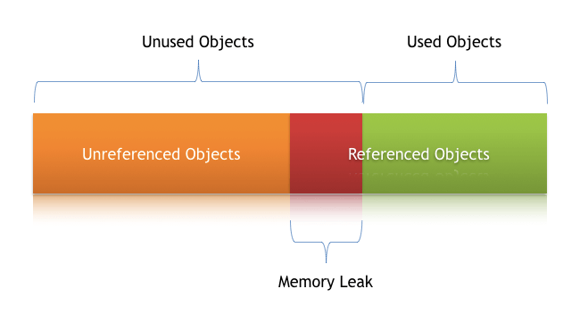

### 2. **内存泄漏的特点**

> **Symptoms of a Memory Leak**
>
> 
>
> - Severe performance degradation when the application is continuously running for a long time
> - *OutOfMemoryError* heap error in the application
> - Spontaneous and strange application crashes
> - The application is occasionally running out of connection objects.
即：

* 当应用程序连续运行很长时间时，严重的性能降解
* 应用程序出现`OutofMemoryError`堆错误
* 自发和奇怪的应用程序崩溃
* 该应用程序偶尔会用尽连接对象

在这里我们区分一下*application*与*program*,文章[Is There any Difference between a “Program” and an “Application“?](https://flatrocktech.com/is-there-any-difference-between-a-program-and-an-application/)有这样一段话：

> Although they might be sometimes used interchangeably, we should associate an end user when we are talking about an application and relate a program to a set of instructions that could be executed on a computer.

大致意思是，虽然*application*与*program*有时可以互换使用，但是当我们谈论*application*（应用程序）时，我们应该将其与**最终用户**关联起来；而将*program*（程序）与**可以在计算机上执行的一组指令**关联起来。所以，就比如“微信”、“QQ”就可以被称为应用程序（*application*），而程序（*program*），一般指一段代码。


----

那么在Java中有哪些情况会导致内存泄漏呢？又如何规避？
<https://www.baeldung.com/java-memory-leaks>

### **3. Types of Memory Leaks in Java**

In any application, memory leaks can occur for numerous reasons. In this section, we'll discuss the most common ones.

> 这部分主要讲了内存泄漏的几个最常见的原因

#### **3.1. Memory Leak Through *static* Fields**

The first scenario[səˈnærioʊ]（场景） that can cause a potential memory leak is heavy use of *static* variables.

In Java, ***static* fields have a life that usually matches the entire lifetime of the running application** (unless *ClassLoader* becomes eligible for garbage collection).                                                                                                                                                                                                                                                                                                                                                                                                                                                                                                                                                                                                                                                                       

> 在 Java 中，***static* 字段的生命周期通常与正在运行的应用程序的整个生命周期相匹配**（除非 *ClassLoader* 符合垃圾回收条件）。

Let's create a simple Java program that populates a *static* *List:*


```java
public class StaticTest {
    public static List<Double> list = new ArrayList<>();

    public void populateList() {
        for (int i = 0; i < 10000000; i++) {
            list.add(Math.random());
        }
        Log.info("Debug Point 2");
    }

    public static void main(String[] args) {
        Log.info("Debug Point 1");
        new StaticTest().populateList();
        Log.info("Debug Point 3");
    }
}
```

If we analyze the Heap memory during this program execution, then  we'll see that between debug points 1 and 2, the heap memory increased  as expected.

But when we leave the *populateList()* method at the debug point 3, **the heap memory isn't yet garbage collected,** as we can see in this VisualVM response:

> 下面是使用*static*时的堆内存图，可以看到，当离开*populateList()*方法后，*list*占用的堆内存并没有被垃圾回收。

 

[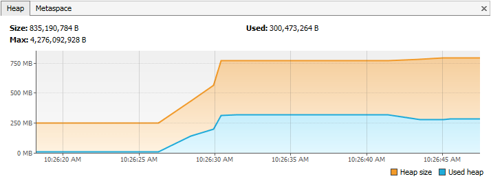](https://www.baeldung.com/wp-content/uploads/2018/11/memory-with-static.png)

However, if we just drop the keyword *static* in line number 2 of the above program, then it'll bring a drastic（激烈的） change to the memory  usage, as shown in this Visual VM response:

> 下面是去掉*static*时的堆内存图，可以看到，当离开*populateList()*方法后，*list*占用的堆内存被垃圾回收。因为已经没有对*list*的任何引用。

 

[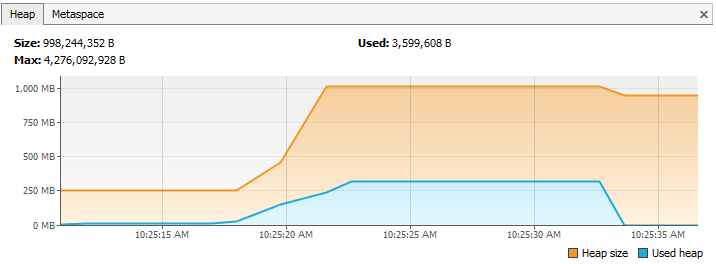](https://www.baeldung.com/wp-content/uploads/2018/11/memory-without-static.png)

The first part until the debug point is almost the same as what we obtained in the case of *static.* But this time, after we leave the *populateList()* method, **all the memory of the list is garbage collected because we don't have any reference to it**.

So we need to <u>pay very close attention to</u> （密切关注）our usage of *static* variables. If collections or large objects are declared as *static*, then they remain in the memory throughout the lifetime of the  application, thus blocking <u>vital memory</u>（重要内存） that could otherwise be used  elsewhere（本该在其它地方使用）.

**How to Prevent It?**


- Minimize the use of *static* variables.
- When using singletons, rely upon an implementation that lazily loads the object, instead of eagerly loading.

> 我们应该密切关注对静态变量的使用。如果集合或者大对象被声明为*static*，它们会一直伴随着应用程序的生命周期存在（当然，这只针对加载了的类。那些没有被加载过的类，是不会出现在在生命周期中的）。


#### **3.2. Through Unclosed Resources**


Whenever we make a new connection or open a stream, the JVM allocates memory for these resources. A few examples of this include database  connections, input streams, and session objects.

Forgetting to close these resources can block the memory, thus  keeping them out of the reach of the GC. This can even happen in case of an exception that prevents the program execution from reaching the  statement that's handling the code to close these resources.

In either case, **the open connection left from the resources consumes memory**, and if we don't deal with them, they can deteriorate performance, and even result in an *OutOfMemoryError*.

**How to Prevent It?**

- Always use *finally* block to close resources.
- The code (even in the *finally* block) that closes the resources shouldn't have any exceptions itself.
- When using Java 7+, we can make use of the *try*-with-resources block.

> 这一段主要说了，要注意关闭流呀。

#### **3.3. Improper *equals()* and *hashCode()* Implementations**

When defining new classes, a very common oversight（疏忽） is not writing proper overridden methods for the *equals()* and *hashCode()* methods.

*HashSet* and *HashMap* use these methods in many  operations, and if they're not overridden correctly, they can become a  source for potential memory leak problems.

Let's take an example of a trivial *Person* class, and use it as a key in a *HashMap*:

```java
public class Person {
    public String name;
    
    public Person(String name) {
        this.name = name;
    }
}
```

Now we'll insert duplicate *Person* objects into a *Map* that uses this key.


Remember that a *Map* can't contain duplicate keys:

```java
@Test
public void givenMap_whenEqualsAndHashCodeNotOverridden_thenMemoryLeak() {
    Map<Person, Integer> map = new HashMap<>();
    for(int i=0; i<100; i++) {
        map.put(new Person("jon"), 1);
    }
    Assert.assertFalse(map.size() == 1);
}
```

Here we're using *Person* as a key. Since *Map* doesn't allow duplicate keys, the numerous duplicate *Person* objects that we inserted as a key shouldn't increase the memory.

But **since we haven't defined the proper \*equals()\* method, the duplicate objects <u>pile up</u>（堆积） and increase the memory**, which is why we see more than one object in the memory. The Heap Memory in VisualVM for this looks like:

 

[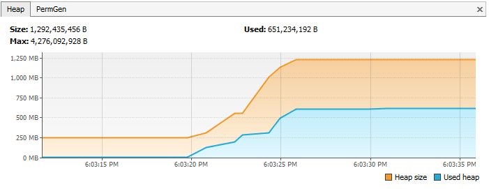](https://www.baeldung.com/wp-content/uploads/2018/11/Before_implementing_equals_and_hashcode.png)

However, **if we'd overridden the \*equals()\* and \*hashCode()\* methods properly, then only one \*Person\* object would exist in this \*Map.\***

Let's take a look at the proper implementations of *equals()* and *hashCode()* for our *Person* class:

```java
public class Person {
    public String name;
    
    public Person(String name) {
        this.name = name;
    }
    
    @Override
    public boolean equals(Object o) {
        if (o == this) return true;
        if (!(o instanceof Person)) {
            return false;
        }
        Person person = (Person) o;
        return person.name.equals(name);
    }
    
    @Override
    public int hashCode() {
        int result = 17;
        result = 31 * result + name.hashCode();
        return result;
    }
}
```

And in this case, the following assertions would be true:

```java
@Test
public void givenMap_whenEqualsAndHashCodeNotOverridden_thenMemoryLeak() {
    Map<Person, Integer> map = new HashMap<>();
    for(int i=0; i<2; i++) {
        map.put(new Person("jon"), 1);
    }
    Assert.assertTrue(map.size() == 1);
}
```

After properly overriding *equals()* and *hashCode()*, the Heap Memory for the same program looks like:


 

[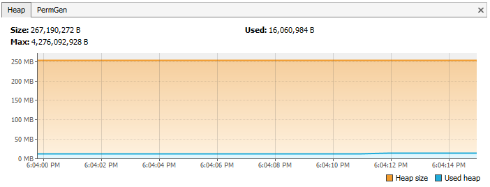](https://www.baeldung.com/wp-content/uploads/2018/11/Afterimplementing_equals_and_hashcode.png)

Another option is using an ORM tool like Hibernate, which uses the *equals()* and *hashCode()* methods to analyze the objects and saves them in the cache.

**The chance of memory leaks is quite high if these methods aren't overridden** because Hibernate wouldn't be able to compare objects and would fill its cache with duplicate objects.

**How to Prevent It?**

- As a rule of thumb, when defining new entities, always override the *equals()* and *hashCode()* methods.
- It's not enough to just override, these methods must be overridden in an <u>optimal way</u>（最佳方式） as well.

For more information, visit our tutorials [Generate *equals()* and *hashCode()* with Eclipse](https://www.baeldung.com/java-eclipse-equals-and-hashcode) and [Guide to *hashCode()* in Java](https://www.baeldung.com/java-hashcode).

> 这一点主要是说，为了避免使用*HashSet* 、 *HashMap* 等时出错，建议：
>
> * 当定义实体时，总是重写*equals()* 与 *hashCode()* 方法。

#### **3.4. Inner Classes That Reference Outer Classes**


This happens in the case of non-static inner classes (anonymous  classes（匿名类）). For initialization, these inner classes always require an  instance of the enclosing class.

Every non-static Inner Class has, by default, an <u>implicit reference</u>（隐式引用）  to its containing class. If we use this inner class' object in our  application, then **even after our containing class' object goes out of scope, it won't be garbage collected**.

Consider a class that holds the reference to lots of bulky（笨重的） objects  and has a non-static inner class. When we create an object of just the  inner class, the memory model looks like:


 

[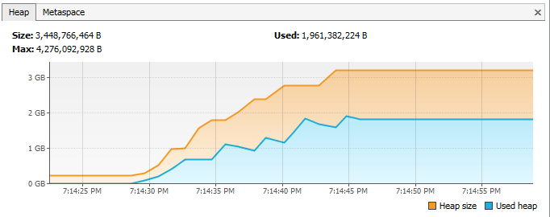](https://www.baeldung.com/wp-content/uploads/2018/11/Inner_Classes_That_Reference_Outer_Classes.png)

However, if we just declare the inner class as static, then the same memory model looks like this:

[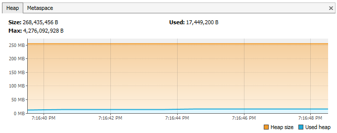](https://www.baeldung.com/wp-content/uploads/2018/11/Static_Classes_That_Reference_Outer_Classes.png)

This happens because the inner class object implicitly holds a  reference to the outer class object, thereby making it an invalid  candidate for garbage collection. The same happens in the case of  anonymous classes.

**How to Prevent It?**

- If the inner class doesn't need access to the containing class members, consider turning it into a *static* class.

> 如果**非静态内部类（或匿名类）**不需要访问包含其的类的成员，请考虑将其变成  *static* class。
>
> 关于内部类，可以参考：https://www.liaoxuefeng.com/wiki/1252599548343744/1376414781669409

#### **3.5. Through *finalize()* Methods**


Use of finalizers is yet another source of potential memory leak issues. Whenever a class' *finalize()* method is overridden, then **objects of that class aren't instantly garbage collected.** Instead, the GC queues them for finalization, which occurs at a later point in time.

Additionally, if the code written in the *finalize()* method  isn't optimal, and if the finalizer queue can't keep up with the Java  garbage collector, then sooner or later our application is destined to  meet an *OutOfMemoryError*.

> finalizers的使用是潜在内存泄漏问题的另一个来源。每当类*finalize ()* 方法被重写时，**该类的对象就不会立即被垃圾收集**。相反，GC 将它们排队等待终结，这将在以后的某个时间点发生。
>
> 此外，如果在 *finalize ()* 方法中编写的代码不是最优的，并且终结器队列无法跟上 Java 垃圾收集器，那么我们的应用程序迟早会遇到 *OutOfMemory* 。

To demonstrate this, let's imagine that we have a class for which we've overridden the *finalize()* method, and that the method takes a little bit of time to execute. When a large number of objects of this class get garbage collected, it looks like this in VisualVM:

 


[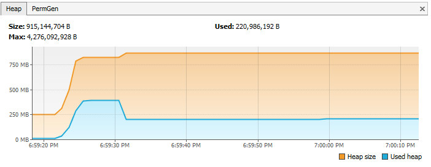](https://www.baeldung.com/wp-content/uploads/2018/11/Finalize_method_overridden.png)

However, if we just remove the overridden *finalize()* method, then the same program gives the following response:

[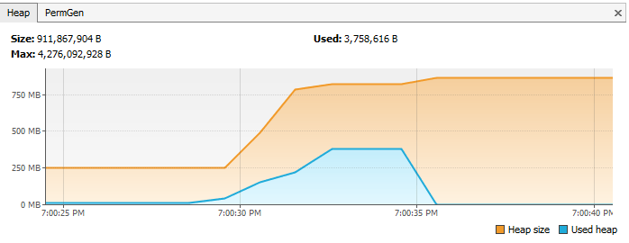](https://www.baeldung.com/wp-content/uploads/2018/11/Finalize_method_not_overridden.png)

**How to Prevent It?**

- We should always avoid finalizers.

For more detail about *finalize()*, we can refer to section 3 (*Avoiding Finalizers)* in our [Guide to the finalize Method in Java](https://www.baeldung.com/java-finalize).

> 要避免使用finalizers，即别重写*finalize()*方法。

#### **3.6. Interned *Strings***


The Java *String* pool went through a major change in Java 7  when it was transferred from PermGen to HeapSpace. However, for  applications operating on version 6 and below, we need to be more  attentive when working with large *Strings.* 

**If we read a massive *String* object, and call *intern()* on that object, it goes to the string pool, which is located in PermGen (permanent memory), and will stay there as long as our application  runs.** This blocks the memory and creates a major memory leak in our application.

The PermGen for this case in JVM 1.6 looks like this in VisualVM:

 

[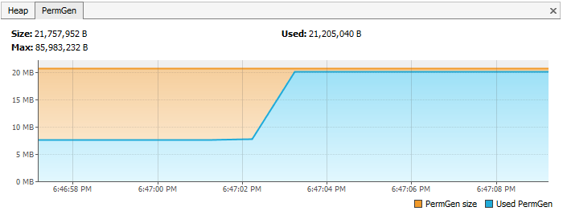](https://www.baeldung.com/wp-content/uploads/2018/11/Interned_Strings.png)

In contrast, if we just read a string from a file in a method, and don't intern it, then the PermGen looks like:


[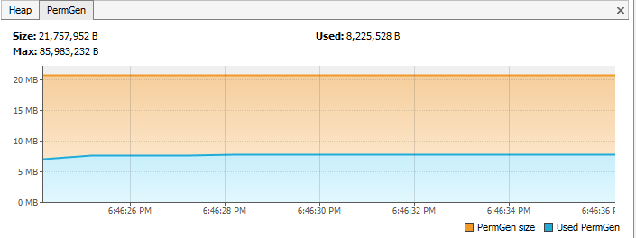](https://www.baeldung.com/wp-content/uploads/2018/11/Normal_Strings.png)

 

**How to Prevent It?**

- The simplest way to resolve this issue is by upgrading to the latest Java version, as String pool moved to HeapSpace starting with Java  version 7.

- If we're working on large *Strings*, we can increase the size of the PermGen space to avoid any potential *OutOfMemoryErrors*:

  ```powershell
  -XX:MaxPermSize=512m
  ```

> 上面说明，当使用Java7及以上版本，不用顾及*String Pool*
>
> 否则，注意扩大PermGen space 的大小

> 秋迟查询的关于**字符串池**的[资料](https://www.digitalocean.com/community/tutorials/what-is-java-string-pool)，觉得下面叙述针对的应该是Java7及以上：
>
> String Pool is maintained in java heap space.
>
> String Pool is possible only because String is immutable（不可变） in Java and its implementation of **String interning concept**. String pool is also example of Flyweight design pattern. String pool helps in saving a lot of space for Java Runtime although it takes more time to create the String（尽管创建字符串需要更多的时间，字符串池有助于为 JavaRuntime 节省大量空间）. 
>
> **When we use double quotes to create a String, it first looks for String with the same value in the String pool, if found it just returns the reference else it creates a new String in the pool and then returns the reference.** However using **new operator**, we force String class to **create a new String object in heap space**. **We can use intern() method to put it into the pool** or refer to another String object from the string pool having the same value. 
>
> 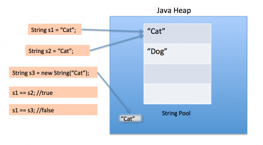
>
> * 当我们使用双引号创建一个 String ：它首先在 String 池中查找具有相同值的 String，如果找到它只返回这个值对应的引用，否则它将在池中创建一个新的 String，然后返回这个引用。
> * 使用 new 运算符，我们强制 String 类在堆空间中创建一个新的 String 对象（此时不会放在池中）。我们可以使用 intern()方法将其放入池中，或者引用具有相同值的字符串池中的另一个 String 对象。

#### **3.7. Using *ThreadLocal*s**


[*ThreadLocal*](https://docs.oracle.com/en/java/javase/11/docs/api/java.base/java/lang/ThreadLocal.html) (discussed in detail in the [Introduction to *ThreadLocal* in Java](https://www.baeldung.com/java-threadlocal) tutorial) is a construct that gives us the ability to isolate state to a particular thread, and thus allows us to achieve thread safety.

When using this construct, **each thread will hold an implicit reference to its copy of a *ThreadLocal* variable and will maintain its own copy, instead of sharing the  resource across multiple threads, as long as the thread is alive.**

> 当使用这个构造时，**每个线程将隐式地引用它对 *ThreadLocal* 变量的副本，并将维护它自己的副本，而不是在多个线程之间共享资源，只要线程是活动的**。

Despite its advantages, the use of *ThreadLocal* variables is  controversial, as they're infamous for introducing memory leaks if not  used properly. Joshua Bloch once commented on thread local usage that:

> “Sloppy use of thread pools in combination with sloppy  use of thread locals can cause unintended object retention, as has been  noted in many places. But placing the blame on thread locals is  unwarranted.”

**Memory Leaks with *ThreadLocals***

*ThreadLocals* are supposed to be garbage collected once the holding thread is no longer alive. But the problem arises when we use *ThreadLocals* along with modern application servers.

Modern application servers use a pool of threads to process requests, instead of creating new ones (for example, [the *Executor*](https://tomcat.apache.org/tomcat-7.0-doc/config/executor.html) in the case of Apache Tomcat). Moreover, they also use a separate classloader.

> 线程池使用单独的类加载器，使用的是线程池，不会进行垃圾回收。


Since [Thread Pools](https://www.baeldung.com/thread-pool-java-and-guava) in application servers work on the concept of thread reuse, they're  never garbage collected; instead, they're reused to serve another  request.

If any class creates a *ThreadLocal* variable, but doesn't explicitly remove it, then a copy of that object will remain with the worker *Thread* even after the web application is stopped, thus preventing the object from being garbage collected.

> 由于应用程序服务器中的线程池遵循线程重用的概念，所以它们从不被垃圾收集; 相反，它们被重用来服务另一个请求。
>
> 如果任何类创建了 ThreadLocal 变量，但没有显式地删除它，那么该对象的一个副本将保留在工作线程中，即使在 Web 应用程序停止之后也是如此，从而对象无法被垃圾收集。

**How to Prevent It?**

- It's good practice to clean-up *ThreadLocals* when we're no longer using them. *ThreadLocals* provide the [*remove()*](https://docs.oracle.com/en/java/javase/11/docs/api/java.base/java/lang/ThreadLocal.html#remove()) method, which removes the current thread's value for this variable.

- **Don't use *ThreadLocal.set(null)* to clear the value.** It doesn't actually clear the value, but will instead look up the *Map* associated with the current thread and set the key-value pair as the current thread and *null,* respectively.

  > 不要使用 ThreadLocal.set (null)来清除值。它实际上并不清除该值，而是查找与当前线程关联的 Map，并将键值对分别设置为当前线程和 null。

- It's best to consider *ThreadLocal* a resource that we need to close in a *finally* block, even in the case of an exception:

```java
try {
    threadLocal.set(System.nanoTime());
    //... further processing
}
finally {
    threadLocal.remove();
}
```

> `ThreadLocal`无法被垃圾回收，使用`ThreadLocal`时，记住要使用`remove()`方法清除值。

### **4. Other Strategies for Dealing With Memory Leaks**


Although there's no <u>one-size-fits-all solution</u>（通用方法） when dealing with  memory leaks, there are some ways by which we can minimize these leaks.

> 虽然在处理内存泄漏时没有一个“一刀切”的解决方案，但是有一些方法可以使这些泄漏最小化。

#### **4.1. Enable Profiling**（分析）


Java profilers are tools that monitor and diagnose the memory leaks  through the application. They analyze what's going on internally in our  application, like how we allocate（分配） memory.

**Using profilers, we can compare different approaches（方法） and find areas where we can optimally（最佳地） use our resources.**

Throughout section 3 of this tutorial, we used [Java VisualVM](https://visualvm.github.io/). Please check out our [Guide to Java Profilers](https://www.baeldung.com/java-profilers) to learn about different types of profilers, like Mission Control,  JProfiler, YourKit, Java VisualVM, and the Netbeans Profiler.


#### **4.2. Verbose Garbage Collection**


By enabling verbose（详细的） garbage collection, we can track the detailed  trace of the GC. To enable this, we need to add the following to our JVM configuration:

```plaintext
-verbose:gc
```

By adding this parameter, we can see the details of what's happening inside the GC:

[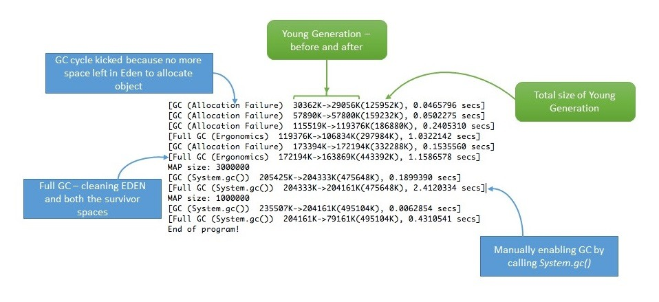](https://www.baeldung.com/wp-content/uploads/2018/11/verbose-garbage-collection.jpg)

> 这一块主要讲了，使用`-verbose:gc`命令，以查看更详细的垃圾回收内容。

> Full GC后面的括号就是本次GC所产生的原因。
>
> Full GC后面有一个单词叫Ergonomics，**Ergonomics翻译成中文，一般都是“人体工程学”。在JVM中的垃圾收集器中的Ergonomics就是负责自动的调解gc暂停时间和吞吐量之间的平衡，然后你的虚拟机性能更好的一种做法。**
>
> 更多关于Full GC源码，可以参考：https://cloud.tencent.com/developer/article/1082687

#### **4.3. Use Reference Objects to Avoid Memory Leaks**


We can also resort to reference objects in Java that come built-in with the *java.lang.ref* package to deal with memory leaks. Using the *java.lang.ref* package, instead of directly referencing objects, we use special  references to objects that allow them to be easily garbage collected.

Reference queues make us aware of the actions the Garbage Collector performs. For more information, we can read the [Soft References in Java](https://www.baeldung.com/java-soft-references) tutorial, specifically section 4.

> 使用软链接去避免内存泄漏的一些提示。

#### **4.4. Eclipse Memory Leak Warnings**


For projects on JDK 1.5 and above, Eclipse shows warnings and errors  whenever it encounters obvious cases of memory leaks. So when developing in Eclipse, we can regularly visit the “Problems” tab and be more  vigilant about memory leak warnings (if any):

[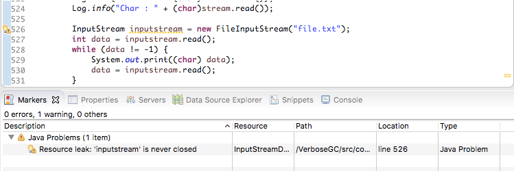](https://www.baeldung.com/wp-content/uploads/2018/11/Eclipse-_Memor-_Leak-_Warnings.png)

> 多多注意提示。

#### **4.5. Benchmarking**（基准测试）

 

We can measure and analyze the Java code's performance by executing  benchmarks. This way, we can compare the performance of alternative  approaches to do the same task. This can help us choose the best  approach, and may help us conserve memory.


For more information about benchmarking, please head over to our [Microbenchmarking with Java](https://www.baeldung.com/java-microbenchmark-harness) tutorial.

> 可以使用JMH (the Java Microbenchmark Harness)工具来优化代码。


## 参考链接

> * https://simple.wikipedia.org/wiki/Memory_leak
>* https://flatrocktech.com/is-there-any-difference-between-a-program-and-an-application/
> * https://www.baeldung.com/java-memory-leaks