::: tip 读前须知
前提：第 01 篇。本篇回答：分析器拿到的不是源码文本，那它面对的是什么？Java 源码经过哪几步变成 Soot 可以逐条处理的语句和“下一步可能执行谁”的图。第 4、5 节的 Coverity 与 Clang 是对照阅读，首次可跳过。
:::

<!-- more -->

对[上一例](01-goals-and-abstraction.md)中的 `y=x`，人可以直接看出变量之间的赋值关系。分析器也需要这样的表示，还需要知道分支后会执行哪条语句。Soot 可以从 Java 字节码构建 Jimple，再建立控制流图，供分析规则使用。

以下涉及三个缩写：**IR（intermediate representation，中间表示）**是编译器或分析器内部使用的程序形式；**AST（abstract syntax tree，抽象语法树）**按源码语法结构组织程序；**CFG（control-flow graph，控制流图）**记录语句之间可能的执行转移。

## 1. 编译六阶段与前端、中端、后端

六阶段描述编译器完成的工作；前端、中端、后端按职责把这些工作归组。下面采用编译原理教材的典型划分（见龙书第 1 章，[Aho 等，Compilers: Principles, Techniques, and Tools](https://suif.stanford.edu/dragonbook/)），实际工具的阶段边界可以不同。



[查看可编辑图源](https://github.com/Scrates1/Scrates1.github.io/blob/main/src/static-analysis/assets/02-01-compiler-stages.mmd)

**图 1：典型职责划分。** 初始 IR 生成放在前端末尾，第五阶段是代码优化，分析为优化提供依据。分析也可以发生在其他阶段，例如前端的类型检查；安全分析还可以直接输出报告。

后面的工具架构图沿用以下配色：

- **蓝色**：输入理解与表示构建。
- **绿色**：分析或变换。
- **橙色**：目标代码生成。
- **灰色**：输入、结果或说明。

①—⑥用于标识后续工具图与这六个阶段的对应关系。

## 2. Soot：从字节码建立便于分析的 Jimple

Soot 提供读取类和方法、转换程序表示、构建分析图等基础设施。本篇采用传统 Soot 的常见路线：读入 Java 字节码，转换成 Jimple，再建立控制流图。[Soot 官方介绍](https://soot-oss.github.io/soot/)



[查看可编辑图源](https://github.com/Scrates1/Scrates1.github.io/blob/main/src/static-analysis/assets/02-02-soot.mmd)

**图 2：Soot 的字节码输入路线。** 实线表示处理或结果流，虚线表示可选输出。这里 javac 先生成字节码，Soot 的前端再将字节码转换成 Jimple。

Jimple 是有类型的三地址（three-address）IR：每条语句最多一个运算、最多三个操作数。Soot 也支持程序变换与字节码输出，具备后端职责；纯分析任务可以在得到结果时结束。[Soot 框架论文](https://soot-oss.github.io/soot/resources/lblh11soot.pdf)

生成 Jimple 后，分析作者仍需定义：

- 哪些调用是输入源，哪些操作是敏感点。
- 赋值等语句怎样传播分析信息。
- 外部库怎样建模。

## 3. 从源码到控制流图

### 3.1 源码中的赋值与分支

下面是配套程序 [BranchFlow.java](https://github.com/Scrates1/Scrates1.github.io/blob/main/examples/static-analysis/src/main/java/tutorial/BranchFlow.java) 中的完整目标方法：

```java
public static void run(boolean flag) {
    String x = input();
    String y = "safe";
    if (flag) {
        y = x;
    }
    sink(y);
}
```

约定 `input()` 返回不可信数据，`sink()` 代表需要检查参数的操作。样例分别用读取系统属性和打印字符串实现它们，打印只用于观察结果。分析目标仍是判断 y 是否可能来自 input。

先按 Java 语义看两条执行路线：

- `flag=true`：执行 `y=x`，sink 接收输入值。
- `flag=false`：跳过赋值，sink 接收 `"safe"`。

以下只观察 `run` 的正常控制流，将调用视为一条语句，暂不展开被调方法和异常路径。

后面的输出使用 JDK 11.0.30、公开版 Soot 4.7.1 生成；复现方式见[配套示例](https://github.com/Scrates1/Scrates1.github.io/blob/main/examples/static-analysis/README.md)。

### 3.2 字节码：一次赋值可能对应多条栈指令

编译后用 `javap -c` 查看 `run`，得到以下指令。为便于阅读，省略常量池序号与完整方法描述符，保留真实指令及偏移量；完整输出见 [bytecode.txt](https://github.com/Scrates1/Scrates1.github.io/blob/main/examples/static-analysis/expected/bytecode.txt)。

```text
 0: invokestatic  input
 3: astore_1
 4: ldc           "safe"
 6: astore_2
 7: iload_0
 8: ifeq          13
11: aload_1
12: astore_2
13: aload_2
14: invokestatic  sink
17: return
```

左边的数字是字节码偏移量，不是源码行号。本例是静态方法，局部变量槽 0、1、2 分别保存 flag、x、y（实例方法的槽 0 是 `this`）。调用 input 后，返回值先位于操作数栈（operand stack，JVM 用来暂存中间值的栈），再由 `astore_1` 存入 x 对应的槽。

偏移 11、12 的 `aload_1` 把 x 加载到栈上，`astore_2` 再把它存入 y。这两条指令合起来表达源码中的 `y=x`。直接分析字节码时，需要跟踪栈上的值，才能恢复这层赋值关系。

偏移 7、8 则负责分支：加载 flag（JVM 把 boolean 当作 int 的 0/1 存放，所以用 `iload`），值为零时跳到偏移 13，直接准备调用 sink；否则继续执行复制。这里跳转的是“跳过 if 语句体”的路线，因此条件方向与源码表面写法相反。

### 3.3 Jimple：把变量依赖和跳转直接写出来

下面是根据[实际输出](https://github.com/Scrates1/Scrates1.github.io/blob/main/examples/static-analysis/expected/graph.txt)简化的 Jimple：省略声明和部分打印格式，添加 n1—n7 语句编号，并将跳转标签统一为 n6。此版本用于读图，不能直接作为 Jimple 文件解析。

```text
n1  flag := @parameter0: boolean;
n2  x = staticinvoke <tutorial.BranchFlow: java.lang.String input()>();
n3  y = "safe";
n4  if flag == false goto n6;
n5  y = x;
n6  staticinvoke <tutorial.BranchFlow: void sink(java.lang.String)>(y);
n7  return;
```

记号说明：

| 写法 | 在本例中的含义 |
| :--- | :--- |
| `flag := @parameter0: boolean` | 将第 0 个参数绑定到局部变量 flag；`:=` 是标识语句（IdentityStmt）中的绑定记号 |
| `x = ...`、`y = x` | 普通赋值，操作数关系直接可见 |
| `staticinvoke` | 调用静态方法；后面的尖括号给出方法签名 |
| `<tutorial.BranchFlow: void sink(java.lang.String)>` | 类名、返回类型、方法名和参数类型；表示 BranchFlow 中接收 String、返回 void 的 sink |
| `if ... goto n6` | 条件成立时跳到 n6，不成立时继续下一条语句 |

Jimple 直接写出 `y=x` 和调用结果的接收变量，复杂表达式也会拆成使用临时变量的简单操作。分析规则可以直接读取这些有类型的操作数，无需再恢复操作数栈。[SootUp 的 Jimple 说明](https://soot-oss.github.io/SootUp/v1.3.0/jimple/)（新一代 Soot 的文档，语法与 Soot 4.x 的 Jimple 基本一致）

顺带对比 AST：源码 `if (flag) { y = x; }` 在 AST 中是一个 `IfStmt` 节点，两个子节点分别是条件 `flag` 和 then 块，块里再挂一个赋值节点——树的形状就是源码的嵌套结构。Jimple 已经把这层嵌套拆平：n4 是一条带跳转目标的条件语句，n5 是一条普通赋值，“哪条语句在哪个块里”这样的结构信息不再保留，换来的是每条语句都能独立处理。

### 3.4 CFG：下一步可能执行哪条语句？

控制流图把程序位置作为节点，把可能的执行转移作为有向边。本例先采用语句级 CFG：每条 Jimple 语句对应一个节点。按顺序执行的语句连到下一条，条件跳转还连接它的目标。直白地说，CFG 回答的只有一个问题：执行完这条语句，下一条**可能**是谁；有分支就画两条出边，不判断哪条会真的走。



[查看可编辑图源](https://github.com/Scrates1/Scrates1.github.io/blob/main/src/static-analysis/assets/02-05-jimple-cfg.mmd)

**图 3：由实际 `BriefUnitGraph` 后继关系绘制的 CFG。** 调用简写为 `input()`、`sink(y)`，边表示可能的控制转移。

n4 是分支点，条件是 `flag == false`。读图时要按这个条件判断：

- `flag=false`：条件成立，跳到 n6。
- `flag=true`：条件不成立，顺序执行 n5。

两条路线在 n6 汇合，之后正常返回：

```text
flag=true ：n1 → n2 → n3 → n4 → n5 → n6 → n7
flag=false：n1 → n2 → n3 → n4 ───────→ n6 → n7
```

图中的入口是 n1，正常出口是 n7。

实际输出中的后继关系与图一致。下面按 n 编号整理了 graph.txt 中的 `successors` 列，去掉了语句文本：

```text
n4: successors = [n5, n6]
n5: successors = [n6]
n6: successors = [n7]
n7: successors = []
```

`BriefUnitGraph` 不含异常控制流边，对应本例只观察正常路径的范围。[BriefUnitGraph API](https://soot-oss.github.io/soot/docs/4.7.1/jdoc/soot/toolkits/graph/BriefUnitGraph.html)

### 3.5 基本块：把连续执行的语句收成一组

语句级图便于逐步讲解，但有些节点之间只有一条顺序路线。可以把这样的连续语句组成**基本块（basic block）**：在所选控制流模型中，控制从块首进入，块内没有分支或从外部跳入中间的路径，到块末再决定后续去向。直白地说，基本块就是“一口气从头执行到尾、中途既不会跳出也不会有人跳进来”的一段语句。一个块可以有多个后继，因此“单出口位置”不等于“只有一条出边”。

本例的 `BriefBlockGraph` 实际给出三个块：



[查看可编辑图源](https://github.com/Scrates1/Scrates1.github.io/blob/main/src/static-analysis/assets/02-06-basic-blocks.mmd)

**图 4：同一方法按基本块组织的正常控制流。** 各块包含：

- **B1（n1—n4）**：参数绑定、两个赋值和条件判断。
- **B2（n5）**：条件内的赋值。
- **B3（n6—n7）**：汇合后的调用和返回。

这里没有改变程序，只是把节点粒度从语句换成了基本块。

AST 侧重源码结构，Jimple 显式表达操作，CFG 则组织这些操作之间的控制流。表示中的节点不必与源码行一一对应，例如 n1 是源码里没有单独写出的参数绑定。

下面两节对照其他工具；首次沿 Java 主线学习时，可以直接进入第 6 节。

## 4. Coverity：捕获构建上下文

对 C/C++ 等编译型项目，同一份源文件在不同宏定义、头文件路径和编译选项下可能表示不同的程序。Coverity 的**构建捕获（build capture）**模式用 `cov-build` 包裹正常的构建命令，监控其中每一次编译器调用，取得文件、选项和环境，再让 Coverity 自己的编译器前端按同样的选项处理这些源文件，建立供分析使用的中间表示。Java 项目同样用它包裹 `mvn`、`javac` 等命令。[构建捕获命令](https://docs.blackduck.com/r/coverity/latest/coverity-documentation/coverity-capture.html)、[官方架构白皮书](https://www.blackduck.com/content/dam/black-duck/en-us/whitepapers/wp-build-security-sdlc-coverity.pdf)



[查看可编辑图源](https://github.com/Scrates1/Scrates1.github.io/blob/main/src/static-analysis/assets/02-03-coverity.mmd)

**图 5：正常构建与分析捕获。** 实线表示处理或输入输出关系，虚线表示监控捕获或解释说明。分析所需的表示由捕获流程建立，而非直接取自最终构建产物。

图中①—④是对源码理解与表示构建职责的教学类比，不代表 Coverity 的内部模块划分。本图仅覆盖构建捕获模式；最终报告属于分析结果，不属于编译后端的目标代码。

## 5. Clang：AST 之后的两条路线

Clang 把源码处理为 AST 后，两条路线在此分开：

- **编译路线**：生成 LLVM IR，再使用 LLVM 的优化器和后端生成目标代码。
- **Static Analyzer 路线**：利用源码级 AST/CFG 开展分析，生成问题报告。

流程依据：[Clang 命令说明](https://clang.llvm.org/docs/CommandGuide/clang.html)、[Clang 内部结构文档](https://clang.llvm.org/docs/InternalsManual.html)。



[查看可编辑图源](https://github.com/Scrates1/Scrates1.github.io/blob/main/src/static-analysis/assets/02-04-clang.mmd)

**图 6：同一前端表示可以支撑不同任务。** 绿色表示分析或变换职责，不意味着 Static Analyzer 是 LLVM 的第五阶段优化 Pass。AST 本身也是广义的程序中间表示；此图中的④特指编译路线上从 AST 到 LLVM IR 的生成，CFG 则是另一条路线上的控制流结构。

Clang 内部的 `CodeGen` 生成 LLVM IR，对应④；LLVM 后端生成目标代码，对应⑥。“代码生成”在这两处指向不同的产物。[Clang CodeGen 说明](https://clang.llvm.org/docs/InternalsManual.html)

Static Analyzer 的引擎进行路径敏感的符号执行（symbolic execution），检查器参与状态处理和问题报告。它能探索多少行为、排除多少不可行路径，取决于模型和探索限制。状态、约束和检查器的执行过程放到[第 09 篇](09-symbolic-execution-clang.md)深入说明。[检查器开发手册](https://clang-analyzer.llvm.org/checker_dev_manual)

## 6. 复现程序表示与控制流

1. 按[配套示例说明](https://github.com/Scrates1/Scrates1.github.io/blob/main/examples/static-analysis/README.md)准备固定依赖，执行其中的 PowerShell 命令，取得原始输出。
2. 比较字节码中的 `aload_1; astore_2` 与 Jimple 中的 `y=x`，确认它们表达同一次赋值。
3. 将输出中的后继列表与图 3 对照，再核对图 4 的基本块分组。

## 本篇要点

- 分析器面对的是**中间表示**而不是源码文本；Soot 从字节码构建 Jimple，每条语句只做一件事、操作数带类型，`y=x` 这样的依赖直接可见。
- 字节码是栈式指令，一次赋值可能对应多条指令（`aload_1; astore_2`），直接分析它需要先恢复栈上的值。
- **CFG** 的节点是语句（或基本块），边是“下一步可能执行谁”；本例 n4 有两条出边，两条路线在 n6 汇合。
- 基本块只是把顺序执行的语句打包，不改变程序。
- Coverity 靠监控构建过程取得 C/C++ 的真实编译上下文；Clang 在 AST 之后分成编译与 Static Analyzer 两条路线。三种工具都先建表示，再做分析。

下一篇在这张 CFG 上计算污点：赋值改变哪些事实，汇合点怎样合并，循环又怎样触发重算。

[上一篇：01 状态、抽象与近似](01-goals-and-abstraction.md) · [下一篇：03 数据流传播与工作列表](03-dataflow-and-worklist.md) · [返回系列总览](README.md)
