::: tip 读前须知
前提：第 01、02 篇。本篇回答：有了 CFG 之后，每个节点上的“可能有污点的变量”到底怎么一步步算出来，遇到循环为什么要算不止一遍，以及程序怎样知道什么时候算完了。本篇是全系列第一处完整的手算加运行核对，建议动手。
:::

<!-- more -->

[第 02 篇](02-compilation-and-tools.md)的 CFG 记录了语句和执行顺序。要判断 sink 是否收到污点，还需要在每个节点保存污点状态，并计算赋值、分支和循环带来的变化。

## 1. 节点的输入、输出与初始状态

沿用上一例，`input()` 产生不可信数据，`sink(y)` 检查 y。一个事实 `x` 表示“x 可能有污点”，状态 `{x,y}` 是多个事实组成的集合。

本篇只处理单方法、局部变量、显式赋值与正常控制流。布尔参数不携带污点；调用不展开，`input`、`sink` 和循环条件方法 `again` 使用明确模型。未知语句在配套实现中直接报错，避免将缺失模型悄悄当作安全。

对每个节点 n，记录：

- **IN[n]**：语句执行前可能有污点的变量。
- **OUT[n]**：语句执行后可能有污点的变量。
- **可达状态**：是否已有入口路径到达该节点。不可达与可达但集合为空分开保存。

可以把 IN 和 OUT 想成每条语句门前、门后各挂的一块小黑板：门前的黑板写着“走到这里时谁可能有污点”，语句按规则改写后抄到门后的黑板，再传给下一条语句的门前。

入口可达，IN 为空集；其他节点初始不可达。这里只在可达节点执行规则。

## 2. 转移规则与合并规则

设输入集合为 S，`S\{y}` 表示从 S 删除 y，`∪` 表示并集。

| 语句 | 输出规则 | 输入 `{x,y}` 时 |
| :--- | :--- | :--- |
| `x=input()` | `S∪{x}` | `{x,y}` |
| `y="safe"` | `S\{y}` | `{x}` |
| `y=x` | 先删除旧 y；若输入 S 含 x，再加入 y | `{x,y}` |
| 分支、跳转、sink、return | 保留 S | `{x,y}` |

复制规则必须读取**赋值前**的 x。例如 `x=x` 不会消除自己的污点；若先修改输入集合再检查右侧，就可能实现错。

本例是向前分析：从前驱的 OUT 计算后继的 IN。合并处取所有可达前驱的并集：

```text
IN[n]  = 所有可达前驱 OUT 的并集（入口另有边界条件）
OUT[n] = 当前语句的转移规则(IN[n])
```

## 3. 把 n1—n7 算完

| 节点 | 语句简写 | IN | OUT |
| :--- | :--- | :--- | :--- |
| n1 | 参数绑定 flag | `∅` | `∅` |
| n2 | `x=input()` | `∅` | `{x}` |
| n3 | `y="safe"` | `{x}` | `{x}` |
| n4 | `if flag==false goto n6` | `{x}` | `{x}` |
| n5 | `y=x` | `{x}` | `{x,y}` |
| n6 | `sink(y)` | `{x,y}` | `{x,y}` |
| n7 | return | `{x,y}` | `{x,y}` |

关键在 n6：它既可以从 n4 直接到达，也可以从 n5 到达。

```text
n4 → n6 贡献 {x}
n5 → n6 贡献 {x,y}
IN[n6] = {x} ∪ {x,y} = {x,y}
```

只要一条路径让 y 带污点，汇合后就要保留这种可能性。这是 **may 分析**：判断某事实是否可能成立。

## 4. “保证已初始化”为什么反而取交集？

换一个问题，用集合表示**在所有到达路径上都已初始化的变量**。下面是用于说明规则的伪代码；类似的未确定赋值读取在 Java 中会被编译器拒绝。

```text
声明 x、y，尚未赋值
x = 1
if flag:
    y = 2
使用 x、y
```

| 到达汇合点的路径 | 保证已初始化 |
| :--- | :--- |
| 执行 y=2 | `{x,y}` |
| 跳过 y=2 | `{x}` |

只有 x 在两条路径上都有保证，所以合并为 `{x,y}∩{x}={x}`。这是 **must 分析**：要求某事实在所有所考虑的到达路径上成立。

两种合并都失去了部分路径上的信息：污点并集放弃了“y 一定安全”，初始化交集放弃了“y 一定已初始化”。集合变大还是变小取决于集合的含义；按“向上更不精确”的顺序，两者都向上移动，对应的运算都叫 Join。第 04 篇会画出这两种顺序。

不可达前驱不应削弱初始化保证。带循环的 must 求解也不能照搬 may 的全空集初始化；第 04 篇会按相应的偏序解释迭代起点。本篇可运行部分只实现 may 污点分析。

## 5. 循环：一次遍历为什么不够？

给程序加入第二个接收变量。将 `again()` 建模为未知布尔值，且不修改 x、y、z：

```java
String x = input();
String y = "safe";
String z = "safe";
while (flag) {
    z = y;
    y = x;
    flag = again();
}
sink(z);
```

第一次经过循环体，`z=y` 看到的是尚未带污点的 y。随后 `y=x` 才让 y 带污点。要发现 z 的污点，必须让这份新信息沿回边走第二圈。

为了手算，把不改变污点的条件更新与跳转合记为 C：



[查看可编辑图源](https://github.com/Scrates1/Scrates1.github.io/blob/main/src/static-analysis/assets/03-series-1.mmd)

图的节点是为推演分组的教学节点，实际 Soot 输出仍按单条 Jimple 语句编号。

## 6. 工作列表怎样安排重算？

工作列表（worklist）就是等待处理的节点队列：谁的门前黑板被改写了，就把谁排进队列，轮到它时重算一次；没被改写的节点不用再看。下面采用 FIFO，H 的后继先放 Z，再放 S，并对已在队列中的节点去重。初始化完成后：`IN[H]={x}`，队列为 `[H]`。

| 取出节点 | 当前 IN | 输出与更新 | 处理后队列 |
| :--- | :--- | :--- | :--- |
| H | `{x}` | 首次到达 Z、S | `[Z,S]` |
| Z | `{x}` | z 仍安全，OUT=`{x}` | `[S,Y]` |
| S | `{x}` | 暂未发现 z 的污点 | `[Y]` |
| Y | `{x}` | OUT=`{x,y}` | `[C]` |
| C | `{x,y}` | H 新增 y | `[H]` |
| H | `{x,y}` | Z、S 的输入改变 | `[Z,S]` |
| Z | `{x,y}` | OUT=`{x,y,z}` | `[S,Y]` |
| S | `{x,y}` | 仍未发现 z 的污点 | `[Y]` |
| Y | `{x,y,z}` | 保留三项 | `[C]` |
| C | `{x,y,z}` | H 新增 z | `[H]` |
| H | `{x,y,z}` | 更新 Z、S | `[Z,S]` |
| Z | `{x,y,z}` | OUT 与上次相同，无需再调度 Y | `[S]` |
| S | `{x,y,z}` | 发现 z 可能有污点 | `[]` |

第三次处理 S 才发现 z 的污点，可见前两次的空缺只是中间结果。队列为空时，所有变化都已传播出去；更换调度顺序会改变访问次数，但完整求解的最终结果相同。

将这个过程写成伪代码：

```text
IN[entry] = 可达且为空集；其他节点不可达
worklist = [entry]；OUT 均未计算
while worklist 非空:
    n = 取出一个节点
    newOut = transfer(n, IN[n])
    if OUT[n] 未计算过，或 newOut != OUT[n]:
        OUT[n] = newOut
        for s in successors(n):
            newIn = 将 newOut 合并入 IN[s]
            if s 首次可达，或 newIn != IN[s]:
                IN[s] = newIn
                若 s 不在队列中，将 s 入队
```

“首次可达”不能省略：入口的空集合经过第一条无影响语句后仍为空，但后面的 input 依然必须被处理。工作列表与变化驱动迭代的背景见 [Static Program Analysis 第 5.3 节](https://cs.au.dk/~amoeller/spa/spa.pdf)。

## 7. 用 Soot 核对

复用第 02 篇的[独立工程](https://github.com/Scrates1/Scrates1.github.io/blob/main/examples/static-analysis/README.md)，运行命令仍为：

```powershell
& './knowlege/静态分析系列/examples/run.ps1' -JdkHome 'C:/path/to/jdk-11'
```

[TaintWorklist.java](https://github.com/Scrates1/Scrates1.github.io/blob/main/examples/static-analysis/src/main/java/tutorial/TaintWorklist.java)读取 `BriefUnitGraph`，实现上述规则和队列。实际输出保存于 [taint.txt](https://github.com/Scrates1/Scrates1.github.io/blob/main/examples/static-analysis/expected/taint.txt)：

- 原始分支：n6 的 IN 为 `[x,y]`，与第 3 节逐点表一致。
- 安全赋值变体：sink 输入不含 y。
- 循环：sink 输入为 `[x,y,z]`，11 个实际节点共处理 22 次，确实发生重访。

程序内还核对自赋值、常量覆盖、不可达来源以及可达空集合，失败时抛出异常。

安全赋值变体中，两条路径上的 y 都来自常量，所以汇合不含 y。Soot 还会移除未使用的 x 接收变量，只保留丢弃返回值的 input 调用，因此实测最终是空集合。分析结果应对应实际 IR 中的变量。

### 接入 Soot 的方法处理流程

本例用 `retrieveActiveBody()` 获取方法体，直接调用求解器。`jb` 负责构建 Jimple，示例设置其 `use-original-names` 选项方便对照。若要让分析随方法处理流水线执行，可将同一逻辑放入 `BodyTransformer` 并注册到 `jtp`；全程序信息通常在 `wjtp` 等阶段组织。接口背景见 [Soot 的 Pack 与阶段说明](https://github.com/soot-oss/soot/wiki/Packs-and-phases-in-Soot)。

## 本篇要点

- 每个节点保存 **IN**（执行前）和 **OUT**（执行后）两个集合，外加一个可达标记；OUT 由转移规则算出，IN 由所有可达前驱的 OUT 合并而来。
- 复制规则 `y=x` 必须先删旧 y、再看赋值前的 x；自赋值 `x=x` 不消除污点。
- **may 分析**在汇合处取并集（本例 `IN[n6]={x,y}`）；**must 分析**取交集，两者都在丢信息，只是方向不同。
- 循环体第一遍看到的是旧信息，`z=y` 要等 y 沾上污点后沿回边再算一次才能发现；所以一次遍历不够。
- **工作列表**只重算输入变了的节点，队列为空即结束；换调度顺序会改变访问次数，不改变最终结果。Soot 实测：11 个节点访问 22 次，sink 处为 `{x,y,z}`。

并集和交集为何都损失精度，循环迭代又为何能停止？[下一篇用偏序、格与不动点解释](04-lattice-and-fixed-point.md)。

[返回系列总览](README.md)
