::: tip 读前须知
前提：第 03 篇，尤其是并集与交集两种合并和循环的工作列表表。本篇回答：为什么第 03 篇“这样合并”是对的，为什么迭代一定会停。本篇是全系列数学味最重的一篇，但只用到第 03 篇已经算过的那几个集合；每个符号后面都有一句直白说法，先读它再回看符号。
:::

<!-- more -->

[第 03 篇](03-dataflow-and-worklist.md)中，可能有污点的变量取并集，保证已初始化的变量取交集。集合变化方向相反，却都在汇合时损失了信息。偏序用来描述这种精度变化，格则给出合并结果的选择依据。

## 1. 两种集合，两种精度变化

先看同一对集合 `{x}`、`{x,y}`，但赋予它们不同含义：

| 分析 | `{x}` 的含义 | `{x,y}` 的含义 | 哪个提供更多信息 |
| :--- | :--- | :--- | :--- |
| 可能有污点 | 只有 x 被列为可能有污点，排除了 y | x、y 都可能有污点 | `{x}`，排除了更多可能性 |
| 保证已初始化 | 只保证 x | 同时保证 x、y | `{x,y}`，提供了更多保证 |

两条路径分别给出这两个集合时：

- **可能有污点**：合并成 `{x,y}`。必须覆盖 y 有污点的那条路径，因此放弃“y 不可能有污点”的信息。
- **保证已初始化**：合并成 `{x}`。另一条路径没有 y 的保证，因此不能继续承诺 y 已初始化。

两次合并都降低了精度。集合一个变大、一个变小，是因为集合承载的语义不同。

## 2. 用偏序比较信息精度

本系列固定约定：**越往上越不精确。** 写作 `a ⊑ b`，读作“a 在偏序下小于或等于 b”，在这里表示 a 至少和 b 一样精确。可以把 `⊑` 读成“不比……更粗”：`{x} ⊑ {x,y}` 就是“只说 x 可能有污点”不比“说 x、y 都可能有污点”更粗。

于是两种分析选择不同的集合关系：

| 集合的语义 | 本文的偏序定义 | 例子 |
| :--- | :--- | :--- |
| 可能有污点 | `A ⊑ B` 当且仅当 `A ⊆ B` | `{x} ⊑ {x,y}` |
| 保证已初始化 | `A ⊑ B` 当且仅当 `A ⊇ B` | `{x,y} ⊑ {x}` |

`⊆` 读作“是……的子集”，允许相等；`⊇` 读作“是……的超集”。`⊑` 表示所定义的偏序，在这两个分析中分别对应包含和反向包含。

**偏序**须满足三个条件：

1. 自反性：`a ⊑ a`，读作“a 小于或等于它自己”。
2. 反对称性：若 `a ⊑ b` 且 `b ⊑ a`，则 `a=b`。
3. 传递性：若 `a ⊑ b` 且 `b ⊑ c`，则 `a ⊑ c`。

偏序不要求任意两个元素都能比较。按包含关系，`{x}` 和 `{y}` 互不包含；它们排除了不同的可能性。**全序**还要求任意两个元素可比较，例如整数上的 `≤`。

## 3. 幂集与格图怎么看？

令 `D={x,y}`。幂集 `𝒫(D)` 就是 D 的所有子集组成的集合：

```text
𝒫({x,y}) = { ∅, {x}, {y}, {x,y} }
```

`𝒫` 读作“幂集”，`∅` 是空集，外层花括号列出四个元素，其中每个元素本身也是集合。

下面两张图都使用这四个元素。线段连接相邻的可比较元素，**向上表示按 `⊑` 变大，即信息变粗**；它们不是程序执行箭头。



[查看可编辑图源](https://github.com/Scrates1/Scrates1.github.io/blob/main/src/static-analysis/assets/04-series-1.mmd)

污点图的顶部表示“x、y 都可能有污点”；初始化图的顶部表示“不能保证任何变量已初始化”。两者都是各自域中最粗的结果。

## 4. Join：最小上界

对于 a、b，**上界**是同时位于它们上方或与它们相等的元素。上界中最小的一个叫**最小上界**，也叫 Join，写作 `a ⊔ b`，读作“a Join b”。

直白地说，Join 是“能同时装下两边、又不多装的最小盒子”。两条路径分别带来 `{x}` 和 `{y}`，能装下两者的盒子有 `{x,y}` 一个（顶部），它就是 Join；若还有更大的域，`{x,y,z}` 也装得下，但装多了，不是最小的。

在本文约定下，Join 同时容纳两边信息，并尽量少损失精度。

| 场景 | 两个输入 | Join 的结果 | 运算 |
| :--- | :--- | :--- | :--- |
| 可能有污点 | `{x}` 与 `{y}` | `{x,y}` | 并集 `∪` |
| 保证已初始化 | `{x}` 与 `{y}` | `∅` | 交集 `∩` |

对应地，**最大下界**叫 Meet，记为 `⊓`。在污点图中是交集，在初始化图中是并集。这两种分析的路径汇合都使用上表的 Join。

每一对元素都存在 Join 和 Meet 的偏序集叫**格（lattice）**。若任意子集都存在上确界和下确界，则是**完全格**；有限格自动满足这一条件。四元素幂集就是完全格。对分析来说，“是格”的实际意义只有一条：任何两条路径的结果合并，总能找到唯一的最小盒子，合并规则因此不会有歧义。

最大元素写作 `⊤`，读作 top；最小元素写作 `⊥`，读作 bottom。污点域的顶、底分别是 D、∅，初始化保证域反过来。

污点域的 ∅ 表示没有变量可能有污点，可达的安全程序点也可以取得这个结果。第 03 篇用独立的可达标记区分空集合与不可达；若将不可达加入整体状态域，它还需要自己的最小元素。

## 5. 单调性为什么不等于“只能增加事实”？

语句的转移函数记作 f。**单调性（monotonicity）**要求：

```text
若 A ⊑ B，则 f(A) ⊑ f(B)。
```

也就是：输入按偏序排列后，对应的输出仍保持这个顺序。直白地说，给同一条语句更粗的输入，得到的输出不会反而更精确；“知道得更少”不能算出“知道得更多”。

例如 `y="safe"` 的污点规则是删除 y：

| 输入 | 输出 |
| :--- | :--- |
| A = `{y}` | `f(A)=∅` |
| B = `{x,y}` | `f(B)={x}` |

输入满足 `A⊆B`，输出仍满足 `∅⊆{x}`，所以它单调；但它确实删除了污点。单调性比较的是**不同输入经过同一个函数后的结果**，不是同一次执行前后的集合大小。

## 6. 从一次传播到不动点

把所有节点的状态装进一个大状态 X，把入口条件、语句转移和后继合并合起来看作 F。方程写成：

```text
X = F(X)
```

满足它时，再按同一套规则计算，结果不变，这就是**不动点（fixed point）**。第 03 篇的工作列表清空，就是所有节点同时到达了不动点：再对任何节点算一次，IN、OUT 都不会变。

第 03 篇的循环头依次得到：

```text
{x} ⊆ {x,y} ⊆ {x,y,z}
```

这是一个上升链。有限事实域中，每次严格上升至少新增一个事实，因此不能无限严格上升。把三个条件合在一起看：单调保证集合只会沿一个方向变（不会变大又变小地来回摆），有限高度保证沿这个方向走不了几步，两者合起来就是“迭代一定会停”。初始化分析按反向包含排序时，上升体现为保证集合逐渐缩小，同样受到有限事实数限制。

以下条件保证工作列表在有限次更新后停止：

1. 程序图有限，抽象域具有有限高度，即严格上升链的长度有统一上限。
2. 转移和合并单调，从底开始，并正确设置入口边界。
3. 状态变化会调度所有受影响的后继；未变化不重复制造无用任务。

迭代得到包含入口约束的数据流方程的最小不动点，即这套方程中最精确的解。抽象规则在合并时丢失的信息，仍会保留为结果中的额外可能性。标准不动点迭代依据见 [Static Program Analysis 第 4—5 章](https://cs.au.dk/~amoeller/spa/spa.pdf)。

初始化保证按反向包含排序，底是 D。传统集合实现以 D 初始化非入口节点，再通过交集逐步撤销保证；入口则设置为实际已初始化的参数等。初始的 D 只是迭代起点，保证要等求解完成才成立。若采用独立不可达状态，未到达节点暂不贡献，首次到达时接收前驱保证，后续再取交集。

若域允许无限上升链，单调性就不足以保证终止。用整数区间域分析第 05 篇将出现的计数循环 `i=0; while(again()) i=i+1;`，循环头的区间每轮都严格变大：

| 轮次 | 回边贡献 | 循环头（与入口 `[0,0]` Join 后） |
| :--- | :--- | :--- |
| 首次 | 无 | `[0,0]` |
| 第 2 轮 | `[1,1]` | `[0,1]` |
| 第 3 轮 | `[1,2]` | `[0,2]` |
| … | … | 上界每轮加一，链无穷 |

**widening（加宽）**用一个人为的运算 `∇` 代替 Join：当某一侧界持续增长时，直接把它推到无穷。`[0,1] ∇ [0,2] = [0,+∞)`，之后回边贡献 `[1,+∞)`，再 Join 入口仍是 `[0,+∞)`，迭代在第 4 轮停止。结果仍是可靠的过近似，代价是丢掉了“i 不超过某个具体上界”的信息；这正是第 05 篇单常量域给出 `⊤` 的区间版本。加宽的引入位置、阈值选择以及随后可选的收窄（narrowing）都是设计决定，见 [Static Program Analysis 第 6 章](https://cs.au.dk/~amoeller/spa/spa.pdf)。

## 7. 补充：为什么别的教材叫 Meet？

有些教材选择“越往上越精确”。把整个偏序反过来，就是**序对偶**：原顺序的最小上界变成新顺序的最大下界。

例如 [Cornell 的迭代数据流讲义](https://courses.cs.cornell.edu/cs4120/2023sp/notes/iterative/index.html)使用从顶开始的下降迭代。读法应服从该资料自身的格约定。

以可能有污点为例：

| 约定 | 精度向上怎样变化 | 路径汇合 | 运算名字 |
| :--- | :--- | :--- | :--- |
| `A⊑B ⇔ A⊆B` | 更粗 | 并集 | Join |
| `A⊑B ⇔ A⊇B` | 更精确 | 并集 | Meet |

两种约定中，可能污点的保守合并都取并集。它在包含序下是最小上界（Join），在反向包含序下是最大下界（Meet）。阅读其他资料时，先确认 `⊑`、顶底元素和图的方向；本系列统一采用向上更粗。

## 本篇要点

- **偏序** `⊑` 比较精度，本系列约定越往上越粗；同一对集合在 may 与 must 分析中排序方向相反，因为集合的含义不同。
- **Join** 是能同时装下两边的最小盒子：污点域是并集，初始化保证域是交集。**格**保证这个最小盒子总存在且唯一。
- **单调**是“输入更粗，输出不会更精”，不是“只能增加事实”；`y="safe"` 删事实但单调。
- **不动点**是再算一遍也不变的状态；单调加**有限高度**保证工作列表一定停，且停在最精确的解（最小不动点）。
- 域的高度无限时（如区间），要用 **widening** 强行收敛，代价是精度。

下一篇把事实集合换成“变量对应的数值”：[常量传播与表达式求值](05-constant-propagation.md)。

[返回系列总览](README.md)
