::: tip 读前须知
前提：第 03、04 篇。本篇回答：把“是否有污点”换成“值是多少”，同一套传播与合并框架还能不能用，会在哪里丢信息。只关心污点分析的读者可以先跳过，在读第 08 篇之前再回来。
:::

<!-- more -->

污点分析记录变量是否可能带有某种来源。将这个状态换成数值，就能用相同的传播框架判断：到达某条语句时，变量是否总是同一个常量。“常量”这个词在编译器里同时对应一项分析和两种改写，先把它们分开，后面才不会混。

## 1. 传播、折叠有什么区别？

```java
int a = 3;
int b = a + 4;
use(b);
```

| 名称 | 在例子中做什么 |
| :--- | :--- |
| **常量传播（constant propagation）** | 沿控制流确定使用 a 时它仍为 3，进而算出 b=7；求值 `a+4` 是传播规则里的一步 |
| **常量折叠（constant folding）** | 把已经确定的常量表达式替换成结果，如将 `3+4` 改写成 `7` |

本系列用“常量传播”专指分析部分：算出每个程序点上各变量是否为常量。编译器语境下它也指把变量的使用替换成常量的改写，折叠则把常量表达式算出来，两种改写交替进行、互相制造机会。以下只计算各程序点的常量状态，不改写程序。

## 2. 单常量域与环境

使用单常量域：一个变量只能记录一个确定常量，或“未知常量”。数学记号是：

```text
L = {⊥} ∪ {所有整数常量} ∪ {⊤}
⊥ ⊑ c ⊑ ⊤
```

- `c`：一个确定整数，例如 3。
- `⊤`：可能不止一个值，无法用单个常量概括；这里简称未知。
- `⊥`：尚无路径贡献的底值，不是源程序中未初始化的变量。

`⊑` 沿用第 04 篇的读法“不比……更粗”。不同常量互不可比。这种“底、一层互不可比的元素、顶”三层结构在文献中叫**平坦格（flat lattice）**，常量传播用它时也称 constant propagation lattice：



[查看可编辑图源](https://github.com/Scrates1/Scrates1.github.io/blob/main/src/static-analysis/assets/05-series-1.mmd)

连线表示按 `⊑` 相邻的可比较元素，向上更粗，与[第 04 篇](04-lattice-and-fixed-point.md)的格图约定相同。图中只画出几个常量，省略号代表其余整数。

将全部变量映射到这些值，就得到**环境（environment）**，例如 `ρ={a↦3,b↦7}`；`ρ` 读作 rho，`↦` 表示映射到。环境就是第 03 篇那块黑板换了写法：污点分析在黑板上写“谁可能有污点”，常量传播在黑板上给每个变量写一个值或一个问号。

整个节点“还没有执行到”仍沿用第 03 篇的可达标记，这里写作整体状态 `UNREACHABLE`，跳过这些语句的转移。单个变量的 `⊥` 则出现在节点已可达、但该变量还没有从任何前驱收到值的时候——例如循环头第一次只收到入口贡献时，回边一侧的 i 就是 `⊥`。可达入口的未知参数设为 `⊤`；示例里的局部变量均先赋值再读取。

## 3. 合并两份环境

继续沿用第 04 篇向上更粗的顺序。每个变量分别合并，`⊔` 读作 Join：

| 左值 | 右值 | Join `⊔` | 原因 |
| :--- | :--- | :--- | :--- |
| `⊥` | 3 | 3 | 尚无贡献不改变已有结果 |
| 3 | 3 | 3 | 两边一致 |
| 3 | 5 | `⊤` | 一个常量装不下两个值 |
| 3 | `⊤` | `⊤` | 另一边已无法确定 |

不可达分支不贡献环境。这里的域虽然含无限多个数学整数，但最长严格上升链只有 `⊥ → c → ⊤` 三个元素（按第 04 篇引用教材的定义，高度为 2）；n 个变量的环境逐变量排序，最长链也只有 2n 步。元素无限不等于高度无限。

```java
int a;
if (flag) a = 3;
else      a = 3;
int b = a + 4;
```

两边都贡献 `a=3`，汇合仍为 3，所以 b=7。若 else 改为 `a=5`，a 的实际取值有 3 和 5 两种，单常量域只能用 `⊤` 概括，b 也随之成为 `⊤`。

单常量传播与逐变量合并的标准框架可对照 [Static Program Analysis 第 5.2 节](https://cs.au.dk/~amoeller/spa/spa.pdf)。

## 4. 循环为什么会把常量变成未知？

```java
int i = 0;
while (again()) {
    i = i + 1;
}
use(i);
```

把 `again()` 视为未知条件，允许零次或多次循环，忽略其副作用。采用普通常量传播，不用条件约束筛选路径。

| 轮次 | 循环头输入 | 循环体输出 | 合并入口 i=0 后 |
| :--- | :--- | :--- | :--- |
| 首次 | 0 | 1 | `0 ⊔ 1 = ⊤` |
| 重算 | `⊤` | `⊤` | `0 ⊔ ⊤ = ⊤` |

第二轮后结果稳定。退出时的 i 随循环次数变化，无法用一个常量概括，因此分析结果为未知。

若把循环体改为 `i=0`，回边仍贡献 0，循环头与出口都保持 0。是否能证明循环终止，是另一个分析问题。

## 5. 为什么合并后 x、y 都未知，z 却本可确定？

```java
int x, y;
if (flag) { x = 2; y = 3; }
else      { x = 3; y = 2; }
int z = x + y;
```

两条真实路径上 z 都等于 5。逐变量合并却得到：

```text
{x↦2,y↦3} ⊔ {x↦3,y↦2} = {x↦⊤,y↦⊤}
再计算 x+y，得到 z↦⊤。
```

原因是独立保存 x、y 的域丢掉了“它们相加为 5”的关联，容许了原来不存在的组合。可以换用能记录变量间关系的域（关系域，如线性等式），或者像[第 09 篇](09-symbolic-execution-clang.md)那样分别沿路径分析，但状态和计算都会更复杂。

这里**先合并再执行，与分别执行再合并的结果不同**。这个差别涉及分配律，也是第 07—08 篇判断分析能否使用 IFDS/IDE 的依据。

如果将 `z=x+y` 移入两个分支，在各自赋值后计算，再汇合使用 z，每条分支内都能算出 z=5，合并时也保持 `5⊔5=5`。同一分析域因此得到更精确的结果：计算发生在关联信息丢失之前。

## 6. 接入工作列表求解器

第 03 篇的队列、变化检测和后继调度仍然可用，需要替换的是状态与规则：

1. 状态由污点集合换成环境，合并按变量逐项执行。
2. 可达的 `x=c` 覆盖 x 的旧值，记录 c。
3. `x=y` 复制 y 的抽象值。
4. `x=y+z` 在两者都为常量时求值；本篇示例只使用加法。任一操作数为 `⊤` 则结果为 `⊤`；任一操作数为 `⊥`（尚无贡献）则结果为 `⊥`。
5. 某节点输出改变后，重新计算受影响的后继，直到队列为空。

实现 Java 分析时，常量运算要遵循 Java 的整数位宽、溢出和异常语义。前面的循环即使发生整数溢出，i 仍有多个可能值，分析结果依然是 `⊤`。

## 本篇要点

- 常量传播把黑板上的内容从“污点集合”换成**环境**：每个变量对应一个确定常量、`⊤`（不止一个值）或 `⊥`（尚无贡献）。
- 这个值域是**平坦格**：元素无穷多，但最长链只有 `⊥ → c → ⊤` 三个元素，所以迭代仍会停。
- 合并按变量逐项做：`3 ⊔ 3 = 3`，`3 ⊔ 5 = ⊤`；计数循环两轮后 i 变为 `⊤`。
- 逐变量合并丢掉变量之间的关联：`(2,3)` 与 `(3,2)` 合并后 x、y 都是 `⊤`，`x+y` 恒为 5 的事实丢了。**先合并再计算**与**先计算再合并**结果不同，这个差别在第 07、08 篇叫分配律。
- 第 03 篇的工作列表求解器不需要改，只换状态和规则。

将计算封装成方法后，还需要传递实参与返回值。

[上一篇：04 偏序、格与不动点](04-lattice-and-fixed-point.md) · [下一篇：06 调用关系与上下文](06-calls-and-context.md) · [返回系列总览](README.md)
