::: tip 读前须知
前提：第 03 篇；第 05 篇只用到“两次调用返回不同常量”这一个直观例子，跳过 05 也能读。本篇回答：分析跨出一个方法之后新增了哪些问题——调用目标是谁、实参怎么变形参、返回值怎么回到正确的调用处、同一方法被调用两次会不会互相污染。本篇只提出问题并给出思路，系统求解交给第 07 篇。
:::

<!-- more -->

同一个方法接受不同实参，可能产生不同结果。过程间分析需要将调用者的实参映射到形参，再把返回值送回相应的调用位置。

## 1. 一个方法，两次调用

```java
int plusTwo(int p) { return p + 2; }
int b = plusTwo(1);   // A：返回 3
int c = plusTwo(4);   // B：返回 6
```

如果在方法入口把 p 的两个值合成未知，再将同一个未知结果交给 A、B，就失去了本来可以保留的区别。过程间分析既要理解方法内部，也要考虑它是**从哪个调用上下文进入的**。

污点传播也有同样的问题。假设 `id` 无副作用：

```java
String id(String p) { return p; }

String a = input();
String b = id(a);       // 调用点 A
String c = id("safe");  // 调用点 B
sink(b);
sink(c);
```

应当得到 b 可能有污点，c 不受 A 的污点影响。本篇仍只追踪显式局部变量传播和正常返回，不展开堆对象、异常与库实现。

## 2. 调用图与过程间控制流图

**调用图**的节点是方法，边表示一个方法可能调用另一个方法。它用于寻找调用目标，但单靠 `caller→id` 无法表达调用点 A、B 的先后位置和返回点。

**ICFG（过程间控制流图，interprocedural CFG）**把方法内部的 CFG 与调用、返回关系接起来：每个方法自己的 CFG 照旧，再用一条调用边从调用点缝到被调方法入口、一条返回边从被调方法出口缝回调用点之后的位置。图中 `retA`、`retB` 分别表示 A、B 正常返回后继续执行的位置。



[查看可编辑图源](https://github.com/Scrates1/Scrates1.github.io/blob/main/src/static-analysis/assets/06-series-1.mmd)

图中省略了调用者内部从 retA 到 B 等顺序边，只突出调用与返回。两条返回边都存在，但合法执行有额外约束：**从 A 进入 id 的这一层调用，必须返回 retA。** 裸图遍历可以从 A 走到 id 出口再接 retB；这条路线并不对应合法的调用栈行为。

ICFG 和上下文敏感分析的背景可参见 [Static Program Analysis 第 8 章](https://cs.au.dk/~amoeller/spa/spa.pdf)。

## 3. 调用目标从哪里来

上面的 id 是静态方法，目标直接写在 `staticinvoke` 指令里。Java 中大多数调用是虚调用：`service.read()` 实际执行哪个 read，取决于 service 在运行时指向哪个类的对象。调用图的边因此要靠分析确定，这一步的近似方向直接决定后面所有过程间结论的可靠性与精度。

```java
interface Reader { String read(); }
class FileReader implements Reader { public String read() { return "file"; } }
class NetReader  implements Reader { public String read() { return input(); } }

Reader service = new FileReader();
sink(service.read());
```

**CHA（Class Hierarchy Analysis，类层次分析）**只看声明类型和类层次：service 的声明类型是 Reader，所有实现了 read 的子类型都算可能目标，得到 `{FileReader.read, NetReader.read}` 两条边。NetReader.read 返回污点，于是 sink 出现一条污点候选路径；但真实执行只会调用 FileReader.read，这是调用图过近似带来的误报。

**基于指向信息的调用图**先分析 service 可能指向哪些对象。这里只有 `new FileReader()` 一个分配点，目标收缩为 `{FileReader.read}`，误报消失。代价是指向分析本身要遍历整个程序，而且调用图与指向信息互相依赖：要知道 service 指向什么，需要知道给它赋值的方法从哪里被调用；要知道调用目标，又需要指向信息。实际实现通常在同一轮求解中同时扩展两者。

| 方法 | 需要的信息 | 边数 | 代价 |
| :--- | :--- | :--- | :--- |
| CHA | 类层次 | 最多；接口类型往往有大量实现 | 低 |
| RTA | 类层次加程序中实际被实例化的类 | 较少 | 低 |
| 基于指向 | 每个引用变量的指向集合 | 最少 | 高；需要全程序指针分析 |

三者都是过近似，只是精度不同。调用图的边数直接进入[第 07 篇](07-ifds.md)复杂度中的 `|E|`；多出的边还会把更多方法的局部变量拉进传播，间接放大 `|D|`。Soot 的 `cg` 阶段同时提供 [CHA](https://soot-oss.github.io/soot/docs/4.3.0/jdoc/soot/jimple/toolkits/callgraph/CHATransformer.html) 和 [Spark 指针分析](https://soot-oss.github.io/soot/docs/4.3.0/jdoc/soot/jimple/spark/SparkTransformer.html)两种构造方式，选项见 [Soot 选项手册的 cg 部分](https://soot-oss.github.io/soot/docs/4.3.0/options/soot_options.html)；Spark 的设计见 [Lhoták 与 Hendren 的论文](https://plg.uwaterloo.ca/~olhotak/pubs/cc03.pdf)。

无论哪种方法，都有几类调用不在字节码的调用指令里直接可见：lambda 与方法引用经 `invokedynamic` 在运行时链接；`Method.invoke`、`Class.forName` 的目标由字符串决定；Servlet、Spring 一类框架回调不从 main 可达；JNI 进入原生代码后不可见。调用图缺一条边，就少一条传播路径，这就是[第 01 篇](01-goals-and-abstraction.md)3.2 节所说“遗漏一个调用目标”导致漏报的位置。这些缺口由后续规划中的覆盖边界专题专门讨论。

本篇后续仍以静态目标 id 为例，把“目标已知”作为假设。

## 4. 按一次调用跟踪变量映射

用 `ret` 表示被调方法的抽象返回事实，将一次调用分为四步：

| 阶段 | A：`b=id(a)` | B：`c=id("safe")` |
| :--- | :--- | :--- |
| 调用前 | a 带污点 | 常量实参不带污点 |
| 参数映射 | a 的事实映射到 p | 不产生 p 的污点事实 |
| 方法内部 | `return p` 产生 ret 的污点 | 不产生 ret 的污点 |
| 对应返回点 | ret 映射到 b | c 不获得污点 |

与此同时，调用者中与返回值无关的事实要保留：执行 A 后 a 仍有污点；执行 B 后 a、b 仍有污点。这由图中的**调用到返回边**表达，下文简称旁路。

无副作用的 id 保留其他变量的事实，调用赋值则覆盖 b 或 c 的旧值，因此旁路要删除接收变量的旧事实。若调用可能修改字段，旁路还需要按副作用模型更新堆事实。

## 5. 流敏感、上下文敏感与路径敏感

| 敏感性 | 保留什么区别 | 能避免的问题 |
| :--- | :--- | :--- |
| 流敏感 | 语句顺序与程序点 | `x=input(); x="safe";` 后仍保留旧污点 |
| 上下文敏感 | 不同调用上下文 | A 的返回污染 B 的接收变量 |
| 路径敏感 | 分支条件及其关联 | 把同一路径上的 b 和 `!b` 都当作成立 |

例如：

```java
String y = "safe";
if (b)  y = input();
if (!b) sink(y);       // b 中途不变
```

即使调用与返回全部匹配，丢失 b 与 `!b` 的关联仍可能导致误报。排除这条路径需要保留条件信息，第 09 篇会展开这个例子。

## 6. 摘要怎样复用，为什么递归需要迭代？

可以记录 id 的一条**摘要（summary）**：**入口 p 有污点，则返回值有污点**。摘要相当于方法的使用说明书——只写“输入怎样影响输出”，不写内部过程；每个调用者拿到说明书后，代入自己的实参就能得到自己的结果。A 将 a 映射到 p，使用摘要后映射回 b。B 没有 p 的污点输入，因此这条摘要不会凭空污染 c。

摘要中的输入条件让 A、B 可以复用同一份方法分析，同时得到各自的结果。

递归时，方法的结果又依赖它自己的摘要。例如一个方法有直接返回 p 的分支，也有递归调用自身再返回的分支：

1. 先从直接返回分支发现 p 到返回值的关系。
2. 将这个关系用于递归调用，产生新的候选摘要。
3. 新关系出现就继续传播；不再新增关系时稳定。

这样只需迭代摘要关系，就能处理递归传播。

## 7. 真实 Java 多了哪些建模问题？

对象、库调用和安全语义还会引入以下问题：

| 情况 | 小例子 | 为什么要补模型 |
| :--- | :--- | :--- |
| 对象别名 | `b=a; a.field=input(); sink(b.field);` | 两个变量可能指向同一个对象；只追踪局部变量名看不到这条传播 |
| 动态派发 | `service.read()` | 接收者运行时类型决定实际调用哪个实现，见第 3 节 |
| 库副作用 | `fill(buffer)` | 信息可能通过参数所指对象流出，而不是返回值 |
| 净化操作 | `y=escape(x); sink(y);` | 污点分析特有的规则：某些调用按约定消除污点，其流函数要删除事实而不是传递事实；净化通常只对特定 sink 有效 |
| 隐式流 | `if (x.equals("a")) y="a";` | y 的值由 x 的内容决定，却没有赋值把 x 传给 y；主流工具默认不追踪，以控制误报数量 |

指针分析可以为对象与调用目标提供近似信息。对象、字段、调用目标和上下文的选择共同影响事实域大小与精度；净化与隐式流的取舍则属于污点分析的安全语义，不由通用求解器决定。前一组问题在[第 11 篇](11-pointer-analysis.md)展开，后一组对应后续规划中的污点分析实践专题。

在 Soot 工程中，`cg` 构建调用图，`wjtp` 一类全程序阶段可利用这些关系；具体调用目标取决于入口、选项和建模。第 03 篇直接加载一个方法体的代码，并没有自动获得完整应用的调用图。[Soot 的 Pack 与阶段说明](https://github.com/soot-oss/soot/wiki/Packs-and-phases-in-Soot)

## 本篇要点

- **调用图**回答“谁可能调用谁”，**ICFG** 把各方法的 CFG 用调用边和返回边缝起来；裸图上存在 A 进入、却从 retB 返回的非法路线。
- Java 的虚调用目标要靠分析确定：**CHA** 按类层次给出所有可能实现（过近似、易误报），**基于指向**的调用图更精确但要全程序指针分析；lambda、反射、框架回调、JNI 是调用图常见的缺口。
- 一次调用分四步：实参映射到形参、方法内部转移、返回值映射到接收变量、调用者其余事实沿**旁路**保留（并删除接收变量的旧事实）。
- **上下文敏感**区分同一方法的不同调用处，避免 A 的返回污染 B 的 c；流敏感、路径敏感分别区分语句顺序和分支条件。
- **摘要**是方法的使用说明书，让多个调用者复用一次分析；递归时摘要要迭代到不再新增关系。
- 真实 Java 还需要处理别名、库副作用、净化和隐式流，分别属于指针分析与污点分析实践的内容。

参数映射、匹配返回和摘要复用可以交给统一的框架求解：[IFDS 事实传播](07-ifds.md)。

[上一篇：常量传播](05-constant-propagation.md) · [返回系列总览](README.md)
