::: tip 读前须知
前提：第 04 篇（Join、单调）与第 06 篇（双调用例子、摘要）。本篇回答：第 06 篇“记一条摘要、两个调用复用”的做法怎样变成一套通用算法。本篇是全系列的核心，也是最长的一篇；第 2—4 节讲“为什么能拆成单个事实”，第 5—7 节讲“拆开后怎样跨方法求解”，可以分两次读。
:::

<!-- more -->

[第 06 篇](06-calls-and-context.md)中的 id 只需记录“入口 p 有污点，返回值就有污点”，两个调用便可复用这条关系。IFDS 将这种做法推广为一套求解算法：把满足分配律的集合变换拆成单事实传播，沿调用与返回匹配的路径计算并复用摘要。

一句话概括 IFDS 的想法：**不要整份集合一起传，而是每个事实单独传，最后把到达同一位置的事实收拢**。单个事实的传播是图上的“可达”问题，而“调用必须回到对应的返回点”是这个图上唯一的额外规矩。

## 1. 从集合变换到事实关系

若事实域为 `D={a,b,c,...}`，可能的集合有 `2^|D|` 个；`|D|` 表示事实数量，每个事实有选或不选两种情况。逐一保存“某个输入集合经过方法得到什么集合”可能很昂贵。

如果每个事实都能独立计算，再合并结果，就可以把方法效果表示成事实之间的关系。IFDS 的全称是 **Interprocedural Finite Distributive Subset**，对应过程间、有限事实域、分配性和事实子集。

以下用 may 污点分析说明，路径合并取并集。IFDS 也支持适当编码的交集分配问题，两者需要使用各自的表示关系。框架定义见 [IFDS 原始论文](https://research.cs.wisc.edu/wpis/papers/popl95.pdf)。

## 2. 分配律：先合并再转移，结果一样吗？

对流函数 f，要求对任意 A、B 都有：

```text
f(A ∪ B) = f(A) ∪ f(B)
```

直白地说：把两份集合先合起来再过这条语句，和分别过这条语句再合起来，结果必须一样。只有这样，才能放心地把集合拆成一个个事实分头传播，最后合拢时不会少东西。

以 `y=x` 为例，x、y 是不同局部变量：

| 输入 S | f(S) |
| :--- | :--- |
| `∅` | `∅` |
| `{x}` | `{x,y}` |
| `{y}` | `∅` |
| `{z}` | `{z}` |
| `{x,y}` | `{x,y}` |

取 `A={x}`、`B={y}`，左边为 `{x,y}`，右边也是 `{x,y}∪∅`。一般地，删除旧 y 对每个输入事实独立生效，生成新 y 只依赖 x，因此这条规则对任意 A、B 都分配。

一个反例是“只有同时包含 p、q 才新增 r”：

```text
g({p}) = {p}
g({q}) = {q}
g({p,q}) = {p,q,r}
g({p}) ∪ g({q}) = {p,q} ≠ g({p,q})
```

这条规则需要两个事实联合触发，不能在原事实域上拆成独立单事实边。若重新设计复合事实域，需要重新验证有限性、语义与分配律。

## 3. 用辅助事实表示无条件生成

`x=input()` 即使输入集合为空，也会产生 x。为表示这种无条件生成，引入辅助事实 `Λ`，读作 lambda，将它与普通变量事实分开。Λ 可以理解为一个永远在场、永远为真的“空事实”：单事实传播的图里每条边都得有个起点，没有起点的新事实就从 Λ 出发。

对并集分配函数：

```text
f(S) = f(∅) ∪ 所有 d∈S 的 f({d}) 的并集
```

因此可构造**表示关系**：

- `Λ→Λ`：沿路径携带辅助事实。
- `Λ→d`：表示 `d∈f(∅)`，即无条件生成。
- `d→d'`：表示单事实 d 产生 d'；已由无条件生成表达的结果可以省去重复边。

`y=x` 的边是 `Λ→Λ`、`x→x`、`x→y` 以及其他非 y 事实的恒等边。没有 `y→y`，因为旧 y 被覆盖。`x=input()` 则有 `Λ→x` 和辅助边，并保留其他变量事实。

## 4. ESG：展开程序点上的事实

把每条程序边上的事实关系展开，得到 **ESG（Exploded Supergraph，爆炸超图）**。节点写成 `(n,d)`，表示程序点 n 处的单个事实 d；这里 n 取语句执行前的位置。换个说法：原来 CFG 的每个节点上挂着一块写满事实的黑板，ESG 把黑板拆开，每个事实自己成为一个小节点，事实之间的边就是表示关系。“爆炸”指的是节点数从 `|N|` 变成 `|N|×(|D|+1)`。



[查看可编辑图源](https://github.com/Scrates1/Scrates1.github.io/blob/main/src/static-analysis/assets/07-series-1.mmd)

旧 y 被赋值覆盖，因此图中没有它的出边。这里仅展示 `D={x,y}`；其他未被修改的事实各有自己的恒等边。

ESG 可以只按需要展开。某位置多个事实可达时，将它们收集起来就恢复了该处的事实集合。

## 5. 调用中的四类流函数

继续使用：

```java
String id(String p) { return p; }
String a = input();
String b = id(a);       // A
String c = id("safe");  // B
sink(b);
sink(c);
```

约定 id 无副作用，`ret` 表示抽象返回事实，各方法的局部变量事实带所属方法，避免同名混淆。

| 类别 | 本例的映射 | 作用 |
| :--- | :--- | :--- |
| 普通流 | 来源 `Λ→a`；id 内 `p→ret` | 方法内部语句 |
| 调用流 | A 的 `a→p`；B 仅传辅助事实 | 实参映射到被调入口 |
| 返回流 | A 的 `ret→b`；B 的 `ret→c` | 返回到相应接收变量 |
| 调用到返回流 | 保留调用者其他事实，删除接收变量旧事实 | 表达不经被调局部状态传播的效果 |

把这四类边放到程序点上，就得到本例的 ESG。图中省略了始终同行的 Λ 恒等边和未受影响事实的恒等边，只保留与污点有关的部分：



[查看可编辑图源](https://github.com/Scrates1/Scrates1.github.io/blob/main/src/static-analysis/assets/07-series-2.mmd)

左列是调用者 main 的程序点，自上而下依次为 A 之前、A 返回（同时是 B 之前）和 B 返回；右侧是 id 的入口与出口。实线是四类流函数产生的单事实边：a 沿调用到返回边一路保留，同时经 A 的调用流映射到 p，经普通流到 ret，再经 A 的返回流回到 b。虚线灰色的 `ret→c` 是 B 的返回流边，它在图中确实存在，但 B 的调用流没有向 `(entry, p)` 送入任何事实，因此没有一条**调用与返回匹配**的路径能到达 `(retB, c)`。

返回流必须绑定具体调用点。单纯在 ESG 上做普通 BFS，会沿 `(A 之前, a) → (entry, p) → (exit, ret) → (retB, c)` 走通，把 A 的 ret 接到 B 的 c；IFDS 求解器通过下一节的路径边与摘要机制排除这类路径。

## 6. 走完一次摘要生成与应用

求解器保存三类主要记录：

- **路径边** `〈d₀,n,d〉`：从当前方法入口事实 d₀，沿该方法内平衡的调用路径，可到达 `(n,d)`。它可以跨越很多条程序边。
- **入口记录 Incoming**：哪些调用点、调用者路径边在等待某个被调入口事实的结果。
- **出口摘要 Summary**：某入口事实能够产生哪些出口事实。

用日常语言重述：路径边记录“我从这个方法门口带着事实 d₀ 进来，现在走到了 n，手里的事实变成了 d”；Incoming 是被调方法门口的**等候名单**，写着哪些调用者正等它的结果；Summary 是这个方法的**使用说明书**，写着“带 d₀ 进来会带什么出去”。算法要做的，就是不断把路径边往前推，方法走到出口时把说明书写好，再回头通知等候名单上的每一位。

以下省略始终同行的辅助边，只追踪新增的污点关系；第一次进入 id 时也要分析 Λ 入口，以发现方法内部可能无条件产生的事实。本例 id 不产生新的来源。

| 步骤 | 当前任务 | 新记录 | 后续动作 |
| :--- | :--- | :--- | :--- |
| 1 | 调用者执行 input | a 到达 A | 调度 A |
| 2 | A 调用 id(a) | 登记 A 等待 `(id,p)`；建立 `〈p,entryId,p〉` | 调度 id 入口；旁路保留 a |
| 3 | id 执行 return p | `〈p,exitId,ret〉`；摘要 `p→ret` | 查找等待该入口事实的调用 |
| 4 | 将摘要用于 A | 在 retA 生成 b | 继续调用者，状态含 a、b |
| 5 | B 调用 id(safe) | 不产生入口 p 的污点；旁路保留 a、b | Λ 摘要没有 ret 污点，故不生成 c |
| 6 | 到达两个 sink | b 有污点，c 没有 | 重复路径边不再入队 |

A 传入 p 的污点，满足摘要 `p→ret` 的条件，因而得到 b；B 的安全实参不满足这个条件，因此不会生成 c 的污点。

调用先到时，Incoming 记录等待关系，摘要生成后再回填；摘要先到时，新调用登记后立即应用它。求解器必须处理这两种时序，才能让结果不受队列顺序影响。

## 7. 工作列表与摘要求解

以下是正常控制流、静态目标、单出口模型下的 tabulation 骨架。`propagate` 只将未见过的路径边加入集合和工作列表。

```text
从种子建立 〈Λ, entryMain, Λ〉
while 工作列表非空:
    取出路径边 〈d0, n, d〉
    if n 是调用点:
        按旁路流函数传播到返回位置
        for 每个调用目标 q、每个调用流结果 dq:
            登记 Incoming(q,dq) 中的调用点与调用者路径边
            propagate(〈dq, entry(q), dq〉)
            将已有 Summary(q,dq) 通过该调用的返回流应用到调用者
    else if n 是方法出口:
        将入口事实 d0 到出口事实 d 的关系加入 Summary
        将新摘要应用到 Incoming 中所有对应调用
    else:
        沿普通边和流函数产生后继路径边
```

应用摘要时，保留调用者原路径边的入口事实，再将被调出口事实通过返回流映射到接收变量，得到新的调用者路径边。多出口、异常以及库调用需要扩展对应的流函数和调度规则。

### 递归如何停止？

考虑概念方法 `idRec(p,k)`：k 为零时直接返回 p，否则递归调用 `idRec(p,k-1)` 并返回结果。污点域不追踪 k 的具体数值。

1. 入口 p 沿直接返回分支产生摘要 `p→ret`。
2. 递归调用登记等待同一 `(idRec,p)` 的结果，并复用这个摘要。
3. 递归返回又得到 `p→ret`，但它已经存在，不再制造新任务。

求解器反复加入新关系，直到得到闭包。有限的事实与程序点限制了关系数量，递归调用因而可以通过关系去重来处理。

## 8. 精度保证与复杂度

IFDS 对给定 ICFG、有限事实域和满足条件的流函数，求解调用返回匹配路径上的结果。文献常称 MRP，即 Meet over all Realizable Paths；其中 Meet 是沿用文献的顺序约定，本篇实际合并仍是并集。

这里的 realizable 指调用栈匹配，并不保证分支条件可满足。第 06 篇 `b` 与 `!b` 的例子仍会产生不可行的候选路径。

MOP（Meet over all Paths）泛指对图中所有路径合并；过程间裸图还可能包含不匹配的返回路径。MRP 排除了这类栈不匹配，分支条件可行性则仍由分析模型决定。

“调用与返回匹配”可以更一般地表述：给每条调用边标上左括号 `(A`、对应返回边标上右括号 `)A`，其他边标为空串，一条路径合法当且仅当沿路读出的括号串是平衡的。判断图上两点之间是否存在标签串属于某个上下文无关语言的路径，叫 **CFL 可达性（CFL-reachability）**；IFDS 就是在 ESG 上求解括号匹配语言的 CFL 可达性，第 6 节的摘要对应一段已经配平的子串。这个视角的价值在于它把 IFDS 和另一类问题放进了同一个框架：字段读写 `x.f=…`、`…=y.f` 也可以看作一对括号，指针分析中的按需别名查询同样是 CFL 可达性问题。两种括号同时出现时，问题变得不可判定，实际工具只能对其中一种做近似，这是[第 11 篇](11-pointer-analysis.md)末尾按需别名分析所面对的核心权衡。[Reps 关于 CFL 可达性与程序分析的综述](https://research.cs.wisc.edu/wpis/papers/tr1386.pdf)

经典一般情形的时间界为 `O(|E|·|D|³)`，E 是 ICFG 的边集，D 是普通事实域，基本集合和流操作按相应成本假设计算；特定问题可有更好的界。访问路径、对象和条件一旦编码进 D，事实域就会增大，这是实际成本的重要来源。[原论文的求解与复杂度分析](https://research.cs.wisc.edu/wpis/papers/popl95.pdf)

## 本篇要点

- IFDS 处理**有限事实域**上满足**分配律**的问题：先合并再转移等于分别转移再合并，所以可以逐个事实传播。联合触发（“p、q 同时在才生成 r”）不满足分配律。
- 每条语句的流函数拆成**表示关系**：恒等边、生成边和被覆盖事实的“无出边”；无条件生成从辅助事实 **Λ** 出发。
- **ESG** 的节点是 `(程序点, 事实)`，四类流函数（普通、调用、返回、调用到返回）给出边；B 的返回边 `ret→c` 存在于图中，但没有匹配的路径能到达它。
- 求解器维护**路径边**、**Incoming 等候名单**和**Summary 说明书**；方法走到出口写好说明书，回头通知等候者；调用先到或摘要先到两种时序结果相同。
- 递归靠“重复的路径边不再入队”自然停止；结果是 **MRP**——只沿调用返回匹配的路径合并，但不保证分支条件可行。
- 一般时间界 `O(|E|·|D|³)`；事实域一旦编码进字段、对象，`|D|` 会迅速增大。

下一篇在事实边上附加值变换：[IDE：环境、边函数与跳转函数](08-ide.md)。

[返回系列总览](README.md)
