::: tip 读前须知
前提：第 03 篇的合并式分析，第 01 篇第 2.2 节定义、第 06 篇第 5 节举例的“路径敏感”。本篇回答：前面所有分析都在分支汇合处合并、因而会走到实际走不通的路径，符号执行用什么办法避免，以及 Clang Static Analyzer 是怎样组织这种分析的。本篇是与 IFDS/IDE 主线并列的另一条路线，可以独立阅读；只有第 6 节的比较需要第 07、08 篇。
:::

<!-- more -->

当两个分支使用同一个条件时，前一次选择会限制后一次选择。若在汇合处丢掉这种关联，分析器就可能沿一条实际无法执行的路径继续传播。**符号执行（symbolic execution）**把路径条件保存在状态中，用约束判断哪些分支仍然可行。

## 1. 两个互斥的分支

假设 flag 中途不变，input 是来源，sink 是敏感操作：

```java
String y = "safe";
if (flag)  y = input();
if (!flag) sink(y);
```

合并式 may 分析可能记录 y 有污点，再把它送到 sink。但来源赋值要求 flag 为真，执行 sink 要求 flag 为假。要发现冲突，状态必须保留这两个条件。

## 2. 符号值与路径条件

令 β 表示 flag 的未知布尔值，σ 表示 input 返回的未知字符串。这就是**符号值（symbolic value）**：不知道具体是什么，就先起个名字记着，之后所有与它有关的条件都用这个名字表达。每走过一个分支，就把该分支要求的条件记进**路径条件（path condition）**；一旦记录里出现自相矛盾的条件，这条路径就走不通，称为**不可行路径（infeasible path）**。

沿 CFG 保存值与路径条件，可以得到以下推演；这张表是语义示例，并非 Clang 运行日志。

| 到达位置 | 路径条件 | y 的值与来源 | 下一步 |
| :--- | :--- | :--- | :--- |
| 第一次 if 之前 | true，无额外约束 | `"safe"` | 分成两条状态 |
| 第一分支为真之后 | β | σ，来自 input | 第二个 if 要求 `¬β` 才进入 |
| 第一分支为假之后 | `¬β` | `"safe"` | 第二个 if 可进入 |
| 污点状态尝试进入 sink | `β ∧ ¬β` | σ | 条件冲突，排除 |
| 安全状态进入 sink | `¬β` | `"safe"` | 可行，但没有污点 |

`¬` 读作“非”，`∧` 读作“且”。这里的冲突只涉及同一个布尔符号，无需复杂算术求解。



[查看可编辑图源](https://github.com/Scrates1/Scrates1.github.io/blob/main/src/static-analysis/assets/09-series-1.mmd)

图只展开与进入 sink 有关的路线；flag 为真时跳过第二个分支的正常结束路线省略。

## 3. 路径探索的限制

实际引擎的探索能力受三方面限制：

- 内存对象、别名与库行为如何表达。
- 哪些约束能够求解，哪些只能保留为未知。Clang 默认用区间约束管理器（RangeConstraintManager）处理单个符号的取值范围，Z3 只是可选的交叉验证。
- 循环迭代次数上限（Clang 默认每个循环最多走 4 圈）、内联深度与节点总数预算到哪里停止。

路径分叉会使状态数量迅速增加：n 个独立的 if 最多产生 `2ⁿ` 条路径，这与合并式分析每个程序点只保留一份状态形成对照——符号执行用状态数量换精度。求解器无法判定某个条件时，两个分支都保留，这是误报的来源之一；预算耗尽后，剩余路径直接放弃，这是漏报的来源之一。

如果 flag 在两次判断之间被重新赋值，那么两次测试可能对应不同的符号，原来的矛盾推导就失效。符号与程序状态的绑定必须随赋值更新。

## 4. Clang 的位置与状态表示

Clang 的编译路线与分析路线已在[第 02 篇](02-compilation-and-tools.md)第 5 节图 6 定位。Static Analyzer 在源码级表示上做路径敏感探索，图节点 `ExplodedNode` 包含 `ProgramPoint` 和 `ProgramState`。[检查器开发手册](https://clang-analyzer.llvm.org/checker_dev_manual)

| 对象 | 作用 | 与上例的对应 |
| :--- | :--- | :--- |
| ProgramPoint | 执行位置及处理阶段 | 第二个 if 之前、调用 sink 之前 |
| Environment | 表达式到 SVal 的映射；SVal 是符号值、具体值或内存位置的统一表示 | 某表达式当前求得的值 |
| Store | 内存区域到值的映射 | 局部变量 y 所在区域保存的值 |
| GenericDataMap | 约束及检查器自定义数据 | 对符号的限制、来源等额外状态 |

后三项构成 ProgramState 的主要内容，`ConstraintManager` 则负责约束的推理与更新。定义可对照 [ProgramState.h](https://clang.llvm.org/doxygen/ProgramState_8h_source.html)，Store 的区域建模见 [Region Store 文档](https://clang.llvm.org/docs/analyzer/developer-docs/RegionStore.html)。

同一程序点可以对应多个状态节点，分别保留 β 和 `¬β` 路线上的 y。引擎还可以共享状态、复用节点，因此探索结果是一张图而不是一棵树，Clang 称它为 `ExplodedGraph`。

## 5. 检查器的回调与自定义状态

引擎负责执行推进和状态管理，检查器根据事件检查或更新规则信息。以污点检查器为例，可以按以下方式设计处理逻辑：

| 事件 | 示例处理 |
| :--- | :--- |
| input 正常返回之后 | 把返回值的符号记为带特定来源标记 |
| 赋值 `y = input()` | 不需要回调：同一个符号经 Store 绑定到 y 的区域，标记随符号走 |
| sink 调用之前 | 检查参数对应符号及当前路径状态 |
| 找到违规状态 | 构造带位置与路径解释的报告 |

真实检查器可注册 `check::PreCall`、`check::PostCall` 等回调。自定义状态应用 `REGISTER_MAP_WITH_PROGRAMSTATE` 一类宏注册到 ProgramState 里；ProgramState 按不可变值使用，更新产生新状态，再通过 `CheckerContext::addTransition` 交回引擎。把路径信息放在检查器实例的普通可变成员中，会混淆不同路径。[自定义状态与回调说明](https://clang-analyzer.llvm.org/checker_dev_manual)

对于函数调用，Clang 可以在调用上下文中内联分析；无法内联时，通过模型或状态失效处理近似调用效果。内联深度和探索预算会限制可检查的行为范围。[Clang 过程间分析文档](https://clang.llvm.org/docs/analyzer/developer-docs/IPA.html)

## 6. 与 IFDS/IDE 的组织方式比较

| 维度 | IFDS/IDE | Clang Static Analyzer |
| :--- | :--- | :--- |
| 节点与边携带的信息 | 节点是程序点加单事实；IDE 在边上另有值变换 | 节点是程序点加一份抽象状态 |
| 跨函数组织 | 匹配路径与过程摘要 | 上下文中的调用探索、内联及模型 |
| 条件关联 | 需显式编码或另外处理 | 状态中维护路径约束 |
| 主要成本 | 事实域、路径边、跳转函数和摘要 | 状态分叉、约束及调用展开 |

IFDS/IDE 以事实及其关系组织传播，Clang Static Analyzer 以位置和抽象状态组织探索。两者都可以通过模型保留条件信息，也都需要控制计算规模。

## 本篇要点

- 合并式分析在汇合处丢掉分支之间的关联，会沿 `β ∧ ¬β` 这种实际走不通的路径继续传播。
- **符号值**给未知量起名字，**路径条件**记录走到当前位置所需的全部条件；条件矛盾即排除该路径。
- 代价是状态数量随分支指数增长，还受对象建模、约束求解能力和探索预算限制；变量被重新赋值后要换新符号。
- Clang Static Analyzer 的 `ExplodedNode` = 位置（ProgramPoint）+ 状态（ProgramState：Environment、Store、约束与检查器数据）；检查器通过回调读写不可变状态，不能把路径信息存在自己的可变成员里。
- 与 IFDS/IDE 相比：一个按“事实与关系”组织，一个按“位置与整份状态”组织；前者靠摘要跨方法，后者靠内联与模型。

下一篇回到 IDE，讨论第 08 篇中跳转函数的工程成本。

[上一篇：08 IDE 值传播](08-ide.md) · [下一篇：10 IDE 求解器工程优化](10-ide-solver-engineering.md) · [返回系列总览](README.md)
