::: tip 读前须知
前提：第 06 篇（别名与动态派发的问题、CHA 与基于指向的调用图）；第 07 篇只用来说明局部变量事实域为什么看不到字段传播，跳过 07 也能读。本篇回答：两个变量什么时候可能指向同一个对象，字段里的信息怎样经别名流到别处，以及调用目标怎样由指向信息确定。第 2—4 节是手算部分，第 5 节讨论上下文，第 6 节精化调用图，第 7 节运行 Soot 的 Spark 对照，第 8 节列出模型选择。
:::

<!-- more -->

[第 06 篇](06-calls-and-context.md)第 7 节留下一行例子：`b=a; a.field=input(); sink(b.field);`。只追踪局部变量名的分析看不到这条传播，因为污点写进的是对象的字段，读出来的却经过另一个变量名。要处理它，分析必须先回答一个此前一直回避的问题：**变量 a 和 b 指向的是不是同一个对象？**

## 1. 局部变量事实为什么看不到这条传播

把第 06 篇的例子写完整，`Holder` 只有一个字段 f：

```java
Holder a = new Holder();   // 分配点 o1
Holder b = a;
a.f = input();
sink(b.f);
```

按[第 03 篇](03-dataflow-and-worklist.md)与[第 07 篇](07-ifds.md)的事实域，事实是“某个局部变量可能有污点”。逐句看：

1. `a = new Holder()` 不产生污点事实。
2. `b = a` 复制 a 的事实，a 没有污点，b 也没有。
3. `a.f = input()` 的左边是字段，不是局部变量，事实域里没有位置能记下它。
4. `sink(b.f)` 读的是字段，同样没有事实可查。

结论是 sink 处集合为空。真实执行中 b 与 a 是同一个对象，`b.f` 就是刚写入的外部输入，这是[第 01 篇](01-goals-and-abstraction.md)定义的漏报。补救的第一步不是在事实域里加一条 `b.f`，而是先弄清楚 a、b 各自可能指向哪些对象——只有知道两者指向同一个对象，才有理由让写 `a.f` 影响读 `b.f`。这就是**指针分析（pointer analysis）**，Java 语境下也叫**指向分析（points-to analysis）**。

## 2. 对象怎样抽象：分配点

一次真实执行里，每执行一遍 `new Holder()` 就产生一个新对象；循环中执行一万次就有一万个对象，个数在静态时不可知。分析需要一个有限的记号来代表它们，把无穷多的运行时对象划分成有限个记号的方式叫**堆抽象（heap abstraction）**。最常用的一种是**分配点（allocation site）抽象**：程序里每一处 `new` 表达式记为一个抽象对象 `oᵢ`，它代表这一处 `new` 在所有执行中创建的全部对象。

直白地说：分析不数对象，只数“出生地”。同一行 `new` 造出来的对象，不管有多少个，在分析眼里都是同一个 `oᵢ`。上面程序里的 `new Holder()` 记为 o1；`input()` 内部的 `new String(...)` 记为 s。

在这个抽象上，分析为每个引用变量 x 维护一个**指向集合（points-to set）** `pts(x)`：x 在某次执行的某个时刻可能引用的抽象对象的集合。抽象对象的字段也是一个可以指向别处的位置，写作 `oᵢ.f`，同样有 `pts(oᵢ.f)`。两个变量 x、y 的指向集合有交集，就说它们**可能别名（may alias）**。

直白地说：`pts(x)` 是挂在名字 x 下面的“可能对象清单”；两个名字的清单有重叠，就得提防它们其实是同一个东西。上面程序里 `pts(a)` 与 `pts(b)` 都应该含 o1。下文还会写 `pts(x.f)`，它是 `pts(x)` 中每个对象 o 的 `pts(o.f)` 的并集，即“经 x 读字段 f 可能读到什么”，只是简写，不是新的变量。

`pts(x)` 是[第 01 篇](01-goals-and-abstraction.md)意义上的过近似：真实执行中 x 引用的每个对象，其分配点都必须在 `pts(x)` 里；集合里多出不可能的分配点会损失精度，少一个就是不可靠。

## 3. Andersen 式规则：四条语句与包含约束

Java 里改变引用的语句只有四种基本形态；其他形态（方法参数、返回值、数组、静态字段）都可以归约到它们。下表是 [Andersen 1994 年博士论文](https://www.cs.cornell.edu/courses/cs711/2005fa/papers/andersen-thesis94.pdf)提出、后来被称为 **Andersen 式**或**基于包含（inclusion-based）**的规则：

| 语句 | 名称 | 约束 | 读法 |
| :--- | :--- | :--- | :--- |
| `x = new T()`（分配点 oᵢ） | new | `oᵢ ∈ pts(x)` | x 至少指向 oᵢ |
| `x = y` | copy | `pts(y) ⊆ pts(x)` | y 能指向的，x 都能指向 |
| `x.f = y` | store | 对每个 `o ∈ pts(x)`：`pts(y) ⊆ pts(o.f)` | 写进 x 所指每个对象的 f 字段 |
| `y = x.f` | load | 对每个 `o ∈ pts(x)`：`pts(o.f) ⊆ pts(y)` | 从 x 所指每个对象的 f 字段读出 |

直白地说：每条语句只说“谁的集合包含谁”，从不删东西。new 往集合里放一个起点，copy 是一根管子让集合从 y 流到 x，store 和 load 也是管子，只是管子的一端要先知道 x 指向谁才能接上。求解就是不断沿管子灌水，直到每个集合都不再变大。

这套规则**流不敏感（flow-insensitive）**：不看语句顺序，把方法里所有语句当成一组同时成立的约束。`b = a` 写在 `a.f = input()` 之前还是之后，结果一样。这是刻意的取舍——堆对象的生命期跨越语句和方法，按程序点保存每个对象的字段状态成本极高；流不敏感让所有约束共用一份解。代价是像 `a = new A(); a.f = x; a = new B();` 这样的重赋值会把两个对象的信息混在一起。[第 03 篇](03-dataflow-and-worklist.md)的局部变量污点是流敏感的，两者可以叠加使用。

另一点是 store 和 load 的约束依赖 `pts(x)`，而 `pts(x)` 又在求解中变化。因此不能一开始就画好全部管子，要在 `pts(x)` 新增对象时再补上对应的字段边。

### 3.1 手算别名例子

把第 1 节的程序改写成六条语句，`t1`、`t2` 是编译器引入的临时变量。S1、S2、S4、S5 对应四种基本形态；S3 是调用，按模型当作返回分配点 s 的 new；S6 也是调用，但不改变任何引用：

```text
S1: a = new Holder()     // o1
S2: b = a
S3: t1 = input()         // 模型：返回分配点 s 的对象
S4: a.f = t1
S5: t2 = b.f
S6: sink(t2)
```

求解按工作列表进行：new 语句给出初始集合，指向集合发生变化的变量进入列表；取出一个变量时，沿它的 copy 边传播，并为它新指向的每个对象接上 store/load 边。

| 步骤 | 取出 | 本次计算 | 新增结果 | 工作列表 |
| :--- | :--- | :--- | :--- | :--- |
| 0 | — | S1、S3 的 new | `pts(a)={o1}`，`pts(t1)={s}` | `[a, t1]` |
| 1 | a | S2 copy：`pts(a)⊆pts(b)`；S4 store：a 指向 o1，接上 `pts(t1)⊆pts(o1.f)` | `pts(b)={o1}`，`pts(o1.f)={s}` | `[t1, b, o1.f]` |
| 2 | t1 | 边 `t1→o1.f` 已传播 | 无 | `[b, o1.f]` |
| 3 | b | S5 load：b 指向 o1，接上 `pts(o1.f)⊆pts(t2)` | `pts(t2)={s}` | `[o1.f, t2]` |
| 4 | o1.f | 边 `o1.f→t2` 已传播 | 无 | `[t2]` |
| 5 | t2 | 没有出边 | 无 | `[]` |

`pts(t2)={s}`：sink 收到的可能是 `input()` 创建的那个字符串对象。以“对象 s 带污点”作为事实，污点分析就能在 sink 报告这条路径。整个过程里没有一条规则直接把 a 和 b 联系起来，别名是从“两者的指向集合都含 o1”推出来的。



[查看可编辑图源](https://github.com/Scrates1/Scrates1.github.io/blob/main/src/static-analysis/assets/11-series-1.mmd)

图中粗箭头表示“指向”，虚线箭头表示语句建立的包含关系，o1 与 o1.f 之间的细线表示字段从属；store 和 load 的虚线是在步骤 1、3 才接上的。

### 3.2 对照：两个分配点

把 `b = a` 换成 `b = new Holder()`（分配点 o2），其余不变。步骤 0 得到 `pts(a)={o1}`、`pts(b)={o2}`；S4 只把 s 写进 `o1.f`；S5 从 `o2.f` 读，而没有任何 store 写过 `o2.f`，`pts(t2)=∅`。sink 处没有对象，不报告。真实执行中 `b.f` 是 null，分析结论与执行一致。两个例子只差一条语句，结果的差别完全来自 a、b 是否共享分配点。

### 3.3 跨方法：参数与返回也是 copy

方法调用不引入新规则。对 `r = m(y)`，实参到形参是一条 copy：`pts(y) ⊆ pts(m.p)`；返回值到接收变量也是一条 copy：`pts(m.ret) ⊆ pts(r)`，其中 `m.ret` 汇集 m 所有 `return` 语句的右值。用 `b = same(a)`、`Holder same(Holder h) { return h; }` 替换 S2，约束变成 `pts(a) ⊆ pts(h)`、`pts(h) ⊆ pts(same.ret)`、`pts(same.ret) ⊆ pts(b)`，三步传播后 `pts(b)={o1}`，与直接 copy 相同。第 7 节的运行示例用的就是这个写法。

虚调用 `r = x.m(y)` 多一步：先看 `pts(x)`，对其中每个对象 o，按 o 的类型解析出实际目标方法 m'，再对 m' 建立上面的 copy，并把 o 放进 `pts(m'.this)`。目标方法依赖指向集合，指向集合又依赖被调方法里的语句，两者只能在同一轮求解中交替扩展。[第 06 篇](06-calls-and-context.md)第 3 节所说“调用图与指向信息互相依赖”指的就是这一步；文献称这种做法为 **on-the-fly 调用图**构建，Spark 默认采用。直白地说：调用图不是分析前画好的，而是分析到哪儿、看见接收者可能是什么对象，就顺手补上哪条边。

### 3.4 算法骨架与成本

```text
传播(s, t)：if pts(s) ⊄ pts(t)：pts(t) ∪= pts(s)，t 入工作列表     // ⊄ 读“不是子集”，∪= 读“并入”
加边(s, t)：记录 s→t，随即 传播(s, t)

初始化：对每条 copy 语句 x = y，只记录边 y→x
       对每条 new 语句 x = new T()（oᵢ），pts(x) ∪= {oᵢ}，x 入工作列表
while 工作列表非空:
    取出节点 v（变量或 oᵢ.f）
    for 每条已有的边 v→w:
        传播(v, w)
    for 每条以 v 为接收者的 store 语句 v.f = y、每个新到达的 o ∈ pts(v):
        加边(y, o.f)
    for 每条以 v 为来源的 load 语句 y = v.f、每个新到达的 o ∈ pts(v):
        加边(o.f, y)
```

3.1 节表格中的每一行都对应循环体的一次执行：步骤 1 先沿已有的 copy 边把 o1 传给 b，再为 store 接上 `t1→o1.f`，新边随即传播，所以 `pts(o1.f)` 在同一步得到 s，工作列表按这个顺序排成 `[t1, b, o1.f]`。集合只增不减且元素来自有限的分配点集合，所以迭代必然停止，这是[第 04 篇](04-lattice-and-fixed-point.md)有限高度条件的又一次应用。

这里为了叙述简单，每次沿边重传整个集合；实现只传本次新增的对象，称为差分传播，结果相同。以差分传播为前提，设约束图的节点数为 N（变量、分配点及其字段位置的总数），最坏时间是 `O(N³)`：边数可达 `N²`，每个对象沿每条边最多传播一次，每条边上最多传 N 个对象。真实实现依靠集合表示与传播顺序把常数压低，Spark 论文比较了几种位向量与混合集合表示对时间和内存的影响。另一条路线是 Steensgaard 的**基于等价（equality-based）**规则：把 `x = y` 处理成 `pts(x) = pts(y)` 并合并两个节点，接近线性时间，但精度低很多；Java 分析器基本采用包含式。

## 4. 上下文不敏感的合流

上面的规则对每个方法只保留一份变量集合，同一个方法被两处调用，两处的信息合在一起。看这个工厂方法：

```java
Holder make() { return new Holder(); }   // 分配点 o3

Holder h1 = make();      // 调用点 A
Holder h2 = make();      // 调用点 B
h1.f = input();
sink(h2.f);
```

真实执行中 h1 和 h2 是两个不同对象，`h2.f` 从未被写过。按第 3 节规则手算：make 里的 new 直接作为返回值，`o3 ∈ pts(make.ret)`；两条返回 copy 给出 `pts(h1)={o3}`、`pts(h2)={o3}`；store 把 s 写进 `o3.f`；load 从 `o3.f` 读出，`pts(h2.f)={s}`。分析报告 sink 收到外部输入，这是一条误报。

问题不在规则错了，而在 o3 这一个记号代表了 A、B 两次调用各自创建的对象，两个对象的字段被迫共用一个 `pts(o3.f)`。这种由分配点抽象叠加上下文不敏感造成的假别名，是真实项目中指针分析误报的主要来源之一：工厂方法、构造器包装、集合类内部的 `new Node()` 都会让大量彼此无关的对象共享一个分配点。

## 5. 上下文敏感保留什么区别

**上下文敏感（context-sensitive）**指针分析为同一个方法在不同“上下文”下分别保存一份变量集合，[第 06 篇](06-calls-and-context.md)第 5 节把它列为三种敏感性之一。上下文取什么，决定了能分开哪些情况。

**调用点敏感（call-site sensitivity）**用最近 k 层调用点作上下文，文献里也叫 k-CFA（k-level control-flow analysis），下文写作“k-调用点”。取 k=1，make 有两个版本 `make[A]`、`make[B]`。直白地说：同一个方法按“从哪一行被叫进来”复印成几份，各记各的账。但如果堆抽象不变，两个版本里的 `new Holder()` 仍然都是 o3，`pts(h1)=pts(h2)={o3}`，误报照旧。要区分工厂返回的对象，必须让分配点也带上下文：`o3[A]`、`o3[B]`，即**上下文敏感堆（context-sensitive heap，也叫 heap cloning）**。加上它之后 `pts(h1)={o3[A]}`、`pts(h2)={o3[B]}`，store 只写 `o3[A].f`，load 读 `o3[B].f` 得到空集，误报消失。直白地说：不只把方法复印几份，连方法里 `new` 出来的对象也要按“这次是从哪儿被叫进来的”分开记账，否则复印出来的几份方法还是往同一个对象上写。

![工厂例子：上下文不敏感时 h1、h2 共享 o3；调用点上下文加到堆上后分成 o3[A]、o3[B]](assets/11-series-2.svg)

[查看可编辑图源](https://github.com/Scrates1/Scrates1.github.io/blob/main/src/static-analysis/assets/11-series-2.mmd)

**对象敏感（object sensitivity）**用接收者对象的分配点作上下文，由 [Milanova、Rountev 与 Ryder](https://cs.rpi.edu/~milanova/docs/tosem05.pdf) 提出。直白地说：不问“这个方法是从哪一行被调用的”，而问“这个方法这次是在替哪个对象干活”。它针对的是另一类合流：

```java
class Holder {
    String f;
    void set(String v)  { this.f = v; }
    void init(String v) { this.set(v); }   // set 的调用点只有这一处，记为 E
}
Holder p = new Holder();   // o4
Holder q = new Holder();   // o5
p.set(input());            // 调用点 C
q.set("safe");             // 调用点 D
sink(q.f);
```

先只看 C、D 两处直接调用。上下文不敏感时 set 只有一份：`pts(this)={o4,o5}`，`pts(v)={s, c}`（c 是常量字符串），store 把 `{s,c}` 同时写进 `o4.f` 和 `o5.f`，`sink(q.f)` 误报。对象敏感把 set 分成 `set[o4]`、`set[o5]`，前者 `this={o4}`、`v={s}`，后者 `this={o5}`、`v={c}`，`o5.f` 只有 c。1-调用点在这个例子里同样有效，因为 C、D 是两个不同的调用点。

把两处直接调用换成 `p.init(input()); q.init("safe");`，区别就出来了。set 现在只有一个调用点 E，1-调用点下 set 只有 `set[E]` 一份，`this={o4,o5}`、`v={s,c}` 又合流，要 k=2 才能区分“经 C 到 E”与“经 D 到 E”。对象敏感则不看调用点：`init[o4]` 里 `this.set(v)` 的接收者是 o4，进入 `set[o4]`；`init[o5]` 进入 `set[o5]`，`o5.f` 仍只有 c。

对象敏感也有分不开的情况。静态方法没有接收者，对象敏感通常让它沿用调用者的上下文。第 4 节的两次 `make()` 来自同一个调用者，上下文相同，`make` 只有一份，仍然合流；同理，若上面的转发写成静态方法 `fill(h, v) { h.set(v); }`，两次 `fill` 也只有一份，`pts(v)={s,c}` 在 fill 的形参上已经合流，再按接收者拆开 set 也无济于事。这类情况要靠调用点上下文，实际框架常把两者混合——虚调用用对象上下文，静态调用用调用点上下文，见 [Kastrinis 与 Smaragdakis 的 hybrid context-sensitivity](https://yanniss.github.io/hybrid-context-pldi13.pdf)。

| 上下文 | 分开的是什么 | 第 4 节工厂例子 | 直接调用 set | 经 init 转发的 set |
| :--- | :--- | :--- | :--- | :--- |
| 不敏感 | — | 误报 | 误报 | 误报 |
| 1-调用点，堆不敏感 | 最近一层调用位置 | 误报（o3 仍共享） | 正确 | 误报（k=2 才正确） |
| 1-调用点 + 上下文敏感堆 | 调用位置及其创建的对象 | 正确 | 正确 | 误报（k=2 才正确） |
| 1-对象敏感 + 上下文敏感堆 | 接收者对象 | 误报（静态方法沿用调用者上下文） | 正确 | 正确 |

表中结论按第 3 节规则加上下文后手算，未用工具验证——Spark 本身是上下文不敏感的。

经验结论来自 [Smaragdakis 与 Balatsouras 的教程](https://yanniss.github.io/points-to-tutorial15.pdf)：对面向对象程序，对象敏感在同等成本下通常比调用点敏感更精确，Doop 一类 Java 指针分析框架把它作为主要的上下文敏感配置。k 每加一层，上下文数量成倍增长，实践中 k 取 1 或 2，并常对堆使用比方法低一层的上下文深度。上下文的数量直接乘在第 3.4 节的 N 上，精度与成本在这里交换。

## 6. 用指向结果精化调用图

第 06 篇第 3 节的表格列了 CHA、RTA 与基于指向三种建图方式。现在可以把“基于指向”那一栏算出来。程序与 06 相比只改了一处：对象由声明返回 Reader 的 `open()` 取得，而不是直接 `new`，原因在第 7 节说明，不影响推演：

```java
interface Reader { String read(); }
class FileReader implements Reader { public String read() { return "file"; } }
class NetReader  implements Reader { public String read() { return input(); } }

Reader open() { return new FileReader(); }   // 分配点 o6
Reader service = open();
sink(service.read());
```

CHA 看声明类型 Reader，目标是 `{FileReader.read, NetReader.read}`；NetReader.read 返回外部输入，sink 得到一条候选路径。指针分析给出 `pts(service)={o6}`，o6 的类型是 FileReader，按第 3.3 节的虚调用规则，目标只有 `FileReader.read`，那条候选路径不存在。

这个例子里 **RTA（rapid type analysis，只保留程序中实际 `new` 过的类）**也能得到同样结果，因为 NetReader 在程序中根本没有被实例化；指向分析的优势要在两个实现都被实例化、但流到这个调用点的只有一个时才显现出来。对后续的 IFDS 求解，调用图每少一条边，[第 07 篇](07-ifds.md)复杂度里的 `|E|` 就少一项，被拉进传播的方法局部变量也随之减少。

## 7. 用 Soot 的 Spark 核对

[配套工程](https://github.com/Scrates1/Scrates1.github.io/blob/main/examples/static-analysis/README.md)的 `PointsToCases` 把第 3.1、3.2、4、6 节的四个例子写成四个方法（第 5 节的 set 例子需要上下文敏感，不在其中），`PointsToInspect` 用 Soot 4.7.1 的 Spark 做整程序指向分析，打印每个引用变量的指向集合、Holder 字段的内容，以及 `service.read()` 在 CHA 与 Spark 下的目标。Spark 是流不敏感、**字段敏感（field-sensitive，区分同一对象的不同字段）**、上下文不敏感的 Andersen 式实现，默认在求解中同步构建调用图，设计见 [Lhoták 与 Hendren 的论文](https://plg.uwaterloo.ca/~olhotak/pubs/cc03.pdf)。实际输出见 [expected/points-to.txt](https://github.com/Scrates1/Scrates1.github.io/blob/main/examples/static-analysis/expected/points-to.txt)，节选：

```text
alias | pts(a) = [new Holder @ alias:42]
alias | pts(b) = [new Holder @ alias:42]
alias | pts(b.f) = [new String @ input:27]
separate | pts(a) = [new Holder @ separate:50]
separate | pts(b) = [new Holder @ separate:51]
separate | pts(b.f) = []
factory | pts(h1) = [new Holder @ make:57]
factory | pts(h2) = [new Holder @ make:57]
factory | pts(h2.f) = [new String @ input:27]
dispatch | pts(service) = [new FileReader @ open:70]
CHA on declared type Reader = [FileReader.read, NetReader.read]
Spark call graph edges      = [FileReader.read]
```

标签 `new Holder @ alias:42` 就是分配点：类型加源码位置。对照手算：`alias` 中 a、b 共享一个分配点，`b.f` 里是 `input()` 创建的字符串对象；`separate` 中 `b.f` 为空；`factory` 中 h1、h2 共享 `make:57`，`h2.f` 被写入——与第 4 节预测的误报一致，直接运行程序时这一句打印的是 `null`。`dispatch` 中 CHA 两个目标、Spark 一个目标。

两处写法与第 1 节、第 06 篇第 3 节的源码不同，都来自 Soot 处理 IR 的方式，读输出时要知道：

- 示例用 `b = same(a)` 而不是 `b = a`。Soot 的 `jb` 阶段默认做拷贝传播，会把同一方法内的 `b = a` 直接替换成 a，分析开始前变量 b 已经不存在。经过方法的 copy 不会被折叠，且第 3.3 节已说明它与直接 copy 等价。
- `service` 由声明返回 `Reader` 的 `open()` 取得。若写成 `Reader service = new FileReader()`，Soot 的类型推断会把 service 的 Jimple 类型收紧为 FileReader，CHA 在这个局部变量上也只剩一个目标，对照就失去意义。

输出里的 Jimple 还展示了第 3 节“重赋值混在一起”的现成实例：`separate` 中 `input()` 的返回值和 `b.f` 的读出共用同一个临时变量 `$stack4`，流不敏感下 `pts($stack4)` 同时含 s，单看它会以为 sink 收到了 s。`PointsToInspect` 因此只打印源码里有名字的局部变量，并直接查询 `pts(b.f)`；真实工具会先拆分这类临时变量，再做指向分析。

字符串常量在 Spark 里默认合并成一个节点，所以示例让 `input()` 用 `new String(...)` 产生独立分配点；库类被排除、不加载方法体，库内部的分配和调用不在结果里。

## 8. 哪些是模型选择

指针分析没有唯一正确的配置，下面几项都由分析设计者决定，并且共同决定精度与成本：

| 选择 | 常见做法 | 影响 |
| :--- | :--- | :--- |
| 堆抽象 | 按分配点；更粗的按类型；更细的加上下文 | 第 4—5 节的假别名来自这里 |
| 上下文与深度 k | 不敏感、k-调用点、k-对象；堆用 k−1 | 每加一层，上下文数成倍增长 |
| 字段 | 字段敏感：区分 `o.f` 与 `o.g`；字段不敏感（field-insensitive）：一个对象一个集合；基于字段（field-based）：按字段名而不分对象 | Spark 默认字段敏感，可切换为基于字段以换取速度 |
| 数组 | 所有下标合成一个特殊字段 `o.[]` | `a[0]` 与 `a[1]` 不区分 |
| 静态字段 | 一个全局节点 `C.f` | 所有写入合流 |
| 字符串与常量 | 常量合并为一个节点，或每个常量一个节点 | 影响以字符串为对象的分析 |
| 库与无方法体的调用 | 排除并视为空操作、手写摘要或整库分析 | 排除会漏掉库内部建立的别名 |

这些选择不改变第 3 节的规则，只改变规则里的“对象”和“变量”指什么。分析报告的每一个别名或调用目标，都是在这组选择之下的结论；换一组选择，`pts` 会变，调用图也会变。反射、动态代理和原生代码给指向集合带来的缺口，在覆盖边界专题中讨论。

**按需求解（demand-driven）**是另一条值得知道的路线。上面的算法计算整个程序的全部 `pts`，而污点分析往往只在少数程序点需要别名信息。[第 07 篇](07-ifds.md)第 8 节提到字段读写可以看成一对括号：当 x、y 可能别名时，`x.f = v` 与 `w = y.f` 构成一对匹配的括号，v 由此流到 w；而“x、y 是否别名”本身又是一个可以从查询点出发、只沿相关语句求解的问题。这样的分析同时面对字段括号和调用返回括号，两种括号一起精确匹配是不可判定的，实际工具只能对其中一种做近似，各家取舍不同；Boomerang（面向 Java 的按需指向与别名分析器）是这一路线的代表。它们与 IFDS 的关系、以及 FlowDroid（基于 IFDS 的 Android 污点分析器）为什么在写字段处触发反向别名查询，留给污点分析实践一篇。

## 本篇要点

- 局部变量事实域看不到 `a.f=input(); sink(b.f)` 这条传播，因为污点经过对象字段和另一个变量名；先要知道 a、b 是否指向同一对象。**分配点抽象**用每处 `new` 代表它创建的全部对象，`pts(x)` 是 x 可能指向的抽象对象集合，两个集合有交集就是**可能别名**。
- **Andersen 式规则**只有四条：new 放起点，copy、store、load 是包含约束；参数与返回也是 copy，虚调用目标按 `pts(接收者)` 中每个对象的类型解析并同步加入调用图。规则**流不敏感**，工作列表迭代到集合不再变大，最坏 `O(N³)`。别名例子算出 `pts(t2)={s}`，两个分配点的对照算出 `∅`。
- **上下文不敏感**让同一方法的两次调用共用一份集合：工厂例子里 h1、h2 都是 `{o3}`，`h2.f` 被误报为有污点。**调用点敏感**要配合**上下文敏感堆**才能分开工厂返回的对象；**对象敏感**按接收者分开 `set` 的两次调用，经 `this` 转发也能分开，但对静态方法（工厂、静态转发）沿用调用者上下文而合流。上下文数量乘在成本上。
- 指向结果把 `service.read()` 的 CHA 目标 `{FileReader.read, NetReader.read}` 收缩为 `{FileReader.read}`；Spark 运行结果与四个例子的手算一致。
- 堆抽象、上下文、字段、数组、静态字段、字符串与库的处理都是模型选择，结论只在所选模型下成立。

下一篇把 IFDS 的事实域从局部变量扩展到访问路径，并加入净化与库模型（规划中）。

[前置：调用关系与上下文](06-calls-and-context.md) · [返回系列总览](README.md)
