#  前言

​		嗨，大家好，我是秋迟。终于有一片自己的网络天地啦！

​		鉴于GitHub访问速度可能有些慢，所以我选择将博客搭载在Linux服务器上。主要阵地如下：

* 写博客：本地Windows电脑
* 发布至：CentOS 8 Stream
* 备份：将本地的内容备份到GitHub

​		下面就来说说我的博客是如何搭建的吧。

<!-- more -->

#  前期准备

1. GitHub账号，没有的小伙伴可以去注册：https://github.com/
2. Linux服务器，我是在阿里云租的：[阿里云官网](https://www.aliyun.com/)，一般新人比较便宜
3. 域名注册：也可以在[阿里云](https://www.aliyun.com/)进行
4. ICP备份。国内的域名是需要备份的，一般审核会需要几天。[阿里云](https://www.aliyun.com/)首页就可以进行。

#  官方文档

可参考[Hexo官方文档](https://hexo.io/zh-cn/docs/)

#  搭建步骤

​		

## 本地博客搭建（Win）

###  安装Git

​		我的电脑是很久以前安的了，大家可以参考：https://zhuanlan.zhihu.com/p/242540359。

###  安装node.js

参考：https://blog.csdn.net/u012124199/article/details/114265578

###  安装Hexo

在工具安装完毕后，电脑右击，Git Bash Here，打开控制台：


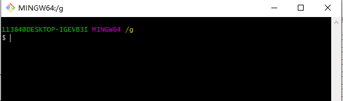

使用 npm **安装 Hexo**，在控制台输入命令：

```
$ npm install -g hexo-cli
```

**建站：**

安装 Hexo 完成后，请执行下列命令，Hexo 将会在指定文件夹中新建所需要的文件。（未指定folder时，会在当前文件夹建站。）

```
$ hexo init <folder>
$ cd <folder>
$ npm install
```

**清缓存**（第一次不需要）

```
$ hexo clean
```

清除缓存文件 (`db.json`) 和已生成的静态文件 (`public`)。

在某些情况（尤其是更换主题后），如果发现您对站点的更改无论如何也不生效，您可能需要运行该命令。

**生成静态文件**

```
$ hexo g
```

**启动服务器**

```
$ hexo server
```

默认情况下，访问网址为： `http://localhost:4000/`。

| 选项             | 描述                           |
| ---------------- | ------------------------------ |
| `-p`, `--port`   | 重设端口                       |
| `-s`, `--static` | 只使用静态文件                 |
| `-l`, `--log`    | 启动日记记录，使用覆盖记录格式 |


此时访问 `http://localhost:4000/`，可以看到我们自己的博客了，好了，下面开始Linux上部署。

## Linux环境搭建（CentOS为例）

主要是要配置hexo运行的环境，

###  安装git

- 安装

```text
 yum install git
```

- 测试

```text
git --version
```

- 输出类似下面的结果则表示安装成功

```text
git version 1.8.3.1
```

- 创建 git 用户

```text
adduser git 
```

密码：

```
passwd +  用户名
```

- 建立裸仓

```text
cd /home/git  # 进入 git 用户目录
mkdir blog && chown -R git:git $_# 创建博客文件夹，，设置权限,作为 nginx web 目录
mkdir projects && chown -R git:git $_ && cd $_  # 创建项目目录，设置权限并进入
git init --bare hexo.git && chown -R git:git $_ # 创建博客裸仓，设置权限
```

###  安装node.js

为防止[参考文章](https://blog.csdn.net/ws9029/article/details/125885368)404,现将原文粘贴如下：

> 秋迟注：
>
> 这个文章用的Ubuntu环境，CentOS跟它原理一致，都是包下载解压到/usr/local/，然后再配置一下环境变量。若不习惯CentOS没有界面，可以使用Xftp。秋迟用的方法二。

####  方法一——在线安装

我这里安装的是最新的16.16.0稳定版本,一般安装在/usr/local/目录下

    wget https://nodejs.org/dist/v16.16.0/node-v16.16.0-linux-x64.tar.xz

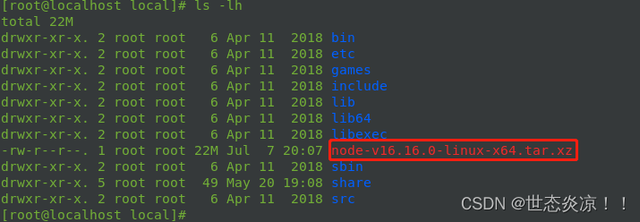

####  方法二——网站下载

第二种去网站把安装包下载好，在复制到/usr/local/目录下
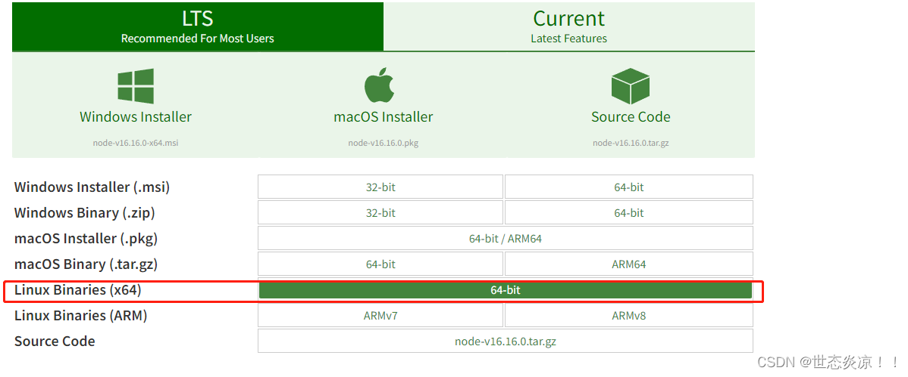
最终在/usr/local/目录下会多出node-v16.16.0-linux-x64.tar.xz文件
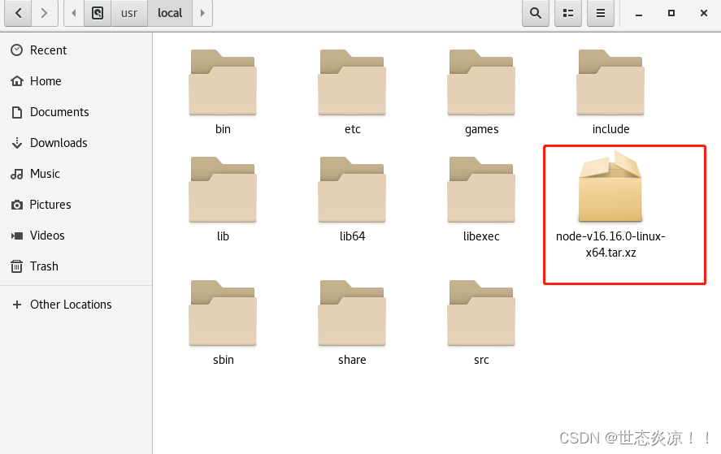
接下来需要压缩这个文件

    tar -xvf node-v16.16.0-linux-x64.tar.xz

下图为解压出来的文件

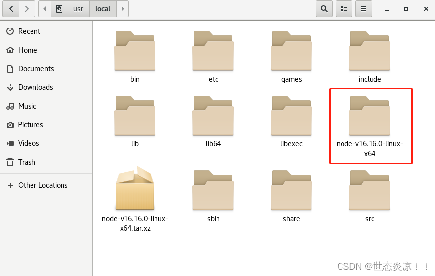解压后的文件夹名感觉有点太长了，把它命名为 node.js

    mv node-v16.16.0-linux-x64  node.js

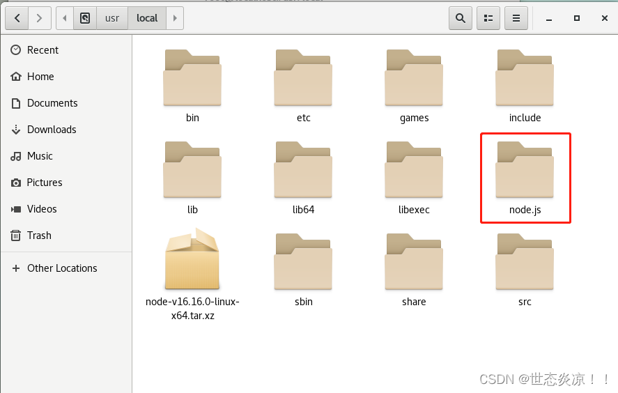测试下是不是安装成功，进入到node.js文件里面的bin文件，看到版本号证明你已经安装成功了
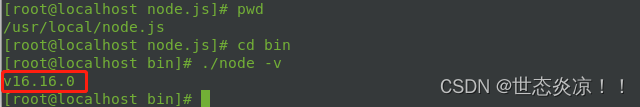
接下来需要配置环境变量，回到到根目录，然后进入到etc文件夹去编辑profile文件，vi是编辑文件
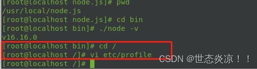vi进入编辑操作，a是在光标后插入文本，在最后加入下面两行，wq为保存文件并退出的意思
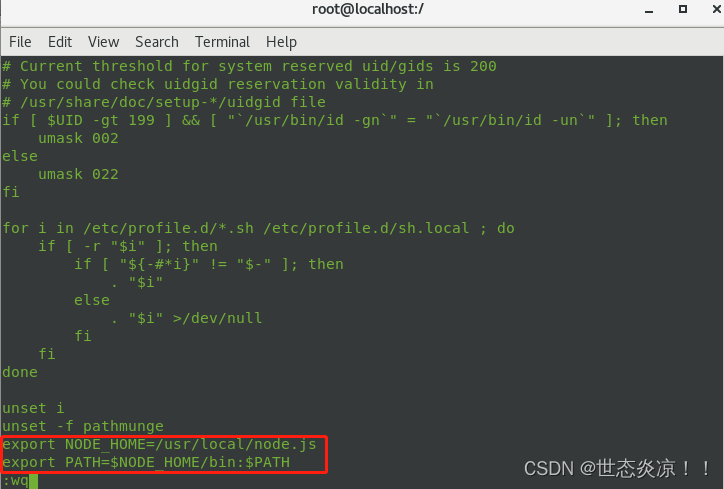如果觉得麻烦，可以直接直观的修改这个文件用下面命令

    gedit etc/profile

加完下面两行代码之后直接点save保存
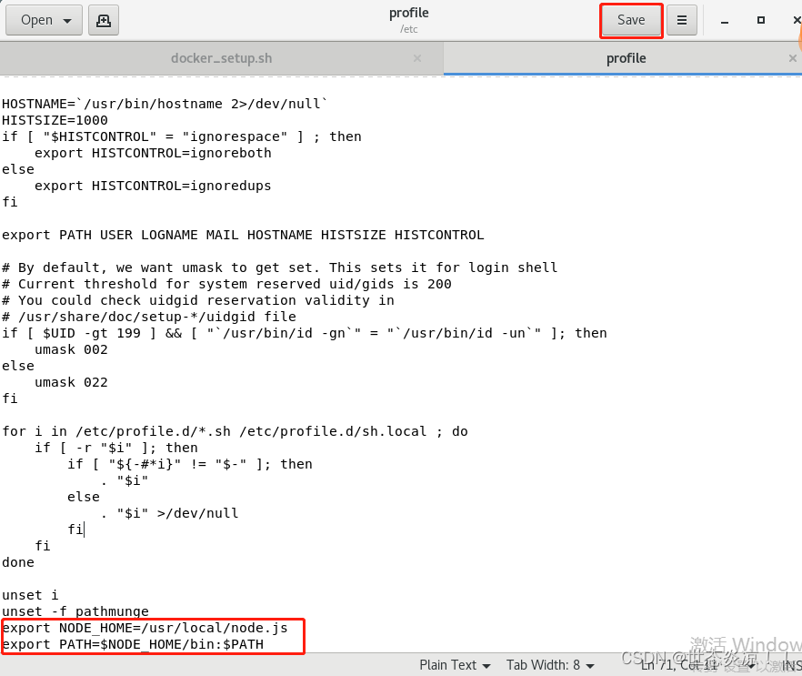虽然配置了环境变量，有些时候开机自启动操作用到npm还是会提示npm command not found（之前启动docker的服务碰到这个问题），查询npm -v 又能显示版本号（说明环境变量配置成功)，这点我感觉或许开机自启动的用到npm的时候，环境变量还没生效，所以会提示npm command not found，所以为了安全些可以再配置个软链接，或者把环境配置放到开机自启动的脚本中去，下面是配置软链接的命令

```
ln -s /usr/local/node.js/bin/node /usr/local/bin/node
ln -s /usr/local/node.js/bin/npm /usr/local/bin/npm
```

> 原文链接：https://blog.csdn.net/ws9029/article/details/125885368

----


> 秋迟注：
>
> 秋迟用的方法二，包解压后没改名，环境变量设置为：
>
> ```bash
> export NODE_HOME=/usr/local/node-v16.16.0-linux-x64
> export PATH=$NODE_HOME/bin:$PATH
> ```
>
> 软连接（由于秋迟的设置环境变量后就可以使用，暂未设置软链接，但先放这）：
>
> ```bash
> ln -s /usr/local/node-v16.16.0-linux-x64/bin/node /usr/local/bin/node
> ln -s /usr/local/node-v16.16.0-linux-x64/bin/npm /usr/local/bin/npm
> ```
>

###   安装Hexo

* 安装

所有必备的应用程序安装完成后，即可使用 npm 安装 Hexo。

```
$ npm install -g hexo-cli
```

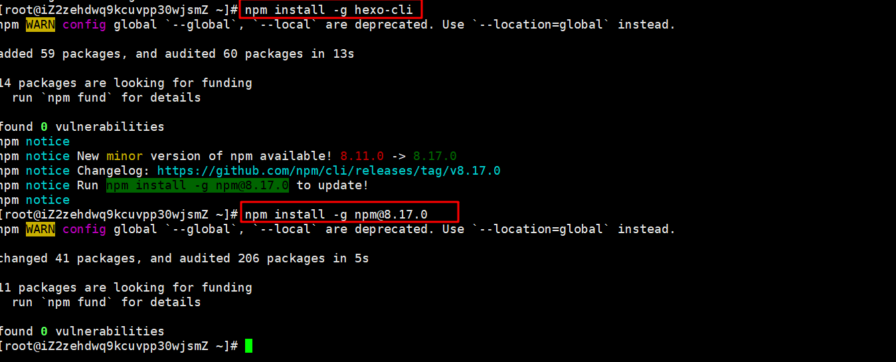

安装以后，可以使用以下两种方式执行 Hexo：

1. `npx hexo <command>`
2. 将 Hexo 所在的目录下的 `node_modules` 添加到环境变量之中即可。直接使用 `hexo <command>`：

```
echo 'PATH="$PATH:./node_modules/.bin"' >> ~/.profile
```

## 自动发布

1. **本地**：

- 配置发布选项
  修改 _config.yml （hexo 配置文件）

```yaml
deploy:
  type: git
  repo: git@ip:/home/git/projects/hexo.git # ip 为服务器ip
  branch: master
```

* 安装用来发布的deployer包

```
npm install hexo-deployer-git --save
```

2. **Linux**

- 自动部署（服务器）

```text
cd /home/git/projects/hexo.git/hooks # 进入 hook 目录
mv post-update.sample post-update # 重命名 post-update
vi post-update # vim 进行编辑
```

> **秋迟注**：
>
> 如果新建了post-update文件的话，请注意git用户对其的权限。如果git用户没有执行权限，后面从本地Win推送时，会报`hint: The 'hooks/post-update' hook was ignored because it's not set as executable.`的错误，比如权限如下图时：
>
> 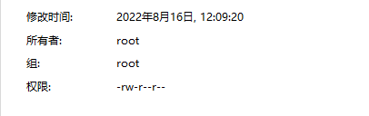
>
> 解决方法：
>
> **将git仓库的所有者修改成git用户**
> `chown -R git:git /home/git`
> 切换至git:
> `su git`
> 修改权限：
>
> `chmod 644 post-update`

- 按 `i` 进入编辑模式，在最后一行上面粘贴下面文字，按 `esc`，输入 `:wq` 保存并退出。

```text
git --work-tree=/home/git/blog --git-dir=/home/git/projects/hexo.git checkout -f 
```

3. **本地** 

hexo 目录执行发布命令。在执行时，会要求需要输入git账户的密码（就是前面在Linux中创建的git用户），后面会配置使用SSH，不用每次输密码。

```text
hexo g -d
```

- 查看服务器 blog 目录中是否有文件，如果没有请检查步骤是否错误。

## Linux安装Nginx

以 centos 为例：

- 安装

```text
yum install -y nginx
```

- 启动

```text
systemctl start  nginx
#开机启动Nginx
systemctl enable  nginx
```

- 测试

```text
wget http://127.0.0.1 
```

可以正常下载 index.html 文件则说明启动成功。 

- 配置

获取配置文件路径：

```
nginx -t
```

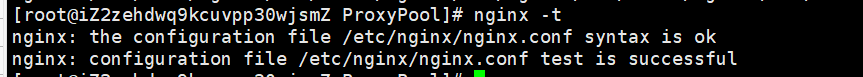

```text
vi /etc/nginx/nginx.conf
```

- 把 `user nginx` 修改为`user root`， server 按照修改两处配置：

```text
root /home/git/blog;
location / {
   index index.html;
}
```

- 重启 nginx

```text
nginx -s reload
```

在浏览器键入你的服务器 ip 地址或域名，即可正常访问。

* 查看nginx的进程号：

```text
ps -ef |grep nginx
```

## 域名

登录阿里云，设置域名。

可参考:https://blog.csdn.net/majinggogogo/article/details/103222074

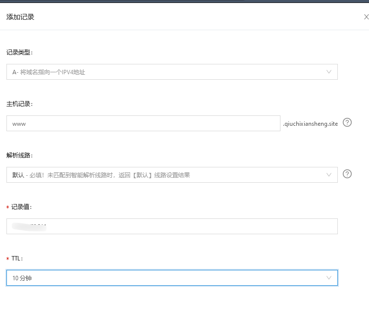

然后将Nginx中的配置文件修改，比如我的网址是http://www.quichixiansheng.site，server_name修改为：

        ```
        server_name  qiuchixiansheng.site;
        ```

## 配置HTTPS

​		网站现在用的是HTTP协议，这种协议在网络传输时，并没有对数据进行加密，是很不安全的，所以秋迟改用HTTPS。

​		免费申请HTTPS证书六大方法可参考这个链接：https://developer.aliyun.com/article/759071

​        出于免费且网站容易访问，最后我选择了使用certbot，可以按照官方说明（https://certbot.eff.org/）进行申请。

改用HTTPS主要需要注意如下两点：

* HTTPS需要证书

* 端口：

  1、443端口：即网页浏览端口，主要是用于HTTPS服务，是提供加密和通过安全端口传输的另一种HTTP。

  2、80端口：为HTTP（HyperText Transport Protocol)即超文本传输协议开放的，此为上网冲浪使用次数最多的协议，主要用于WWW（World Wide Web）即万维网传输信息的协议。

参考链接：https://blog.csdn.net/qq_39154864/article/details/121116278

### 配置证书

1. 选择自己的环境

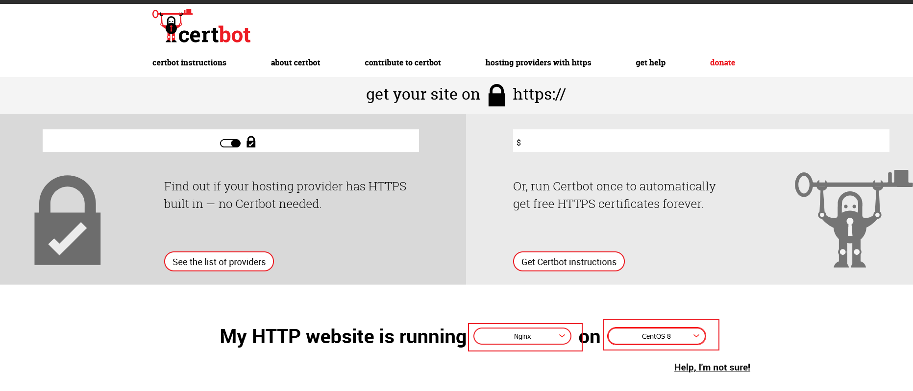

2. 往下拉，按照步骤执行即可

   

**注意到第7步的时候**，我直接使用的第一种方式`cerbot --nginx`：

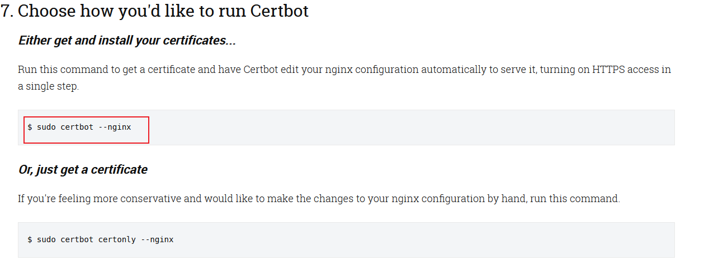

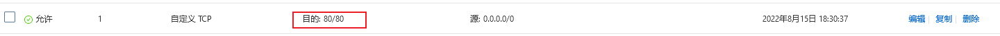

在命令行让我输入网址时，我输成了`qiuchixiansheng.site`，没有加`www.`的前缀，真的要哭死，然后下面就成了这样：

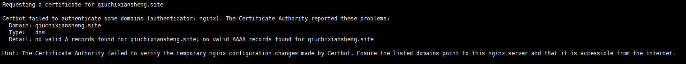

上面啥原因我目前也还没看明白，欢迎大佬解惑。反正结果就是没成功。

当我再执行命令`certbot --nginx`时，成了下面这样：

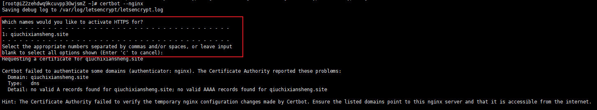

竟然记住了我上次输入的内容，且只能选择！！！我想修改咋办？

后面使用`certbot -h`查看帮助，看到下面这个命令参数：

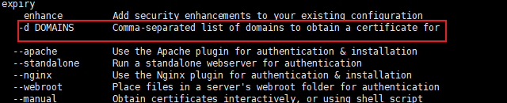


**所以我的命令成为：**

```bash
certbot --nginx -d  www.qiuchixiansheng.site
```

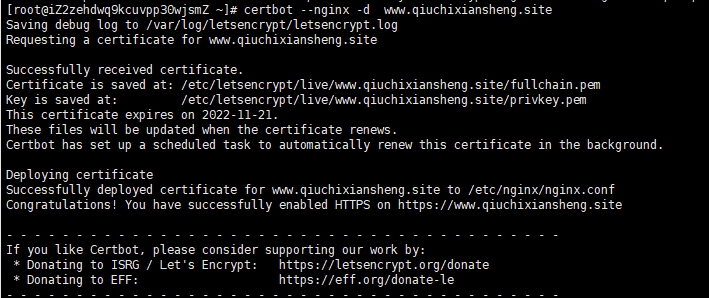

搞定！

重启nginx：

```
nginx -s reload
```

此时如果我们打开nginx的配置文件，可以看到它变成下面这样：

```
# For more information on configuration, see:
#   * Official English Documentation: http://nginx.org/en/docs/
#   * Official Russian Documentation: http://nginx.org/ru/docs/

user root;
worker_processes auto;
error_log /var/log/nginx/error.log;
pid /run/nginx.pid;

# Load dynamic modules. See /usr/share/doc/nginx/README.dynamic.
include /usr/share/nginx/modules/*.conf;

events {
    worker_connections 1024;
}

http {
    log_format  main  '$remote_addr - $remote_user [$time_local] "$request" '
                      '$status $body_bytes_sent "$http_referer" '
                      '"$http_user_agent" "$http_x_forwarded_for"';

    access_log  /var/log/nginx/access.log  main;

    sendfile            on;
    tcp_nopush          on;
    tcp_nodelay         on;
    keepalive_timeout   65;
    types_hash_max_size 2048;

    include             /etc/nginx/mime.types;
    default_type        application/octet-stream;

    # Load modular configuration files from the /etc/nginx/conf.d directory.
    # See http://nginx.org/en/docs/ngx_core_module.html#include
    # for more information.
    include /etc/nginx/conf.d/*.conf;

    server {
        listen       80 default_server;
        listen       [::]:80 default_server;
        server_name  qiuchixiansheng.site;
        root         /home/git/blog;

        # Load configuration files for the default server block.
        include /etc/nginx/default.d/*.conf;

        location / {
	index index.html;
        }

        error_page 404 /404.html;
            location = /40x.html {
        }

        error_page 500 502 503 504 /50x.html;
            location = /50x.html {
        }
    }

# Settings for a TLS enabled server.
#
#    server {
#        listen       443 ssl http2 default_server;
#        listen       [::]:443 ssl http2 default_server;
#        server_name  _;
#        root         /usr/share/nginx/html;
#
#        ssl_certificate "/etc/pki/nginx/server.crt";
#        ssl_certificate_key "/etc/pki/nginx/private/server.key";
#        ssl_session_cache shared:SSL:1m;
#        ssl_session_timeout  10m;
#        ssl_ciphers PROFILE=SYSTEM;
#        ssl_prefer_server_ciphers on;
#
#        # Load configuration files for the default server block.
#        include /etc/nginx/default.d/*.conf;
#
#        location / {
#        }
#
#        error_page 404 /404.html;
#            location = /40x.html {
#        }
#
#        error_page 500 502 503 504 /50x.html;
#            location = /50x.html {
#        }
#    }


    server {
    server_name www.qiuchixiansheng.site; # managed by Certbot
        root         /home/git/blog;

        # Load configuration files for the default server block.
        include /etc/nginx/default.d/*.conf;

        location / {
	index index.html;
        }

        error_page 404 /404.html;
            location = /40x.html {
        }

        error_page 500 502 503 504 /50x.html;
            location = /50x.html {
        }
    

    listen [::]:443 ssl ipv6only=on; # managed by Certbot
    listen 443 ssl; # managed by Certbot
    ssl_certificate /etc/letsencrypt/live/www.qiuchixiansheng.site/fullchain.pem; # managed by Certbot
    ssl_certificate_key /etc/letsencrypt/live/www.qiuchixiansheng.site/privkey.pem; # managed by Certbot
    include /etc/letsencrypt/options-ssl-nginx.conf; # managed by Certbot
    ssl_dhparam /etc/letsencrypt/ssl-dhparams.pem; # managed by Certbot

}

    server {
    if ($host = www.qiuchixiansheng.site) {
        return 301 https://$host$request_uri;
    } # managed by Certbot


        listen       80 ;
        listen       [::]:80 ;
    server_name www.qiuchixiansheng.site;
    return 404; # managed by Certbot


}}


```

可以看到现在有三个server，其中第一个是我们以前的（也是80端口），后两个是certbot追加的，分别是对应443端口与80端口。那么80端口究竟会按照哪个执行？答案是下面的会覆盖上面的。所以会certbot设置的来，不信你往下面看。

### 配置阿里云安全组

上面配置好了，我通过https://www.qiuchixiansheng.site/还是无法访问网址。

在Linux上wget一下，发现超时，而它请求的端口有443：

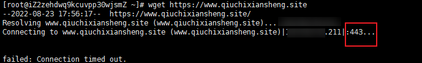

还记得我们打开Nginx的配置文件，发现certbot在http {}中增加了两个server,大概意思就是监听80端口，转到443。但是我们尚未开放443啊。

所以，在阿里云控制台，我要再配置一下安全组。

​	进入阿里云控制台，点击网络与安全->安全组，增加入方向的规则：

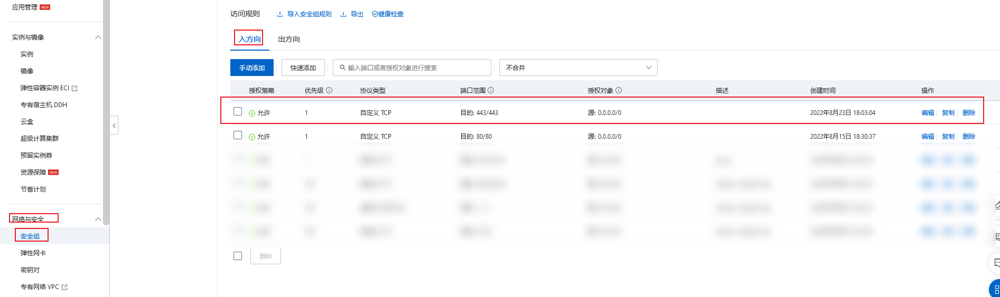

此时再用HTTPS访问，搞定：

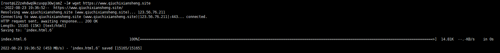

如果此时我们使用http访问会如何呢？可以看到，它重定向到了443端口，也就是最终也会使用HTTPS协议。

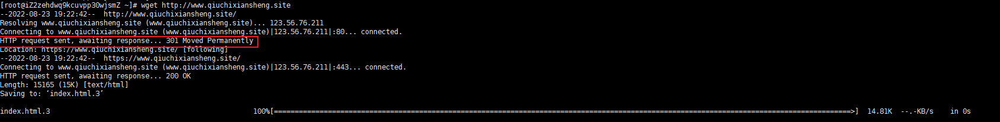

那么问题来了，当80端口没重定向的时候，它会如何输出呢？

记得我们配置文件中，第一个server端口就是80，没有重定向。我将第三个重定向的server端口由80改为81，重新请求：

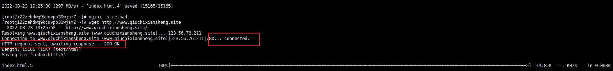

看到了吗？这是没重定向的样子，这也间接说明了**nginx配置文件中的server，如果使用同一端口，后面的会覆盖前面的，即最后生效的是最后面的配置**。

## win10免密发布到Linux

下面文章来自：https://zhuanlan.zhihu.com/p/401327519

### 前言

使用win10自带的SSH工具登录Linux，不需要每次都输入密码。网上找了很多教程才找到合适的，重新整理和操作并记录下来，给相同需求的小伙伴提供参考。（所有的操作都是在win10的CMD命令行）

### 生成公钥文件（win10）

**1.1** 键盘输入"win + R"，再输入"cmd"，在命令提示符上输入以下指令：

```text
ssh-keygen -t rsa
```

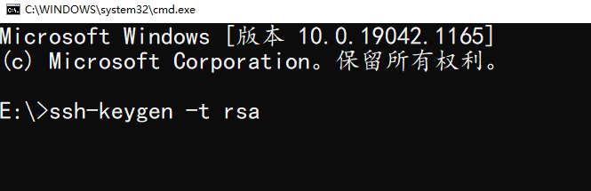

**1.2** 提示选择路径时，直接回车，会自动选择默认路径。

**1.3** 提示输入密码时，直接回车，**不要输入密码。**

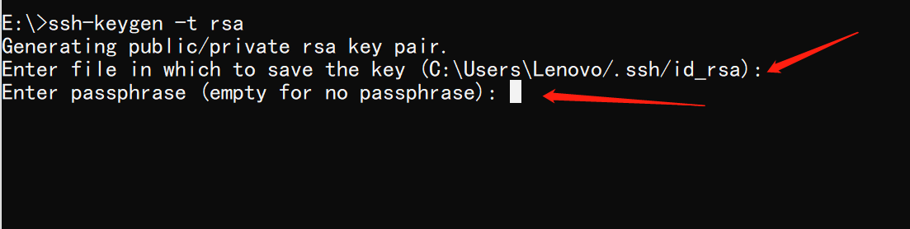

出现以下页面代表生了密钥

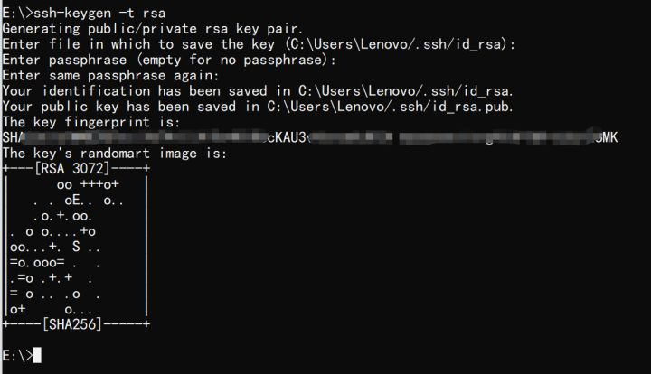

### 上传公钥文件（win10）

**2.1** 找到公钥文件的路径

第1步出现“Your public key has been saved in C:\Users\Lenovo/.ssh/id_rsa.pub.”，所以公钥文件的路径是"C:\Users\Lenovo/.ssh/id_rsa.pub"

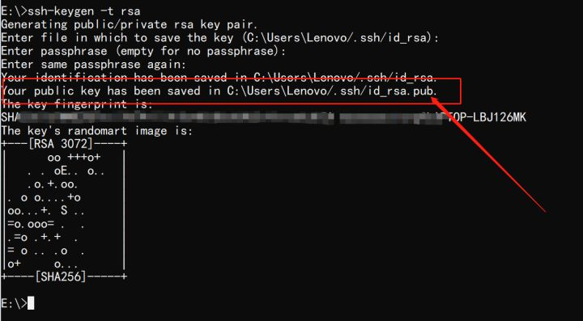

**2.2** 上传。在命令提示符上输入以下命令，即可把公钥文件上传到linux服务器对应的路径下。

```text
scp C:\Users\Lenovo/.ssh/id_rsa.pub eby@192.168.0.113:~/.ssh
```

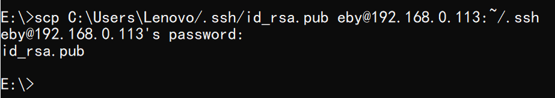

至此，win10的配置已经完成。接下来去linux上配置

### 重命名公钥文件和修改文件权限（win10的cmd上登录linux）

**3.1** 登录linux，此时仍需要密码登陆

```text
ssh eby@192.168.0.113
```

（对应自己的用户和ip）

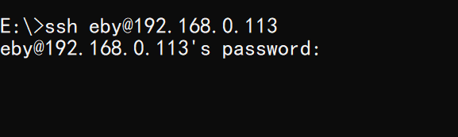

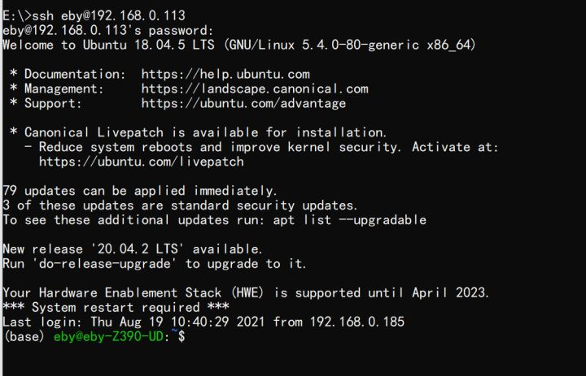

**3.2** 重命名公钥文件。

输入以下命令重命名公钥文件(如果以前就有authorized_keys文件，追加即可，一行一个秘钥)

```text
mv .ssh/id_rsa.pub .ssh/authorized_keys
```

注意：这一步的目的是把id_rsa.pub中的内容添加到authorized_keys中去。也可以直接复制和粘贴内容。

**3.3** 修改文件权限

```text
chmod 600 .ssh/authorized_keys
chmod 700 .ssh
```

### 修改SSH配置文件（Linux）

这个配置文件一般是只读文件，需要root权限

```text
sudo vim /etc/ssh/sshd_config
```

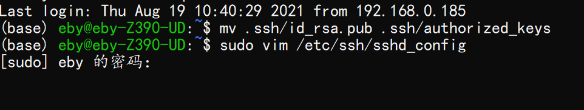

保证这三句不被注释掉，如果没有则添加新的对应的语句，我需要添加"RSAAuthentication yes"

```text
RSAAuthentication yes 
PubkeyAuthentication yes 
AuthorizedKeysFile .ssh/authorized_keys
```

保存退出。

### 重新启动SSH服务（Linux）

```text
sudo service sshd restart
```

### 测试免密登录(win10)

在命令提示符上输入

```text
ssh eby@192.168.0.113
```

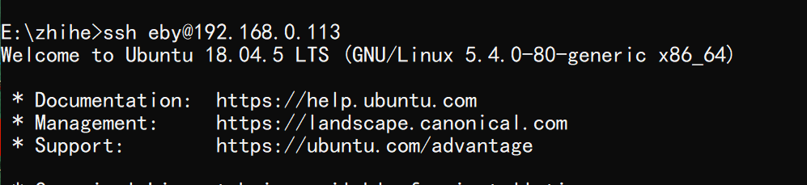

可以看出，不需要输入密码就可以登录到linux啦！


----

至此，只要动动小手，最多两行命令，就可以将本地博客发布到Linux了。

清缓存（一般改某些配置文件才需要它）：

```
hexo clean
```

g生成，d 发布

```
hexo g -d
```


## 初始化主题

选来选去最后选择[Next主题](https://theme-next.js.org/)。

点击[主题下载地址](https://github.com/next-theme/hexo-theme-next/tags)，点击tags，下载后解压到themes文件夹


然后_config.yml 

```
theme: hexo-theme-next-8.12.3
```

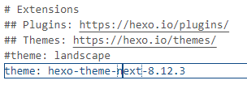

发布：

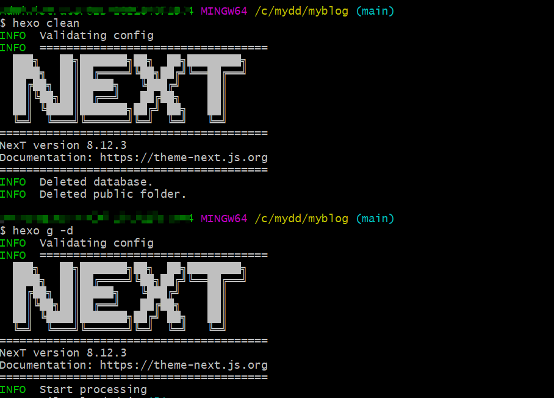

## 自定义主题

[hexo配置文档](https://hexo.io/zh-cn/docs/configuration.html/)

----

先查看主题文件夹hexo-theme-next-8.12.3下的_config.yml，修改参数如下：

 language:zh-CN

### **设置ICP备案号**

```
beian:
    enable: true
    icp: 鲁ICP备2021042179号
    # The digit in the num of gongan beian.
    gongan_id:
    # The full num of gongan beian.
    gongan_num:
    # The icon for gongan beian. See: http://www.beian.gov.cn/portal/download
    gongan_icon_url:
```

### **主题**

Muse

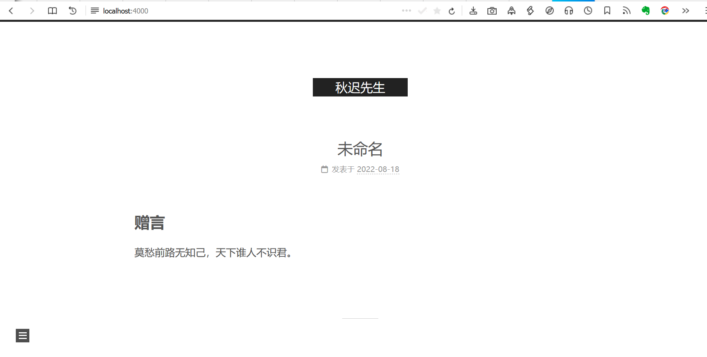

Mist

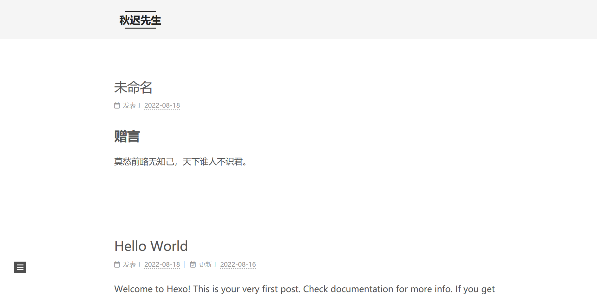

选择Mist

### **菜单**

```
menu:
  home: / || fa fa-home
  about: /about/ || fa fa-user
  tags: /tags/ || fa fa-tags
  categories: /categories/ || fa fa-th
  archives: /archives/ || fa fa-archive
  #schedule: /schedule/ || fa fa-calendar
  sitemap: /sitemap.xml || fa fa-sitemap
  #commonweal: /404/ || fa fa-heartbeat
```

### **设置头像**

注意头像文件是放在博客根目录的source\images(需新建images文件夹)下。

如，我的是：G:\myblog\source\images

```
# Sidebar Avatar
avatar:
  # Replace the default image and set the url here.
  url: /images/avatar.jpg
  # If true, the avatar will be displayed in circle.
  rounded: true
  # If true, the avatar will be rotated with the cursor.
  rotated: false
```

效果：


### 增加本地搜索功能--无效，有空再琢磨

-    安装插件  

```
npm install hexo-generator-searchdb --save
```

-    修改博客根目录下_config.yml文件，增加 search  

```
# Search
search:
path: search.xml # 支持json和xml，可自行设定，索引文件的路径，相对于站点根目录
field: post # 搜索范围，默认是 post，还可以选择 page、all，设置成 all 表示搜索所有页面
format: html
limit: 10000 # 限制搜索的条目数
```

-    修改 next 主题文件夹下的_config.yml文件  

```
# Local Search
# Dependencies: https://github.com/theme-next/hexo-generator-searchdb
local_search:
  enable: true
  # If auto, trigger search by changing input.
  # If manual, trigger search by pressing enter key or search button.
  trigger: auto
  # Show top n results per article, show all results by setting to -1
  top_n_per_article: 1
  # Unescape html strings to the readable one.
  unescape: false
  # Preload the search data when the page loads.
  preload: false
```

### 增加阅读全文功能

-    修改 next 主题文件夹下的_config.yml文件  

```
# Automatically excerpt description in homepage as preamble text.
excerpt_description: true

# Read more button
# If true, the read more button will be displayed in excerpt section.
read_more_btn: true
```

-    配置完后，由于next 7.6 版本以后删除自动摘要功能，需要我们手动设置，方法主要有    

  - ​      为每个博客写好 description     

  ```
  ---
  title: Hexo 中 Next 主题（持续更新...）
  date: 2021-10-04 20:52:01
  tags: 博客搭建
  categories: 技术
  description: xxxx
  ---
  ```

  - ​      在博客中间手动添加`<!-- more -->`以截断，**推荐该方法**     

参考链接：https://www.mdnice.com/writing/382af676baff4ed4ad5511074fb736da

# 发现的几个比较喜欢的博客

中英文混杂：

https://jdhao.github.io/

# 如果以后对Hexo不满意

迁移到hugo:https://jdhao.github.io/2018/10/10/hexo_to_hugo/