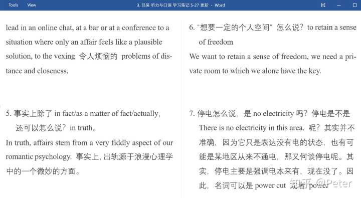
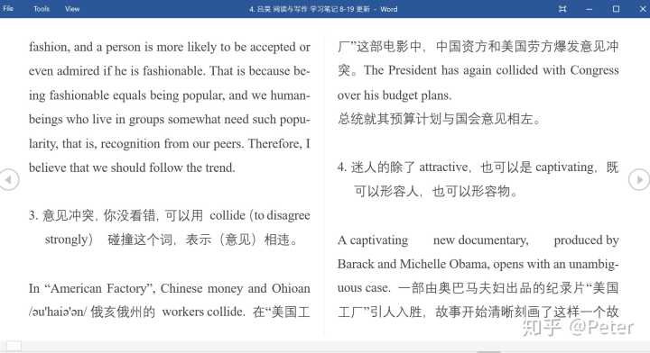

想了想如何才能提高自己的英语水平呢？平时会遇到很多比较地道的用法，好像用哪个软件积累都不尽人意。直到今天，看到这篇文章[如何做英语积累本](https://www.zhihu.com/question/423745276/answer/1504282950?utm_campaign=&utm_medium=social&utm_oi=943763902366986240&utm_psn=1549079814140841984&utm_source=cn.ticktick.task)。

用来用去，背单词还是喜欢“墨墨背单词”，网页与PDF翻译还是喜欢“沙拉查词”。

<!-- more -->

积累方面，就按上面文章试一段时间吧。

# 附录-如何做英语积累本原文

有这个想法就很好，因为它对于我们二语习得者或外语学习者来说是科学且高效的。我建议你用电脑或者纸质笔记本分类记录，没错，关键是分类。

**那么怎么分类呢？**可以将学到的表达（句型或词组，但不包括单词）分成“读写类”和“听说类”。

**为什么不用将单词记本子里？**这是因为很多单词书或者app已经帮你做了这样的工作，并且这些资源还有辅助记忆（一般是[艾宾浩斯遗忘曲线](https://www.zhihu.com/search?q=艾宾浩斯遗忘曲线&search_source=Entity&hybrid_search_source=Entity&hybrid_search_extra={"sourceType"%3A"answer"%2C"sourceId"%3A1504282950})的逻辑）的功能，何必浪费精力去做这些呢？

高中生或者大学生国内和出国用到的90%以上的词汇不外乎在四六级词汇（6000词）和雅思词汇（8000词）之内。我们完全可以将其中的生词（听口/读写非积极词汇）过一遍，这样效率更好。

现在大方向有了。**那么，该记录些什么？怎么去做记录？如何去复习呢？**

**1. 听说词汇：**

大概逻辑follow的是“**。。。怎么说**”，这样可以最高效地帮助自己学会最地道的口语表达，**可以有例句，但对于那些名词类的用法或者比较容易掌握的用法，也可以只有词组**：比如 power cut 停电。我看到这个词，不需要例句也知道怎么用。

**我有2个途径去整理：第一，在听力材料中听到，然后记下来；第二，思考这样的表达怎么说，然后自己想一个版本，再去考证，看看有没有更加地道的版本。**

比如“想要**有一定的个人空间**”，我之前曾说：**to have one's personal space**，这样说没有问题。但是，我后来发现有老外这么说：**to retain a sense of freedom**，我就记了下来。不是说之前的版本不好，而是这样能丰富表达的多样性。我在专栏里的写作也基本上是源于自己平时的整理。

			我的听说记录本

**2. 读写词汇：**

书面语的东西跟口语化的内容不一样，比较严谨正式。

因此，**每项用法最好表明例句和出处**（文体不同，非正式，正式或者特别正式以至于庄重的文体用词完全不同；一般来说，越正式的问题名词化现象越严重，比如 [achieve](https://www.zhihu.com/search?q=achieve&search_source=Entity&hybrid_search_source=Entity&hybrid_search_extra={"sourceType"%3A"answer"%2C"sourceId"%3A1504282950})变成 make achievement）。比如，我有天看外刊时，发现 [collide with sb over sth](https://www.zhihu.com/search?q=collide+with+sb+over+sth&search_source=Entity&hybrid_search_source=Entity&hybrid_search_extra={"sourceType"%3A"answer"%2C"sourceId"%3A1504282950})可以表示意见相左，就记录了下来。例句顺便复制过来，方便以后举一反三。

​												我的读写记录本

最后，关于**复习方法**，建议遵循艾宾浩斯遗忘曲线，隔一段时间再看一遍，大概7-8遍就可以基本掌握。**另外，在写作和口语（输出）中也要试着去使用，才能从根本上掌握新的用法和表达。**

我自己是这样记录的，这帮助我从**高三英语成绩不及格**，提升到**大二专四及格**，再到**大四专八良好**，再到**研究生成功考入广外同传班**，对我有很大帮助。**鉴于我当时基础也很薄弱，这套方法应该适用于80%以上的同学。**

作者：考研英语皮特儿
链接：https://www.zhihu.com/question/423745276/answer/1504282950
来源：知乎
著作权归作者所有。商业转载请联系作者获得授权，非商业转载请注明出处。