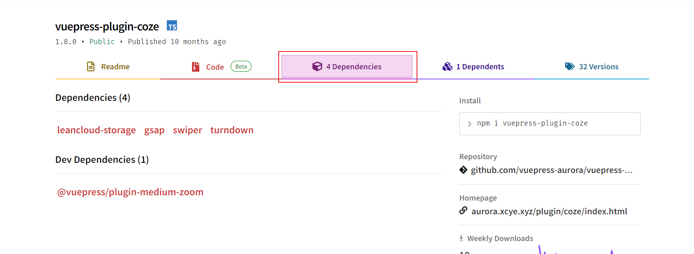
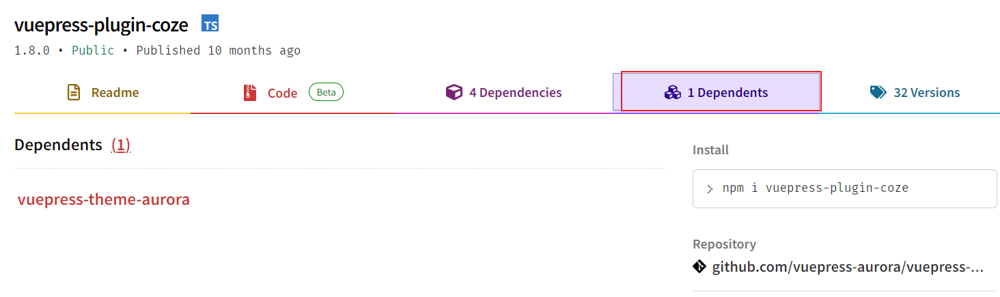
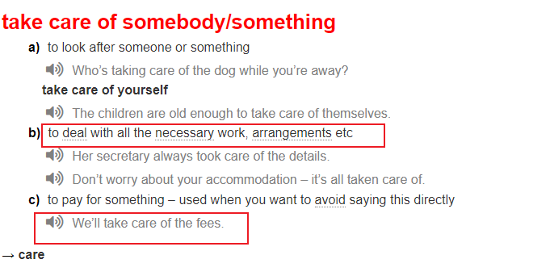

## 缩略词

下面的缩略词主要用在如 [Reddit](https://www.reddit.com/) 或 GitHub 的讨论中。

<!-- more -->

- AFAIK: As Far As I Know, 据我所知。
- ATM: At The Moment, 在此刻，现在。
- AWOL: Absent Without Official Leave, 没有得到批准，私自离开。
- BAU: Business as usual, 和往常一样正常。
- DM: Direct Message, 指的是用社交软件工具发私信。
- DWIM: Do What I Mean, 指的是计算机能够根据人的意图，做出符合的反应。
- FOSS: Free And Open-Source Software, 自由与开源软件。
- FWIW: For What Is Worth, 给别人一些信息，但不确定是否有用。
- FYI: For Your Information, 仅供参考。
- GIYF: Google Is Your Friend, 请自己去谷歌。
- GTFO: Get the Fuck Out，滚出去。
- IIRC: If I Recall Correctly, 如果我记得没错的话。
- IMHO: In My Humble Opinion, 依我愚见。
- IMO: In My Opinion, 依我之见。
- IOW: In other words, 换一种说法。
- LGTM: Looks Good To Me, 在我看起来还不错。
- LMAO: Laugh My Ass Off，笑死我了。
- LMGTFY: Let Me Google That For You, 让我为你谷歌一下（意思是问题太简单，一搜就能搜到）。
- N.B.: nota bene, 英语 note well, 一般用于句首，用来吸引读者对接下来句子的注意力。
- NIH syndrome: [Not Invented Here](https://en.wikipedia.org/wiki/Not_invented_here) syndrome, 指在软件开发中重复造轮子，不使用外部的实现。
- OT: Off Topic，指的是在论坛/群组上的讨论偏离了论坛或者群组的主题。
- OTOH: On The Other Hand, 另外一方面，用于说明其他情况。
- PITA: Pain In The Ass，非常令人烦恼的事情。
- PR: Pull Request, Git 合并分支请求。
- PSA: Public Service Announcement, 开源项目或者服务发布公告。
- PTAL: Please Take Another Look，请再检查一下（指已经有所更新或变化）。
- PoC: Proof of Concept, 原型设计（通常用来证明某种想法的可行性）
- RFC: Request For Comment, 征求意见。
- RTFM: Read The Fucking/Fine Manual, 请读程序文档
- SLA: Sevice Level Agreement，常用来形容互联网服务的稳定性，例如 SLA 0.9999
- STFW: Search The Fucking Web, 自己去网上搜索
- TBH: To Be Honest, 实话跟你说吧。
- TBQH: To Be Quite Honest, 实话跟你说吧（语气诚恳）。
- TIL: Today I Learned, 今天又学到了新知识。
- TL;DR: Too Long, Don’t Read，总结起来，就是（一般放在长文章的开头，用于总结要点）。
- TYSM: Thank You So Much，非常感谢。
- WDYT: What Do You Think, 你认为如何。
- WFH: Work from Home，居家办公。
- WIP: Work In Progress，未完成，还在进行中。
- WLB: Work-Life Balance, 工作和生活平衡。
- WYSIWYG: What You See Is What You Get, 所见即所得。
- YMMV: Your Mileage May Vary, 你的感受或者体验可能会有所不同。

### 参考

- https://en.wikipedia.org/wiki/RTFM
- https://github.com/jquery/2015-developer-summit/issues/24
- https://www.freecodecamp.org/news/what-do-cryptic-github-comments-mean-9c1912bcc0a4/
- https://www.urbandictionary.com/
- [互联网上常用缩略语集锦](https://jdhao.github.io/2019/11/18/acronym_on_internet_and_forum/)

## 专业词

以下多为计算机专业词。

### Dependency 与 Dependent

#### 官方解释：

* dependency：
  Something dependent on, or subordinate to, something else:
  *In the United States' governmental structure, the military is conceived as a **dependency** under the executive branch.*
  在美国的政府结构中，军队被认为是行政部门的附属机构。

* dependent：
  One who relies on another for support：
  *With two children and an ailing mother, she had three dependents in all*

  她有两个孩子和一个生病的母亲，一共有三个家属

来自 [https://wikidiff.com/dependent/dependency](https://wikidiff.com/dependent/dependency)

#### 使用场景：

这里 dependency 意味着 vuepress-plugin-coze 所有环境会依赖 

* [leancloud-storage](https://www.npmjs.com/package/leancloud-storage)
* [gsap](https://www.npmjs.com/package/gsap)
* [swiper](https://www.npmjs.com/package/swiper)
* [turndown](https://www.npmjs.com/package/turndown)

在dev 环境会依赖 [@vuepress/plugin-medium-zoom](https://www.npmjs.com/package/@vuepress%2Fplugin-medium-zoom)。

----

dependent 意味着 vuepress-theme-aurora 会依赖 vuepress-plugin-coze。

###  stateless session Enterprise JavaBean

A stateless session Enterprise JavaBean (EJB) is a type of EJB that does not maintain any conversational state between method invocations. In other words, each method call to a stateless session EJB is independent and does not rely on any previous method invocations or stored data within the bean.

The stateless nature of these EJBs makes them suitable for handling multiple client requests concurrently, as the container can assign different instances of the stateless session bean to serve each request without worrying about maintaining state between requests.

Stateless session EJBs are commonly used in enterprise applications for implementing business logic that doesn't require stateful interactions or long-term data storage. They provide scalability and performance advantages in scenarios where state preservation is not necessary, as the absence of conversational state simplifies the management of the EJB instances.

无状态会话 EnterpriseJavaBean (EJB)是一种在方法调用之间不维护任何会话状态的 EJB。换句话说，对无状态会话 EJB 的每个方法调用都是独立的，不依赖于 bean 中以前的任何方法调用或存储的数据。

这些 EJB 的无状态特性使它们适合于同时处理多个客户端请求，因为容器可以分配不同的无状态会话 bean 实例来服务每个请求，而无需担心维护请求之间的状态。

无状态会话 EJB 通常用于企业应用程序中实现不需要有状态交互或长期数据存储的业务逻辑。在不需要保存状态的场景中，它们提供了可伸缩性和性能优势，因为没有会话状态可以简化 EJB 实例的管理。

——来自openai。

### forward slash /

正斜杠“/”（forward slash）用于表示**或者**：

his/her（他/她），and/or（并且/或），Sir/Madam（先生/女士）

> 反斜杠“\”的说法则是：backward slash

参考[正斜杠英文含义](https://englishsou.com/what-is-slash-forward-slash-chinese-translation-slash-used-as-or-examples/#:~:text=%E8%8B%B1%E6%96%87%E4%B8%AD%EF%BC%8C%E6%AD%A3%E6%96%9C%E6%9D%A0%EF%BC%88%2F%EF%BC%89%E7%9A%84%E5%AE%8C%E6%95%B4%E8%AF%B4%E6%B3%95%E6%98%AF%EF%BC%9Aforward%20slash%EF%BC%88%E8%80%8C%E5%8F%8D%E6%96%9C%E6%9D%A0%E2%80%9C%E2%80%9D%E7%9A%84%E8%AF%B4%E6%B3%95%E5%88%99%E6%98%AF%EF%BC%9Abackward%20slash%EF%BC%89%EF%BC%8C%E4%BA%BA%E4%BB%AC%E4%B9%9F%E5%B8%B8%E5%B8%B8%E5%B0%86%E5%85%B6%E7%AE%80%E5%8C%96%E4%B8%BA%EF%BC%9Aslash%E3%80%82,Forward%20slash%E7%9A%84%E7%94%A8%E9%80%94%E5%BE%88%E5%A4%9A%EF%BC%8C%E4%B8%8E%E4%B8%AD%E6%96%87%E9%87%8C%E4%B8%80%E6%A0%B7%EF%BC%8C%E5%AE%83%E4%B9%9F%E5%8F%AF%E4%BB%A5%E7%94%A8%E6%9D%A5%E8%A1%A8%E7%A4%BA%EF%BC%9A%E6%88%96%E8%80%85%EF%BC%88or%EF%BC%89%E3%80%82%20%E4%BE%8B%E5%A6%82%EF%BC%9Ahis%2Fher%EF%BC%88%E4%BB%96%2F%E5%A5%B9%EF%BC%89%EF%BC%8Cand%2For%EF%BC%88%E5%B9%B6%E4%B8%94%2F%E6%88%96%EF%BC%89%EF%BC%8CSir%2FMadam%EF%BC%88%E5%85%88%E7%94%9F%2F%E5%A5%B3%E5%A3%AB%EF%BC%89%E7%AD%89%E7%AD%89%E3%80%82)

### infinite loop

死循环

An infinite loop -- sometimes called an endless loop -- is a piece of code that lacks a functional exit so that it repeats indefinitely.

参考[infinite loop (endless loop)](https://www.techtarget.com/whatis/definition/infinite-loop-endless-loop)

## 读写

1. 自动收钱是为了让你少点麻烦

   * Billing Agreement  账单协议
   * 向账户收费：charge...account for ...
   * 应付账单：due invoices 或者是unpaid invoices
   * 减少...麻烦：save sb. the **hassle** of doing sth.
   * **ease somebody’s mind**：to make someone feel less [worried](https://www.ldoceonline.com/dictionary/worry) about something 
     It would ease my mind to know you had arrived safely.
   * PayPal：贝宝；贝宝公司；信用卡
   * invoices[ˈɪnvɔɪs] ：账单、发票
     Your PayPal **Billing Agreement ID** allows us to automatically **charge** your  PayPal account **for** （invoices that are due） and （new orders）, **saving**  you **the  hassle of** making sure your invoices are paid on time and **easing your  mind to** let us take care of the billing for you! 

   您的PayPal帐单协议ID允许我们自动向您的PayPal帐户收取应付账单和新订单的发票，从而减少您确认账单按时付费的麻烦，通过我们帮你解决付费的问题来让你感到轻松。

   > 我觉得这里，take care of 是第二个意思。
   >
   > 

2. 你强烈建议别人按某规则怎么说？

   * As a rule of thumb 作为一种经验法则。

3. 通用方法你会怎么说？
   没错，可以用`one-size-fits-all solution`。
   Although there is no .... when ...., there are some ways by which we can ...

   > **Although there's no** <u>one-size-fits-all solution</u>（通用方法） **when** dealing with  memory leaks, **there are some ways by which** we can minimize these leaks.
   >
   > 虽然在处理内存泄漏时没有一个“一刀切”的解决方案，但是有一些方法可以使这些泄漏最小化。

## 听说
